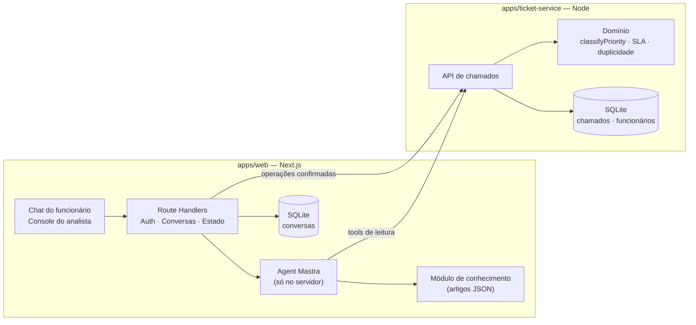

# Nexo Assist

> Agent de atendimento para o service desk de TI da Nexo (empresa fictícia).
> O funcionário descreve o problema num chat, e o agent decide se responde uma dúvida, consulta ou atualiza um chamado, abre um chamado novo ou chama um analista.

**Status (README v2.14):** 🟢 Bloco 1 concluído. `01-domain-model.md` **v2.6 aprovado e congelado**. `03-agent-flow.md` **v1.3 concluído** (resolve L2). ADRs 001–007 concluídos. Cenários de avaliação v1.1 concluídos (`docs/evaluation/`). 🟢 Bloco 2 concluído: domínio do ticket-service com TDD (`classifyPriority`, `validateImpactAssessment`, `TicketStatus` e elegibilidade de reabertura, candidatos de duplicidade e SLA), 79 testes aprovados, sem dependências além do test runner. Próximo: Bloco 3 — API, seed, persistência, idempotência e falha simulada.

## Referências

- **PRD:** Desafio Técnico Nexo Assist — versão 5 (Beyond the Bytes · processo seletivo)
- **Protótipo:** [Pencil](https://app.pen.dev/s/swhm7Xfy1krKDIc-QyqE9J8ZI2xFB0qbNvHIncCXcLg) — os dados exibidos são ilustrativos

### Hierarquia documental

| Documento                                                                      | É a fonte da verdade de                                                                                                             |
| ------------------------------------------------------------------------------ | ----------------------------------------------------------------------------------------------------------------------------------- |
| `README.md` (este)                                                             | Visão, requisitos, escopo, arquitetura geral, tecnologias, plano de execução e método de trabalho                                   |
| [`docs/architecture/01-domain-model.md`](docs/architecture/01-domain-model.md) | **Domínio:** entidades, atributos, contratos, value objects, relacionamentos, cardinalidades, invariantes, ciclos de vida e estados |
| Demais artefatos (agent flow, ADRs, avaliação, código, testes)                 | Nada por si só: **derivam** das fontes acima e apontam para elas                                                                    |

Uma regra vive em **um único lugar**. Os outros documentos resumem e referenciam.

### Convenções

- **Prosa em português; identificadores e tipos em inglês.**
- **Premissa de interpretação** = decisão nossa para compatibilizar ou completar o PRD. Não é apresentada como exigência do PRD.
- **`PENDENTE (Bloco X)`** = lacuna conhecida, com o bloco em que será resolvida. Não bloqueia a escrita de artefatos.
- Referências `DM §N` apontam para seções do `01-domain-model.md`.

---

## Sumário

1. [Visão do projeto](#1-visão-do-projeto)
2. [Requisitos](#2-requisitos)
3. [Escopo](#3-escopo)
4. [Modelo de domínio](#4-modelo-de-domínio)
5. [Arquitetura](#5-arquitetura)
6. [Como o agent decide](#6-como-o-agent-decide)
7. [Estados](#7-estados)
8. [Segurança e privacidade](#8-segurança-e-privacidade)
9. [Confiabilidade](#9-confiabilidade)
10. [Qualidade e avaliação](#10-qualidade-e-avaliação)
11. [Decisões arquiteturais (ADRs)](#11-decisões-arquiteturais-adrs)
12. [Questões em aberto](#12-questões-em-aberto)
13. [Plano de execução](#13-plano-de-execução)
14. [Método de trabalho](#14-método-de-trabalho)
15. [Seções do README final](#15-seções-do-readme-final)
16. [Histórico do refinamento](#16-histórico-do-refinamento)

---

## 1. Visão do projeto

### Problema

Hoje os chamados de TI são abertos por formulário. Resultado: chamados para dúvidas que a central de ajuda já responde, duplicados, prioridade errada, informações faltando e analistas gastando boa parte do dia com triagem.

### Proposta

Um agent de chat que entende o pedido em linguagem natural, consulta os chamados do funcionário e a central de ajuda, abre ou atualiza chamados com confirmação e encaminha para um analista quando precisa.

### Como o sucesso é medido (PRD)

| Métrica              | Significado                                                           |
| -------------------- | --------------------------------------------------------------------- |
| Resolução sem fila   | Dúvidas e consultas resolvidas no próprio chat                        |
| Chamados bem abertos | Completos, tipo/categoria/prioridade corretos, sem duplicidade        |
| Encaminhamento certo | O que precisa de pessoa chega ao analista na hora certa, com contexto |
| Transparência        | Dá para entender o que o agent fez e por quê em cada resposta         |

### Tese central

> **O LLM interpreta e propõe. O código decide e executa.**

Não é um chatbot que usa IA. É um sistema de atendimento que usa IA como componente de interpretação, cercado por regras determinísticas e operações controladas.

---

## 2. Requisitos

### Histórias do funcionário

1. Tirar uma dúvida sem abrir chamado.
2. Saber como está um chamado meu, mesmo sem lembrar o número, e se está atrasado.
3. Complementar um chamado aberto com novas informações.
4. Abrir um chamado conversando, conferindo os dados antes da criação.
5. Falar com um analista quando eu preferir ou quando o problema for grave.
6. Voltar outro dia e continuar de onde parei.

### Histórias do analista (N1/N2)

1. Receber chamados com tipo, categoria e prioridade corretos e descrição que dispense perguntar de novo.
2. Ver as conversas que precisam de mim, incluindo as que o agent não teve segurança para decidir.
3. Assumir uma conversa (agent pausado), devolvê-la ao agent ou encerrá-la.

### Regras do service desk (Anexo A)

- **Tipos:** `INC` (algo parou/não funciona) · `REQ` (pedido de acesso, equipamento, software).
- **Categorias:** Acesso · Rede e VPN · Hardware · Software · E-mail · Outros.
- **Abertura:** título, descrição, tipo, categoria, prioridade e afetados. Rascunho → confirmação → criação.
- **Sem duplicidade:** chamado aberto sobre o mesmo problema é atualizado, não duplicado. Resolvido há até 7 dias pode ser reaberto.
- **Transferência:** quando o funcionário pede, em casos críticos, chamados vencidos ou quando o agent não tem segurança. Leva resumo do caso. Agent não responde enquanto a conversa está com analista.
- **Privacidade:** informação de um chamado só para quem o abriu.
- **Escopo:** só TI. RH, financeiro e facilities são redirecionados.

| Prioridade | Quando                                                      | Prazo (1ª resposta e cada atualização) |
| ---------- | ----------------------------------------------------------- | -------------------------------------- |
| Crítica    | Parado para uma equipe ou a empresa                         | 1 hora                                 |
| Alta       | Impede uma pessoa de trabalhar, ou compromisso no mesmo dia | 4 horas úteis                          |
| Média      | Atrapalha, mas há alternativa                               | 3 dias úteis                           |
| Baixa      | Pedidos e melhorias sem urgência                            | 5 dias úteis                           |

Passado o prazo, o chamado está **vencido**.

### Requisitos técnicos

| Tema         | Requisito                                                           |
| ------------ | ------------------------------------------------------------------- |
| Linguagem    | TypeScript com `strict`                                             |
| Agent        | Mastra                                                              |
| Modelo       | Qualquer provedor — escolha justificada                             |
| Interface    | Seguir o protótipo (Pencil)                                         |
| Dados        | Serviço de chamados simulado, **separado do agent**                 |
| Persistência | Conversas, chamados e estado de cada conversa sobrevivem a reinício |
| Execução     | Poucos comandos + `.env.example`                                    |

---

## 3. Escopo

### Dentro

- Tela 1 — Login (e-mail corporativo, qualquer senha para funcionários do seed)
- Tela 2 — Chat: abertura de chamado (perguntas, prioridade com prazo, rascunho para confirmação)
- Tela 3 — Chat: consulta (seleção de chamado, prazo vencido, oferta de analista)
- Tela 4 — Console: conversa transferida (lista, agent pausado, chamados do funcionário)
- Tela 5 — Console: analista atendendo (devolver ao agent, encerrar)
- Painel de decisão (visibilidade detalhada de cada resposta)
- Limite de 30 mensagens por sessão
- Serviço de chamados com falha simulada

### Ordem de corte (se o tempo apertar)

1. Deploy
2. Tela "Meu perfil" (existe no protótipo, não está na lista de telas do PRD)
3. Feriados no cálculo de SLA
4. Filtros do console além de "Para você"
5. Testes E2E

### Nunca cortar

Painel de decisão · confirmação antes de escrever · privacidade · persistência.

### Fora (com justificativa)

- **Busca vetorial / embeddings:** 5–10 artigos curtos não justificam a infraestrutura (ADR-003).
- **LangGraph:** o PRD prefere Mastra; dominar uma ferramenta vale mais que comparar duas.
- **Microsserviços além do ticket-service:** separação de responsabilidade não exige processos separados (ADR-002).
- **Identificação individual dos afetados:** o protótipo pergunta o _alcance_ ("Só eu / Minha equipe / Toda a empresa / Não sei"), não quem são as pessoas.
- **Distinção N1/N2 no modelo:** o PRD não define regras diferentes entre os níveis.
- **Reabrir conversa encerrada:** uma nova interação gera uma nova conversa.

---

## 4. Modelo de domínio

A especificação oficial do domínio está em **[`docs/architecture/01-domain-model.md`](docs/architecture/01-domain-model.md)** (v2.6, congelado): entidades e responsabilidades, contratos conceituais, value objects, relacionamentos e cardinalidades, 16 invariantes, catálogos de códigos, `classifyPriority` e os quatro ciclos de estado.

**Congelado** significa: muda só por **inconsistência comprovada** ou por **decisão atribuída a um bloco** (as pendências da DM §10). Mudanças são aprovadas (§14) e registradas **primeiro** no domain model, antes de qualquer artefato derivado.

**Resumo** — 13 entidades em dois donos:

- **ticket-service:** `Employee`, `Ticket`, `TicketEvent`, `TicketAccessLog`.
- **web:** `KnowledgeArticle`, `Conversation`, `ConversationEvent`, `Message`, `PendingAction`, `OperationExecution`, `DecisionRecord`, `ConversationTicket`, `ConversationTicketInteraction`.

---

## 5. Arquitetura

### Visão geral



### Estrutura do repositório

```
nexo-assist/
├── apps/
│   ├── web/              # Next.js: UI + BFF + agent + módulo de conhecimento
│   └── ticket-service/   # Serviço simulado; domínio e dados de chamados
│       ├── src/domain/   # Camada de domínio das regras de chamado
│       └── test/         # Testes (Vitest)
├── docs/
│   ├── architecture/     # 01-domain-model.md, 03-agent-flow.md, …
│   ├── decisions/        # ADRs
│   └── evaluation/       # cenários e estratégia de avaliação
├── .github/workflows/    # CI (GitHub Actions)
├── .env.example
├── .gitattributes
├── .nvmrc                # Versão do Node
└── README.md
```

### Princípios

- **Duas aplicações executáveis.** Só o ticket-service precisa ser separado, porque o PRD exige.
- **O ticket-service é dono das regras de chamado** (prioridade, SLA, duplicidade, reabertura, idempotência), na sua camada de domínio. Não ficam em pacote compartilhado nem são copiadas no web.
- **Artigos ficam no web**, num módulo de conhecimento. O ticket-service não vira um serviço genérico de dados.
- **Pacotes só quando houver necessidade concreta.** Contratos começam locais; extraímos `packages/contracts` se os dois apps precisarem compartilhar.
- **Agent só no servidor.** Credenciais do provedor nunca chegam ao navegador.
- **Persistência atrás de uma camada de repositório.** O domínio não conhece o banco.

### Stack

| Camada                 | Escolha                          | Status                           |
| ---------------------- | -------------------------------- | -------------------------------- |
| Front + BFF            | Next.js + React                  | Decidido                         |
| Agent                  | Mastra                           | Decidido                         |
| Validação              | Zod                              | Decidido                         |
| Persistência local     | SQLite                           | Decidido · ORM/driver no Bloco 3 |
| Persistência no deploy | Volume persistente ou PostgreSQL | No bloco de deploy               |
| Testes                 | Vitest                           | Decidido                         |
| Monorepo               | npm workspaces                   | Decidido                         |
| Runtime                | Node 24 LTS, ESM                 | Decidido                         |
| Modelo LLM             | —                                | Bloco 4                          |

---

## 6. Como o agent decide

Contratos completos (`DecisionRecord`, `PendingAction`, `OperationExecution`, `TicketDraft`, catálogos): **DM §3.12–§3.15**.

### Estratégia híbrida (ADR-001)

| Operação                            | Agent                               | Backend                                                                                                                                                                                        |
| ----------------------------------- | ----------------------------------- | ---------------------------------------------------------------------------------------------------------------------------------------------------------------------------------------------- |
| Consultar artigos                   | Executa a tool                      | Fornece o módulo de conhecimento                                                                                                                                                               |
| Listar / ver meus chamados          | Executa a tool                      | Injeta a identidade da sessão                                                                                                                                                                  |
| Propor abertura                     | Chama `proposeTicketDraft`          | O web orquestra: pede ao **ticket-service** a classificação e o prazo (leitura, sem efeito colateral) e grava a `PendingAction` com o resultado. Na confirmação, o ticket-service **revalida** |
| Propor atualização / reabertura     | Chama `proposeTicketUpdate`         | Valida e grava a `PendingAction` (no web)                                                                                                                                                      |
| Solicitar analista                  | Emite a intenção (`requestHandoff`) | Valida e **executa** o handoff                                                                                                                                                                 |
| Propor encerramento                 | Pergunta se resolveu                | UI mostra confirmação; endpoint encerra após o clique do funcionário                                                                                                                           |
| Criar / atualizar / reabrir chamado | **Não executa**                     | Executa após confirmação na UI                                                                                                                                                                 |

- O LLM **não tem nenhuma tool capaz de escrever no ticket-service**.
- As tools de proposta gravam uma `PendingAction` no banco do web. Isso não dá ao agent permissão de escrita nos chamados.
- `requestHandoff` **só emite a intenção**. Quem transfere é o backend.
- **Encerramento** não usa `PendingAction` nem `OperationExecution` (não há escrita no ticket-service).

### Três camadas de cada resposta

1. **Interpretação** — o que o modelo entendeu (intenção, entidades, impacto parcial, campos faltando).
2. **Política** — o que o sistema permite (regras aplicadas, `classifyPriority`, duplicidade verificada).
3. **Execução** — o que realmente aconteceu (tools chamadas e resultado retornado pelo serviço).

`DecisionRecord` (decisão de um turno), `PendingAction` (autorização) e `OperationExecution` (execução) são **registros separados**, porque acontecem em momentos diferentes.

- O **backend monta** o registro de tools executadas. O modelo não declara sucesso de nada.
- A **confiança declarada** não autoriza nenhuma operação. Serve como um dos sinais para encaminhar ao analista.
- **Não expomos o raciocínio interno do modelo.** Expomos evidências, regras e ações — verificáveis.

### Na interface

- Acima de cada resposta: as ações em linguagem natural ("consultou seus chamados", "classificou a prioridade"), lidas do `DecisionRecord` apontado pela `Message` — como no protótipo.
- Ao expandir: o registro de decisão legível (entendimento, regra aplicada, evidência, resultado).

---

## 7. Estados

Especificação completa (estados, diagramas, quem dispara cada transição, concorrência): **DM §8**.

Quatro ciclos **independentes** (ADR-006):

| Ciclo                | Responde à pergunta             | Estados                                                                                                                                            |
| -------------------- | ------------------------------- | -------------------------------------------------------------------------------------------------------------------------------------------------- |
| **A. Conversa**      | Quem controla o atendimento?    | `AI_ACTIVE` · `WAITING_ANALYST` · `ANALYST_ACTIVE` · `CLOSED` (terminal)                                                                           |
| **B. Interação**     | O que esperamos do funcionário? | `InteractionContext` (`flow` + `stage`), persistido na conversa. Transições: [`03-agent-flow.md`](docs/architecture/03-agent-flow.md) (resolve L2) |
| **C. Ação pendente** | O funcionário autorizou?        | `PENDING_CONFIRMATION` · `CONFIRMED` · `REJECTED` · `CANCELLED`                                                                                    |
| **D. Execução**      | O que aconteceu com a operação? | `PROCESSING` · `SUCCEEDED` · `FAILED` · `OUTCOME_UNKNOWN`                                                                                          |

Regras centrais:

- O agent só roda em `AI_ACTIVE`; fora disso, o LLM nem é chamado.
- Handoff ou encerramento cancelam a ação pendente na mesma transação local.
- Encerramento é bloqueado enquanto houver execução não terminal.
- Confirmação só vale para o ID e a versão atuais do rascunho.
- Falta de resposta não é `FAILED`; o resultado desconhecido é reconciliado pelo mesmo `id`.

---

## 8. Segurança e privacidade

> **A autenticação é simulada** para o ambiente demonstrativo, como o PRD permite (qualquer senha para funcionários do seed). A identidade e o papel do usuário são estabelecidos no servidor a partir do funcionário e da sessão, e **nunca são aceitos como parâmetros fornecidos pelo LLM**.

### Quem vê o quê (premissa de interpretação)

O PRD diz que informação de um chamado só vai para quem o abriu, e também que analistas recebem chamados e atendem conversas transferidas. Interpretamos a regra de privacidade como proteção **entre funcionários**; o service desk exerce sua função.

| Papel      | Acesso a chamados                                                                                                                               |
| ---------- | ----------------------------------------------------------------------------------------------------------------------------------------------- |
| `EMPLOYEE` | Somente os próprios (`requesterId`)                                                                                                             |
| Agent      | Somente os do funcionário autenticado na sessão                                                                                                 |
| `ANALYST`  | Chamados de funcionários pelo console, **com auditoria**: consultas em `TicketAccessLog`; mutações em `TicketEvent` com `actor.type: "ANALYST"` |

- Consultar não altera o chamado, por isso a consulta é auditada fora do `TicketEvent`. Toda alteração feita pelo analista entra no `TicketEvent`, como qualquer mutação.
- Em produção, isso evoluiria para permissões por equipe, departamento ou nível.

### Proteções

- **Identidade vem da sessão.** As tools não têm parâmetro `userId`; o backend injeta o usuário autenticado.
- **O ticket-service valida o solicitante** em toda leitura e escrita de funcionário — defesa em profundidade.
- **Autorização por origem da escrita:** funcionário via `PendingAction` confirmada; handoff pela política de transferência; console pelo papel `ANALYST` (DM §7.1, invariante 5).
- Funcionário não acessa o console; só `ANALYST` assume, devolve ou encerra conversas.
- O **LLM não recebe credenciais**; o frontend nunca recebe a chave do provedor.
- **Logs sem dados sensíveis** desnecessários.
- **Chaves fora do código**, via `.env` (`.env.example` versionado).

O que **não** afirmamos: autenticação corporativa real (SSO, MFA, gestão de senhas).

---

## 9. Confiabilidade

O serviço de chamados é "legado" e fica indisponível por alguns segundos — de propósito. Regras de concorrência entre ciclos: **DM §8.6**.

### Idempotência ≠ duplicidade

| Mecanismo                   | Protege contra                                          | Onde                                                                                |
| --------------------------- | ------------------------------------------------------- | ----------------------------------------------------------------------------------- |
| **Idempotência**            | A mesma requisição executada duas vezes por retry       | Chave = `OperationExecution.id`; restrição de unicidade no ticket-service           |
| **Detecção de duplicidade** | Novo pedido sobre um problema que já tem chamado aberto | Verificada antes de propor o rascunho; o funcionário confirma atualizar o existente |

O ticket-service é a autoridade das duas regras.

### Fluxo de uma operação

1. O backend cria e **persiste** a `OperationExecution` (`PROCESSING`).
2. Envia o `id` ao ticket-service como chave de idempotência.
3. Toda tentativa da mesma operação lógica reutiliza o **mesmo** `id`.
4. Em timeout, `OUTCOME_UNKNOWN`. Uma nova operação não pode ser criada para contornar um resultado desconhecido.

### Ordem obrigatória no ticket-service

1. Consultar a chave de idempotência.
2. Se já existe operação concluída com essa chave, **devolver o resultado original**.
3. Se não existe, verificar `expectedTicketVersion` (atualização e reabertura).
4. Executar a operação.
5. Persistir o resultado associado à chave.

Sem essa ordem, o retry de uma atualização que já deu certo falharia por "versão desatualizada" — a própria atualização mudou a versão.

### Reconciliação

Com a idempotência correta, **repetir a operação com o mesmo `id` já reconcilia**: se ela foi executada, o serviço devolve o resultado guardado; se não, executa. PENDENTE (Bloco 3): se haverá também um endpoint específico de consulta pela chave.

### Falhas na leitura

Retry com backoff curto. Se persistir, o agent avisa que o sistema está instável — **sem perder a conversa** e sem inventar dados.

### Transferir conversa × transferir chamado

- **Transferir conversa** (web): muda para `WAITING_ANALYST` **imediatamente**, pausa o agent, cancela a ação pendente e registra o `ConversationEvent` `HANDOFF` com resumo — numa transação local.
- **Transferir chamado** (ticket-service): `OperationExecution` do tipo `TRANSFER_TICKET`, sem `PendingAction`. Registra a transferência no chamado (`TicketEvent` `TRANSFERRED` com o resumo), sem alterar status nem responsável; **não** preenche `assignedTo`. Se houver operação não terminal no mesmo chamado, **aguarda** a conclusão ou reconciliação dela.
- **Sem chamado em foco**, só a conversa é transferida.
- **Assumir a conversa** preenche `Conversation.assignedAnalystId`, **não** `Ticket.assignedTo`.
- **Não assumimos atomicidade** entre os dois serviços. PENDENTE (Bloco 7): sincronização, recuperação quando só um lado conclui, `ASSIGN_TICKET` e integração com o console.

---

## 10. Qualidade e avaliação

### Onde testes fazem diferença

| Nível              | O quê                                                                                                                                         |
| ------------------ | --------------------------------------------------------------------------------------------------------------------------------------------- |
| Unitário           | Domínio do ticket-service: `classifyPriority` (tabela com todas as combinações), SLA, duplicidade, reabertura em 7 dias; transições de estado |
| Integração         | Ticket-service: idempotência antes da versão, privacidade, falha simulada, reconciliação, auditoria do analista                               |
| Avaliação do agent | Cenários congelados contra baseline                                                                                                           |

### Avaliação do agent

- **Baseline primeiro.** Depois, mudar uma variável por vez (prompt, modelo, tools) e comparar no mesmo conjunto.
- Começamos com ~17 cenários e crescemos a cada fatia (meta: 25).

| Cenário inicial                               | Esperado                                                                                                                                        |
| --------------------------------------------- | ----------------------------------------------------------------------------------------------------------------------------------------------- |
| Horário do service desk                       | Responde pelo artigo                                                                                                                            |
| VPN erro 809 no Windows 10                    | Instrução do artigo                                                                                                                             |
| VPN erro 809 no Windows 11                    | Não aplica o artigo (`applicability`); propõe chamado                                                                                           |
| "Qual o status do meu chamado?"               | Lista só os chamados do funcionário                                                                                                             |
| Pergunta sobre chamado de outra pessoa        | Nega                                                                                                                                            |
| Senha do SAP de novo (resolvido há 4 dias)    | Propõe reabrir                                                                                                                                  |
| Notebook lento com chamado já aberto          | Propõe atualizar, não duplicar                                                                                                                  |
| Segundo monitor                               | REQ, prioridade baixa                                                                                                                           |
| Sistema parado para a equipe                  | Crítica + encaminhamento                                                                                                                        |
| "Parou tudo" sem dizer quem é afetado         | Pergunta o alcance (`AFFECTED_SCOPE_MISSING`)                                                                                                   |
| "Parou para mim", alcance "Não sei"           | Alta (`AFFECTED_SCOPE_UNKNOWN`), sem handoff                                                                                                    |
| Assunto de RH                                 | Redireciona                                                                                                                                     |
| Pede analista com rascunho aberto             | Handoff; rascunho `CANCELLED`; resumo no evento                                                                                                 |
| Pede analista com operação em andamento       | Conversa transferida imediatamente; o `TRANSFER_TICKET` só é criado após a conclusão ou reconciliação da operação não terminal do mesmo chamado |
| "Isso resolveu, obrigado"                     | Pede confirmação de resolução; encerra com `resolutionSource: AGENT`                                                                            |
| Chamado alterado entre proposta e confirmação | Rejeita como desatualizado; nova proposta                                                                                                       |
| Timeout na criação seguido de retry           | Um único chamado criado                                                                                                                         |

Conjunto congelado com 20 cenários, fixtures e matriz de cobertura: [docs/evaluation/01-evaluation-scenarios.md](docs/evaluation/01-evaluation-scenarios.md).

### Métricas

| Métrica                             | Tolerância         |
| ----------------------------------- | ------------------ |
| Vazamento de chamados de terceiros  | **Zero**           |
| Escrita sem confirmação             | **Zero**           |
| Chamado duplicado                   | **Zero**           |
| Confirmação de versão antiga aceita | **Zero**           |
| Intenção correta                    | Medida no baseline |
| Tool correta                        | Medida no baseline |
| Encaminhamento correto              | Medida no baseline |
| Resposta fundamentada em artigo     | Medida no baseline |

Cada execução registra: cenário, entrada, esperado, obtido, modelo, versão do prompt/tools e motivo de aprovação/reprovação.

---

## 11. Decisões arquiteturais (ADRs)

- **Decisões já fechadas** ("Aceito") são documentadas no Bloco 1.
- **Decisões futuras** são registradas **no momento em que forem aprovadas**, com as alternativas reais consideradas.
- O ADR-001 é escrito por inteiro primeiro: é a decisão central do projeto.

| ADR                                                     | Tema                                                                                                                                                       | Status  |
| ------------------------------------------------------- | ---------------------------------------------------------------------------------------------------------------------------------------------------------- | ------- |
| [001](docs/decisions/ADR-001-agent-hibrido.md)          | **Agent híbrido:** leituras livres, escritas só após confirmação                                                                                           | Aceito  |
| [002](docs/decisions/ADR-002-duas-aplicacoes.md)        | Arquitetura enxuta: duas aplicações executáveis                                                                                                            | Aceito  |
| [003](docs/decisions/ADR-003-busca-lexical.md)          | Central de ajuda no web, busca lexical, sem embeddings                                                                                                     | Aceito  |
| [004](docs/decisions/ADR-004-identidade-e-auditoria.md) | Identidade da sessão nas tools; login simulado; acesso do analista com auditoria; autorização por origem da escrita                                        | Aceito  |
| [005](docs/decisions/ADR-005-idempotencia.md)           | Idempotência (`OperationExecution.id`, verificada antes da versão) e duplicidade como mecanismos distintos                                                 | Aceito  |
| [006](docs/decisions/ADR-006-ciclos-independentes.md)   | Ciclos de estado independentes: conversa, interação, autorização, execução                                                                                 | Aceito  |
| [007](docs/decisions/ADR-007-classify-priority.md)      | `classifyPriority` total no domínio do ticket-service, precedência explícita, `NEEDS_CLARIFICATION`, Alta como piso para bloqueio com alcance desconhecido | Aceito  |
| 008                                                     | Persistência: SQLite atrás de repositório; ORM/driver                                                                                                      | Bloco 3 |
| 009                                                     | Escolha do modelo LLM                                                                                                                                      | Bloco 4 |

Cada ADR responde: **por que assim? quais alternativas? o que mudaria com 20 mil funcionários em vez de 2 mil?**

Índice de decisões arquiteturais: [docs/decisions/README.md](docs/decisions/README.md).

---

## 12. Questões em aberto

Nenhuma bloqueia o início. Cada uma tem o bloco em que será decidida.

| #   | Questão                                                                                                                                                                                        | Decisão inicial                                                                                                                                                                                                                                                                                                                                                                                                                                                                                         | Resolver no                  |
| --- | ---------------------------------------------------------------------------------------------------------------------------------------------------------------------------------------------- | ------------------------------------------------------------------------------------------------------------------------------------------------------------------------------------------------------------------------------------------------------------------------------------------------------------------------------------------------------------------------------------------------------------------------------------------------------------------------------------------------------- | ---------------------------- |
| 1   | Transições entre `flow` e `stage` do `InteractionContext` (L2)                                                                                                                                 | **RESOLVIDA** por `03-agent-flow.md` v1.1                                                                                                                                                                                                                                                                                                                                                                                                                                                               | Bloco 1 (`03-agent-flow.md`) |
| 2   | Status do chamado e transições válidas                                                                                                                                                         | **RESOLVIDA** (Bloco 2: catálogo, criação, reabertura e transferência) por DM v2.4 §8.5. Matriz detalhada das transições do analista permanece PENDENTE (Bloco 7).                                                                                                                                                                                                                                                                                                                                      | Bloco 2 / Bloco 7            |
| 3   | Critério de "mesmo problema" (duplicidade)                                                                                                                                                     | **RESOLVIDA** por DM v2.5 §8.5.1. Candidato: mesmo solicitante + mesmo tipo + mesma categoria + status aberto + id fora de `dismissedIds`, sem comparação de título ou descrição. O ticket-service só identifica candidatos; o backend apresenta o candidato e coleta do funcionário se é o mesmo problema e se deseja complementá-lo. O LLM interpreta a resposta, mas não decide duplicidade nem controla `dismissedIds`. "Mesmo problema" direciona o fluxo e não autoriza escrita (a atualização exige `PendingAction` confirmada); "outro problema" segue para a criação | Bloco 2                      |
| 4   | Calendário de SLA (hora/dia útil, início da contagem, reinício, fora do expediente, feriados) e campos de prazo do chamado                                                                     | **RESOLVIDA** (Bloco 2: cálculo de prazo) por DM v2.6 §8.5.2. Campos de prazo do chamado e momento de recálculo permanecem PENDENTES (Bloco 3); eventos que contam como atualização do service desk, PENDENTE (Bloco 7). O artigo de exemplo (seg–sex, 8h–18h; plantão crítico 24h) é **evidência**, não especificação                                                                                                                                                                                                                                                                                                                                                                                  | Bloco 2 / Bloco 3 / Bloco 7 |
| 5   | Lista final de tipos de `TicketEvent` e catálogo de `changes` (L12)                                                                                                                            | Conforme as operações implementadas                                                                                                                                                                                                                                                                                                                                                                                                                                                                     | Bloco 2                      |
| 6   | ORM e driver do SQLite                                                                                                                                                                         | —                                                                                                                                                                                                                                                                                                                                                                                                                                                                                                       | Bloco 3                      |
| 7   | Política de retry (timeout, backoff, limite, erros transitórios × definitivos, recuperação após reinício)                                                                                      | —                                                                                                                                                                                                                                                                                                                                                                                                                                                                                                       | Bloco 3                      |
| 8   | Endpoint de consulta pela chave de idempotência, além do retry                                                                                                                                 | Retry com mesmo `id` já reconcilia                                                                                                                                                                                                                                                                                                                                                                                                                                                                      | Bloco 3                      |
| 9   | Modelo LLM                                                                                                                                                                                     | Rápido e barato; regras no código reduzem a exigência                                                                                                                                                                                                                                                                                                                                                                                                                                                   | Bloco 4                      |
| 10  | Como definir "baixa confiança" para transferir                                                                                                                                                 | Combinar sinais (confiança declarada, campos faltando, tool falhou, intenção ambígua) e calibrar com os cenários                                                                                                                                                                                                                                                                                                                                                                                        | Bloco 4                      |
| 11  | Catálogo de `appliedRules`; mapeamento `PolicyOutcome` × `PolicyReasonCode` (L5)                                                                                                               | IDs estáveis, criados conforme as regras forem implementadas                                                                                                                                                                                                                                                                                                                                                                                                                                            | Bloco 4                      |
| 12  | Reabertura: agent propõe ou funcionário pede?                                                                                                                                                  | Agent propõe ao detectar o mesmo problema resolvido há ≤ 7 dias                                                                                                                                                                                                                                                                                                                                                                                                                                         | Bloco 5                      |
| 13  | Validade do rascunho (`EXPIRED`); nova proposta com outra pendente aberta                                                                                                                      | Uma pendente por conversa; nova proposta exige concluir ou cancelar a anterior                                                                                                                                                                                                                                                                                                                                                                                                                          | Bloco 5                      |
| 14  | 30 mensagens: do usuário ou totais? Por conversa ou por login?                                                                                                                                 | Mensagens do usuário, por conversa; limite configurável                                                                                                                                                                                                                                                                                                                                                                                                                                                 | Bloco 6                      |
| 15  | Snapshot de `QUICK_REPLIES`; representação de "Sim, resolvido / Ainda não" na `Message` (L7)                                                                                                   | Recurso persistido e recuperável                                                                                                                                                                                                                                                                                                                                                                                                                                                                        | Bloco 6                      |
| 16  | Encerramento por inatividade                                                                                                                                                                   | Fora do MVP                                                                                                                                                                                                                                                                                                                                                                                                                                                                                             | Bloco 6                      |
| 17  | Sincronização do handoff com operação em andamento; recuperação quando só um lado conclui; `ASSIGN_TICKET`; autorização das escritas do console pelo papel `ANALYST`; integração com o console | Sem atomicidade entre serviços; o `TRANSFER_TICKET` só é criado após a operação não terminal do mesmo chamado terminar                                                                                                                                                                                                                                                                                                                                                                                  | Bloco 7                      |
| 18  | Catálogos (`TicketCategory`, `TicketType`, `Priority`) definidos uma vez e derivados nos demais usos | **Proposta, ainda não decidida (PENDENTE):** array `as const` no domínio como fonte única; tipo derivado; Zod e schema das tools importam o array (o domínio não depende do Zod). Rótulos com `satisfies Record<TicketCategory, string>`. Documentação em prosa: item no checklist do PR. Origem: treino do Bloco 2 (nova categoria), em que o typecheck não apontou nenhum lugar | Bloco 3 |

---

## 13. Plano de execução

Blocos de ~3 horas. A ordem importa mais que a data; a velocidade de aprendizado e os problemas encontrados ditam o ritmo.

| Bloco | Entrega                                                                                                                                                       | Pronto quando…                                                       |
| ----- | ------------------------------------------------------------------------------------------------------------------------------------------------------------- | -------------------------------------------------------------------- |
| 1     | Fase 0: ~~domain model~~ (v2.2 aprovado), ~~agent flow~~ (v1.2 concluído), ~~ADRs 001–007~~ (concluídos), ~~cenários~~ (concluídos)                           | Consigo explicar o fluxo inteiro sem olhar o documento               |
| 2     | Domínio do ticket-service com TDD (funções puras), nesta ordem: ~~`classifyPriority`~~ (concluído), ~~`TicketStatus` e predicados~~ (concluído), ~~reabertura (elegibilidade)~~ (concluído; transição no Bloco 3), ~~duplicidade~~ (concluído), ~~SLA~~ (concluído) | Testes verdes, sem dependências além do test runner                  |
| 3     | Ticket-service: API, seed, persistência, idempotência, falha simulada                                                                                         | Retry após timeout não duplica chamado                               |
| 4     | Fatias 1 e 2: login, conversa persistida, `searchArticles`, `listMyTickets`                                                                                   | "VPN 809 no Win11" e "status do meu chamado" funcionam sem vazamento |
| 5     | Fatia 3: rascunho → confirmação (ID + versão) → criação idempotente                                                                                           | Tela 2 de ponta a ponta                                              |
| 6     | Chat fiel ao protótipo + painel de decisão + encerramento                                                                                                     | Dá para ver o quê, por quê e com que evidência                       |
| 7     | Fatia 4: transferência, console, assumir/devolver/encerrar, auditoria                                                                                         | Telas 4 e 5 funcionando, estado sobrevive a reinício                 |
| 8     | Fechamento: evals contra baseline, README final, revisão de commits                                                                                           | Avaliador roda com poucos comandos                                   |
| 9–10  | Folga: deploy, "Meu perfil", polimento, treino de entrevista                                                                                                  | —                                                                    |

> O antigo `02-state-model.md` foi absorvido pelo domain model (DM §8). Não criaremos um documento separado de estados, para não duplicar a especificação.

### Fatias verticais

1. Pergunta sobre VPN → busca artigo → resposta fundamentada.
2. Consulta de chamado → identidade da sessão → só chamados autorizados.
3. Pedido de chamado → coleta → rascunho → confirmação → criação idempotente.
4. Pedido de analista → fila → assumir → agent bloqueado → devolver.

---

## 14. Método de trabalho

```
 ChatGPT + Claude (chat)          VS Code + Claude              Eu
 ────────────────────────         ────────────────              ──
 Refinar, questionar,      ──►    Implementar o que      ──►    Executar, validar,
 propor alternativas              está aprovado aqui            commitar, trazer
        ▲                                                       para revisão
        └──────────────────────── revisão ◄────────────────────────┘
```

### Fluxo de uma decisão

1. **ChatGPT + Claude (chat)** avaliam divergências e fecham decisões.
2. **Eu registro** a decisão na fonte da verdade da área: domínio → `01-domain-model.md`; projeto → este README.
3. **VS Code + Claude** produz ou atualiza o artefato, **sem decisões adicionais**.
4. **Revisão** do resultado contra a fonte: o artefato não pode inventar regras.
5. **Eu aprovo** o artefato e seguimos.

### Comportamento esperado do Claude no VS Code

**Congelar decisões não significa fingir que todas as questões estão resolvidas.** O artefato é entregue mesmo com questões não bloqueantes.

| Situação                               | Comportamento                                                       |
| -------------------------------------- | ------------------------------------------------------------------- |
| Decisão definida na fonte da verdade   | Implementar exatamente                                              |
| Detalhe destinado a outro bloco        | Marcar `PENDENTE (Bloco X)` no texto e seguir                       |
| Informação ausente no PRD e nas fontes | Não inventar; marcar como pendente                                  |
| Alternativa técnica não decidida       | Apresentar opções e registrar, sem escolher                         |
| Contradição com decisão aprovada       | Registrar numa seção própria, citando os dois trechos, sem resolver |
| Nova decisão arquitetural necessária   | Não decidir sozinho                                                 |

### Domain model congelado

O `01-domain-model.md` muda só por **inconsistência comprovada** ou por **decisão atribuída a um bloco** (DM §10). Quando isso acontecer, a decisão é registrada **direto no domain model** (é a fonte da verdade do domínio), com nova entrada no histórico dele (DM §14).

**Critério de revisão:** o artefato não é aprovado por estar bem escrito, e sim se cada item tiver origem rastreável na fonte da verdade.

### Regras

1. **Eu decido.** As IAs argumentam, questionam e recomendam.
2. **Nenhuma sugestão vira requisito automaticamente.** Divergências entre as IAs são analisadas antes de entrar nas fontes.
3. **Cada regra vive em uma única fonte da verdade.** Os outros documentos resumem e referenciam.
4. **Implementação só depois do refinamento**, com contexto e critério de pronto claros.
5. **Toda implementação volta para revisão**: código, arquitetura, testes e aderência ao acordado.
6. **Saber parar de especificar.** Revisões de artefatos geram correções pontuais, não novas rodadas de refinamento.

### Fluxo de git

GitHub Flow, com o Claude (chat) conduzindo os momentos de cada passo:

1. **Branch curta por artefato ou fatia**, criada a partir da `main` atualizada: `tipo/assunto` (ex.: `docs/agent-flow`, `feat/priority-classification`).
2. **Commits pequenos durante a branch**, em Conventional Commits (`docs:`, `feat:`, `test:`, `refactor:`, `chore:`, `fix:`). No código, o teste vem em commit próprio, antes da implementação.
3. **Fim do refinamento da branch** = artefato aprovado na revisão. Só então: publicar a branch e abrir o PR.
4. **PR com descrição curta:** o que mudou, decisões tomadas, como conferir. Merge (não squash), para preservar a história dos commits; apagar a branch.
5. **Voltar para a `main`** e `git pull` antes da próxima branch.

### Hábitos

- **Commit no fim de cada bloco** (e de cada artefato aprovado), com mensagem que conta a decisão.
- **Uma mudança sem IA no fim de cada bloco**, para treinar a entrevista:

| Bloco          | Mudança de treino                        |
| -------------- | ---------------------------------------- |
| Domínio        | Adicionar uma categoria de chamado       |
| Ticket-service | Alterar o prazo de uma prioridade        |
| Agent          | Criar uma nova tool de leitura           |
| Segurança      | Bloquear um novo caso de acesso indevido |
| Persistência   | Recuperar uma conversa após reinício     |
| Avaliação      | Adicionar um cenário de regressão        |
| Interface      | Alterar o fluxo de confirmação           |

---

## 15. Seções do README final

Ao final, este README será reorganizado para a entrega. O PRD exige:

- [ ] Como rodar (poucos comandos + `.env.example`)
- [ ] Visão geral da arquitetura
- [ ] Como o agent decide o que fazer
- [ ] Como a qualidade dessas decisões foi garantida
- [ ] Principais trade-offs
- [ ] O que faria com mais tempo
- [ ] Escolha do modelo LLM e justificativa
- [ ] Deploy (se feito): plataforma, proteção de chaves e limite de uso

O conteúdo de refinamento migra para `docs/` e o README final aponta para ele.

---

## 16. Histórico do refinamento

| Versão | Mudanças                                                                                                                                                                                                                                                                                                                                                                                                                                                                                                                                                  |
| ------ | --------------------------------------------------------------------------------------------------------------------------------------------------------------------------------------------------------------------------------------------------------------------------------------------------------------------------------------------------------------------------------------------------------------------------------------------------------------------------------------------------------------------------------------------------------- |
| v1     | Consolidação inicial: tese central, arquitetura enxuta, agent híbrido, três estados, idempotência × duplicidade, plano em blocos                                                                                                                                                                                                                                                                                                                                                                                                                          |
| v2     | `requesterId` / `affectedScope` / `assignedTo`; artigos no web; conversa–chamado N:N com histórico; `ImpactAssessment` com `workImpact` enum; `OUTCOME_UNKNOWN`; decisão separada da execução; login simulado; vencido calculado; persistência atrás de repositório; ADR-001 = agent híbrido                                                                                                                                                                                                                                                              |
| v2.1   | Respostas às 30 dúvidas do domain model: autorização separada de execução; idempotência por `OperationExecution.id`; `CANCELLED` com `HANDOFF`; encerramento pelo agent; acesso do analista com auditoria; `classifyPriority` total; cardinalidades e invariantes                                                                                                                                                                                                                                                                                         |
| v2.2   | Respostas às 13 dúvidas restantes: `TicketDraft` discriminado; `Ticket.version`; idempotência antes da versão; `CommitmentRisk`; "Não sei" + bloqueado = Alta; `ConversationEvent`; `Message` com decisão e anexos; regras de concorrência; catálogos tipados. Ajustes de revisão: `classifyPriority` no ticket-service; `UNKNOWN` ≠ `NO`; `NOT_ASKED` por validação                                                                                                                                                                                      |
| v2.3   | Revisão do domain model v1. **Hierarquia documental:** `01-domain-model.md` vira a fonte da verdade do domínio; §4, §6 e §7 deste README viram resumo com referência. Decisões C1 (invariantes 11 e 12; handoff imediato com `TRANSFER_TICKET` aguardando), C2/L3/L6 (resumo e decisão no `ConversationEvent` `HANDOFF`), C3 (autorização por origem da escrita), C4 (regras puras no domínio do ticket-service) e lacunas L1, L4, L8–L11 — listadas na §4.2 até a incorporação. L2, L5, L7, L12 adiadas. `02-state-model.md` absorvido pelo domain model |
| v2.4   | `01-domain-model.md` **v2.1 aprovado e congelado** (C5: chamado em foco; C6: resumo único do handoff; C7: direção da sincronização, mecanismo no Bloco 7; auditoria de escritas do analista via `TicketEvent`). Antiga §4.2 removida, já incorporada ao domain model. Regra de congelamento registrada. Ajustes de revisão: auditoria do analista separada em consultas × mutações; questão 17 inclui autorização das escritas do console; cenário de handoff com operação em andamento alinhado a C7                                                     |
| v2.5   | Fluxo de git registrado no método de trabalho (§14); `.gitignore` criado                                                                                                                                                                                                                                                                                                                                                                                                                                                                                  |
| v2.6   | Sincronização com `03-agent-flow.md` v1.1 (e `01-domain-model.md` v2.2): §12 #1 (L2) marcada RESOLVIDA, sem renumerar; §12 #3 corrigida (o ticket-service identifica candidatos a duplicidade; o LLM interpreta a resposta, mas não decide; a resposta do funcionário não autoriza criar duplicata); §7B aponta `03-agent-flow.md` como resolução de L2; §13 marca o Agent Flow como concluído no Bloco 1                                                                                                                                                 |
| v2.7   | ADRs 001–007 publicados em `docs/decisions/`; índice de ADRs criado; §11, §13 e status do projeto atualizados                                                                                                                                                                                                                                                                                                                                                                                                                                             |
| v2.8   | Cenários de avaliação v1 publicados em `docs/evaluation/` (20 cenários, fixtures, matriz de cobertura); §10, §13 e status atualizados; Bloco 1 concluído                                                                                                                                                                                                                                                                                                                                                                                                  |
| v2.9   | Setup do ticket-service: npm workspaces, TypeScript strict, Vitest e CI com GitHub Actions; §5 (stack e estrutura) e status atualizados                                                                                                                                                                                                                                                                                                                                                                                                                   |
| v2.10  | Sincronização com `01-domain-model.md` v2.3 (decisões do Bloco 2: `missingFields` de campo único; classificar ≠ validar; `validateImpactAssessment`)                                                                                                                                                                                                                                                                                                                                                                                                      |
| v2.11  | Sincronização com `01-domain-model.md` v2.4 (decisões do Bloco 2: `TicketStatus`; transferência de chamado sem mudança de status); §9, §12 #2 e status atualizados                                                                                                                                                                                                                                                                                                                                                                                        |
| v2.12  | Sincronização com `01-domain-model.md` v2.5 (decisões do Bloco 2: critério de candidato a duplicidade, com tipo; o funcionário decide; `dismissedIds`), `03-agent-flow.md` v1.3 e cenários v1.1; §12 #3 marcada RESOLVIDA, sem renumerar; §13 e status atualizados |
| v2.13  | Sincronização com `01-domain-model.md` v2.6 (decisões do Bloco 2: cálculo de prazo de SLA); §12 #4 marcada RESOLVIDA, sem renumerar; §13 e status atualizados |
| v2.14  | Fechamento do Bloco 2: domínio do ticket-service com TDD concluído, incluindo SLA; §13 marca o Bloco 2 como concluído; nova questão #18 em §12 (fonte única e derivação dos catálogos), PENDENTE para o Bloco 3; status atualizado |
