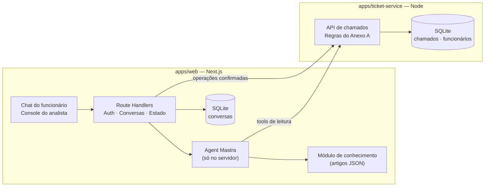
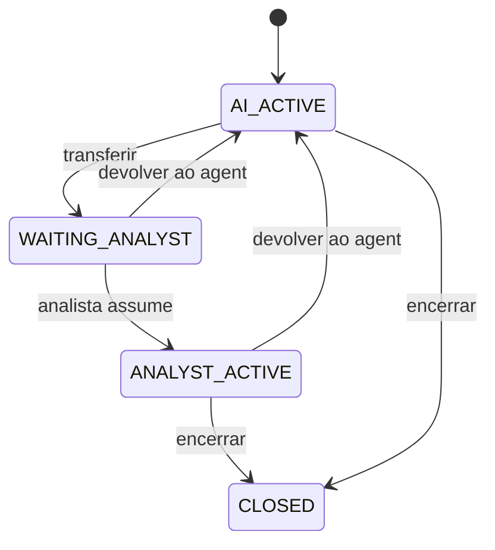
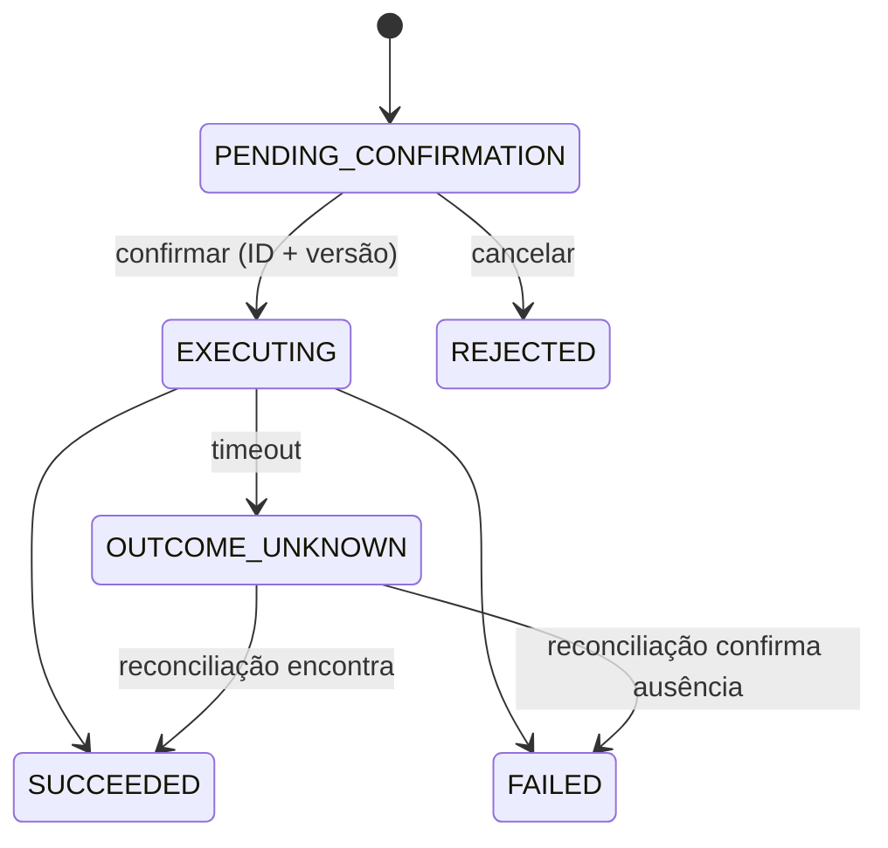

# Nexo Assist

> Agent de atendimento para o service desk de TI da Nexo (empresa fictícia).
> O funcionário descreve o problema num chat, e o agent decide se responde uma dúvida, consulta ou atualiza um chamado, abre um chamado novo ou chama um analista.

**Status:** 🟢 Refinamento v2 — **congelado**. Próximo passo: Bloco 1 (Fase 0) no VS Code.
Este README é a **fonte da verdade** do projeto. Se uma decisão mudar, ela muda aqui primeiro.

## Referências

- **PRD:** Desafio Técnico Nexo Assist — versão 5 (Beyond the Bytes · processo seletivo)
- **Protótipo:** [Pencil](https://app.pen.dev/s/swhm7Xfy1krKDIc-QyqE9J8ZI2xFB0qbNvHIncCXcLg) — os dados exibidos são ilustrativos

---

## Sumário

1. [Visão do projeto](#1-visão-do-projeto)
2. [Requisitos](#2-requisitos)
3. [Escopo](#3-escopo)
4. [Modelo de domínio](#4-modelo-de-domínio)
5. [Arquitetura](#5-arquitetura)
6. [Como o agent decide](#6-como-o-agent-decide)
7. [Estados](#7-estados)
8. [Segurança e privacidade](#8-segurança-e-privacidade)
9. [Confiabilidade](#9-confiabilidade)
10. [Qualidade e avaliação](#10-qualidade-e-avaliação)
11. [Decisões arquiteturais (ADRs)](#11-decisões-arquiteturais-adrs)
12. [Questões em aberto](#12-questões-em-aberto)
13. [Plano de execução](#13-plano-de-execução)
14. [Método de trabalho](#14-método-de-trabalho)
15. [Seções do README final](#15-seções-do-readme-final)
16. [Histórico do refinamento](#16-histórico-do-refinamento)

---

## 1. Visão do projeto

### Problema

Hoje os chamados de TI são abertos por formulário. Resultado: chamados para dúvidas que a central de ajuda já responde, duplicados, prioridade errada, informações faltando e analistas gastando boa parte do dia com triagem.

### Proposta

Um agent de chat que entende o pedido em linguagem natural, consulta os chamados do funcionário e a central de ajuda, abre ou atualiza chamados com confirmação e encaminha para um analista quando precisa.

### Como o sucesso é medido (PRD)

| Métrica              | Significado                                                           |
| -------------------- | --------------------------------------------------------------------- |
| Resolução sem fila   | Dúvidas e consultas resolvidas no próprio chat                        |
| Chamados bem abertos | Completos, tipo/categoria/prioridade corretos, sem duplicidade        |
| Encaminhamento certo | O que precisa de pessoa chega ao analista na hora certa, com contexto |
| Transparência        | Dá para entender o que o agent fez e por quê em cada resposta         |

### Tese central

> **O LLM interpreta e propõe. O código decide e executa.**

Não é um chatbot que usa IA. É um sistema de atendimento que usa IA como componente de interpretação, cercado por regras determinísticas e operações controladas.

---

## 2. Requisitos

### Histórias do funcionário

1. Tirar uma dúvida sem abrir chamado.
2. Saber como está um chamado meu, mesmo sem lembrar o número, e se está atrasado.
3. Complementar um chamado aberto com novas informações.
4. Abrir um chamado conversando, conferindo os dados antes da criação.
5. Falar com um analista quando eu preferir ou quando o problema for grave.
6. Voltar outro dia e continuar de onde parei.

### Histórias do analista (N1/N2)

1. Receber chamados com tipo, categoria e prioridade corretos e descrição que dispense perguntar de novo.
2. Ver as conversas que precisam de mim, incluindo as que o agent não teve segurança para decidir.
3. Assumir uma conversa (agent pausado), devolvê-la ao agent ou encerrá-la.

### Regras do service desk (Anexo A)

- **Tipos:** `INC` (algo parou/não funciona) · `REQ` (pedido de acesso, equipamento, software).
- **Categorias:** Acesso · Rede e VPN · Hardware · Software · E-mail · Outros.
- **Abertura:** título, descrição, tipo, categoria, prioridade e afetados. Rascunho → confirmação → criação.
- **Sem duplicidade:** chamado aberto sobre o mesmo problema é atualizado, não duplicado. Resolvido há até 7 dias pode ser reaberto.
- **Transferência:** quando o funcionário pede, em casos críticos, chamados vencidos ou quando o agent não tem segurança. Leva resumo do caso. Agent não responde enquanto a conversa está com analista.
- **Privacidade:** informação de um chamado só para quem o abriu.
- **Escopo:** só TI. RH, financeiro e facilities são redirecionados.

| Prioridade | Quando                                                      | Prazo (1ª resposta e cada atualização) |
| ---------- | ----------------------------------------------------------- | -------------------------------------- |
| Crítica    | Parado para uma equipe ou a empresa                         | 1 hora                                 |
| Alta       | Impede uma pessoa de trabalhar, ou compromisso no mesmo dia | 4 horas úteis                          |
| Média      | Atrapalha, mas há alternativa                               | 3 dias úteis                           |
| Baixa      | Pedidos e melhorias sem urgência                            | 5 dias úteis                           |

Passado o prazo, o chamado está **vencido**.

### Requisitos técnicos

| Tema         | Requisito                                                           |
| ------------ | ------------------------------------------------------------------- |
| Linguagem    | TypeScript com `strict`                                             |
| Agent        | Mastra                                                              |
| Modelo       | Qualquer provedor — escolha justificada                             |
| Interface    | Seguir o protótipo (Pencil)                                         |
| Dados        | Serviço de chamados simulado, **separado do agent**                 |
| Persistência | Conversas, chamados e estado de cada conversa sobrevivem a reinício |
| Execução     | Poucos comandos + `.env.example`                                    |

---

## 3. Escopo

### Dentro

- Tela 1 — Login (e-mail corporativo, qualquer senha para funcionários do seed)
- Tela 2 — Chat: abertura de chamado (perguntas, prioridade com prazo, rascunho para confirmação)
- Tela 3 — Chat: consulta (seleção de chamado, prazo vencido, oferta de analista)
- Tela 4 — Console: conversa transferida (lista, agent pausado, chamados do funcionário)
- Tela 5 — Console: analista atendendo (devolver ao agent, encerrar)
- Painel de decisão (visibilidade detalhada de cada resposta)
- Limite de 30 mensagens por sessão
- Serviço de chamados com falha simulada

### Ordem de corte (se o tempo apertar)

1. Deploy
2. Tela "Meu perfil" (existe no protótipo, não está na lista de telas do PRD)
3. Feriados no cálculo de SLA
4. Filtros do console além de "Para você"
5. Testes E2E

### Nunca cortar

Painel de decisão · confirmação antes de escrever · privacidade · persistência.

### Fora (com justificativa)

- **Busca vetorial / embeddings:** 5–10 artigos curtos não justificam a infraestrutura (ADR-003).
- **LangGraph:** o PRD prefere Mastra; dominar uma ferramenta vale mais que comparar duas.
- **Microsserviços além do ticket-service:** separação de responsabilidade não exige processos separados (ADR-002).
- **Identificação individual dos afetados:** o protótipo pergunta o _alcance_ ("Só eu / Minha equipe / Toda a empresa"), não quem são as pessoas. Fica como evolução.

---

## 4. Modelo de domínio

> O detalhamento (atributos completos, invariantes, transições) é o primeiro artefato do Bloco 1: `docs/architecture/01-domain-model.md`.

### Entidades e donos

| Entidade                    | Dono                         | Responsabilidade                                          |
| --------------------------- | ---------------------------- | --------------------------------------------------------- |
| Funcionário                 | ticket-service               | Identidade demonstrativa e papel (`EMPLOYEE` / `ANALYST`) |
| Chamado                     | ticket-service               | Dados e ciclo de vida                                     |
| Evento do chamado           | ticket-service               | **Histórico oficial** do chamado                          |
| Artigo                      | web (módulo de conhecimento) | Conteúdo da central de ajuda, em JSON                     |
| Conversa                    | web                          | Controle do atendimento                                   |
| Mensagem                    | web                          | Histórico conversacional                                  |
| Ação pendente               | web                          | Operação aguardando confirmação                           |
| Registro de decisão         | web                          | Interpretação e política de um turno do agent             |
| Execução de operação        | web                          | Resultado real de uma operação confirmada                 |
| Associação conversa–chamado | web                          | Relacionamento N:N                                        |
| Interação conversa–chamado  | web                          | Como o chamado participou da conversa                     |

### Chamado: três papéis distintos

```ts
type AffectedScope = "SELF" | "TEAM" | "COMPANY" | "UNKNOWN";

interface Ticket {
  id: string; // INC-xxxxx / REQ-xxxxx
  requesterId: string; // quem abriu — base da privacidade
  affectedScope: AffectedScope; // quem é afetado — alcance, não lista de pessoas
  assignedTo?: string; // quem atende
  // tipo, categoria, prioridade, status, prazos… → Bloco 1
}
```

- A **privacidade é baseada em `requesterId`**, nunca em `affectedScope`.
- **Vencido é calculado** (prazo × relógio), não é um status persistido. Ciclo de vida e SLA são dimensões diferentes.
- O PRD dá exemplos de status (Aguardando analista, Em andamento, Aprovado, Resolvido) mas **não define uma máquina de estados completa**. A nossa será proposta no Bloco 2, sem ser apresentada como exigência do PRD.

### Conversa ↔ Chamado (N:N com histórico)

```ts
interface ConversationTicket {
  conversationId: string;
  ticketId: string;
  linkedAt: string;
}

type ConversationTicketInteractionType =
  | "CREATED"
  | "UPDATED"
  | "VIEWED"
  | "HANDED_OFF";

interface ConversationTicketInteraction {
  id: string;
  conversationId: string;
  ticketId: string;
  type: ConversationTicketInteractionType;
  occurredAt: string;
}
```

- Só entra na associação o chamado que a conversa **tocou de fato**. Aparecer numa lista de resultados não conta.
- `VIEWED` = consulta detalhada de um chamado específico.
- Essas interações são **contexto da conversa**. O histórico oficial do chamado continua sendo o Evento do chamado, no ticket-service. Não misturamos as duas fontes de auditoria.

### Avaliação de impacto (base da prioridade)

```ts
interface ImpactAssessment {
  affectedScope: AffectedScope; // alcance
  workImpact: "BLOCKED" | "DEGRADED_WITH_WORKAROUND" | "NONE"; // impacto no trabalho
  commitmentAtRiskToday: boolean; // urgência
}
```

- **Estados inválidos não são representáveis.** Dois booleanos (`workBlocked` + `alternativeAvailable`) permitiriam "bloqueado e com alternativa"; o enum não permite.
- **Tipo e impacto são dimensões diferentes.** `workImpact` não decide sozinho se é INC ou REQ:

| Pedido                                          | Tipo | `workImpact`               |
| ----------------------------------------------- | ---- | -------------------------- |
| Notebook parou                                  | INC  | `BLOCKED`                  |
| VPN instável, com alternativa                   | INC  | `DEGRADED_WITH_WORKAROUND` |
| Solicitar mouse                                 | REQ  | `NONE`                     |
| Acesso a sistema necessário para trabalhar hoje | REQ  | `BLOCKED`                  |

- O LLM extrai as três dimensões; a função `classifyPriority(assessment)` calcula a prioridade. Testada com **testes de tabela**.
- **Impacto desconhecido não vira prioridade inventada.** O sistema pergunta ou encaminha.

---

## 5. Arquitetura

### Visão geral



### Estrutura do repositório

```
nexo-assist/
├── apps/
│   ├── web/              # Next.js: UI + BFF + agent + módulo de conhecimento
│   └── ticket-service/   # Serviço simulado, dono das regras e dados de chamados
├── docs/
│   ├── architecture/
│   ├── decisions/        # ADRs
│   └── evaluation/       # cenários e estratégia de avaliação
├── .env.example
└── README.md
```

### Princípios

- **Duas aplicações executáveis.** Só o ticket-service precisa ser separado, porque o PRD exige.
- **O ticket-service é dono das regras de chamado** (prioridade, SLA, duplicidade, reabertura, idempotência). Não ficam em pacote compartilhado.
- **Artigos ficam no web**, num módulo de conhecimento. O ticket-service não vira um serviço genérico de dados.
- **Pacotes só quando houver necessidade concreta.** Contratos começam locais; extraímos `packages/contracts` se os dois apps precisarem compartilhar.
- **Agent só no servidor.** Credenciais do provedor nunca chegam ao navegador.
- **Persistência atrás de uma camada de repositório.** O domínio não conhece o banco.

### Stack

| Camada                 | Escolha                          | Status                           |
| ---------------------- | -------------------------------- | -------------------------------- |
| Front + BFF            | Next.js + React                  | Decidido                         |
| Agent                  | Mastra                           | Decidido                         |
| Validação              | Zod                              | Decidido                         |
| Persistência local     | SQLite                           | Decidido · ORM/driver no Bloco 3 |
| Persistência no deploy | Volume persistente ou PostgreSQL | No bloco de deploy               |
| Testes                 | Vitest                           | Proposto                         |
| Modelo LLM             | —                                | Bloco 4                          |

---

## 6. Como o agent decide

### Estratégia híbrida (ADR-001)

| Operação                            | Agent                               | Backend                                 |
| ----------------------------------- | ----------------------------------- | --------------------------------------- |
| Consultar artigos                   | Executa a tool                      | Fornece o módulo de conhecimento        |
| Listar / ver meus chamados          | Executa a tool                      | Injeta a identidade da sessão           |
| Propor abertura                     | Chama `proposeTicketDraft`          | Valida e grava a ação pendente (no web) |
| Propor atualização / reabertura     | Chama `proposeTicketUpdate`         | Valida e grava a ação pendente (no web) |
| Solicitar analista                  | Emite a intenção (`requestHandoff`) | Valida e **executa** o handoff          |
| Criar / atualizar / reabrir chamado | **Não executa**                     | Executa após confirmação na UI          |

- O LLM **não tem nenhuma tool capaz de escrever no ticket-service**.
- As tools de proposta gravam uma ação pendente no banco do web. Isso não dá ao agent permissão de escrita nos chamados.
- `requestHandoff` **só emite a intenção**. Quem transfere é o backend.

### Três camadas de cada resposta

1. **Interpretação** — o que o modelo entendeu (intenção, entidades, avaliação de impacto, campos faltando).
2. **Política** — o que o sistema permite (regras aplicadas, prioridade calculada, duplicidade verificada).
3. **Execução** — o que realmente aconteceu (tools chamadas e resultado retornado pelo serviço).

### Registro de decisão × Execução de operação

São registros **separados**, porque acontecem em momentos diferentes: o agent propõe a criação num turno e o funcionário confirma em outro.

```ts
type Intent =
  | "ANSWER_KB"
  | "LIST_MY_TICKETS"
  | "CREATE_TICKET"
  | "UPDATE_TICKET"
  | "HANDOFF"
  | "OUT_OF_SCOPE"
  | "CLARIFY";

// Um por turno do agent
interface DecisionRecord {
  id: string;
  conversationId: string;
  interpretation: {
    intent: Intent;
    confidence: "LOW" | "MEDIUM" | "HIGH"; // sinal auxiliar, NÃO probabilidade
    entities: {
      problem?: string;
      category?: TicketCategory;
      operatingSystem?: string;
      impact?: Partial<ImpactAssessment>;
    };
    missingFields: string[];
  };
  policy: {
    outcome:
      | "ANSWER"
      | "ASK"
      | "PROPOSE_ACTION"
      | "HANDOFF"
      | "DENY"
      | "REDIRECT";
    reasonCode: string;
    appliedRules: string[];
  };
  evidence: Array<{
    type: "ARTICLE" | "TICKET" | "BUSINESS_RULE";
    referenceId: string;
  }>;
  toolExecutions: Array<{
    name: string;
    status: "SUCCESS" | "FAILED";
    durationMs: number;
  }>;
  pendingActionId?: string;
}

// Uma por operação confirmada
interface OperationExecution {
  id: string;
  pendingActionId: string; // = chave de idempotência
  operation: "CREATE" | "UPDATE" | "REOPEN" | "TRANSFER";
  status: "SUCCEEDED" | "FAILED" | "OUTCOME_UNKNOWN";
  ticketId?: string;
  attempts: number;
}
```

- O **backend monta** `toolExecutions` a partir do que de fato rodou. O modelo não declara sucesso de nada.
- A **prioridade é calculada** a partir da `ImpactAssessment`. O LLM nunca escolhe CRÍTICA/ALTA/MÉDIA/BAIXA.
- A **confiança declarada** não autoriza nenhuma operação. Serve como um dos sinais para encaminhar ao analista.
- **Não expomos o raciocínio interno do modelo.** Expomos evidências, regras e ações — verificáveis.

### Na interface

- Acima de cada resposta: as ações em linguagem natural ("consultou seus chamados", "classificou a prioridade") — como no protótipo.
- Ao expandir: o registro de decisão legível (entendimento, regra aplicada, evidência, resultado).

---

## 7. Estados

Três ciclos **independentes**.

### A. Estado da conversa — quem controla o atendimento

| Estado            | Agent responde? |
| ----------------- | --------------- |
| `AI_ACTIVE`       | Sim             |
| `WAITING_ANALYST` | Não             |
| `ANALYST_ACTIVE`  | Não             |
| `CLOSED`          | Não             |



- O backend **verifica o estado antes de cada execução** do agent. Fora de `AI_ACTIVE`, o LLM nem é chamado (garante a regra e economiza custo).
- "Assumir" é uma **transição atômica** — dois analistas não assumem a mesma conversa.

### B. Estado da interação — o que esperamos do funcionário

Ex.: informar o sistema operacional, escolher um chamado, dizer quem é afetado. **Não muda** o controle da conversa; vive no contexto do agent.

### C. Estado da ação pendente — operação que exige autorização

| Estado                 | Significado                                       |
| ---------------------- | ------------------------------------------------- |
| `PENDING_CONFIRMATION` | Rascunho apresentado                              |
| `EXECUTING`            | Confirmado, serviço processando                   |
| `SUCCEEDED`            | Concluído                                         |
| `FAILED`               | Falhou de forma definitiva                        |
| `OUTCOME_UNKNOWN`      | Timeout ou erro ambíguo — **precisa reconciliar** |
| `REJECTED`             | Funcionário cancelou                              |



- **Reconciliação é uma ação, não um estado:** consulta o ticket-service pela chave de idempotência. Se continuar sem resposta, permanece em `OUTCOME_UNKNOWN`.
- A confirmação é vinculada ao **ID e à versão** do rascunho. "Sim" solto não confirma nada.
- Rascunho **não executa** se a conversa não estiver em `AI_ACTIVE`.
- `EXPIRED` entra quando definirmos a validade do rascunho (Bloco 5).

---

## 8. Segurança e privacidade

> **A autenticação é simulada** para o ambiente demonstrativo, como o PRD permite (qualquer senha para funcionários do seed). A identidade e o papel do usuário são estabelecidos no servidor a partir do funcionário e da sessão, e **nunca são aceitos como parâmetros fornecidos pelo LLM**.

O que demonstramos de fato:

- **Identidade vem da sessão.** As tools não têm parâmetro `userId`; o backend injeta o usuário autenticado.
- **O ticket-service valida o solicitante** em toda leitura e escrita — defesa em profundidade.
- **Autorização por papel:** funcionário não acessa o console; só `ANALYST` assume conversas.
- O **LLM não recebe credenciais**; o frontend nunca recebe a chave do provedor.
- **Logs sem dados sensíveis** desnecessários.
- **Chaves fora do código**, via `.env` (`.env.example` versionado).

O que **não** afirmamos: autenticação corporativa real (SSO, MFA, gestão de senhas).

---

## 9. Confiabilidade

O serviço de chamados é "legado" e fica indisponível por alguns segundos — de propósito.

### Idempotência ≠ duplicidade

| Mecanismo                   | Protege contra                                          | Onde                                                                                |
| --------------------------- | ------------------------------------------------------- | ----------------------------------------------------------------------------------- |
| **Idempotência**            | A mesma requisição executada duas vezes por retry       | Chave = ID da ação pendente; restrição de unicidade no ticket-service               |
| **Detecção de duplicidade** | Novo pedido sobre um problema que já tem chamado aberto | Verificada antes de propor o rascunho; o funcionário confirma atualizar o existente |

O ticket-service é a autoridade das duas regras.

### Timeout com resultado desconhecido

Timeout numa criação **não significa falha** — o chamado pode ter sido criado e só a resposta se perdeu. A operação vai para `OUTCOME_UNKNOWN` e é reconciliada pela chave de idempotência **antes** de qualquer nova tentativa.

### Falhas na leitura

Retry com backoff curto. Se persistir, o agent avisa que o sistema está instável — **sem perder a conversa** e sem inventar dados.

### Transferir conversa × transferir chamado

- **Transferir conversa** (web): muda o estado para `WAITING_ANALYST` e pausa o agent.
- **Transferir chamado** (ticket-service): registra a atribuição, com resumo.
- O caso de uso de transferir conversa **orquestra** a transferência do chamado quando há um chamado vinculado.
- **Não assumimos atomicidade** entre os dois serviços. A recuperação quando só um lado conclui é decidida no Bloco 7.

---

## 10. Qualidade e avaliação

### Onde testes fazem diferença

| Nível              | O quê                                                                                                           |
| ------------------ | --------------------------------------------------------------------------------------------------------------- |
| Unitário           | Regras do Anexo A: `classifyPriority` (testes de tabela), SLA em horas úteis, duplicidade, reabertura em 7 dias |
| Integração         | Ticket-service: idempotência, privacidade, falha simulada, reconciliação                                        |
| Avaliação do agent | Cenários congelados contra baseline                                                                             |

### Avaliação do agent

- **Baseline primeiro.** Depois, mudar uma variável por vez (prompt, modelo, tools) e comparar no mesmo conjunto.
- Começamos com ~10 cenários e crescemos a cada fatia (meta: 25).

| Cenário inicial                            | Esperado                            |
| ------------------------------------------ | ----------------------------------- |
| Horário do service desk                    | Responde pelo artigo                |
| VPN erro 809 no Windows 10                 | Instrução do artigo                 |
| VPN erro 809 no Windows 11                 | Não aplica o artigo; propõe chamado |
| "Qual o status do meu chamado?"            | Lista só os chamados do funcionário |
| Pergunta sobre chamado de outra pessoa     | Nega                                |
| Senha do SAP de novo (resolvido há 4 dias) | Propõe reabrir                      |
| Notebook lento com chamado já aberto       | Propõe atualizar, não duplicar      |
| Segundo monitor                            | REQ, prioridade baixa               |
| Sistema parado para a equipe               | Crítica + encaminhamento            |
| Assunto de RH                              | Redireciona                         |

### Métricas

| Métrica                            | Tolerância         |
| ---------------------------------- | ------------------ |
| Vazamento de chamados de terceiros | **Zero**           |
| Escrita sem confirmação            | **Zero**           |
| Chamado duplicado                  | **Zero**           |
| Intenção correta                   | Medida no baseline |
| Tool correta                       | Medida no baseline |
| Encaminhamento correto             | Medida no baseline |
| Resposta fundamentada em artigo    | Medida no baseline |

Cada execução registra: cenário, entrada, esperado, obtido, modelo, versão do prompt/tools e motivo de aprovação/reprovação.

---

## 11. Decisões arquiteturais (ADRs)

- **Decisões já fechadas** (abaixo, "Aceito") são documentadas no Bloco 1.
- **Decisões futuras** são registradas **no momento em que forem aprovadas**, com as alternativas reais consideradas.
- O ADR-001 é escrito por inteiro primeiro: é a decisão central do projeto.

| ADR | Tema                                                             | Status  |
| --- | ---------------------------------------------------------------- | ------- |
| 001 | **Agent híbrido:** leituras livres, escritas só após confirmação | Aceito  |
| 002 | Arquitetura enxuta: duas aplicações executáveis                  | Aceito  |
| 003 | Central de ajuda no web, busca lexical, sem embeddings           | Aceito  |
| 004 | Identidade da sessão injetada nas tools; login simulado          | Aceito  |
| 005 | Idempotência e detecção de duplicidade como mecanismos distintos | Aceito  |
| 006 | Três ciclos de estado independentes; `OUTCOME_UNKNOWN`           | Aceito  |
| 007 | Prioridade calculada a partir de `ImpactAssessment`              | Aceito  |
| 008 | Persistência: SQLite atrás de repositório; ORM/driver            | Bloco 3 |
| 009 | Escolha do modelo LLM                                            | Bloco 4 |

Cada ADR responde: **por que assim? quais alternativas? o que mudaria com 20 mil funcionários em vez de 2 mil?**

---

## 12. Questões em aberto

Nenhuma bloqueia o início. Cada uma tem o bloco em que será decidida.

| #   | Questão                                                        | Decisão inicial                                                                                                             | Resolver no |
| --- | -------------------------------------------------------------- | --------------------------------------------------------------------------------------------------------------------------- | ----------- |
| 1   | Status do chamado e transições válidas                         | Propor a partir dos exemplos do PRD                                                                                         | Bloco 2     |
| 2   | Critério de "mesmo problema" (duplicidade)                     | Candidatos: mesmo solicitante + mesma categoria + status aberto; agent compara, funcionário confirma                        | Bloco 2     |
| 3   | Calendário de SLA                                              | Seg–sex, 8h–18h (artigo de exemplo do PRD); Crítica em horas corridas (plantão 24h); feriados fora; calendário configurável | Bloco 2     |
| 4   | ORM e driver do SQLite                                         | —                                                                                                                           | Bloco 3     |
| 5   | Modelo LLM                                                     | Rápido e barato; regras no código reduzem a exigência                                                                       | Bloco 4     |
| 6   | Como definir "baixa confiança" para transferir                 | Combinar sinais (confiança declarada, campos faltando, tool falhou, intenção ambígua) e calibrar com os cenários            | Bloco 4     |
| 7   | Reabertura: agent propõe ou funcionário pede?                  | Agent propõe ao detectar o mesmo problema resolvido há ≤ 7 dias                                                             | Bloco 5     |
| 8   | Validade do rascunho após mudança de assunto                   | Mantém pendente; exige confirmação específica                                                                               | Bloco 5     |
| 9   | 30 mensagens: do usuário ou totais? Por conversa ou por login? | Mensagens do usuário, por conversa; limite configurável                                                                     | Bloco 6     |
| 10  | Conversa transferida, chamado não (ou vice-versa)              | Sem atomicidade entre serviços                                                                                              | Bloco 7     |

---

## 13. Plano de execução

Blocos de ~3 horas. A ordem importa mais que a data; a velocidade de aprendizado e os problemas encontrados ditam o ritmo.

| Bloco | Entrega                                                                           | Pronto quando…                                                       |
| ----- | --------------------------------------------------------------------------------- | -------------------------------------------------------------------- |
| 1     | Fase 0: domain model, state model, contrato de decisão, ADRs 001–007, 10 cenários | Consigo explicar o fluxo inteiro sem olhar o documento               |
| 2     | Regras do Anexo A com TDD (funções puras)                                         | Testes verdes, sem dependências além do test runner                  |
| 3     | Ticket-service: API, seed, persistência, idempotência, falha simulada             | Retry após timeout não duplica chamado                               |
| 4     | Fatias 1 e 2: login, conversa persistida, `searchArticles`, `listMyTickets`       | "VPN 809 no Win11" e "status do meu chamado" funcionam sem vazamento |
| 5     | Fatia 3: rascunho → confirmação (ID + versão) → criação idempotente               | Tela 2 de ponta a ponta                                              |
| 6     | Chat fiel ao protótipo + painel de decisão                                        | Dá para ver o quê, por quê e com que evidência                       |
| 7     | Fatia 4: transferência, console, assumir/devolver/encerrar                        | Telas 4 e 5 funcionando, estado sobrevive a reinício                 |
| 8     | Fechamento: evals contra baseline, README final, revisão de commits               | Avaliador roda com poucos comandos                                   |
| 9–10  | Folga: deploy, "Meu perfil", polimento, treino de entrevista                      | —                                                                    |

### Fatias verticais

1. Pergunta sobre VPN → busca artigo → resposta fundamentada.
2. Consulta de chamado → identidade da sessão → só chamados autorizados.
3. Pedido de chamado → coleta → rascunho → confirmação → criação idempotente.
4. Pedido de analista → fila → assumir → agent bloqueado → devolver.

---

## 14. Método de trabalho

```
 ChatGPT + Claude (chat)          VS Code + Claude              Eu
 ────────────────────────         ────────────────              ──
 Refinar, questionar,      ──►    Implementar o que      ──►    Executar, validar,
 propor alternativas              está aprovado aqui            commitar, trazer
        ▲                                                       para revisão
        └──────────────────────── revisão ◄────────────────────────┘
```

### Regras

1. **Eu decido.** As IAs argumentam, questionam e recomendam.
2. **Nenhuma sugestão vira requisito automaticamente.** Divergências entre as IAs são analisadas antes de entrar aqui.
3. **Este README é a fonte da verdade.** Mudou a decisão, muda o documento.
4. **Implementação só depois do refinamento**, com contexto e critério de pronto claros.
5. **Toda implementação volta para revisão**: código, arquitetura, testes e aderência ao acordado.

### Hábitos

- **Commit no fim de cada bloco**, com mensagem que conta a decisão (ex.: `docs: separa estado da conversa do estado da ação pendente`).
- **Uma mudança sem IA no fim de cada bloco**, para treinar a entrevista:

| Bloco          | Mudança de treino                        |
| -------------- | ---------------------------------------- |
| Domínio        | Adicionar uma categoria de chamado       |
| Ticket-service | Alterar o prazo de uma prioridade        |
| Agent          | Criar uma nova tool de leitura           |
| Segurança      | Bloquear um novo caso de acesso indevido |
| Persistência   | Recuperar uma conversa após reinício     |
| Avaliação      | Adicionar um cenário de regressão        |
| Interface      | Alterar o fluxo de confirmação           |

---

## 15. Seções do README final

Ao final, este README será reorganizado para a entrega. O PRD exige:

- [ ] Como rodar (poucos comandos + `.env.example`)
- [ ] Visão geral da arquitetura
- [ ] Como o agent decide o que fazer
- [ ] Como a qualidade dessas decisões foi garantida
- [ ] Principais trade-offs
- [ ] O que faria com mais tempo
- [ ] Escolha do modelo LLM e justificativa
- [ ] Deploy (se feito): plataforma, proteção de chaves e limite de uso

O conteúdo de refinamento migra para `docs/` e o README final aponta para ele.

---

## 16. Histórico do refinamento

| Versão | Mudanças                                                                                                                                                                                                                                                                                                                                                                                                     |
| ------ | ------------------------------------------------------------------------------------------------------------------------------------------------------------------------------------------------------------------------------------------------------------------------------------------------------------------------------------------------------------------------------------------------------------ |
| v1     | Consolidação inicial: tese central, arquitetura enxuta, agent híbrido, três estados, idempotência × duplicidade, plano em blocos                                                                                                                                                                                                                                                                             |
| v2     | `requesterId` / `affectedScope` / `assignedTo`; artigos movidos para o web; conversa–chamado N:N com histórico de interações; `ImpactAssessment` com `workImpact` enum; `OUTCOME_UNKNOWN`; registro de decisão separado da execução; login simulado documentado; vencido calculado; persistência atrás de repositório; ADR-001 = agent híbrido; pendências com bloco de resolução; previsão em dias removida |
