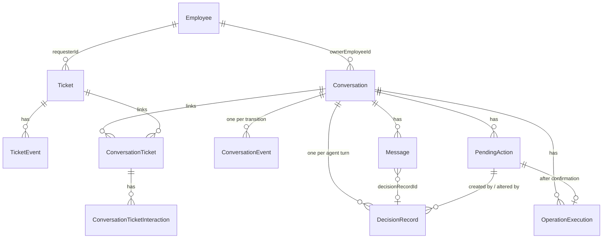
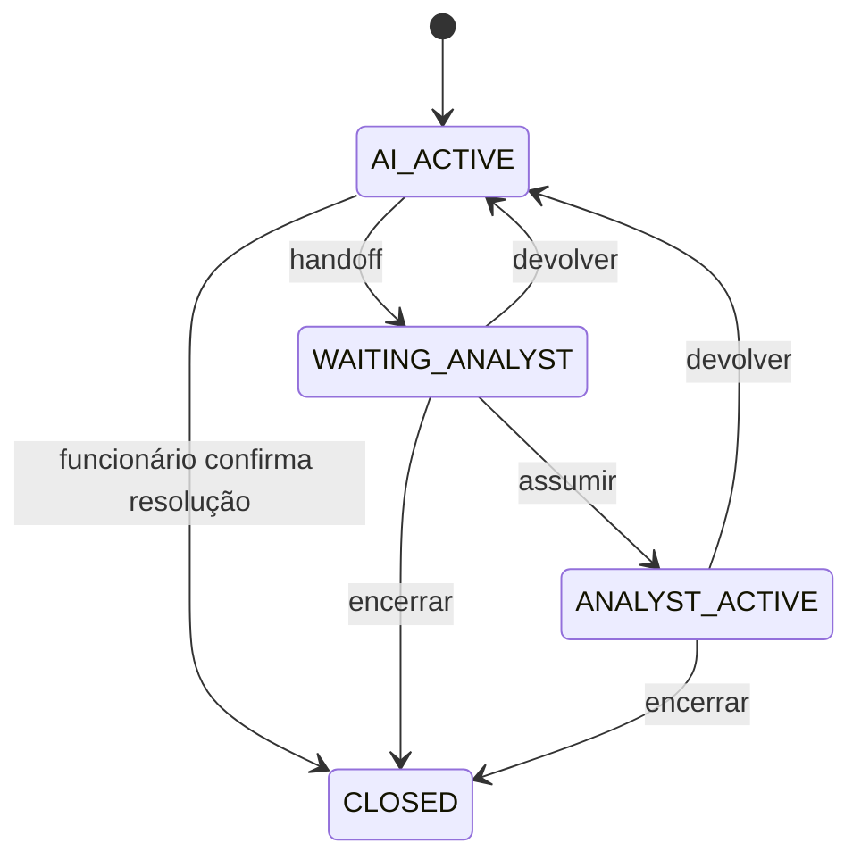
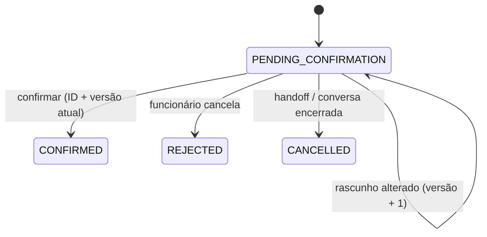
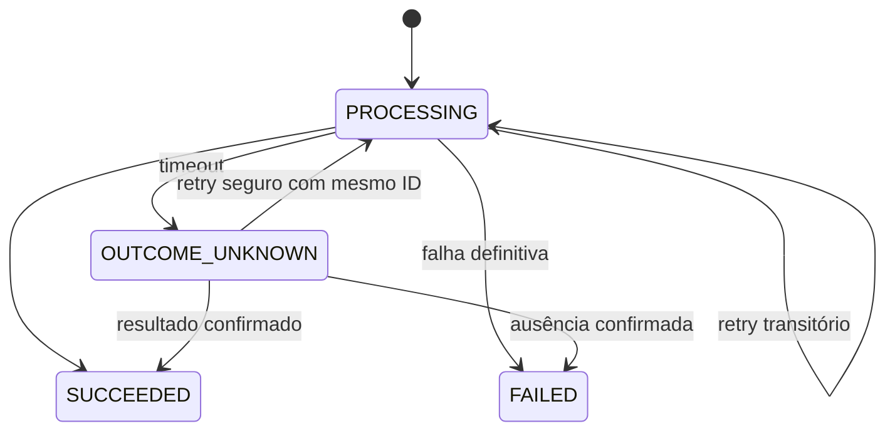

# 01 — Domain Model

> Artefato do Bloco 1, **versão 2.13** (ver seção 14, Histórico de versões).
>
> **Hierarquia das fontes:** este documento é a **fonte da verdade do domínio**; o `README.md` é a **fonte da verdade do projeto**.
>
> Estado: documentação arquitetural. Implementado no ticket-service (Blocos 2 e 3): as funções de domínio `classifyPriority` e `validateImpactAssessment` (§4, §5), `TicketStatus` com `isOpenTicket` e `canReopen` (§8.5), `findDuplicateCandidates` (§8.5.1), `computeDueAt` e `isOverdue` (§8.5.2), `formatTicketId` e `validateTicketInvariants` (§3.2); a persistência de `Ticket`, `TicketEvent` e `IdempotencyRecord` (§3.2, §3.9, §3.16); e a criação de chamado com idempotência (`createTicket`, §3.3, §3.16). As demais regras (as outras entidades e as operações de atualização, reabertura e transferência) seguem como especificação.

## 0. Como ler este documento

### 0.1 Classificação das afirmações

Cada regra é rotulada pela sua natureza, conforme a convenção do README (Convenções):

| Rótulo                 | Significado                                                                                                                       |
| ---------------------- | --------------------------------------------------------------------------------------------------------------------------------- |
| **[PRD]**              | Regra vinda do PRD (Anexo A e requisitos). Exigência externa.                                                                     |
| **[Premissa]**         | Decisão do projeto para compatibilizar ou completar o PRD. README a chama de "premissa de interpretação". Não é exigência do PRD. |
| **[ADR]**              | Decisão arquitetural aceita (README §11, ADR-001 a ADR-007).                                                                      |
| **[Contrato]**         | Contrato conceitual do README: nomes, campos e regras. Os tipos finais nascem no código.                                          |
| **PENDENTE (Bloco X)** | Lacuna conhecida cujo bloco de resolução o README indica.                                                                         |

Quando o README não rotula a origem de uma regra, este documento cita apenas a seção e usa **[Contrato]**. Não se atribui origem PRD sem que o README o faça.

### 0.2 Convenções

Prosa em português; identificadores, tipos e valores de enum em inglês. Convenção de referências: `§N.N` sem prefixo aponta para uma seção **deste documento**; `README §N.N` aponta para uma seção do `README.md`; o PRD e os ADRs são identificados pela própria fonte (ex.: PRD, ADR-001).

---

## 1. Visão geral do domínio

O sistema é um agent de atendimento do service desk de TI. A tese central é: **o LLM interpreta e propõe; o código decide e executa** (README §1, ADR-001).

O domínio tem dois donos arquiteturais (§2, README §5). A coluna "Dono" é contexto arquitetural; nenhuma regra de negócio depende de onde a entidade mora (§2).

- **ticket-service:** `Employee`, `Ticket`, `TicketEvent`, `TicketAccessLog`.
- **web:** `KnowledgeArticle`, `Conversation`, `ConversationEvent`, `Message`, `PendingAction`, `OperationExecution`, `DecisionRecord`, `ConversationTicket`, `ConversationTicketInteraction`.

Quatro ciclos de estado independentes (README §7, ADR-006): conversa, interação, ação pendente e execução de operação.

Três registros separados por acontecerem em momentos diferentes (README §6): `DecisionRecord` (decisão de um turno do agent), `PendingAction` (autorização do funcionário) e `OperationExecution` (execução técnica).

---

## 2. Entidades e responsabilidades

Fonte: contratos conceituais da seção 3.

| Entidade                        | Dono                         | Responsabilidade                                                         | Origem           |
| ------------------------------- | ---------------------------- | ------------------------------------------------------------------------ | ---------------- |
| `Employee`                      | ticket-service               | Identidade demonstrativa e papel                                         | §3.1             |
| `Ticket`                        | ticket-service               | Dados e ciclo de vida do chamado                                         | §3.2             |
| `TicketEvent`                   | ticket-service               | **Histórico oficial** do chamado (alterações)                            | §3.9             |
| `TicketAccessLog`               | ticket-service               | Auditoria de consultas feitas pelo console                               | §3.10, README §8 |
| `KnowledgeArticle`              | web (módulo de conhecimento) | Conteúdo da central de ajuda, em JSON                                    | §3.11            |
| `Conversation`                  | web                          | Controle do atendimento e contexto da interação                          | §3.5             |
| `ConversationEvent`             | web                          | **Histórico oficial** das transições da conversa (ator, horário, motivo) | §3.6, §8.1       |
| `Message`                       | web                          | Histórico conversacional, com vínculo à decisão e aos cards              | §3.8             |
| `PendingAction`                 | web                          | **Autorização** do funcionário                                           | §3.13, README §6 |
| `OperationExecution`            | web                          | **Execução técnica** de uma operação no ticket-service                   | §3.14, README §6 |
| `DecisionRecord`                | web                          | Interpretação e política de um turno do agent                            | §3.12, README §6 |
| `ConversationTicket`            | web                          | Relacionamento N:N conversa–chamado                                      | §3.7             |
| `ConversationTicketInteraction` | web                          | Como o chamado participou da conversa                                    | §3.7             |

Fontes da verdade (README §7D): autorização = `PendingAction`; execução = `OperationExecution`, conciliada com o ticket-service; histórico oficial do chamado = `TicketEvent` (§3.9); histórico oficial da conversa = `ConversationEvent`; rascunho apresentado = `PendingAction` (§3.5).

---

## 3. Atributos e contratos conceituais

Os blocos a seguir reproduzem os contratos do README. São **contratos conceituais** (Convenções): definem nomes, campos e regras, não tipos finais.

### 3.1 Employee

```ts
type EmployeeRole = "EMPLOYEE" | "ANALYST";

interface Employee {
  id: string;
  name: string;
  email: string; // e-mail corporativo, usado no login
  department: string; // ex.: "Financeiro" (Tela 4)
  role: EmployeeRole;
}
```

- Distinção N1/N2 **não** é modelada: o PRD não define regras diferentes entre os níveis (README §3, "Fora").
- Autenticação simulada, com qualquer senha para funcionários do seed (README §3, README §8). Identidade e papel são estabelecidos no servidor a partir da sessão e nunca vêm de parâmetros fornecidos pelo LLM (README §8).

### 3.2 Ticket

```ts
type TicketType = "INC" | "REQ";
type TicketCategory =
  | "ACCESS"
  | "NETWORK_VPN"
  | "HARDWARE"
  | "SOFTWARE"
  | "EMAIL"
  | "OTHER";
type Priority = "CRITICAL" | "HIGH" | "MEDIUM" | "LOW";
type TicketStatus = "WAITING_ANALYST" | "APPROVED" | "RESOLVED";

interface Ticket {
  id: string; // gerado pelo ticket-service: "INC-20311", "REQ-10442"
  version: number; // incrementada pelo ticket-service a cada alteração
  type: TicketType; // fonte da verdade do tipo; o prefixo do id é só apresentação
  title: string;
  description: string;
  category: TicketCategory;
  priority: Priority;
  status: TicketStatus; // ver §8.5
  requesterId: string; // quem abriu — base da privacidade
  impactAssessment: ImpactAssessment; // value object embutido
  assignedTo?: string; // Employee com role ANALYST; não preenchido automaticamente no handoff
  createdAt: string;
  updatedAt: string;
  resolvedAt?: string; // ISO 8601 com fuso; ver nota abaixo
  firstResponseDueAt: string; // obrigatório; calculado na criação (§8.5.2)
  nextUpdateDueAt?: string; // Bloco 7
  serviceDeskUpdatedAt?: string; // Bloco 7
}
```

Regras e observações:

- Tipos e categorias do service desk são regras **[PRD]** (Anexo A, README §2). Os valores de enum em inglês são **[Contrato]**.
- O formato de 5 dígitos do `id` segue exemplos do PRD e **não é invariante**.
- **Vencido é calculado** (prazo x relógio), nunca persistido como status (README §2).
- **Atualização acrescenta** informação; não substitui silenciosamente a descrição original.
- `requesterId` vem da sessão, nunca do rascunho; `assignedTo` não é escolhido na abertura.
- `Ticket.assignedTo` (quem atende o chamado) é distinto de `Conversation.assignedAnalystId` (quem atende a conversa) (§3.5, README §9).
- **[PRD]** O Anexo B apresenta exemplos de status: Aguardando analista, Aprovado e Resolvido. "Em andamento" não consta no PRD. **[Premissa]** O catálogo do MVP contém só esses três; um estado de atendimento do chamado (ex.: `IN_PROGRESS`) pode entrar no Bloco 7, se o console precisar. Catálogo, criação, reabertura e transferência: §8.5.
- `resolvedAt` está presente sempre que `status = RESOLVED`; é definido pelo ticket-service ao entrar em `RESOLVED` e removido na reabertura. O histórico fica em `TicketEvent`.
- Prazos por prioridade são **[PRD]** (README §2): Crítica 1 hora; Alta 4 horas úteis; Média 3 dias úteis; Baixa 5 dias úteis, para a primeira resposta e para cada atualização.
- **[Premissa]** `nextUpdateDueAt` e `serviceDeskUpdatedAt` são ambos ausentes (sem atualização do service desk) ou ambos presentes; só um presente é inconsistente.
- Prazo vigente = `nextUpdateDueAt ?? firstResponseDueAt`. Cálculo do `firstResponseDueAt` e recálculo: §8.5.2; critério de duplicidade: §8.5.1.

Persistência **[Premissa]**:

- **`id`:** string gerada pelo ticket-service, sem default no schema. O formato legível segue os exemplos do PRD (Anexo B; ex.: `INC-20311`), que são exemplos, não regra.
  - Formatado por `formatTicketId(type, n)`.
  - `n` é alocado por um contador independente para cada tipo de chamado (`TicketCounter`), dentro da transação de criação.
  - A numeração começa em 1, sem zeros à esquerda.
  - A linha do contador de cada tipo é criada por `upsert` no primeiro uso.
  - Numeração sem buracos não é garantida.
- **`version`:** começa em 1 na criação, definido pelo ticket-service, sem default no schema.
- **Datas:** `DateTime` na persistência; o repositório converte string ISO ↔ `Date`. O instante é preservado; o deslocamento original não (volta normalizado em UTC, sufixo `Z`).
- **`createdAt`, `updatedAt` e `status`:** `createdAt` e `updatedAt` são fornecidos pelo ticket-service com relógio injetado; `status` é fornecido explicitamente pelo ticket-service (valor inicial: §8.5). Nenhum deles tem default no schema.
- **`requesterId` e `assignedTo`** (quando presente) referenciam `Employee.id`; a FK entra junto com o model `Employee`, em migração posterior.
- **`requesterId` é imutável depois da criação.** A verificação de solicitante do §3.16 depende disso. PENDENTE (operação `UPDATED`): onde garantir, no caso de uso de atualização ou no `update` do repositório, que hoje grava todos os campos recebidos.
- **Regras que o schema não expressa** (prazos juntos ou ausentes; `resolvedAt` se e só se `RESOLVED`; `APPROVED` só para `REQ`) são validadas antes da gravação. Sem `CHECK` no SQLite: restrições manuais se perdem quando o Prisma recria a tabela (experimento no ADR-008). Limitação aceita: escritas SQL fora do Prisma não têm essas garantias, como já ocorre com os enums (README §5).

### 3.3 TicketDraft (payload da PendingAction)

União discriminada; cada operação tem seus próprios campos obrigatórios.

```ts
type TicketDraft = CreateTicketDraft | UpdateTicketDraft | ReopenTicketDraft;

interface CreateTicketDraft {
  operation: "CREATE_TICKET";
  title: string;
  description: string;
  type: TicketType;
  category: TicketCategory;
  impactAssessment: ImpactAssessment;
  priority: Priority; // calculada pelo ticket-service, nunca pelo LLM
  firstResponseDueAt: string; // previsão calculada pelo ticket-service, para exibição
}

interface UpdateTicketDraft {
  operation: "UPDATE_TICKET";
  ticketId: string;
  expectedTicketVersion: number;
  additionalInformation: string;
}

interface ReopenTicketDraft {
  operation: "REOPEN_TICKET";
  ticketId: string;
  expectedTicketVersion: number;
  reason: string;
  additionalInformation?: string;
}
```

Regras:

- **Prioridade:** o funcionário confirma a prioridade exibida no card, e ela precisa ser igual à prioridade recalculada pelo ticket-service antes de criar. Se houver divergência, nova proposta é apresentada ao funcionário.
- **[Premissa] Prazo:** o `firstResponseDueAt` do draft é previsão para exibição. O prazo persistido é recalculado com o instante efetivo da criação (§8.5.2). Exemplo: prévia às 17:55 e confirmação às 18:05; o prazo pode passar para o próximo dia útil sem exigir nova confirmação, porque o prazo apresentado era previsão. (Antes, esta regra exigia confirmar "exatamente" também o prazo, o que um prazo calculado a partir do instante da criação não permite cumprir; inconsistência comprovada, v2.10.)
- Se `expectedTicketVersion` não bate com a versão atual do chamado, a operação é rejeitada como desatualizada e o agent consulta de novo antes de propor.
- Resolvido há até 7 dias pode ser reaberto **[PRD]** (README §2).
- Abertura exige título, descrição, tipo, categoria, prioridade e afetados; fluxo rascunho, confirmação, criação **[PRD]** (README §2).

### 3.4 ImpactAssessment e ImpactAssessmentDraft

```ts
type AffectedScope = "SELF" | "TEAM" | "COMPANY" | "UNKNOWN";
type WorkImpact = "BLOCKED" | "DEGRADED_WITH_WORKAROUND" | "NONE";
type CommitmentRisk = "YES" | "NO" | "UNKNOWN" | "NOT_ASKED";

interface ImpactAssessment {
  affectedScope: AffectedScope; // alcance
  workImpact: WorkImpact; // impacto no trabalho
  commitmentRisk: CommitmentRisk; // urgência: compromisso em risco hoje
}

type ImpactAssessmentDraft = Partial<ImpactAssessment>; // em construção
```

Ver §5 (Value Objects) para semântica completa.

- **[Premissa] Persistência do `ImpactAssessment`:** três colunas (`workImpact`, `affectedScope`, `commitmentRisk`), sem JSON e sem valor padrão. Os enums validam cada valor; a consistência entre eles (`NOT_ASKED_REQUIRES_BLOCKED`) continua em `validateImpactAssessment` (§5.1), antes da persistência.

### 3.5 Conversation e InteractionContext

```ts
type ConversationStatus =
  | "AI_ACTIVE"
  | "WAITING_ANALYST"
  | "ANALYST_ACTIVE"
  | "CLOSED";

interface Conversation {
  id: string;
  ownerEmployeeId: string;
  status: ConversationStatus;
  assignedAnalystId?: string; // presente somente em ANALYST_ACTIVE; limpo ao sair desse estado
  interactionContext: InteractionContext; // README §7B, persistido
  resolutionSource?: "AGENT" | "ANALYST"; // presente somente em CLOSED
  createdAt: string;
  updatedAt: string;
}

type InteractionFlow =
  | "NONE"
  | "CREATE_TICKET"
  | "UPDATE_TICKET"
  | "REOPEN_TICKET"
  | "TICKET_LOOKUP";
type InteractionStage =
  | "IDLE"
  | "COLLECTING_DETAILS"
  | "SELECTING_TICKET"
  | "READY_TO_PROPOSE";

interface InteractionContext {
  flow: InteractionFlow;
  stage: InteractionStage;
  targetTicketId?: string;
  collectedData?: {
    title?: string;
    description?: string;
    type?: TicketType;
    category?: TicketCategory;
    impactAssessment?: ImpactAssessmentDraft;
    additionalInformation?: string;
    reason?: string;
  };
}
```

Regras:

- `assignedAnalystId` é **limpo** ao sair de `ANALYST_ACTIVE` (devolver ou encerrar). O histórico de quem atendeu fica nos `ConversationEvent`.
- Quem encerrou e quando ficam no `ConversationEvent` do tipo `CLOSED`; **não duplicados** na conversa.
- `resolutionSource: "AGENT"` alimenta a tag "Resolvida pelo agent" do console.
- `PendingAction` é a fonte da verdade do rascunho apresentado; o contexto **não duplica** o status dela.
- Ao devolver a conversa ao agent, o contexto é **totalmente limpo**: `flow`, `stage`, `targetTicketId` e `collectedData`. Após a devolução, o contexto fica em `NONE` / `IDLE`, sem foco nem dados de coleta. Isso descreve o estado **após a devolução**; durante o atendimento normal, `NONE` / `IDLE` pode ter `targetTicketId` (`03-agent-flow.md`, D5). Mensagens, histórico, o `summary` do handoff e as `notes` do analista são preservados; o agent consulta os dados de novo antes de propor qualquer coisa (README §7A).
- `READY_TO_PROPOSE` é um estágio **transitório** (`03-agent-flow.md`, D3 e D11). O valor permanece em `InteractionStage`. Este documento não estabelece, como regra de domínio, se esse estágio é gravado no banco ou apenas atravessado (ver `03-agent-flow.md` §5.2).
- **Chamado em foco** = `InteractionContext.targetTicketId` no instante do handoff (§8.7).
- O `InteractionContext` não muda o controle da conversa (README §7B). O histórico persistido é a fonte da verdade; a memória do LLM não é (README §7B).

### 3.6 ConversationEvent

```ts
type ConversationEventType =
  | "HANDOFF"
  | "ANALYST_ASSIGNED"
  | "RETURNED_TO_AGENT"
  | "CLOSED";
type ConversationEventReason =
  | "NO_HUMAN_ACTION_NEEDED"
  | "NEEDS_AGENT_FOLLOW_UP"
  | "MISROUTED"
  | "OTHER";

interface ConversationEvent {
  id: string;
  conversationId: string;
  type: ConversationEventType;
  actorId: string; // funcionário, analista ou "SYSTEM"
  fromStatus: ConversationStatus;
  toStatus: ConversationStatus;
  occurredAt: string;
  reasonCode?: ConversationEventReason; // obrigatório em RETURNED_TO_AGENT
  notes?: string;
  summary?: string; // obrigatório em HANDOFF
  decisionRecordId?: string; // obrigatório em HANDOFF
}
```

- Gravado em **toda transição** da conversa (§8.1). A devolução ao agent registra motivo tanto a partir de `WAITING_ANALYST` quanto de `ANALYST_ACTIVE`.
- `summary` é a **fotografia** do contexto apresentada ao analista no momento da transferência; **não substitui** a fonte original dos dados. A `PendingAction` mantém o rascunho estruturado original, mesmo cancelada.
- `decisionRecordId` aponta para a decisão que originou o encaminhamento; o **motivo do handoff** é o `PolicyReasonCode` dessa decisão. `ConversationEventReason` continua cobrindo apenas a devolução ao agent.
- `summary` e `decisionRecordId` são obrigatórios apenas em `HANDOFF`; nos demais tipos permanecem opcionais, sem regra adicional definida.
- `summary` é o **único resumo do handoff**. O `TRANSFER_TICKET` envia uma **cópia** desse texto ao ticket-service (fronteira entre serviços); a cópia é registrada em `TicketEvent.summary`, no evento `TRANSFERRED` (§3.9, §8.7).
- `notes` guarda as observações do analista ao devolver a conversa (`RETURNED_TO_AGENT`), quando houver. Não é uma segunda versão do resumo do handoff.

### 3.7 ConversationTicket e ConversationTicketInteraction

```ts
interface ConversationTicket {
  conversationId: string; // (conversationId, ticketId) é único
  ticketId: string;
  linkedAt: string; // primeira interação efetiva; nunca atualizado
}

type ConversationTicketInteractionType =
  | "CREATED"
  | "UPDATED"
  | "REOPENED"
  | "VIEWED"
  | "HANDED_OFF";

interface ConversationTicketInteraction {
  id: string;
  conversationId: string;
  ticketId: string;
  type: ConversationTicketInteractionType;
  operationExecutionId?: string; // referência para idempotência do registro
  occurredAt: string;
}
```

Momento do registro de cada interação:

| Interação    | Quando registrar                                                    |
| ------------ | ------------------------------------------------------------------- |
| `CREATED`    | Após `OperationExecution` `CREATE_TICKET` em `SUCCEEDED`            |
| `UPDATED`    | Após `UPDATE_TICKET` em `SUCCEEDED`                                 |
| `REOPENED`   | Após `REOPEN_TICKET` em `SUCCEEDED`                                 |
| `VIEWED`     | Após consulta **detalhada e bem-sucedida** de um chamado específico |
| `HANDED_OFF` | Após `TRANSFER_TICKET` em `SUCCEEDED`                               |

- A associação nasce na **primeira interação efetiva**. Aparecer numa lista de resultados **não** cria associação.
- `HANDED_OFF` só para chamados efetivamente encaminhados (por padrão, o chamado em foco; §8.7). A transferência **da conversa** é registrada em `ConversationEvent`. Handoff sem chamado em foco não gera `TRANSFER_TICKET` nem `HANDED_OFF`, mesmo com outros chamados vinculados.
- O registro é **idempotente** pelo `operationExecutionId`: retries não duplicam interações.

### 3.8 Message

```ts
type MessageAuthor =
  | { type: "EMPLOYEE"; employeeId: string }
  | { type: "ANALYST"; employeeId: string }
  | { type: "AGENT" }
  | { type: "SYSTEM" };

type MessageAttachmentKind =
  | "PENDING_ACTION"
  | "TICKET"
  | "TICKET_SELECTOR"
  | "QUICK_REPLIES";

interface MessageAttachment {
  kind: MessageAttachmentKind;
  refId: string;
}

interface Message {
  id: string;
  conversationId: string;
  author: MessageAuthor;
  content: string;
  decisionRecordId?: string; // só em mensagens do agent
  attachments: MessageAttachment[]; // ordem preservada
  createdAt: string;
}
```

- A mensagem guarda **referências** aos cards, não cópias de dados.
- Toda referência aponta para um recurso persistido ou snapshot recuperável. `QUICK_REPLIES` precisa reconstruir **exatamente** as opções oferecidas, mesmo após reinício. PENDENTE (Bloco 6): onde o snapshot das opções é armazenado (README §12 #15).

### 3.9 TicketEvent

```ts
type ActorType = "EMPLOYEE" | "ANALYST" | "SYSTEM";

type Actor =
  | { type: "EMPLOYEE" | "ANALYST"; employeeId: string }
  | { type: "SYSTEM" };

interface TicketEvent {
  id: string;
  ticketId: string;
  type:
    | "CREATED"
    | "UPDATED"
    | "REOPENED"
    | "TRANSFERRED"
    | "ASSIGNED"
    | "STATUS_CHANGED";
  actor: Actor;
  summary: string;
  changes: Array<{
    field: string;
    previousValue?: unknown;
    newValue?: unknown;
  }>;
  occurredAt: string;
}
```

Até a operação `UPDATED`, o código tipa os elementos de `changes` como `JsonValue` (contrato PENDENTE).

- Histórico oficial de alterações.
- **[Premissa]** Os seis valores de `type` formam o catálogo `TicketEventType`. Produtor previsto de cada um:

  | Tipo             | Produtor previsto                     |
  | ---------------- | ------------------------------------- |
  | `CREATED`        | Criação                               |
  | `UPDATED`        | Atualização pelo funcionário          |
  | `REOPENED`       | Reabertura                            |
  | `TRANSFERRED`    | `TRANSFER_TICKET`                     |
  | `ASSIGNED`       | Analista assume o chamado (Bloco 7)   |
  | `STATUS_CHANGED` | Analista muda o status (§7.3)         |

  Revisão no Bloco 8: valor sem produtor implementado sai do catálogo.
- **[Premissa]** `CREATED`: `changes = []` e `summary` fixo "Chamado criado".
- No evento `TRANSFERRED`, `summary` recebe a cópia de `ConversationEvent.summary` enviada pelo `TRANSFER_TICKET` (§3.6).
- Toda mutação de chamado feita por analista gera `TicketEvent` com `actor.type: "ANALYST"` (§7.3).
- `TicketEventType`, `ActorType` e `TicketOperationType` (§3.16) são **catálogos distintos**: uma operação pode produzir um evento, mas os conceitos não se confundem.
- PENDENTE (operação `UPDATED`): contrato dos elementos de `changes` (catálogo de `field`, `previousValue`, `newValue`) (L12).

Persistência **[Premissa]**:

- **`actor`:** no domínio, `Actor` (união discriminada); na persistência, duas colunas, `actorType` (catálogo `ActorType`) e `actorEmployeeId` (opcional). O repositório converte nos dois sentidos, como no `ImpactAssessment` (§3.4). A interface de domínio não tem campos de persistência.
- **Regra do ator:** `EMPLOYEE` e `ANALYST` têm `employeeId`; `SYSTEM` não tem. No domínio, a regra é expressa pelo tipo `Actor`. Na leitura do banco, o repositório valida a consistência entre `actorType` e `actorEmployeeId` ao converter as colunas em `Actor`; combinação inválida lança exceção (dado corrompido, como o snapshot do §3.16).
- **`changes`:** coluna JSON (`JsonValue`, como §3.16).
- **`ticketId`:** FK para `Ticket`.
- Chamados não são excluídos; as FKs para `Ticket` usam `Restrict` em exclusão e atualização (`onDelete` e `onUpdate` explícitos).
- Catálogos persistidos: regra em README §5 (Princípios).

### 3.10 TicketAccessLog (README §8)

Campos: `id`, `analystId`, `ticketId`, `occurredAt` e `origin: CONSOLE` (README §8).

```ts
interface TicketAccessLog {
  id: string;
  analystId: string;
  ticketId: string;
  occurredAt: string;
  origin: "CONSOLE";
}
```

- Cada consulta de analista pelo console gera um `TicketAccessLog`. **Não é `TicketEvent`:** consultar não altera o chamado (README §8).
- Os tipos dos campos seguem a convenção dos demais contratos (identificadores e datas como `string`).

### 3.11 KnowledgeArticle

```ts
interface KnowledgeArticle {
  id: string;
  title: string;
  content: string;
  category?: TicketCategory;
  keywords: string[];
  applicability?: { operatingSystems?: string[] };
}
```

- `applicability` impede aplicar, por exemplo, o artigo de VPN do Windows 10 a quem usa Windows 11 (README §10).
- Busca lexical, sem embeddings (ADR-003, README §3).

### 3.12 DecisionRecord (README §6)

```ts
type Intent =
  | "ANSWER_KB"
  | "LIST_MY_TICKETS"
  | "VIEW_TICKET"
  | "CREATE_TICKET"
  | "UPDATE_TICKET"
  | "REOPEN_TICKET"
  | "HANDOFF"
  | "CLOSE_CONVERSATION"
  | "OUT_OF_SCOPE"
  | "CLARIFY";

type PolicyOutcome =
  | "ANSWER"
  | "ASK"
  | "PROPOSE_ACTION"
  | "HANDOFF"
  | "DENY"
  | "REDIRECT"
  | "REQUEST_RESOLUTION_CONFIRMATION";

interface DecisionRecord {
  // um por turno do agent
  id: string;
  conversationId: string;
  interpretation: {
    intent: Intent;
    confidence: "LOW" | "MEDIUM" | "HIGH"; // sinal auxiliar, NÃO probabilidade
    entities: {
      problem?: string;
      category?: TicketCategory;
      operatingSystem?: string;
      impact?: ImpactAssessmentDraft;
    };
    missingFields: MissingField[];
  };
  policy: {
    outcome: PolicyOutcome;
    reasonCode: PolicyReasonCode;
    appliedRules: string[];
  };
  evidence: Array<{
    type: "ARTICLE" | "TICKET" | "BUSINESS_RULE";
    referenceId: string;
  }>;
  toolExecutions: Array<{
    name: string;
    status: "SUCCESS" | "FAILED";
    durationMs: number;
  }>;
  pendingActionId?: string; // ação criada OU alterada neste turno
  pendingActionVersion?: number; // versão do rascunho produzida neste turno
}
```

Regras:

- `pendingActionVersion` está presente **junto** com `pendingActionId` ou ausente junto com ele. Permite reconstruir qual versão do rascunho cada turno produziu.
- `Intent` passa a conter `REOPEN_TICKET`, alinhado a `InteractionFlow`, `PendingActionType` e `OperationType`.
- `LIST_MY_TICKETS` e `VIEW_TICKET` têm significados distintos: `LIST_MY_TICKETS` é a **listagem** dos chamados autorizados do funcionário; `VIEW_TICKET` é a **consulta detalhada** de um chamado específico. Na Tela 3, a escolha de um chamado na lista e a consulta por id informado usam `VIEW_TICKET` (`03-agent-flow.md` v1.1, §9). `VIEW_TICKET` não cria novo `InteractionFlow`: o `InteractionFlow` `TICKET_LOOKUP` (§3.5) permanece como está.

- Três camadas por resposta: **interpretação** (o que o modelo entendeu), **política** (o que o sistema permite), **execução** (o que realmente aconteceu) (README §6).
- O **backend monta** `toolExecutions` a partir do que de fato rodou. O modelo não declara sucesso de nada (README §6).
- A **confiança declarada não autoriza nenhuma operação**; serve como um dos sinais para encaminhar ao analista (README §6).
- **Não se expõe o raciocínio interno do modelo**; expõem-se evidências, regras e ações (README §6).
- `appliedRules` usa IDs estáveis (ex.: `SD-PRIORITY-001`). PENDENTE (Bloco 4): catálogo definido conforme as regras forem implementadas (§3.15, README §12 #11).

### 3.13 PendingAction (README §6)

```ts
type PendingActionType = "CREATE_TICKET" | "UPDATE_TICKET" | "REOPEN_TICKET";
type PendingActionStatus =
  | "PENDING_CONFIRMATION"
  | "CONFIRMED"
  | "REJECTED"
  | "CANCELLED";

interface PendingAction {
  id: string;
  conversationId: string;
  createdByDecisionRecordId: string; // as decisões seguintes apontam via DecisionRecord.pendingActionId
  type: PendingActionType;
  version: number; // começa em 1; incrementa conforme a tabela abaixo
  payload: TicketDraft;
  status: PendingActionStatus; // README §7C
  cancellationReason?: "HANDOFF" | "CONVERSATION_CLOSED";
}
```

- `CONVERSATION_CLOSED` ocorre em **qualquer** encerramento da conversa com ação pendente, na mesma transação local que encerra a conversa.
- Mesmo cancelada, a `PendingAction` mantém o rascunho estruturado original.

O que incrementa `version`:

| Alteração                                                | Incrementa? |
| -------------------------------------------------------- | ----------- |
| Título, descrição, tipo, categoria                       | Sim         |
| Avaliação de impacto, prioridade ou prazo calculados     | Sim         |
| Chamado-alvo, informação adicional, motivo de reabertura | Sim         |
| Apenas formatação do texto                               | Não         |
| Nova mensagem sem alteração do rascunho                  | Não         |

### 3.14 OperationExecution (README §6, README §9)

```ts
type OperationType =
  | "CREATE_TICKET"
  | "UPDATE_TICKET"
  | "REOPEN_TICKET"
  | "TRANSFER_TICKET";
type OperationExecutionStatus =
  | "PROCESSING"
  | "SUCCEEDED"
  | "FAILED"
  | "OUTCOME_UNKNOWN";

interface OperationExecution {
  id: string; // = chave de idempotência; gerado e persistido ANTES da chamada
  conversationId: string;
  pendingActionId?: string; // ausente em TRANSFER_TICKET originado por handoff
  operation: OperationType;
  status: OperationExecutionStatus; // README §7D
  ticketId?: string;
  attempts: number; // tentativas técnicas da MESMA operação
}
```

- Toda tentativa da mesma operação reutiliza o **mesmo** `id` (`attempts + 1`) (README §7D, README §9).
- Nova operação de negócio = novo `id`. Repetição técnica = mesmo `id` (README §9).
- `PendingActionType` não inclui `TRANSFER_TICKET`; `OperationType` inclui (README §6).
- O `TRANSFER_TICKET` envia ao ticket-service uma cópia de `ConversationEvent.summary` (§3.6).

### 3.15 Catálogos de códigos

Códigos operacionais são **tipados e estáveis**; o texto exibido na UI é separado.

```ts
type MissingField =
  | "TITLE"
  | "DESCRIPTION"
  | "TYPE"
  | "CATEGORY"
  | "AFFECTED_SCOPE"
  | "WORK_IMPACT"
  | "COMMITMENT_RISK"
  | "TARGET_TICKET"
  | "ADDITIONAL_INFORMATION"
  | "REOPEN_REASON";

type PriorityReasonCode = // por que esta prioridade (classifyPriority)
  | "TEAM_OR_COMPANY_BLOCKED"
  | "SELF_BLOCKED"
  | "AFFECTED_SCOPE_UNKNOWN"
  | "COMMITMENT_AT_RISK_TODAY"
  | "WORKAROUND_AVAILABLE"
  | "NO_WORK_IMPACT"
  | "WORK_IMPACT_MISSING"
  | "AFFECTED_SCOPE_MISSING"
  | "COMMITMENT_RISK_MISSING";

type PolicyReasonCode = // por que esta ação (política)
  | "USER_REQUESTED_HANDOFF"
  | "CRITICAL_IMPACT"
  | "OVERDUE_TICKET"
  | "LOW_CONFIDENCE"
  | "TOOL_FAILURE"
  | "OUT_OF_SCOPE"
  | "INSUFFICIENT_INFORMATION"
  | "USER_CONFIRMED_RESOLUTION";
```

- `PriorityReasonCode` e `PolicyReasonCode` são **catálogos distintos**.
- Catálogos persistidos (enums no banco e fonte única no domínio): regra em README §5 (Princípios).

### 3.16 IdempotencyRecord (registro técnico do ticket-service)

Registro técnico do ticket-service. **Não é entidade de domínio**: a contagem de entidades (§2) não muda. É distinto de `OperationExecution` (§3.14), que pertence ao web e ao fluxo do agent.

```ts
type TicketOperationType = "CREATE" | "UPDATE" | "REOPEN" | "TRANSFER"; // [Premissa]

interface IdempotencyRecord {
  key: string; // valor opaco = OperationExecution.id; chave primária; não é FK
  operationType: TicketOperationType;
  ticketId: string; // obrigatório; FK para Ticket
  result: JsonValue; // snapshot JSON serializável do resultado original
  createdAt: string;
}
```

- **[Premissa]** `JsonValue` representa um valor serializável em JSON. É a representação do resultado persistido, não uma dependência do domínio em Prisma; a conversão para o tipo do ORM é feita no repositório.

- `TicketOperationType` é definido no ticket-service (as operações que ele aceita: criação, atualização, reabertura e transferência), sem depender do `OperationType` do web. É catálogo distinto de `TicketEventType` (§3.9).

- Chamados não são excluídos; as FKs para `Ticket` usam `Restrict` em exclusão e atualização (`onDelete` e `onUpdate` explícitos).

Regras **[Premissa]**:

- **Só operações que produziram efeito sobre um chamado são registradas.** Operação rejeitada (ex.: versão desatualizada) não gera registro; a chave não é consumida e a nova tentativa reavalia a operação (o resultado pode mudar se o estado do chamado mudar).
- **Resultado original:** com a chave existente, devolve o `result` armazenado, sem reavaliar a operação nem consultar o estado atual do chamado. A única leitura do chamado é a do `requesterId`, imutável (§3.2), para a verificação abaixo.
- **Criação × repetição:** o caso de uso distingue internamente a criação (`CREATED`) da devolução do resultado original (`REPLAYED`) em todos os caminhos de repetição, inclusive na concorrência e no conflito recuperável abaixo; o HTTP não expõe essa distinção (contrato HTTP §3: 201 com o `ticket`, sem marcador), e o snapshot persistido continua `{ ok: true, ticket }`.
- **Chave reutilizada:** com a chave existente, confere `operationType` e o solicitante (`IdempotencyRecord.ticketId` → `Ticket.requesterId`). Se a operação ou o solicitante não corresponderem, responde `IDEMPOTENCY_KEY_CONFLICT`, sem revelar o `result` armazenado. Não há comparação do conteúdo da requisição (fingerprint do payload). PENDENTE (operação `TRANSFER`): como a verificação de solicitante se aplica quando o ator é `SYSTEM`.
- **Snapshot:** o `result` é a resposta original da operação. Na leitura, a validação é rasa: `ok === true`, `ticket` é objeto, `ticket.id` é string e igual a `IdempotencyRecord.ticketId`. Se falhar, lança exceção. O restante do objeto não é validado contra a estrutura atual de `Ticket`: o snapshot preserva a resposta original mesmo depois que o modelo evoluir.
- **Ordem:** a chave é verificada antes de `expectedTicketVersion`; a consulta é repetida dentro da transação antes da validação de versão.
- **Atomicidade:** `Ticket`, `TicketEvent` e `IdempotencyRecord` na mesma transação; se ela falhar, nenhum efeito fica confirmado isoladamente.
- **Concorrência com a mesma chave:** só uma operação é confirmada. A perdedora, após o rollback integral (por chave duplicada ou por bloqueio de escrita), relê a chave fora da transação que falhou; se o registro vencedor existir, devolve o `result` original, sem erro de duplicidade; se não existir, vale o conflito recuperável abaixo.
- **Conflito recuperável:** só o `P2002` da chave de idempotência. `P2002` de outra restrição é relançado. Se a releitura após o rollback não encontrar o registro vencedor, a falha é relançada. A política de retry pertence ao cliente web/BFF, que repete a mesma intenção com a mesma chave e o mesmo corpo original; nova intenção ou nova confirmação recebe outra chave (README §12 #7). O ticket-service não tem laço de retry.
- **Consulta pela chave:** endpoint opcional, fora do MVP; repetir a operação com a mesma chave reconcilia o resultado original (README §12 #8).

---

## 4. Funções de domínio: classifyPriority (ADR-007)

Regra do **ticket-service** (dono das regras de chamado); o web não tem cópia e obtém o resultado por **leitura** (README §6).

As funções puras de domínio do Bloco 2, incluindo `classifyPriority`, pertencem à **camada de domínio do ticket-service** e são testadas nessa aplicação. Uma única implementação; nenhuma cópia no web. Contradição C4 resolvida (seção 12).

```ts
type PriorityClassification =
  | { status: "CLASSIFIED"; priority: Priority; reasonCode: PriorityReasonCode }
  | {
      status: "NEEDS_CLARIFICATION";
      missingFields: MissingField[];
      reasonCode: PriorityReasonCode;
    };

function classifyPriority(
  assessment: ImpactAssessmentDraft,
): PriorityClassification;
```

`classifyPriority` é uma **função total** (devolve resultado para qualquer entrada, inclusive incompleta). **A primeira regra que casa vence:**

| #   | Condição                            | Resultado             | `reasonCode`               |
| --- | ----------------------------------- | --------------------- | -------------------------- |
| 0   | `workImpact` ausente                | `NEEDS_CLARIFICATION` | `WORK_IMPACT_MISSING`      |
| 1   | `BLOCKED` + `affectedScope` ausente | `NEEDS_CLARIFICATION` | `AFFECTED_SCOPE_MISSING`   |
| 2   | `BLOCKED` + `TEAM` ou `COMPANY`     | `CRITICAL`            | `TEAM_OR_COMPANY_BLOCKED`  |
| 3   | `BLOCKED` + `SELF`                  | `HIGH`                | `SELF_BLOCKED`             |
| 4   | `BLOCKED` + `UNKNOWN`               | `HIGH`                | `AFFECTED_SCOPE_UNKNOWN`   |
| 5   | `commitmentRisk` ausente            | `NEEDS_CLARIFICATION` | `COMMITMENT_RISK_MISSING`  |
| 6   | `commitmentRisk = YES`              | `HIGH`                | `COMMITMENT_AT_RISK_TODAY` |
| 7   | `DEGRADED_WITH_WORKAROUND`          | `MEDIUM`              | `WORKAROUND_AVAILABLE`     |
| 8   | `NONE`                              | `LOW`                 | `NO_WORK_IMPACT`           |

Regras associadas:

- **Regra 4 [Premissa]:** "Não sei" + bloqueado vira Alta, prioridade do **impacto mínimo conhecido**. Não afirma que o caso não possa ser crítico; `AFFECTED_SCOPE_UNKNOWN` fica visível ao analista. **Não** gera handoff automático nem repete a pergunta.
- Com `BLOCKED`, a pergunta sobre compromisso é dispensada; o chamado grava `commitmentRisk: NOT_ASKED`.
- `commitmentRisk = UNKNOWN` ou `NO` não eleva a prioridade e segue para as regras 7 e 8. **[Premissa] conservadora:** com risco desconhecido, usa-se o impacto conhecido sem presumir urgência adicional; a incerteza fica registrada e visível.
- Fora de `BLOCKED`, o alcance não altera a prioridade, mas continua **obrigatório para abrir o chamado** (completude do rascunho difere de classificação).
- `NEEDS_CLARIFICATION` **não é uma prioridade**; é um resultado discriminado.
- `missingFields` contém **somente** o campo da regra que casou (coleta progressiva: um campo por vez, na ordem em que se torna relevante). Ex.: sem `workImpact` e sem `affectedScope`, pede só `WORK_IMPACT`.
- `classifyPriority` **classifica, não valida**: uma entrada inconsistente (ex.: `NOT_ASKED` fora de `BLOCKED`) é classificada normalmente; a rejeição é de `validateImpactAssessment` (§5). `CLASSIFIED` não significa que o assessment é válido para persistência.
- Testes em `apps/ticket-service/test/domain/`: `classify-priority.test.ts` (tabela de regras e casos de precedência) e `classify-priority.invariants.test.ts` (invariantes sobre as 100 combinações de `ImpactAssessmentDraft`, incluindo campos ausentes).
- O LLM nunca escolhe a prioridade nem o prazo (invariante 3).

---

## 5. Value Objects

| Value Object                         | Definição                                                                                                                                   | Origem |
| ------------------------------------ | ------------------------------------------------------------------------------------------------------------------------------------------- | ------ |
| `ImpactAssessment`                   | `affectedScope`, `workImpact`, `commitmentRisk`. Sem id, sem repositório próprio; vive dentro do `Ticket` (snapshot usado na classificação) | §3.4   |
| `ImpactAssessmentDraft`              | `Partial<ImpactAssessment>`: o que existe durante a conversa                                                                                | §3.4   |
| `TicketDraft` (e variantes)          | Payload da `PendingAction`; união discriminada por `operation`                                                                              | §3.3   |
| `InteractionContext`                 | Estrutura embutida e persistida na `Conversation`                                                                                           | §3.5   |
| `MessageAuthor`, `MessageAttachment` | Estruturas embutidas na `Message`                                                                                                           | §3.8   |
| `PriorityClassification`             | Resultado discriminado de `classifyPriority` (`CLASSIFIED` ou `NEEDS_CLARIFICATION`)                                                        | §4     |

Observação: apenas `ImpactAssessment` é declarado explicitamente como value object ("sem id, sem repositório próprio"). A classificação dos demais itens da tabela como value objects é a leitura estrutural deste documento (estruturas embutidas sem identidade própria nos contratos); não é declaração textual da fonte.

### 5.1 Semântica de ImpactAssessment

| Representação                  | Significado                                   |
| ------------------------------ | --------------------------------------------- |
| Campo ausente (só no rascunho) | Ainda não coletado                            |
| `UNKNOWN`                      | Perguntado; o funcionário respondeu "Não sei" |
| `NOT_ASKED`                    | Não foi necessário perguntar para classificar |
| `YES` / `NO`                   | Resposta explícita                            |

- **Enums em vez de booleanos e `null`**, para tornar combinações contraditórias de `workImpact` não representáveis e evitar interpretações diferentes de `null`/`undefined`/`false` entre TypeScript, JSON e SQLite.
- `NOT_ASKED` só é válido com `workImpact: BLOCKED`. **O tipo ainda permite a combinação inválida**; a regra é garantida por **validação de domínio obrigatória**: `validateImpactAssessment(assessment: ImpactAssessment): { ok: true } | { ok: false; error: "NOT_ASKED_REQUIRES_BLOCKED" }`, função pura na camada de domínio do ticket-service que recebe o assessment completo. `BLOCKED` com `YES`, `NO` ou `UNKNOWN` é válido (não há regra inversa). Evoluir para união discriminada é alternativa registrada, sem decisão.
- **`UNKNOWN` difere de `NO`.** Podem produzir a mesma prioridade, mas não são a mesma informação: `UNKNOWN` continua gravado e visível no card e no painel do analista.
- **Tipo e impacto são dimensões diferentes.** `workImpact` não decide INC x REQ:

| Pedido                                          | Tipo | `workImpact`               |
| ----------------------------------------------- | ---- | -------------------------- |
| Notebook parou                                  | INC  | `BLOCKED`                  |
| VPN instável, com alternativa                   | INC  | `DEGRADED_WITH_WORKAROUND` |
| Solicitar mouse                                 | REQ  | `NONE`                     |
| Acesso a sistema necessário para trabalhar hoje | REQ  | `BLOCKED`                  |

- A identificação individual dos afetados está fora de escopo: o protótipo pergunta o **alcance** ("Só eu / Minha equipe / Toda a empresa / Não sei") (README §3).

---

## 6. Relacionamentos e cardinalidades

Fonte: README §6 e README §9, completadas pelos contratos da seção 3.



| Relacionamento                                         | Cardinalidade | Observação                                                                            | Origem    |
| ------------------------------------------------------ | ------------- | ------------------------------------------------------------------------------------- | --------- |
| `Employee` → `Ticket` (solicitante)                    | 1:N           | `Ticket.requesterId`                                                                  | —         |
| `Ticket` → `TicketEvent`                               | 1:N           |                                                                                       | —         |
| `Employee` → `Conversation`                            | 1:N           | `Conversation.ownerEmployeeId`                                                        | —         |
| `Conversation` → `Message`                             | 1:N           |                                                                                       | —         |
| `Conversation` → `ConversationEvent`                   | 1:N           | Uma por transição                                                                     | —         |
| `Conversation` → `DecisionRecord`                      | 1:N           | Um por turno do agent                                                                 | —         |
| `Message` → `DecisionRecord`                           | N:0..1        | Mensagens do agent apontam para a decisão do turno                                    | —         |
| `Conversation` → `PendingAction`                       | 1:N           | Histórico; **no máximo uma** em `PENDING_CONFIRMATION`                                | —         |
| `PendingAction` → `DecisionRecord`                     | 1:N           | `createdByDecisionRecordId` = a que criou; as seguintes apontam via `pendingActionId` | README §6 |
| `PendingAction` → `OperationExecution`                 | 1:0..1        | Só existe execução após confirmação                                                   | —         |
| `Conversation` → `OperationExecution`                  | 1:N           | Toda operação nasce de um atendimento                                                 | —         |
| `OperationExecution` sem `PendingAction`               | permitido     | Ex.: `TRANSFER_TICKET` originado por handoff                                          | README §6 |
| `Conversation` ↔ `Ticket`                              | N:N           | Via `ConversationTicket`, chave composta `(conversationId, ticketId)` única           | §3.7      |
| `ConversationTicket` → `ConversationTicketInteraction` | 1:N           |                                                                                       | —         |

Relacionamentos adicionais derivados de campos dos contratos (sem cardinalidade explícita nos contratos):

| Referência                                                        | Campo                             | Origem    |
| ----------------------------------------------------------------- | --------------------------------- | --------- |
| `Ticket` → `Employee` (analista responsável pelo chamado)         | `Ticket.assignedTo?`              | §3.2      |
| `Conversation` → `Employee` (analista que atende a conversa)      | `Conversation.assignedAnalystId?` | §3.5      |
| `Message` → `Employee` (autor)                                    | `MessageAuthor.employeeId`        | §3.8      |
| `Message` → recurso referenciado                                  | `MessageAttachment.refId`         | §3.8      |
| `OperationExecution` → `Ticket`                                   | `OperationExecution.ticketId?`    | README §6 |
| `ConversationTicketInteraction` → `OperationExecution`            | `operationExecutionId?`           | §3.7      |
| `TicketAccessLog` → `Employee` (analista), `Ticket`               | `analystId`, `ticketId`           | README §8 |
| `DecisionRecord.evidence` → `KnowledgeArticle`, `Ticket` ou regra | `referenceId`                     | README §6 |

---

## 7. Invariantes

Numeração preservada da lista oficial de invariantes, complementada por regras explícitas de README §7, README §8, README §9. Cada item indica o rótulo de origem quando a fonte o dá.

### 7.1 Invariantes oficiais

| #   | Invariante                                                                                                                                                                                                                                                                                                                                                                     | Rótulo / origem complementar                                                                         |
| --- | ------------------------------------------------------------------------------------------------------------------------------------------------------------------------------------------------------------------------------------------------------------------------------------------------------------------------------------------------------------------------------ | ---------------------------------------------------------------------------------------------------- |
| 1   | Um funcionário **nunca** consulta chamados de outro funcionário.                                                                                                                                                                                                                                                                                                               | **[PRD]** privacidade (README §2); README §8                                                         |
| 2   | Um analista pode consultar chamados pelo console, e **todo acesso gera `TicketAccessLog`**.                                                                                                                                                                                                                                                                                    | **[Premissa]** de interpretação da privacidade como proteção entre funcionários (README §8); ADR-004 |
| 3   | O LLM nunca escolhe a prioridade nem o prazo; ambos vêm do domínio.                                                                                                                                                                                                                                                                                                            | **[ADR]** ADR-001, ADR-007; §3.2, §3.3, README §6                                                    |
| 4   | Uma classificação sem informações suficientes retorna `NEEDS_CLARIFICATION`.                                                                                                                                                                                                                                                                                                   | **[ADR]** ADR-007; §4                                                                                |
| 5   | Operações de criação, atualização e reabertura de chamados **originadas por solicitações do funcionário** exigem uma `PendingAction` confirmada. `TRANSFER_TICKET` é uma exceção executada pelo backend como parte de um handoff autorizado. Operações originadas pelo **console do analista** seguem autorização própria pelo papel `ANALYST`, com auditoria (tabela abaixo). | **[ADR]** ADR-001; README §6                                                                         |
| 6   | Uma confirmação só vale para o **ID e a versão atuais** da ação pendente.                                                                                                                                                                                                                                                                                                      | README §7C                                                                                           |
| 7   | No máximo **uma** ação em `PENDING_CONFIRMATION` por conversa.                                                                                                                                                                                                                                                                                                                 | §6                                                                                                   |
| 8   | Um handoff efetivado **cancela** a ação pendente com motivo `HANDOFF`.                                                                                                                                                                                                                                                                                                         | README §7C, README §9                                                                                |
| 9   | Nenhuma ação `CANCELLED` ou `REJECTED` pode ser confirmada.                                                                                                                                                                                                                                                                                                                    | README §7C                                                                                           |
| 10  | Toda operação que possa sofrer retry tem **identidade própria persistida antes da execução**.                                                                                                                                                                                                                                                                                  | **[ADR]** ADR-005; README §9                                                                         |
| 11  | Enquanto o resultado de uma operação estiver desconhecido, qualquer tentativa de concluir **aquela mesma operação lógica** reutiliza o mesmo `OperationExecution.id`. Uma nova operação não pode ser criada para contornar um resultado desconhecido.                                                                                                                          | ADR-005; README §9                                                                                   |
| 12  | Nenhuma nova `PendingAction` de escrita pode ser iniciada enquanto existir uma `OperationExecution` não terminal na conversa.                                                                                                                                                                                                                                                  | README §9 (tabela de concorrência)                                                                   |
| 13  | Uma conversa **não pode ser encerrada** com `OperationExecution` em `PROCESSING` ou `OUTCOME_UNKNOWN`.                                                                                                                                                                                                                                                                         | README §7A, README §9                                                                                |
| 14  | O agent só é executado em conversas `AI_ACTIVE`.                                                                                                                                                                                                                                                                                                                               | **[PRD]** "Agent não responde enquanto a conversa está com analista" (README §2); README §7A         |
| 15  | `CLOSED` é terminal.                                                                                                                                                                                                                                                                                                                                                           | README §3 ("Reabrir conversa encerrada" fora), README §7A                                            |
| 16  | `commitmentRisk: NOT_ASKED` só existe com `workImpact: BLOCKED`.                                                                                                                                                                                                                                                                                                               | §3.4, §5.1; garantida por validação de domínio                                                       |

Origem das escritas e autorização correspondente:

| Origem                     | Autorização                              |
| -------------------------- | ---------------------------------------- |
| Solicitação do funcionário | `PendingAction` confirmada               |
| Handoff pelo backend       | Política de transferência                |
| Console do analista        | Papel `ANALYST` + autorização do serviço |

`ASSIGN_TICKET` continua PENDENTE (Bloco 7) e **não entra em `OperationType`** agora.

Sobre as invariantes 11 e 12 em conjunto com o handoff, ver §8.6. A exceção do `TRANSFER_TICKET` ali descrita vale só para ele; a invariante 12 continua impedindo nova `PendingAction` de escrita.

### 7.2 Regras de estrutura e consistência do domínio

| Regra                                                                                                                                                                                                                                                                          | Origem                 |
| ------------------------------------------------------------------------------------------------------------------------------------------------------------------------------------------------------------------------------------------------------------------------------ | ---------------------- |
| `Conversation.assignedAnalystId` presente somente em `ANALYST_ACTIVE`                                                                                                                                                                                                          | §3.5                   |
| `Conversation.resolutionSource` presente somente em `CLOSED`                                                                                                                                                                                                                   | §3.5                   |
| `ConversationEvent.reasonCode` obrigatório em `RETURNED_TO_AGENT`                                                                                                                                                                                                              | §3.6                   |
| Toda transição da conversa (§8.1) grava um `ConversationEvent`                                                                                                                                                                                                                 | §3.6, §8.1, README §7A |
| `(conversationId, ticketId)` é único em `ConversationTicket`; `linkedAt` nunca é atualizado                                                                                                                                                                                    | §3.7                   |
| Associação conversa–chamado nasce na primeira interação efetiva; listar resultados não associa                                                                                                                                                                                 | §3.7                   |
| Registro de interação é idempotente por `operationExecutionId`                                                                                                                                                                                                                 | §3.7                   |
| `requesterId` vem da sessão, nunca do rascunho; `assignedTo` não é escolhido na abertura                                                                                                                                                                                       | §3.2                   |
| `Ticket.assignedTo` não é preenchido automaticamente no handoff nem ao assumir a conversa                                                                                                                                                                                      | §3.2, README §9        |
| `Ticket.type` é a fonte da verdade do tipo; o prefixo do `id` é só apresentação                                                                                                                                                                                                | §3.2                   |
| "Vencido" é calculado, nunca persistido como status                                                                                                                                                                                                                            | §3.2                   |
| Atualização acrescenta informação; não substitui silenciosamente a descrição original                                                                                                                                                                                          | §3.2                   |
| `expectedTicketVersion` divergente da versão atual rejeita a operação como desatualizada                                                                                                                                                                                       | §3.3                   |
| `OperationExecution.id` é a chave de idempotência, gerado e persistido antes da chamada; tentativas reutilizam o mesmo `id`                                                                                                                                                    | README §6, README §9   |
| Ordem no ticket-service: (1) consultar chave; (2) se concluída, devolver resultado original; (3) verificar `expectedTicketVersion`; (4) executar; (5) persistir resultado                                                                                                      | README §9, ADR-005     |
| Falta de resposta não é `FAILED`; sem resultado após as tentativas permanece em `OUTCOME_UNKNOWN`                                                                                                                                                                              | README §7D             |
| Falha definitiva: sem retry automático; corrigir e tentar de novo é nova `PendingAction` e nova `OperationExecution`                                                                                                                                                           | README §7D             |
| Confirmação com versão antiga é rejeitada; a UI mostra a versão atual                                                                                                                                                                                                          | README §7C             |
| Se a conversa voltar ao agent após handoff, ele cria outra ação, com novo ID e versão 1                                                                                                                                                                                        | README §7C             |
| Handoff cancela a ação na mesma transação local que muda a conversa para `WAITING_ANALYST`                                                                                                                                                                                     | README §7C, README §9  |
| Assumir `WAITING_ANALYST → ANALYST_ACTIVE` é atômico: dois analistas não assumem a mesma conversa                                                                                                                                                                              | README §7A             |
| Backend verifica o estado antes de cada execução do agent; fora de `AI_ACTIVE` o LLM nem é chamado                                                                                                                                                                             | README §7A             |
| Devolver ao agent limpa todo o contexto da interação (`flow`, `stage`, `targetTicketId` e `collectedData`); após a devolução, `NONE` / `IDLE` sem foco nem dados de coleta                                                                                                     | §3.5, README §7A       |
| `Message` guarda referências aos cards, não cópias                                                                                                                                                                                                                             | §3.8                   |
| Encerramento por confirmação do funcionário não usa `PendingAction` nem `OperationExecution`                                                                                                                                                                                   | README §6              |
| `PriorityReasonCode` e `PolicyReasonCode` são catálogos distintos                                                                                                                                                                                                              | §3.15                  |
| `DecisionRecord.pendingActionVersion` presente junto com `pendingActionId`, ou ausente junto com ele                                                                                                                                                                           | §3.12                  |
| `ConversationEvent.summary` e `ConversationEvent.decisionRecordId` obrigatórios em `HANDOFF`; o motivo do handoff é o `PolicyReasonCode` da decisão apontada                                                                                                                   | §3.6                   |
| `Conversation.assignedAnalystId` é limpo ao sair de `ANALYST_ACTIVE` (devolver ou encerrar)                                                                                                                                                                                    | §3.5, §8.1             |
| Qualquer encerramento com ação pendente cancela a ação com `CONVERSATION_CLOSED`, na mesma transação local que encerra a conversa                                                                                                                                              | §3.13, §8.1            |
| Handoff sem chamado em foco transfere só a conversa: sem `TRANSFER_TICKET` e sem `HANDED_OFF`, mesmo com outros chamados vinculados                                                                                                                                            | §8.7                   |
| Funções puras de domínio do Bloco 2 (incl. `classifyPriority`) vivem na camada de domínio do ticket-service, sem cópia no web                                                                                                                                                  | §4                     |
| `ConversationEvent.summary` é o único resumo do handoff; o `TRANSFER_TICKET` envia uma cópia ao ticket-service, registrada em `TicketEvent.summary` no evento `TRANSFERRED`; `ConversationEvent.notes` guarda as observações do analista ao devolver a conversa, quando houver | §3.6, §3.9             |
| `TRANSFER_TICKET` só é criado quando não existir operação não terminal para o mesmo chamado; operação não terminal de outro chamado não o bloqueia                                                                                                                             | §8.6                   |

### 7.3 Segurança e privacidade como regras do domínio (README §8)

| Papel      | Acesso a chamados                                        | Rótulo                          |
| ---------- | -------------------------------------------------------- | ------------------------------- |
| `EMPLOYEE` | Somente os próprios (`requesterId`)                      | **[PRD]** privacidade           |
| Agent      | Somente os do funcionário autenticado na sessão          | **[Contrato]**                  |
| `ANALYST`  | Chamados de funcionários pelo console, **com auditoria** | **[Premissa]** de interpretação |

- Identidade vem da sessão. As tools não têm parâmetro `userId`; o backend injeta o usuário autenticado (README §8).
- O ticket-service valida o solicitante em toda leitura e escrita de funcionário (defesa em profundidade) (README §8).
- Autorização por papel: funcionário não acessa o console; só `ANALYST` assume, devolve ou encerra conversas (README §8).
- Escopo: só TI; RH, financeiro e facilities são redirecionados **[PRD]** (README §2).
- **Auditoria de escritas do analista:** toda mutação de chamado feita por analista gera `TicketEvent` com `actor.type: "ANALYST"`. Leituras continuam auditadas por `TicketAccessLog`. A autorização pelo papel `ANALYST` segue PENDENTE (Bloco 7).

---

## 8. Ciclos de vida e estados

Quatro ciclos independentes (README §7, ADR-006).

### 8.1 Conversa (README §7A)

| Estado            | Agent responde? |
| ----------------- | --------------- |
| `AI_ACTIVE`       | Sim             |
| `WAITING_ANALYST` | Não             |
| `ANALYST_ACTIVE`  | Não             |
| `CLOSED`          | Não (terminal)  |



| Transição                          | Quem dispara                                                             | `ConversationEvent`              |
| ---------------------------------- | ------------------------------------------------------------------------ | -------------------------------- |
| `AI_ACTIVE → WAITING_ANALYST`      | Backend, após aplicar a política de handoff                              | `HANDOFF`                        |
| `AI_ACTIVE → CLOSED`               | Endpoint, após o funcionário confirmar na UI (`resolutionSource: AGENT`) | `CLOSED`                         |
| `WAITING_ANALYST → ANALYST_ACTIVE` | Analista (atômica)                                                       | `ANALYST_ASSIGNED`               |
| `WAITING_ANALYST → AI_ACTIVE`      | Analista, sem assumir                                                    | `RETURNED_TO_AGENT` (com motivo) |
| `WAITING_ANALYST → CLOSED`         | Analista                                                                 | `CLOSED`                         |
| `ANALYST_ACTIVE → AI_ACTIVE`       | Analista responsável                                                     | `RETURNED_TO_AGENT` (com motivo) |
| `ANALYST_ACTIVE → CLOSED`          | Analista responsável (`resolutionSource: ANALYST`)                       | `CLOSED`                         |

Regras do ciclo:

- Transferência quando o funcionário pede, em casos críticos, chamados vencidos ou quando o agent não tem segurança; leva resumo do caso **[PRD]** (README §2).
- **Encerramento bloqueado** enquanto houver `OperationExecution` em `PROCESSING` ou `OUTCOME_UNKNOWN` (README §7A, README §9).
- Qualquer encerramento (`AI_ACTIVE → CLOSED`, `WAITING_ANALYST → CLOSED`, `ANALYST_ACTIVE → CLOSED`) com `PendingAction` em `PENDING_CONFIRMATION` cancela a ação com `CONVERSATION_CLOSED`, na mesma transação local que encerra a conversa.
- Ao sair de `ANALYST_ACTIVE` (`→ AI_ACTIVE` ou `→ CLOSED`), `Conversation.assignedAnalystId` é limpo; quem atendeu permanece registrado nos `ConversationEvent` (`ANALYST_ASSIGNED`, `RETURNED_TO_AGENT`, `CLOSED`).
- Na transição `AI_ACTIVE → WAITING_ANALYST` a conversa muda **imediatamente**, mesmo com `OperationExecution` não terminal (ver 8.6). O `ConversationEvent` `HANDOFF` carrega `summary` e `decisionRecordId` (seção 3.6).
- **`CLOSED` é terminal.** Ao voltar outro dia (história 6), o funcionário inicia uma nova conversa; o agent tem acesso aos chamados dele e ao histórico persistido (README §7A).
- Encerramento por inatividade: fora do MVP. PENDENTE (Bloco 6) (README §7A, README §12 #16).
- As únicas transições definidas são as da tabela acima; nenhuma outra existe (em particular, não há `WAITING_ANALYST → WAITING_ANALYST` nem `ANALYST_ACTIVE → ANALYST_ACTIVE`).

### 8.2 Interação (README §7B)

- Estrutura em `InteractionContext` (§3.5), **persistida** na `Conversation`.
- **Não muda** o controle da conversa. O histórico persistido é a fonte da verdade; a memória do LLM não é.
- Valores de `flow` e `stage` estão definidos; as transições válidas entre pares `(flow, stage)` estão definidas em `03-agent-flow.md` v1.1, §§3–6 (L2 resolvida; ver seção 11.2).

### 8.3 Ação pendente (README §7C)

| Estado                 | Significado                                                 | Terminal? |
| ---------------------- | ----------------------------------------------------------- | --------- |
| `PENDING_CONFIRMATION` | Rascunho apresentado                                        | Não       |
| `CONFIRMED`            | Funcionário autorizou                                       | Sim       |
| `REJECTED`             | Funcionário recusou                                         | Sim       |
| `CANCELLED`            | Cancelada pelo sistema (`HANDOFF` ou `CONVERSATION_CLOSED`) | Sim       |



- PENDENTE (Bloco 5): `EXPIRED` e a validade do rascunho; comportamento de nova proposta com outra pendente aberta (decisão inicial do README: nova proposta exige concluir ou cancelar a anterior) (README §7C, README §12 #13).

### 8.4 Execução de operação (README §7D)

| Estado            | Significado                                  | Terminal? |
| ----------------- | -------------------------------------------- | --------- |
| `PROCESSING`      | Chamada ao ticket-service em andamento       | Não       |
| `SUCCEEDED`       | Concluída                                    | Sim       |
| `FAILED`          | Falha **definitiva** confirmada              | Sim       |
| `OUTCOME_UNKNOWN` | Timeout ou erro ambíguo; precisa reconciliar | Não       |



- Reconciliação: repetir a operação com o mesmo `id` já reconcilia (se executada, o serviço devolve o resultado guardado; se não, executa) (README §9). Um endpoint específico de consulta pela chave é opcional, fora do MVP (README §12 #8).
- Timeout, backoff, limite de tentativas, classificação de erros transitórios x definitivos e recuperação após reinício: a responsabilidade é do cliente web/BFF (README §7D, README §12 #7). PENDENTE (quando o web existir): os parâmetros concretos. O ticket-service não implementa laço de retry (§3.16).

### 8.5 Ticket

Ciclo de vida de `Ticket.status` (README §12 #2):

- **[Premissa]** Criação (`CREATE_TICKET` em `SUCCEEDED`) → `WAITING_ANALYST`, definido pelo ticket-service.
- **[Premissa]** `APPROVED` só para `type` `REQ`.
- **[Premissa]** Não existe status "fechado": `RESOLVED` permanece `RESOLVED`; a elegibilidade de reabertura é **calculada** (mesmo padrão do "vencido").
- **[PRD]** Reabertura "até 7 dias" (README §2). **[Premissa]** 168 horas corridas, limite incluído: elegível ⇔ `status` `RESOLVED`, `resolvedAt` presente e `now ≤ resolvedAt + 168 h`. `RESOLVED` sem `resolvedAt`, ou com `resolvedAt` ou `now` inválido, resulta em `false` (não elegível).
- **[Premissa]** Reabertura: `RESOLVED` → `WAITING_ANALYST`, só via `REOPEN_TICKET` confirmado pelo funcionário, com `expectedTicketVersion`. Nenhuma transição direta de `RESOLVED` para outro status.
- `TRANSFER_TICKET` não altera status nem `assignedTo`; em `SUCCEEDED` registra `TicketEvent` `TRANSFERRED` com a cópia do resumo (C6, §3.6).
- **[Premissa]** "Aberto" = status diferente de `RESOLVED` (base da duplicidade). Consultar chamados não se limita a abertos; a busca de resolvidos recentes para reabertura é distinta da busca de duplicidade.
- **Origem das mudanças:** o funcionário solicita criação e reabertura (o ticket-service define o status); o analista muda os demais pelo console, com `TicketEvent` `actor.type: "ANALYST"`. O LLM nunca define status.
- **Funções de domínio** (predicados, sem efeito colateral):
  - `isOpenTicket(status: TicketStatus): boolean`
  - `canReopen(ticket: Pick<Ticket, "status" | "resolvedAt">, now: string): boolean`
  - Apenas respondem: não reabrem, não alteram estado, não validam confirmação. `now` é parâmetro: o domínio não lê relógio.
- PENDENTE (Bloco 7): matriz de transições do analista. Até lá, nenhuma função genérica de transição.
- `Ticket.version` é incrementada pelo ticket-service a cada alteração.

#### 8.5.1 Duplicidade: candidatos

- **[PRD]** "Chamado aberto sobre o mesmo problema é atualizado, não duplicado" (README §2).
- **[Premissa]** **Candidato** = chamado com o mesmo `requesterId`, o mesmo `type`, a mesma `category`, `isOpenTicket(status)` e `id` fora de `dismissedIds`. Sem comparação de título ou descrição.
- **[Premissa]** O critério é estrutural e conservador: identifica candidatos, não comprova duplicidade semântica. Falso positivo custa uma pergunta; chamado com tipo ou categoria divergente pode escapar (falso negativo). A tolerância zero de duplicidade (README §10) é meta de avaliação; o filtro é proteção, não garantia.
- **Função de domínio** (pura, sem efeito colateral):

  ```ts
  findDuplicateCandidates(
    requesterId: string,
    criteria: { type: TicketType; category: TicketCategory },
    tickets: readonly Pick<Ticket, "id" | "requesterId" | "type" | "category" | "status" | "updatedAt">[],
    dismissedIds: ReadonlySet<string>,
  ): candidatos
  ```

  - `requesterId` vem da sessão (ADR-004), nunca do rascunho nem do LLM.
  - Ordem dos candidatos: `updatedAt` decrescente (comparando instantes, não texto), desempate por `id` crescente. Não modifica o array recebido.

- **[Premissa]** `dismissedIds` é mantido pelo backend durante a verificação de duplicidade da interação atual; não é global nem permanente; mudança de `type` ou `category` reinicia a verificação. O LLM interpreta a resposta do funcionário, mas não controla a lista: quem inclui um id é o backend. `dismissedIds` não autoriza criar nem atualizar chamado; apenas exclui candidatos da busca. A escrita continua exigindo `PendingAction` confirmada.
- **[Premissa]** **Quem confirma:** o ticket-service só identifica candidatos; o funcionário decide se é o mesmo problema. Não existe "duplicidade confirmada pelo serviço". "Mesmo problema" direciona o fluxo e não autoriza escrita: a atualização exige `PendingAction` confirmada. Todos os candidatos descartados → segue a criação.
- A busca de resolvidos recentes para reabertura é **separada** da busca de duplicidade (README §12 #12, Bloco 5).

#### 8.5.2 SLA: cálculo de prazo

- **[PRD]** Prazos da tabela do Anexo A (README §2): Crítica 1 hora; Alta 4 horas úteis; Média 3 dias úteis; Baixa 5 dias úteis. Valem para a primeira resposta e para cada atualização. Passado o prazo, o chamado está vencido.
- **[Premissa]** Crítica em tempo corrido (24×7): o PRD escreve "1 hora" e não "hora útil"; o artigo de exemplo cita plantão crítico 24h (evidência, README §12 #4).
- **[Premissa]** Janela útil: segunda a sexta, 08:00 inclusive a 18:00 exclusivo. Sábado e domingo sem expediente. Feriados fora do MVP (README §3, ordem de corte).
- **[Premissa]** Prazos em horas úteis: Alta 4, Média 30, Baixa 50 (dia útil = jornada de 10 horas). A contagem é contínua dentro da janela; os testes registram os casos de borda (início às 08:00, término às 18:00, início fora da janela).
- **[Premissa]** Início fora da janela: a contagem começa na próxima abertura (ex.: segunda 07:59 → 08:00; segunda 18:00 → terça 08:00; sábado 15:00 → segunda 08:00).
- **[Premissa]** Quando as horas úteis se completam exatamente no fim da janela, o prazo é 18:00 daquele dia (não 08:00 do dia seguinte).
- **[Premissa]** Fuso operacional do MVP: UTC−03:00, deslocamento fixo, sem biblioteca de fuso. **Risco registrado:** se houver horário de verão, rever.
- **Funções de domínio** (puras, sem relógio):
  - `computeDueAt(start: string, priority: Priority): string` → instante ISO 8601 normalizado em UTC (`Z`).
  - `isOverdue(dueAt: string, now: string): boolean` → `now > dueAt`, comparando instantes; `now === dueAt` não é vencido.
- **[Premissa]** Vencido é calculado, nunca gravado como status.
- **[Premissa]** O prazo seguinte é calculado a partir da última atualização do service desk; informação adicional do funcionário não reinicia o prazo. Quais eventos contam como atualização do service desk: PENDENTE (Bloco 7).
- **[Premissa]** `firstResponseDueAt = computeDueAt(createdAt, priority)`, calculado na criação; permanece como registro histórico após a primeira resposta. Campos de prazo, consistência entre eles e prazo vigente: §3.2.
- **[Premissa]** Mudança de prioridade: sem atualização do service desk, recalcula `firstResponseDueAt` a partir de `createdAt`; com atualização, recalcula `nextUpdateDueAt` a partir de `serviceDeskUpdatedAt`. Consequência: uma elevação pode tornar o chamado vencido no mesmo instante; uma redução pode estender o prazo.

### 8.6 Concorrência entre ciclos (README §9)

| Situação                                                     | Comportamento                                                                                                                                                                                           |
| ------------------------------------------------------------ | ------------------------------------------------------------------------------------------------------------------------------------------------------------------------------------------------------- |
| `PendingAction` não confirmada + handoff                     | Cancela a ação (`HANDOFF`)                                                                                                                                                                              |
| `OperationExecution` em `PROCESSING` + handoff               | Handoff permitido; a operação continua; o analista é informado. A conversa vai imediatamente a `WAITING_ANALYST`; se a operação for **para o mesmo chamado**, o `TRANSFER_TICKET` aguarda sua conclusão |
| `OperationExecution` em `OUTCOME_UNKNOWN` + handoff          | Handoff permitido; a reconciliação continua. Idem: o `TRANSFER_TICKET` do mesmo chamado aguarda a reconciliação                                                                                         |
| `OperationExecution` não terminal + encerramento             | **Encerramento bloqueado**                                                                                                                                                                              |
| `OperationExecution` não terminal + nova proposta de escrita | Nenhuma nova `PendingAction` de escrita pode ser iniciada (invariante 12) até a operação terminar                                                                                                       |

Depois da confirmação já existe autorização: uma operação remota não é cancelada porque o funcionário pediu um analista (README §9).

**Handoff com operação não terminal:**

- A conversa muda **imediatamente** para `WAITING_ANALYST`.
- O `TRANSFER_TICKET` só é criado quando **não existir operação não terminal para o mesmo chamado**:
  - operação anterior do mesmo chamado em `SUCCEEDED` ou `FAILED`: prosseguir, com chave própria;
  - operação anterior do mesmo chamado em `PROCESSING`: aguardar a conclusão;
  - operação anterior do mesmo chamado em `OUTCOME_UNKNOWN`: aguardar a reconciliação. A transferência **não usa outra chave** para repetir a operação anterior (invariante 11).
- Operação não terminal de **outro** chamado não bloqueia a criação do `TRANSFER_TICKET` do chamado em foco.
- Essa exceção vale só para o `TRANSFER_TICKET`: a invariante 12 continua impedindo nova `PendingAction` de escrita enquanto houver operação não terminal na conversa.
- O `TRANSFER_TICKET` ainda não criado **não** é representado como `OperationExecution` em espera (o ciclo 8.4 não tem estado "aguardando").
- O analista é informado das operações em andamento.
- Bloquear novas propostas (invariante 12) **não bloqueia** a transferência da conversa.
- PENDENTE (Bloco 7): mecanismo de sincronização e o que acontece se a reconciliação não resolver (conversa transferida, chamado não). Ver seção 12, C7.

### 8.7 Transferir conversa x transferir chamado (README §9)

- **Transferir conversa** (web): muda para `WAITING_ANALYST`, pausa o agent e cancela a ação pendente, numa transação local; registra `ConversationEvent` `HANDOFF`.
- **Transferir chamado** (ticket-service): `OperationExecution` do tipo `TRANSFER_TICKET`, com cópia de `ConversationEvent.summary` (§3.6), sem `PendingAction`. Registra a transferência no chamado (`TicketEvent` `TRANSFERRED` com o resumo), sem alterar status nem responsável (`assignedTo`); o chamado vai para a fila.
- **Assumir a conversa** preenche `Conversation.assignedAnalystId`, **não** `Ticket.assignedTo`. Atribuir o chamado a um analista é operação explícita do ticket-service.
- O caso de uso de transferir conversa **orquestra** a transferência do chamado quando há chamado em foco.
- **Chamado em foco** = `InteractionContext.targetTicketId` no instante do handoff. O alvo precisa ser um chamado válido e acessível ao funcionário naquele momento. Existir um `ConversationTicket` não significa, por si só, que o chamado está em foco.
- Handoff **sem chamado em foco** transfere **só a conversa**: sem `TRANSFER_TICKET` e sem `HANDED_OFF`, mesmo com outros chamados vinculados.
- Se há operação não terminal para o mesmo chamado, o `TRANSFER_TICKET` aguarda (§8.6).
- **Não se assume atomicidade** entre os dois serviços.

### 8.8 Encerramento pelo funcionário (README §6)

Não usa `PendingAction` nem `OperationExecution` (não há escrita no ticket-service). A decisão registra `REQUEST_RESOLUTION_CONFIRMATION`; a UI mostra "Sim, resolvido / Ainda não"; o endpoint valida o estado e encerra após o clique. O `ConversationEvent` registra o funcionário como ator; `resolutionSource: AGENT`.

---

## 9. Lacunas herdadas ainda abertas

Das 13 lacunas da rodada anterior, permanecem abertas apenas as abaixo. A numeração original (#) é preservada; as demais estão resolvidas.

| #   | Lacuna                                                        | Resíduo aberto                                                                                                | Tratamento               |
| --- | ------------------------------------------------------------- | ------------------------------------------------------------------------------------------------------------- | ------------------------ |
| 7   | Atributos de `Message`, `TicketEvent`, `KnowledgeArticle`     | Contrato de `TicketEvent.changes` (operação `UPDATED`); snapshot de `QUICK_REPLIES` (Bloco 6)                 | §3.8, §3.9               |
| 8   | Encerramento pelo funcionário sem `PendingActionType` `CLOSE` | Como a confirmação "Sim, resolvido / Ainda não" é representada na `Message` (L7)                              | §8.8. PENDENTE (Bloco 6) |
| 10  | Efeito de `TRANSFER_TICKET`/assumir sobre `assignedTo`        | `ASSIGN_TICKET` fora de `OperationType`                                                                       | §8.7. PENDENTE (Bloco 7) |
| 11  | Máquina D sem retentativa/saída de `OUTCOME_UNKNOWN`          | Parâmetros de timeout, backoff e tentativas; a responsabilidade (cliente web/BFF, README §12 #7) está decidida | §8.4. PENDENTE (quando o web existir) |
| 13  | Catálogos de códigos string                                   | `appliedRules` (Bloco 4); mapeamento `PolicyOutcome` x `PolicyReasonCode` (L5, Bloco 4); `TicketStatus`: §8.5 | §3.15                    |

A lacuna #5 (estrutura de `InteractionContext`; transições entre pares `(flow, stage)`, L2) foi resolvida por `03-agent-flow.md` v1.1, §§3–6 (§8.2, §11.2).

---

## 10. Pendências com bloco definido

Todas marcadas no README. Nenhuma bloqueia este artefato.

| Pendência                                                                                                                                               | Bloco | Origem                          |
| ------------------------------------------------------------------------------------------------------------------------------------------------------- | ----- | ------------------------------- |
| PENDENTE (Bloco 7): matriz de transições do analista sobre `Ticket.status` (`TicketStatus` e demais regras: §8.5)                                       | 7     | §8.5, README §12 #2             |
| PENDENTE (Bloco 4): modelo LLM                                                                                                                          | 4     | README §12 #9                   |
| PENDENTE (Bloco 4): critério de "baixa confiança" para transferir                                                                                       | 4     | README §12 #10                  |
| PENDENTE (Bloco 4): catálogo de `appliedRules`                                                                                                          | 4     | §3.15, README §12 #11           |
| PENDENTE (Bloco 5): reabertura, quem propõe (agent propõe ao detectar o mesmo problema resolvido há ate 7 dias, decisão inicial)                        | 5     | README §12 #12                  |
| PENDENTE (Bloco 5): `EXPIRED` e validade do rascunho; nova proposta com outra pendente aberta                                                           | 5     | README §7C, README §12 #13      |
| PENDENTE (Bloco 6): limite de 30 mensagens (do usuário ou totais; por conversa ou por login)                                                            | 6     | README §12 #14                  |
| PENDENTE (Bloco 6): onde fica o snapshot das opções de `QUICK_REPLIES`                                                                                  | 6     | §3.8, README §12 #15            |
| PENDENTE (Bloco 6): encerramento por inatividade (fora do MVP)                                                                                          | 6     | README §7A, README §12 #16      |
| PENDENTE (Bloco 7): operação `ASSIGN_TICKET` ausente de `OperationType` embora `TicketEvent` preveja `ASSIGNED` (não entra em `OperationType` agora)    | 7     | README §9, README §12 #17, §7.1 |
| PENDENTE (Bloco 7): o que acontece se a reconciliação do `TRANSFER_TICKET` não resolver (conversa transferida, chamado não); mecanismo de sincronização | 7     | §8.6 (C7)                       |
| PENDENTE (Bloco 7): autorização pelo papel `ANALYST` nas escritas feitas pelo console                                                                   | 7     | §7.3                            |
| PENDENTE (Bloco 7): quais eventos contam como atualização do service desk para o prazo seguinte (§8.5.2)                                                | 7     | §8.5.2, README §12 #4           |
| PENDENTE (Bloco 4): mapeamento `PolicyOutcome` x `PolicyReasonCode` (L5)                                                                                | 4     | §3.15                           |
| PENDENTE (Bloco 6): representação de "Sim, resolvido / Ainda não" na `Message` (L7)                                                                     | 6     | §3.8                            |
| PENDENTE (operação `UPDATED`): contrato dos elementos de `TicketEvent.changes` (catálogo de `field`, `previousValue`, `newValue`) (L12)                  | —     | §3.9, README §12 #5             |
| PENDENTE (operação `UPDATED`): onde garantir a imutabilidade de `requesterId` (caso de uso de atualização ou `update` do repositório)                    | —     | §3.2, §3.16                     |
| PENDENTE (operação `TRANSFER`): como a verificação de solicitante da chave reutilizada se aplica quando o ator é `SYSTEM`                                | —     | §3.16                           |
| PENDENTE (quando o web existir): detalhamento operacional da política de retry do cliente (timeout, backoff, limite de tentativas, classificação de erros transitórios x definitivos e recuperação após reinício) | —     | §8.4, §9 lacuna #11, README §12 #7 |
| PENDENTE (Bloco 7): recuperação quando só um lado (conversa x chamado) conclui; integração da atribuição com o console                                  | 7     | README §9, README §12 #17       |

As transições entre `flow` e `stage` do `InteractionContext` (L2) não constam mais como pendência: estão definidas em `03-agent-flow.md` v1.1, §§3–6 (§8.2, §11.2).

A lista final de tipos de `TicketEvent` (README §12 #5) não consta mais como pendência: está no §3.9 (catálogo `TicketEventType`). Continua PENDENTE o contrato de `changes` (linha acima): pendência por gatilho, não por bloco, resolvida quando a operação `UPDATED` for implementada; por isso a coluna Bloco traz "—".

A responsabilidade pela política de retry não consta mais como pendência. O detalhamento operacional permanece PENDENTE até a existência do web. O ticket-service não implementa laço de retry (§3.16).

O endpoint de consulta pela chave de idempotência (README §12 #8) não consta mais como pendência: é opcional e fora do MVP; repetir a operação com a mesma chave reconcilia o resultado original (§3.16).

O ORM e o driver do SQLite (README §12 #6) não constam mais como pendência: estão decididos no ADR-008 (infraestrutura de persistência; não altera o domínio).

Os campos de prazo do `Ticket` e o momento de recálculo (README §12 #4) não constam mais como pendência: estão em §3.2 e §8.5.2. Continua PENDENTE (Bloco 7) quais eventos contam como atualização do service desk (linha acima).

---

## 11. Lacunas identificadas na derivação e ainda abertas

### 11.1 Introdução

Os itens abaixo são ausências **observadas ao derivar o modelo**, que não tinham bloco de resolução na derivação inicial e foram encaminhadas: L5, L7 e L12 hoje têm bloco indicado na coluna Situação; L2 está RESOLVIDA por `03-agent-flow.md` v1.1, §§3–6, e permanece listada para registrar a situação. Os identificadores L1–L12 são preservados (as ausentes daqui estão resolvidas).

### 11.2 Lista

| ID  | Lacuna                                                                                                                                                                       | Onde aparece     | Situação                                         |
| --- | ---------------------------------------------------------------------------------------------------------------------------------------------------------------------------- | ---------------- | ------------------------------------------------ |
| L2  | `InteractionContext`: não há transições válidas entre pares `(flow, stage)` (ex.: quando `READY_TO_PROPOSE` volta a `IDLE`; o que acontece após `CONFIRMED`/`REJECTED`).     | §3.5, README §7B | **RESOLVIDA** por `03-agent-flow.md` v1.1, §§3–6 |
| L5  | `PolicyOutcome` x `PolicyReasonCode`: não há mapeamento de quais motivos valem para cada resultado (ex.: `USER_CONFIRMED_RESOLUTION` com `REQUEST_RESOLUTION_CONFIRMATION`). | README §6, §3.15 | **PENDENTE** (Bloco 4)                           |
| L7  | Como a pergunta "Sim, resolvido / Ainda não" é representada na `Message` (`QUICK_REPLIES`? outro anexo?).                                                                    | README §6, §3.8  | **PENDENTE** (Bloco 6)                           |
| L12 | `TicketEvent.changes[].field` e `OperationExecution`-ticket: não há catálogo de nomes de campo (string livre). Mesmo caso de `TicketEvent.summary`.                          | §3.9, §3.15      | **PENDENTE** (operação `UPDATED`)                |

---

## 12. Contradições encontradas

Registro das contradições identificadas ao derivar o modelo. C1–C6 estão **RESOLVIDAS**; C7 está **PENDENTE (Bloco 7)**. A numeração C1–C7 é preservada.

### C1. Invariantes 11 e 12 x handoff com operação em andamento

**Situação: RESOLVIDA.** Invariantes 11 e 12 reescritas (§7.1); regra do handoff com operação não terminal em §8.6. O mecanismo de sincronização segue PENDENTE (Bloco 7); ver C7.

- **Trecho A (invariantes 12 e 11, texto anterior):** "Nenhuma nova escrita começa na conversa enquanto houver `OperationExecution` não terminal." E: "Nunca se executa uma nova operação com outra chave enquanto o resultado da anterior for desconhecido."
- **Trecho B (README §9, tabela de concorrência):** "`OperationExecution` em `PROCESSING` + handoff: Handoff permitido"; "`OperationExecution` em `OUTCOME_UNKNOWN` + handoff: Handoff permitido". E, em "Transferir conversa x transferir chamado": o handoff orquestra a transferência do chamado como `OperationExecution` `TRANSFER_TICKET`, uma escrita no ticket-service com chave própria.
- **Tensão:** se o handoff dispara `TRANSFER_TICKET` (nova `OperationExecution`, nova chave) enquanto outra está em `PROCESSING` ou `OUTCOME_UNKNOWN`, isso aparentava violar as invariantes 11 e 12.

### C2. Fonte da verdade do rascunho em handoff

**Situação: RESOLVIDA.** A `PendingAction` mantém o rascunho estruturado (fonte da verdade, mesmo cancelada); `ConversationEvent.summary` é apenas a fotografia apresentada ao analista (§3.6).

- **Trecho A:** "A `PendingAction` é a fonte da verdade do rascunho apresentado."
- **Trecho B (README §7C):** "Handoff cancela a ação (`reason: HANDOFF`)... O rascunho vai no resumo do analista."
- **Tensão:** o rascunho passava a constar também no resumo; após `CANCELLED`, a `PendingAction` continua existindo como histórico. Contradição de fontes, não de regras.

### C3. "Escrita sem `PendingAction`" x escrita fora do ticket-service

**Situação: RESOLVIDA.** Invariante 5 reescrita com a tabela de origem x autorização (§7.1). `ASSIGN_TICKET` segue PENDENTE (Bloco 7) e fora de `OperationType`.

- **Trecho A (invariante 5, texto anterior):** "Nenhuma escrita no ticket-service sem `PendingAction` confirmada, exceto `TRANSFER_TICKET`..."
- **Trecho B (README §9):** "Atribuir o chamado a um analista é uma operação explícita do ticket-service" (`ASSIGN_TICKET`), PENDENTE (Bloco 7), e `TicketEvent` já prevê `ASSIGNED`.
- **Tensão:** `ASSIGN_TICKET` seria uma escrita originada por analista, e a invariante só admitia a exceção `TRANSFER_TICKET`.

### C4. Rótulo do dono da regra de prioridade

**Situação: RESOLVIDA.** As funções puras do Bloco 2, incluindo `classifyPriority`, pertencem à camada de domínio do ticket-service (§4).

- **Trecho A:** "`classifyPriority` é uma regra do **ticket-service**. O web não tem cópia dela."
- **Trecho B (README §10, Unitário e README §13, Bloco 2):** "Regras do Anexo A com TDD (funções puras)... sem dependências além do test runner", sem informar em qual app vivem.
- **Tensão:** leve; as funções puras eram compatíveis com viver no ticket-service, mas o README não o afirmava.

### C5. "Chamado vinculado" x "chamado em foco" no handoff

**Situação: RESOLVIDA.**

- **Tensão original:** "vinculado" (existe `ConversationTicket`) e "em foco" não eram o mesmo conceito, e o handoff era descrito ora por um, ora por outro.
- **Decisão adotada:** chamado em foco = `InteractionContext.targetTicketId` no instante do handoff. O alvo precisa ser um chamado válido e acessível ao funcionário naquele momento. Existir um `ConversationTicket` não significa, por si só, que o chamado está em foco. Sem chamado em foco: não criar `TRANSFER_TICKET` nem registrar `HANDED_OFF`, mesmo com outros chamados vinculados (§8.7).

### C6. Resumo do `TRANSFER_TICKET` e "resumo do analista"

**Situação: RESOLVIDA.**

- **Tensão original:** o resumo do `TRANSFER_TICKET` era o mesmo `ConversationEvent.summary`, uma cópia ou outro conteúdo? E o "resumo do analista" preservado ao devolver a conversa?
- **Decisão adotada:** `ConversationEvent.summary` é a fotografia do caso no handoff (único resumo do handoff). O `TRANSFER_TICKET` envia uma cópia desse texto ao ticket-service (fronteira entre serviços); a cópia é registrada em `TicketEvent.summary`, no evento `TRANSFERRED`. `ConversationEvent.notes` guarda as observações do analista ao devolver a conversa (`RETURNED_TO_AGENT`), quando houver; não é uma segunda versão do resumo do handoff (§3.6).

### C7. `TRANSFER_TICKET` que aguarda x operação não terminal

**Situação: PENDENTE (Bloco 7).** A direção está registrada em §8.6; o mecanismo não.

- **Direção registrada:** o `TRANSFER_TICKET` só é criado quando não existir operação não terminal para o mesmo chamado. Operação anterior do mesmo chamado em `SUCCEEDED` ou `FAILED`: prosseguir, com chave própria. Em `OUTCOME_UNKNOWN`: aguardar a reconciliação. Operação não terminal de outro chamado não bloqueia a criação do `TRANSFER_TICKET` do chamado em foco; essa exceção vale só para o `TRANSFER_TICKET` (a invariante 12 continua valendo para novas `PendingAction` de escrita). O `TRANSFER_TICKET` ainda não criado não é representado como `OperationExecution` em espera.
- **PENDENTE (Bloco 7):** o que acontece se a reconciliação não resolver (conversa transferida, chamado não); mecanismo de sincronização.

---

## 13. Rastreabilidade: Domain Model x fontes

Fontes: seções do `README.md` (prefixo "README"), PRD e ADRs. "—" indica modelo definido neste documento, sem seção equivalente no README atual (origem histórica na seção 14).

| Seção deste documento                 | Fontes                                                       |
| ------------------------------------- | ------------------------------------------------------------ |
| 1 Visão geral                         | README §1, README §5, README §6, README §7, ADR-001, ADR-006 |
| 2 Entidades e responsabilidades       | README §7D                                                   |
| 3.1 Employee                          | README §3, README §8                                         |
| 3.2 Ticket                            | README §2, README §9, README §12 #2 a #5                     |
| 3.3 TicketDraft                       | README §2                                                    |
| 3.4 ImpactAssessment                  | —                                                            |
| 3.5 Conversation, InteractionContext  | README §7B                                                   |
| 3.6 ConversationEvent                 | README §7A                                                   |
| 3.7 ConversationTicket, Interaction   | —                                                            |
| 3.8 Message                           | README §12 #15                                               |
| 3.9 TicketEvent                       | README §12 #5                                                |
| 3.10 TicketAccessLog                  | README §8                                                    |
| 3.11 KnowledgeArticle                 | README §10, ADR-003                                          |
| 3.12 DecisionRecord                   | README §6                                                    |
| 3.13 PendingAction                    | README §6, README §7C                                        |
| 3.14 OperationExecution               | README §6, README §7D, README §9                             |
| 3.15 Catálogos                        | —                                                            |
| 4 classifyPriority                    | ADR-007                                                      |
| 5 Value Objects                       | —                                                            |
| 6 Relacionamentos                     | README §6, README §8                                         |
| 7 Invariantes                         | README §7, README §8, README §9                              |
| 8 Ciclos de vida                      | README §7A a §7D, README §9, README §6                       |
| 9 Lacunas herdadas ainda abertas      | README §6, README §7, README §9                              |
| 10 Pendências com bloco               | README §12, README §7, README §9                             |
| 11 Lacunas identificadas na derivação | derivadas da leitura de README §6, §7, §8, §9                |
| 12 Contradições                       | README §6, README §7C, README §9                             |
| 14 Histórico de versões               | README §16                                                   |

Itens do README **não** cobertos por este modelo, por pertencerem a outros artefatos: arquitetura de apps e stack (README §5), avaliação (README §10), ADRs completos (README §11), plano e método (README §13, README §14), seções do README final (README §15), histórico (README §16).

---

## 14. Histórico de versões

| Versão | Base                                                                          | Descrição                                                                                                                                                                                                                                                                                                                              |
| ------ | ----------------------------------------------------------------------------- | -------------------------------------------------------------------------------------------------------------------------------------------------------------------------------------------------------------------------------------------------------------------------------------------------------------------------------------- |
| v1     | `README.md` v2.2 (seções 4, 6, 7, 8 e 9 do README)                            | Derivação inicial do domain model. Contradições C1-C4 e lacunas L1-L12 registradas sem resolução.                                                                                                                                                                                                                                      |
| v2     | Antiga README §4.2 (decisões aprovadas após a revisão da v1)                  | Incorporadas **exclusivamente** as decisões dessa seção (abaixo). Numeração de invariantes, lacunas e contradições preservada. Novas contradições C5-C7 registradas sem resolução.                                                                                                                                                     |
| v2.1   | Antiga README §4.2, aprovada na revisão da v2                                 | Resolvidas as lacunas C5 e C6 (e o resíduo de L3); C7 registrada como PENDENTE (Bloco 7), com a direção definida; auditoria de escritas do analista (§7.3); revisão editorial.                                                                                                                                                         |
| v2.2   | v2.1; `03-agent-flow.md` v1.1; README §14 (sincronização aprovada)            | Sincronização com `03-agent-flow.md` v1.1, sem nova decisão de domínio: `VIEW_TICKET` em `Intent` (T2); L2 marcada RESOLVIDA; devolução ao agent limpa todo o contexto (T1); `READY_TO_PROPOSE` documentado como transitório (T4); referências a `README §12 #N` auditadas pelo significado (T12).                                     |
| v2.3   | v2.2; Bloco 2 (`classifyPriority` e `validateImpactAssessment` implementados) | Decisões do Bloco 2: `missingFields` de campo único (coleta progressiva); classificar ≠ validar; `validateImpactAssessment` e o erro `NOT_ASKED_REQUIRES_BLOCKED` substituem o exemplo `.superRefine` na regra do `NOT_ASKED`; referência aos testes em `apps/ticket-service/test/domain/`.                                            |
| v2.4   | v2.3; Bloco 2 (`TicketStatus`, reabertura e transferência)                    | Decisões do Bloco 2: catálogo `TicketStatus` (`WAITING_ANALYST`, `APPROVED`, `RESOLVED`); `resolvedAt`; elegibilidade de reabertura calculada (168 horas corridas); `isOpenTicket` e `canReopen`; `TRANSFER_TICKET` sem mudança de status. Correção da lista de exemplos de status do PRD (inconsistência comprovada).                 |
| v2.5   | v2.4; Bloco 2 (duplicidade)                                                   | Decisões do Bloco 2: critério estrutural de candidato (mesmo solicitante, tipo e categoria, chamado aberto, fora de `dismissedIds`); `findDuplicateCandidates`; o ticket-service só identifica candidatos e o funcionário decide; `dismissedIds` mantido pelo backend; busca de reabertura separada.                                   |
| v2.6   | v2.5; Bloco 2 (SLA)                                                           | Decisões do Bloco 2: cálculo de prazo (§8.5.2): Crítica em tempo corrido; janela útil seg–sex 08:00–18:00; Alta 4, Média 30 e Baixa 50 horas úteis; início fora da janela; fuso UTC−03:00 fixo; `computeDueAt` e `isOverdue`; prazo seguinte a partir da última atualização do service desk; recálculo na mudança de prioridade.       |
| v2.7   | v2.6; ADR-008 (Bloco 3)                                                       | Pendência "ORM e driver do SQLite" removida do §10, com remissão ao ADR-008. Decisão de infraestrutura; nenhuma regra, entidade, tipo ou função do domínio foi alterada.                                                                                                                                                               |
| v2.8   | v2.7; Bloco 3 (mapeamento)                                                    | Decisões de mapeamento do ticket-service: campos de prazo do `Ticket` (`firstResponseDueAt`, `nextUpdateDueAt`, `serviceDeskUpdatedAt`) e regras de recálculo; persistência do `ImpactAssessment` em três colunas; `IdempotencyRecord` (§3.16, registro técnico, não entidade); remissão à regra de catálogos persistidos (README §5). |
| v2.9   | v2.8; Bloco 3 (persistência do `Ticket`) | Premissas de persistência do `Ticket` (§3.2): `id` gerado pelo ticket-service com gerador injetado; `version` começa em 1; datas como `DateTime` (instante preservado, deslocamento normalizado em UTC); `createdAt`, `updatedAt` e `status` fornecidos pelo ticket-service, sem default no schema; FK para `Employee` em migração posterior; regras fora do schema validadas antes da gravação; sem `CHECK` no SQLite (experimento no ADR-008). |
| v2.10  | v2.9; Bloco 3 (`TicketEvent` e idempotência) | Catálogo `TicketEventType` (§3.9) com o produtor previsto de cada tipo e revisão no Bloco 8; `CREATED` com `changes` vazio e `summary` fixo; `ActorType`; persistência do `TicketEvent` (`actor` em duas colunas, `changes` em JSON, FK para `Ticket`); `TicketOperationType` (§3.16) com FK de `IdempotencyRecord.ticketId`; catálogos distintos; contrato de `changes` PENDENTE até a operação `UPDATED`; tipo `Actor`; prioridade e prazo do draft (§3.3, inconsistência comprovada); geração do `id` por contador; imutabilidade de `requesterId`; chave reutilizada, snapshot e conflito (§3.16). |
| v2.11  | v2.10; Bloco 3 (contrato HTTP, ADR-010) | Pendências de retry (README §12 #7) e de consulta pela chave (README §12 #8) resolvidas em §3.16 e removidas do §10: o retry pertence ao cliente web/BFF, com a mesma chave e o mesmo corpo, sem laço no ticket-service; a consulta pela chave é opcional, e o retry do `POST` reconcilia. Ajustes de coerência em §8.4, §9 (lacuna #11) e §10: responsabilidade decidida, detalhamento operacional PENDENTE até o web existir. Nenhuma outra alteração. |
| v2.12  | v2.11; Bloco 3 (instrumentação das escritas, `01-evaluation-scenarios.md` §1.1, IN7) | §3.16: o caso de uso distingue internamente criação (`CREATED`) e repetição (`REPLAYED`) em todos os caminhos de repetição; o HTTP não expõe a distinção e o snapshot persistido não muda. Nenhuma outra alteração. |
| v2.13  | v2.12; fechamento do Bloco 3 | Cabeçalho, "Estado": passa a listar o que está implementado no ticket-service depois dos Blocos 2 e 3 (funções de domínio, persistência de `Ticket`, `TicketEvent` e `IdempotencyRecord`, `createTicket`). Nenhuma regra, entidade, tipo ou função do domínio foi alterada. |

As decisões das versões v2 e v2.1 vieram da antiga README §4.2, aprovada na revisão da v2. Os modelos das seções 3 a 7 derivam da antiga README §4 (v2.2), que não existe mais no README. Esse registro é apenas histórico; o corpo deste documento não cita mais essas seções.

### Alterações da v2.12 para a v2.13

| Item | Seção(ões) | Efeito |
| --- | --- | --- |
| Estado da implementação (fechamento do Bloco 3) | cabeçalho | "Implementado no ticket-service (Bloco 2): classifyPriority e validateImpactAssessment" passa a listar o que existe depois dos Blocos 2 e 3: funções de domínio (§3.2, §4, §5, §8.5, §8.5.1, §8.5.2), persistência de `Ticket`, `TicketEvent` e `IdempotencyRecord` (§3.2, §3.9, §3.16) e `createTicket` (§3.3, §3.16). Sem mudança de regra |
| Cabeçalho e histórico | cabeçalho, 14 | Versão 2.13 |

### Alterações da v2.11 para a v2.12

| Item | Seção(ões) | Efeito |
| --- | --- | --- |
| Criação × repetição (instrumentação das escritas, Bloco 3) | 3.16 | Nova regra: o caso de uso distingue internamente `CREATED` e `REPLAYED` em todos os caminhos de repetição (verificação prévia, verificação na transação, recuperação após chave duplicada); o HTTP não expõe a distinção (contrato HTTP §3) e o snapshot persistido continua `{ ok: true, ticket }` |
| Cabeçalho e histórico | cabeçalho, 14 | Versão 2.12 |

### Alterações da v2.10 para a v2.11

| Item | Seção(ões) | Efeito |
| --- | --- | --- |
| Política de retry (README §12 #7) | 3.16, 10 | Pertence ao cliente web/BFF: mesma intenção, mesma chave e mesmo corpo original; nova intenção ou confirmação, chave nova; sem laço de retry no ticket-service. Removida do §10 |
| Consulta pela chave (README §12 #8) | 3.16, 10 | Opcional, fora do MVP; repetir a operação com a mesma chave reconcilia o resultado original. Removida do §10 |
| Coerência da execução (README §12 #7 e #8) | 8.4, 9 | §8.4: consulta pela chave deixa de ser pendência e passa a opcional, fora do MVP; timeout, backoff, limite de tentativas, classificação de erros e recuperação após reinício são responsabilidade do cliente web/BFF, com os parâmetros concretos PENDENTES até o web existir; sem laço de retry no ticket-service. §9, lacuna #11: mesma distinção (responsabilidade decidida; parâmetros PENDENTES, gatilho "quando o web existir") |
| Pendência do retry no §10 | 10 | Nova linha "PENDENTE (quando o web existir): detalhamento operacional da política de retry do cliente" (origem §8.4, §9 lacuna #11, README §12 #7); o parágrafo do §10 passa a dizer que só a responsabilidade deixou de ser pendência, e o detalhamento operacional segue PENDENTE até a existência do web |
| Cabeçalho e histórico | cabeçalho, 14 | Versão 2.11 |

### Alterações da v2.9 para a v2.10

| Item | Seção(ões) | Efeito |
| --- | --- | --- |
| `TicketEventType` | 3.9, 10 | Os seis tipos do §3.9 formam o catálogo, com o produtor previsto de cada um; revisão no Bloco 8 (valor sem produtor implementado sai do catálogo); removido o PENDENTE (Bloco 2) dos tipos |
| `CREATED` | 3.9 | `changes = []` e `summary` fixo "Chamado criado" |
| `ActorType` | 3.9 | Catálogo `EMPLOYEE`, `ANALYST`, `SYSTEM`, persistido em `actorType` |
| `Actor` | 3.9 | União discriminada nomeada (`EMPLOYEE` e `ANALYST` com `employeeId`; `SYSTEM` sem); `TicketEvent.actor` usa `Actor`; a regra do ator passa a ser expressa pelo tipo, e o repositório valida a consistência entre `actorType` e `actorEmployeeId` na leitura; combinação inválida lança exceção (dado corrompido) |
| Prioridade e prazo do draft | 3.3 | Inconsistência comprovada: a regra exigia confirmar "exatamente" o prazo, que é recalculado a partir do instante da criação. Prioridade exige igualdade com a recalculada (divergência → nova proposta); `firstResponseDueAt` do draft é previsão, e o persistido é recalculado (exemplo 17:55 → 18:05) |
| Geração do `id` | 3.2 | `formatTicketId(type, n)`; contador por tipo (`TicketCounter`) alocado na transação de criação; começa em 1, sem zeros à esquerda; linha criada por `upsert` no primeiro uso; numeração sem buracos não garantida |
| Imutabilidade de `requesterId` | 3.2, 10 | `requesterId` não muda depois da criação (base da verificação de solicitante do §3.16); onde garantir: PENDENTE (operação `UPDATED`) |
| Chave reutilizada e snapshot | 3.16 | Confere `operationType` e solicitante (`ticketId` → `requesterId`); divergência → `IDEMPOTENCY_KEY_CONFLICT` sem revelar o `result`; sem fingerprint do payload; verificação de solicitante com ator `SYSTEM`: PENDENTE (operação `TRANSFER`), também no §10; validação rasa do snapshot na leitura (exceção se falhar), sem validar contra a estrutura atual de `Ticket` |
| Conflito e retry | 3.16 | Só o `P2002` da chave é recuperável; outro `P2002` é relançado; até a política do README §12 #7, releitura sem registro vencedor relança; sem laço de retry no caso de uso |
| Persistência do `TicketEvent` | 3.9 | `actor` em `actorType` e `actorEmployeeId` (opcional), convertido pelo repositório nos dois sentidos, como no `ImpactAssessment`; regra do ator: linha `Actor`; `changes` em coluna JSON (`JsonValue`); `ticketId` com FK para `Ticket` |
| `TicketOperationType` | 3.16 | Catálogo `CREATE`, `UPDATE`, `REOPEN`, `TRANSFER`; `IdempotencyRecord.ticketId` com FK para `Ticket` |
| Catálogos distintos | 3.9, 3.16 | `TicketEventType`, `ActorType` e `TicketOperationType` não se confundem: uma operação pode produzir um evento |
| FKs para `Ticket` | 3.9, 3.16 | Chamados não são excluídos; `TicketEvent.ticketId` e `IdempotencyRecord.ticketId` usam `Restrict` em exclusão e atualização (`onDelete` e `onUpdate` explícitos) |
| Contrato de `changes` (L12) | 3.9, 9, 10, 11.2 | PENDENTE até a operação `UPDATED` (antes: Bloco 2) |
| Cabeçalho e histórico | cabeçalho, 14 | Versão 2.10 |

### Alterações da v2.8 para a v2.9

| Item | Seção(ões) | Efeito |
| --- | --- | --- |
| `id` | 3.2 | String gerada pelo ticket-service, sem default no schema; gerador injetado; formato legível segue os exemplos do PRD (Anexo B), sem ser regra |
| `version` | 3.2 | Começa em 1 na criação, definido pelo ticket-service, sem default no schema |
| Datas | 3.2 | `DateTime` na persistência; o repositório converte string ISO ↔ `Date`; instante preservado, deslocamento normalizado em UTC (`Z`) |
| `createdAt`, `updatedAt` e `status` | 3.2 | Fornecidos pelo ticket-service (datas com relógio injetado); sem default no schema |
| `requesterId` e `assignedTo` | 3.2 | Referenciam `Employee.id`; FK com o model `Employee`, em migração posterior |
| Regras fora do schema | 3.2 | Validadas antes da gravação; sem `CHECK` no SQLite, porque restrições manuais se perdem quando o Prisma recria a tabela (experimento no ADR-008); limitação aceita para escritas SQL fora do Prisma |
| Cabeçalho e histórico | cabeçalho, 14 | Versão 2.9 |

### Alterações da v2.7 para a v2.8

| Item                                | Seção(ões)    | Efeito                                                                                                                                                                                             |
| ----------------------------------- | ------------- | -------------------------------------------------------------------------------------------------------------------------------------------------------------------------------------------------- |
| Campos de prazo do `Ticket`         | 3.2, 8.5.2    | `firstResponseDueAt` obrigatório, calculado na criação; `nextUpdateDueAt` e `serviceDeskUpdatedAt` juntos ou ausentes (Bloco 7); prazo vigente = `nextUpdateDueAt ?? firstResponseDueAt`           |
| Recálculo por mudança de prioridade | 8.5.2         | Sem atualização do service desk: `firstResponseDueAt` a partir de `createdAt`; com atualização: `nextUpdateDueAt` a partir de `serviceDeskUpdatedAt`                                               |
| Persistência do `ImpactAssessment`  | 3.4           | Três colunas, sem JSON nem valor padrão; consistência em `validateImpactAssessment`, antes da persistência                                                                                         |
| `IdempotencyRecord`                 | 3.16          | Registro técnico do ticket-service (não é entidade); `TicketOperationType` próprio; só operações com efeito; resultado original; ordem chave → versão; atomicidade; concorrência com a mesma chave |
| Catálogos persistidos               | 3.15          | Remissão ao README §5 (Princípios)                                                                                                                                                                 |
| Pendências                          | 3.2, 10       | Removida a pendência dos campos de prazo (Bloco 3); eventos de atualização do service desk continuam PENDENTES (Bloco 7)                                                                           |
| Cabeçalho e histórico               | cabeçalho, 14 | Versão 2.8                                                                                                                                                                                         |

### Alterações da v2.6 para a v2.7

| Item                   | Seção(ões)    | Efeito                                                                   |
| ---------------------- | ------------- | ------------------------------------------------------------------------ |
| ORM e driver do SQLite | 10            | Pendência removida, com remissão ao ADR-008 (Prisma ORM 7.10.1 + SQLite) |
| Cabeçalho e histórico  | cabeçalho, 14 | Versão 2.7                                                               |

### Alterações da v2.5 para a v2.6

| Item                         | Seção(ões)    | Efeito                                                                                                                                                                                                                                       |
| ---------------------------- | ------------- | -------------------------------------------------------------------------------------------------------------------------------------------------------------------------------------------------------------------------------------------- |
| Prazos do PRD                | 8.5.2         | [PRD] tabela do Anexo A; vencido após o prazo                                                                                                                                                                                                |
| Calendário                   | 8.5.2         | [Premissa] Crítica em tempo corrido; janela útil seg–sex 08:00 inclusive a 18:00 exclusivo; sem feriados no MVP; Alta 4, Média 30, Baixa 50 horas úteis; início fora da janela na próxima abertura; fim exato da janela = 18:00 do mesmo dia |
| Fuso                         | 8.5.2         | [Premissa] UTC−03:00 fixo, sem biblioteca de fuso; risco registrado para horário de verão                                                                                                                                                    |
| `computeDueAt` e `isOverdue` | 8.5.2         | Funções puras, sem relógio; `computeDueAt` devolve UTC (`Z`); `now === dueAt` não é vencido                                                                                                                                                  |
| Reinício e recálculo         | 8.5.2         | Prazo seguinte a partir da última atualização do service desk (eventos: PENDENTE, Bloco 7); mudança de prioridade recalcula a partir do mesmo início                                                                                         |
| Pendências                   | 3.2, 10       | Removido o calendário de SLA do Bloco 2, com remissão ao §8.5.2; novas: campos de prazo e recálculo (Bloco 3) e eventos de atualização do service desk (Bloco 7)                                                                             |
| Cabeçalho e histórico        | cabeçalho, 14 | Versão 2.6                                                                                                                                                                                                                                   |

### Alterações da v2.4 para a v2.5

| Item                      | Seção(ões)    | Efeito                                                                                                                                                                                                           |
| ------------------------- | ------------- | ---------------------------------------------------------------------------------------------------------------------------------------------------------------------------------------------------------------- |
| Critério de candidato     | 8.5.1         | [PRD] atualizar, não duplicar; [Premissa] mesmo `requesterId`, `type`, `category`, `isOpenTicket(status)` e `id` fora de `dismissedIds`; sem comparação de texto; critério conservador (falso negativo possível) |
| `findDuplicateCandidates` | 8.5.1         | Função de domínio pura; `requesterId` da sessão; ordem por `updatedAt` decrescente (instantes) e `id` crescente; não modifica a entrada                                                                          |
| `dismissedIds`            | 8.5.1         | Mantido pelo backend na verificação da interação atual; mudança de `type` ou `category` reinicia; não autoriza escrita                                                                                           |
| Quem confirma             | 8.5.1         | O serviço só identifica candidatos; não existe "duplicidade confirmada pelo serviço"; "mesmo problema" direciona o fluxo; todos descartados → segue a criação                                                    |
| Pendências do Bloco 2     | 3.2, 10       | Removidos o critério de duplicidade e a distinção candidato × duplicidade confirmada, com remissão ao §8.5.1                                                                                                     |
| Cabeçalho e histórico     | cabeçalho, 14 | Versão 2.5                                                                                                                                                                                                       |

### Alterações da v2.3 para a v2.4

| Item                         | Seção(ões)      | Efeito                                                                                                                                                         |
| ---------------------------- | --------------- | -------------------------------------------------------------------------------------------------------------------------------------------------------------- |
| `TicketStatus`               | 3.2, 8.5, 9, 10 | Catálogo `WAITING_ANALYST`, `APPROVED`, `RESOLVED`; removido das listas de PENDENTE, com remissão ao §8.5; matriz de transições do analista PENDENTE (Bloco 7) |
| Lista de exemplos do PRD     | 3.2             | Correção, inconsistência comprovada: o PRD (Anexo B) exemplifica Aguardando analista, Aprovado e Resolvido; "Em andamento" não consta no PRD                   |
| `resolvedAt`                 | 3.2             | Campo opcional do `Ticket`; presente sempre que `RESOLVED`; removido na reabertura                                                                             |
| Ciclo de vida do `Ticket`    | 8.5             | Criação, `APPROVED` só para `REQ`, sem status "fechado", reabertura (168 horas corridas, limite incluído) e origem das mudanças                                |
| `isOpenTicket` e `canReopen` | 8.5             | Predicados de domínio puros; `now` é parâmetro                                                                                                                 |
| `TRANSFER_TICKET`            | 8.5, 8.7        | Não altera status nem `assignedTo`; registra `TicketEvent` `TRANSFERRED` (alinha o §8.7, que dizia "altera o status do chamado")                               |
| Cabeçalho e histórico        | cabeçalho, 14   | Versão 2.4                                                                                                                                                     |

### Alterações da v2.2 para a v2.3

| Item                           | Seção(ões)    | Efeito                                                                                                                 |
| ------------------------------ | ------------- | ---------------------------------------------------------------------------------------------------------------------- |
| `missingFields` de campo único | 4             | Só o campo da regra que casou; coleta progressiva                                                                      |
| Classificar ≠ validar          | 4, 5          | `classifyPriority` classifica entradas inconsistentes normalmente; a rejeição é de `validateImpactAssessment`          |
| `validateImpactAssessment`     | 5             | Substitui o exemplo `.superRefine`; erro `NOT_ASKED_REQUIRES_BLOCKED`; `BLOCKED` com `YES`, `NO` ou `UNKNOWN` é válido |
| Referência aos testes          | 4             | `apps/ticket-service/test/domain/`                                                                                     |
| Cabeçalho e histórico          | cabeçalho, 14 | Versão 2.3                                                                                                             |

### Alterações da v2.1 para a v2.2

| Item                  | Seção(ões)                                      | Efeito                                                                                                                                                     |
| --------------------- | ----------------------------------------------- | ---------------------------------------------------------------------------------------------------------------------------------------------------------- |
| T2                    | 3.12                                            | `VIEW_TICKET` (consulta detalhada de um chamado específico) incluído em `Intent`; `LIST_MY_TICKETS` permanece como listagem; nenhum novo `InteractionFlow` |
| L2                    | 8.2, 9, 10, 11.1, 11.2                          | Marcada RESOLVIDA por `03-agent-flow.md` v1.1, §§3–6; retirada das pendências (§9, §10), com remissão ao Agent Flow                                        |
| T1                    | 3.5, 7.2                                        | Devolução ao agent limpa `flow`, `stage`, `targetTicketId` e `collectedData`; `NONE` / `IDLE` com foco durante o atendimento normal não é alterado         |
| T4                    | 3.5                                             | `READY_TO_PROPOSE` registrado como estágio transitório (D3, D11); permanece em `InteractionStage`                                                          |
| T12                   | 3.2, 3.8, 3.9, 3.12, 8.1, 8.3, 8.4, 8.5, 10, 13 | Referências a `README §12 #N` auditadas pelo significado, conforme a numeração atual da tabela do README §12                                               |
| Cabeçalho e histórico | cabeçalho, 14                                   | Versão 2.2                                                                                                                                                 |

### Alterações da v2 para a v2.1

| Item                              | Seção(ões)                        | Efeito                                                                                                                                    |
| --------------------------------- | --------------------------------- | ----------------------------------------------------------------------------------------------------------------------------------------- |
| C5                                | 3.5, 3.7, 7.2, 8.7, 12            | Chamado em foco definido; sem chamado em foco, sem `TRANSFER_TICKET` nem `HANDED_OFF`; C5 RESOLVIDA                                       |
| C6                                | 3.5, 3.6, 3.9, 3.14, 7.2, 8.7, 12 | `summary` único do handoff; cópia no `TicketEvent.summary` (`TRANSFERRED`); `notes` só na devolução; C6 RESOLVIDA                         |
| C7                                | 7.2, 8.6, 10, 12                  | Direção registrada; mecanismo PENDENTE (Bloco 7)                                                                                          |
| Auditoria de escritas do analista | 7.3, 3.9, 10                      | `TicketEvent` com `actor.type: "ANALYST"`; autorização pelo papel `ANALYST` PENDENTE (Bloco 7)                                            |
| Editorial                         | todas                             | Hierarquia das fontes, convenção de referências, marcas `[v2 / ...]` e textos da v1 removidos, seções 9 e 11 reduzidas às lacunas abertas |

### Alterações da v1 para a v2

| Decisão         | Seção(ões) alterada(s)                       | Efeito                                                                                               |
| --------------- | -------------------------------------------- | ---------------------------------------------------------------------------------------------------- |
| C1              | 7.1 (inv. 11 e 12), 8.6, 10, 12 (C1)         | Invariantes reescritas; handoff com operação não terminal definido; C1 resolvida                     |
| C2 / L3 / L6    | 3.6, 3.13, 7.2, 12 (C2)                      | `ConversationEvent.summary` e `decisionRecordId` (obrigatórios em `HANDOFF`); C2, L3 e L6 resolvidas |
| C3              | 7.1 (inv. 5 e tabela de origem), 10, 12 (C3) | Invariante 5 reescrita; `ASSIGN_TICKET` PENDENTE (Bloco 7); C3 resolvida                             |
| C4              | 4, 7.2, 12 (C4)                              | Dono das funções puras: camada de domínio do ticket-service; C4 resolvida                            |
| L1              | 3.12, 7.2                                    | `DecisionRecord.pendingActionVersion?`                                                               |
| L4              | 3.10                                         | `TicketAccessLog.id`                                                                                 |
| L8              | 3.12                                         | `Intent` ganha `REOPEN_TICKET`                                                                       |
| L9              | 3.5, 7.2, 8.1                                | `assignedAnalystId` limpo ao sair de `ANALYST_ACTIVE`                                                |
| L10             | 3.13, 7.2, 8.1                               | Qualquer encerramento com ação pendente cancela com `CONVERSATION_CLOSED`                            |
| L11             | 3.7, 7.2, 8.7                                | Handoff sem chamado em foco transfere só a conversa                                                  |
| L2, L5, L7, L12 | 8.2, 10, 11.2                                | Marcadas PENDENTE (Bloco 1 `03-agent-flow.md`; Bloco 4; Bloco 6; Bloco 2)                            |
