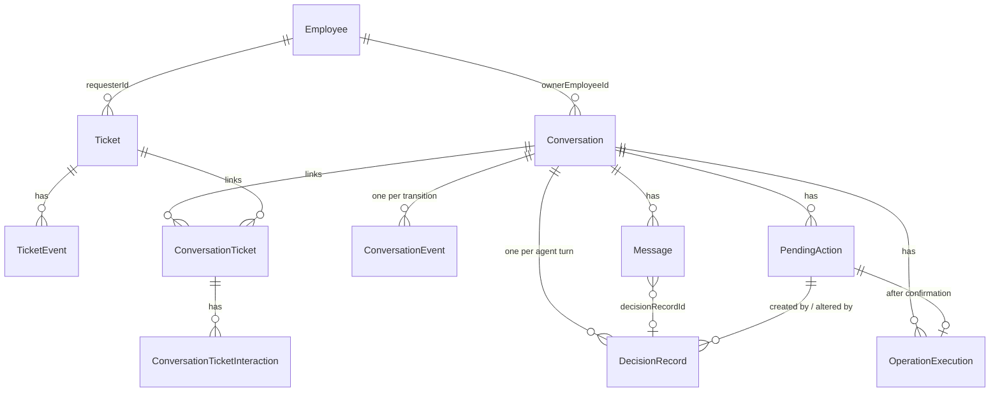
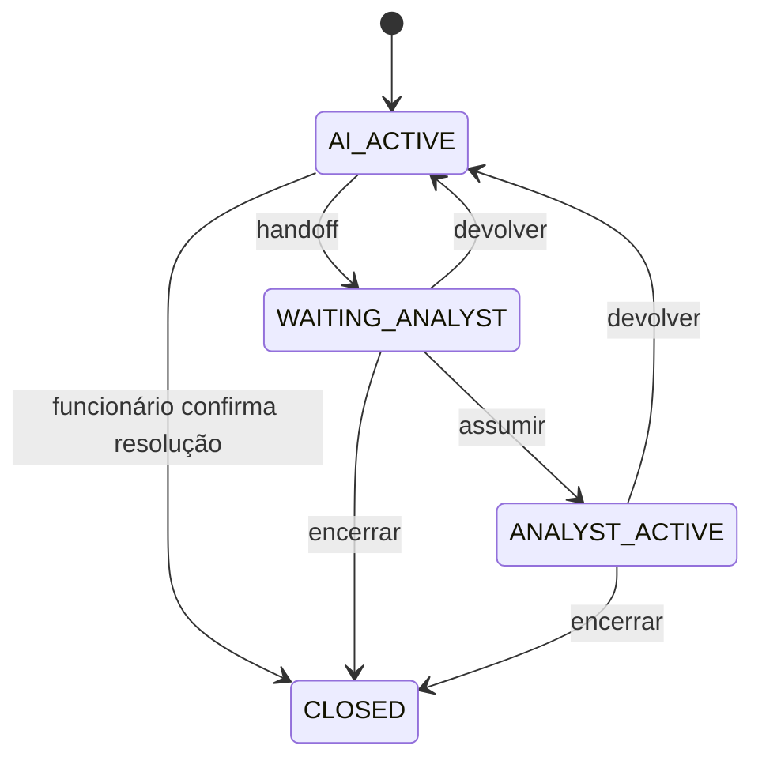
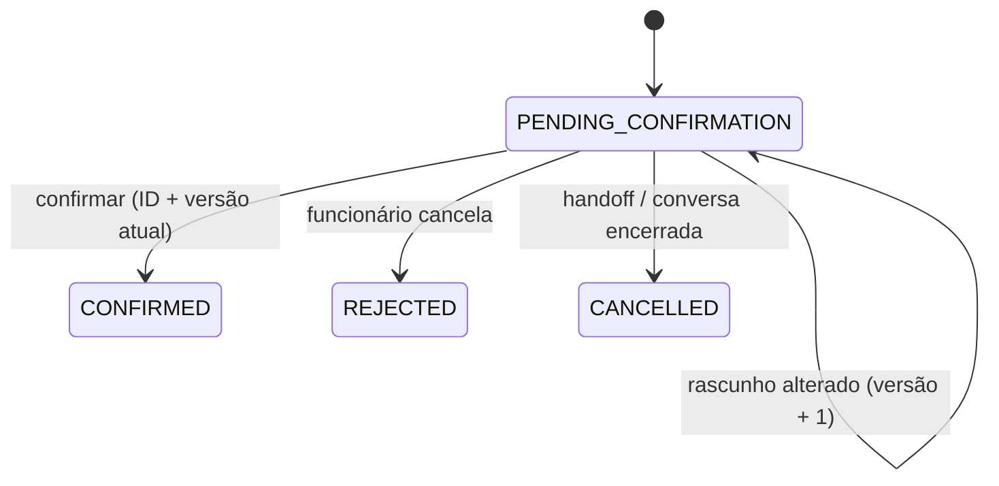
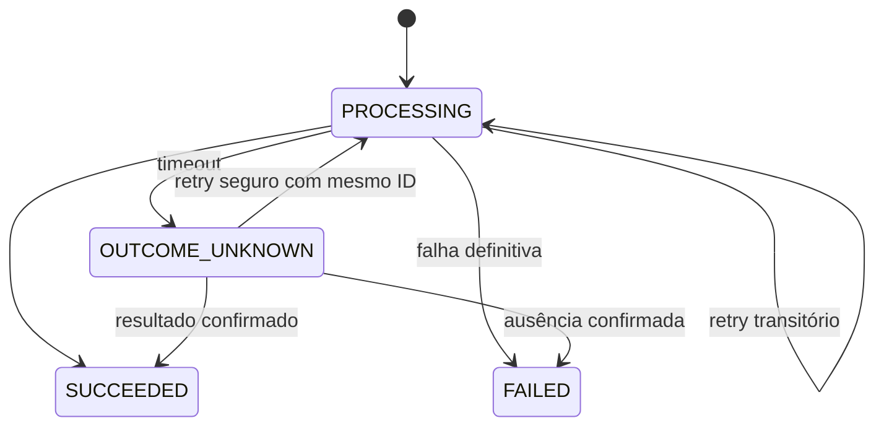

# 01 — Domain Model

> Artefato do Bloco 1, derivado do `README.md` v2.2 (seções 4, 6, 7, 8 e 9). **Nenhuma decisão nova** é introduzida aqui. O README é a fonte da verdade; se este documento divergir dele, o README prevalece.
>
> Estado: documentação arquitetural. Nenhum código funcional foi produzido.

## 0. Como ler este documento

### 0.1 Classificação das afirmações

Cada regra é rotulada pela sua natureza, conforme a convenção do README (Convenções; §14):

| Rótulo | Significado |
| --- | --- |
| **[PRD]** | Regra vinda do PRD (Anexo A e requisitos). Exigência externa. |
| **[Premissa]** | Decisão do projeto para compatibilizar ou completar o PRD. README a chama de "premissa de interpretação". Não é exigência do PRD. |
| **[ADR]** | Decisão arquitetural aceita (README §11, ADR-001 a ADR-007). |
| **[Contrato]** | Contrato conceitual do README: nomes, campos e regras. Os tipos finais nascem no código. |
| **PENDENTE (Bloco X)** | Lacuna conhecida cujo bloco de resolução o README indica. |

Quando o README não rotula a origem de uma regra, este documento cita apenas a seção e usa **[Contrato]**. Não se atribui origem PRD sem que o README o faça.

### 0.2 Convenções

Prosa em português; identificadores, tipos e valores de enum em inglês. As referências `§N.N` apontam para seções do `README.md`.

---

## 1. Visão geral do domínio

O sistema é um agent de atendimento do service desk de TI. A tese central é: **o LLM interpreta e propõe; o código decide e executa** (§1, ADR-001).

O domínio tem dois donos arquiteturais (§4.1, §5). A coluna "Dono" é contexto arquitetural; nenhuma regra de negócio depende de onde a entidade mora (§4.1).

- **ticket-service:** `Employee`, `Ticket`, `TicketEvent`, `TicketAccessLog`.
- **web:** `KnowledgeArticle`, `Conversation`, `ConversationEvent`, `Message`, `PendingAction`, `OperationExecution`, `DecisionRecord`, `ConversationTicket`, `ConversationTicketInteraction`.

Quatro ciclos de estado independentes (§7, ADR-006): conversa, interação, ação pendente e execução de operação.

Três registros separados por acontecerem em momentos diferentes (§6): `DecisionRecord` (decisão de um turno do agent), `PendingAction` (autorização do funcionário) e `OperationExecution` (execução técnica).

---

## 2. Entidades e responsabilidades

Fonte: §4.1.

| Entidade | Dono | Responsabilidade | Origem |
| --- | --- | --- | --- |
| `Employee` | ticket-service | Identidade demonstrativa e papel | §4.1, §4.2 |
| `Ticket` | ticket-service | Dados e ciclo de vida do chamado | §4.1, §4.3 |
| `TicketEvent` | ticket-service | **Histórico oficial** do chamado (alterações) | §4.1, §4.8 |
| `TicketAccessLog` | ticket-service | Auditoria de consultas feitas pelo console | §4.1, §8 |
| `KnowledgeArticle` | web (módulo de conhecimento) | Conteúdo da central de ajuda, em JSON | §4.1, §4.8 |
| `Conversation` | web | Controle do atendimento e contexto da interação | §4.1, §4.6 |
| `ConversationEvent` | web | **Histórico oficial** das transições da conversa (ator, horário, motivo) | §4.1, §4.6 |
| `Message` | web | Histórico conversacional, com vínculo à decisão e aos cards | §4.1, §4.8 |
| `PendingAction` | web | **Autorização** do funcionário | §4.1, §6 |
| `OperationExecution` | web | **Execução técnica** de uma operação no ticket-service | §4.1, §6 |
| `DecisionRecord` | web | Interpretação e política de um turno do agent | §4.1, §6 |
| `ConversationTicket` | web | Relacionamento N:N conversa–chamado | §4.1, §4.7 |
| `ConversationTicketInteraction` | web | Como o chamado participou da conversa | §4.1, §4.7 |

Fontes da verdade (§7D): autorização = `PendingAction`; execução = `OperationExecution`, conciliada com o ticket-service; histórico oficial do chamado = `TicketEvent` (§4.7); histórico oficial da conversa = `ConversationEvent`; rascunho apresentado = `PendingAction` (§4.6).

---

## 3. Atributos e contratos conceituais

Os blocos a seguir reproduzem os contratos do README. São **contratos conceituais** (Convenções): definem nomes, campos e regras, não tipos finais.

### 3.1 Employee (§4.2)

```ts
type EmployeeRole = "EMPLOYEE" | "ANALYST";

interface Employee {
  id: string;
  name: string;
  email: string;        // e-mail corporativo, usado no login
  department: string;   // ex.: "Financeiro" (Tela 4)
  role: EmployeeRole;
}
```

- Distinção N1/N2 **não** é modelada: o PRD não define regras diferentes entre os níveis (§3, "Fora").
- Autenticação simulada, com qualquer senha para funcionários do seed (§3, §8). Identidade e papel são estabelecidos no servidor a partir da sessão e nunca vêm de parâmetros fornecidos pelo LLM (§8).

### 3.2 Ticket (§4.3)

```ts
type TicketType = "INC" | "REQ";
type TicketCategory = "ACCESS" | "NETWORK_VPN" | "HARDWARE" | "SOFTWARE" | "EMAIL" | "OTHER";
type Priority = "CRITICAL" | "HIGH" | "MEDIUM" | "LOW";

interface Ticket {
  id: string;                         // gerado pelo ticket-service: "INC-20311", "REQ-10442"
  version: number;                    // incrementada pelo ticket-service a cada alteração
  type: TicketType;                   // fonte da verdade do tipo; o prefixo do id é só apresentação
  title: string;
  description: string;
  category: TicketCategory;
  priority: Priority;
  status: TicketStatus;               // PENDENTE (Bloco 2): máquina de estados
  requesterId: string;                // quem abriu — base da privacidade
  impactAssessment: ImpactAssessment; // value object embutido
  assignedTo?: string;                // Employee com role ANALYST; não preenchido automaticamente no handoff
  createdAt: string;
  updatedAt: string;
  // PENDENTE (Bloco 2): prazos (ex.: firstResponseDueAt, nextUpdateDueAt)
}
```

Regras e observações:

- Tipos e categorias do service desk são regras **[PRD]** (Anexo A, §2). Os valores de enum em inglês são **[Contrato]**.
- O formato de 5 dígitos do `id` segue exemplos do PRD e **não é invariante** (§4.3).
- **Vencido é calculado** (prazo x relógio), nunca persistido como status (§2, §4.3).
- **Atualização acrescenta** informação; não substitui silenciosamente a descrição original (§4.3).
- `requesterId` vem da sessão, nunca do rascunho; `assignedTo` não é escolhido na abertura (§4.3).
- `Ticket.assignedTo` (quem atende o chamado) é distinto de `Conversation.assignedAnalystId` (quem atende a conversa) (§4.6, §9).
- A máquina de estados de `TicketStatus` é **[Premissa]** a ser proposta no Bloco 2. O PRD só dá exemplos: Aguardando analista, Em andamento, Aprovado, Resolvido (§4.3).
- Prazos por prioridade são **[PRD]** (§2): Crítica 1 hora; Alta 4 horas úteis; Média 3 dias úteis; Baixa 5 dias úteis, para a primeira resposta e para cada atualização.

PENDENTE (Bloco 2): `TicketStatus` e transições válidas (§12 #1); campos de prazo do chamado e calendário de SLA (§12 #3); critério de "mesmo problema" para duplicidade (§12 #2).

### 3.3 TicketDraft (payload da PendingAction) (§4.3)

União discriminada; cada operação tem seus próprios campos obrigatórios.

```ts
type TicketDraft = CreateTicketDraft | UpdateTicketDraft | ReopenTicketDraft;

interface CreateTicketDraft {
  operation: "CREATE_TICKET";
  title: string;
  description: string;
  type: TicketType;
  category: TicketCategory;
  impactAssessment: ImpactAssessment;
  priority: Priority;            // calculada pelo ticket-service, nunca pelo LLM
  firstResponseDueAt: string;    // previsão calculada pelo ticket-service, para exibição
}

interface UpdateTicketDraft {
  operation: "UPDATE_TICKET";
  ticketId: string;
  expectedTicketVersion: number;
  additionalInformation: string;
}

interface ReopenTicketDraft {
  operation: "REOPEN_TICKET";
  ticketId: string;
  expectedTicketVersion: number;
  reason: string;
  additionalInformation?: string;
}
```

Regras:

- O funcionário confirma **exatamente** a prioridade e o prazo exibidos no card. O ticket-service **revalida** antes de criar; se o resultado mudou, nova proposta é apresentada (§4.3).
- Se `expectedTicketVersion` não bate com a versão atual do chamado, a operação é rejeitada como desatualizada e o agent consulta de novo antes de propor (§4.3).
- Resolvido há até 7 dias pode ser reaberto **[PRD]** (§2).
- Abertura exige título, descrição, tipo, categoria, prioridade e afetados; fluxo rascunho, confirmação, criação **[PRD]** (§2).

### 3.4 ImpactAssessment e ImpactAssessmentDraft (§4.4)

```ts
type AffectedScope  = "SELF" | "TEAM" | "COMPANY" | "UNKNOWN";
type WorkImpact     = "BLOCKED" | "DEGRADED_WITH_WORKAROUND" | "NONE";
type CommitmentRisk = "YES" | "NO" | "UNKNOWN" | "NOT_ASKED";

interface ImpactAssessment {
  affectedScope: AffectedScope;   // alcance
  workImpact: WorkImpact;         // impacto no trabalho
  commitmentRisk: CommitmentRisk; // urgência: compromisso em risco hoje
}

type ImpactAssessmentDraft = Partial<ImpactAssessment>; // em construção
```

Ver §5 (Value Objects) para semântica completa.

### 3.5 Conversation e InteractionContext (§4.6)

```ts
type ConversationStatus = "AI_ACTIVE" | "WAITING_ANALYST" | "ANALYST_ACTIVE" | "CLOSED";

interface Conversation {
  id: string;
  ownerEmployeeId: string;
  status: ConversationStatus;
  assignedAnalystId?: string;                // presente somente em ANALYST_ACTIVE
  interactionContext: InteractionContext;    // §7B, persistido
  resolutionSource?: "AGENT" | "ANALYST";    // presente somente em CLOSED
  createdAt: string;
  updatedAt: string;
}

type InteractionFlow  = "NONE" | "CREATE_TICKET" | "UPDATE_TICKET" | "REOPEN_TICKET" | "TICKET_LOOKUP";
type InteractionStage = "IDLE" | "COLLECTING_DETAILS" | "SELECTING_TICKET" | "READY_TO_PROPOSE";

interface InteractionContext {
  flow: InteractionFlow;
  stage: InteractionStage;
  targetTicketId?: string;
  collectedData?: {
    title?: string; description?: string; type?: TicketType; category?: TicketCategory;
    impactAssessment?: ImpactAssessmentDraft;
    additionalInformation?: string; reason?: string;
  };
}
```

Regras:

- Quem encerrou e quando ficam no `ConversationEvent` do tipo `CLOSED`; **não duplicados** na conversa (§4.6).
- `resolutionSource: "AGENT"` alimenta a tag "Resolvida pelo agent" do console (§4.6).
- `PendingAction` é a fonte da verdade do rascunho apresentado; o contexto **não duplica** o status dela (§4.6).
- Ao devolver a conversa ao agent, o contexto volta para `NONE` / `IDLE`. Mensagens, histórico e resumo do analista são preservados; o agent consulta os dados de novo antes de propor qualquer coisa (§4.6, §7A).
- O `InteractionContext` não muda o controle da conversa (§7B). O histórico persistido é a fonte da verdade; a memória do LLM não é (§7B).

### 3.6 ConversationEvent (§4.6)

```ts
type ConversationEventType = "HANDOFF" | "ANALYST_ASSIGNED" | "RETURNED_TO_AGENT" | "CLOSED";
type ConversationEventReason = "NO_HUMAN_ACTION_NEEDED" | "NEEDS_AGENT_FOLLOW_UP" | "MISROUTED" | "OTHER";

interface ConversationEvent {
  id: string;
  conversationId: string;
  type: ConversationEventType;
  actorId: string;                      // funcionário, analista ou "SYSTEM"
  fromStatus: ConversationStatus;
  toStatus: ConversationStatus;
  occurredAt: string;
  reasonCode?: ConversationEventReason; // obrigatório em RETURNED_TO_AGENT
  notes?: string;
}
```

- Gravado em **toda transição** da §7A. A devolução ao agent registra motivo tanto a partir de `WAITING_ANALYST` quanto de `ANALYST_ACTIVE` (§4.6).

### 3.7 ConversationTicket e ConversationTicketInteraction (§4.7)

```ts
interface ConversationTicket {
  conversationId: string;  // (conversationId, ticketId) é único
  ticketId: string;
  linkedAt: string;        // primeira interação efetiva; nunca atualizado
}

type ConversationTicketInteractionType = "CREATED" | "UPDATED" | "REOPENED" | "VIEWED" | "HANDED_OFF";

interface ConversationTicketInteraction {
  id: string;
  conversationId: string;
  ticketId: string;
  type: ConversationTicketInteractionType;
  operationExecutionId?: string; // referência para idempotência do registro
  occurredAt: string;
}
```

Momento do registro de cada interação (§4.7):

| Interação | Quando registrar |
| --- | --- |
| `CREATED` | Após `OperationExecution` `CREATE_TICKET` em `SUCCEEDED` |
| `UPDATED` | Após `UPDATE_TICKET` em `SUCCEEDED` |
| `REOPENED` | Após `REOPEN_TICKET` em `SUCCEEDED` |
| `VIEWED` | Após consulta **detalhada e bem-sucedida** de um chamado específico |
| `HANDED_OFF` | Após `TRANSFER_TICKET` em `SUCCEEDED` |

- A associação nasce na **primeira interação efetiva**. Aparecer numa lista de resultados **não** cria associação (§4.7).
- `HANDED_OFF` só para chamados efetivamente encaminhados (por padrão, o chamado em foco). A transferência **da conversa** é registrada em `ConversationEvent` (§4.7).
- O registro é **idempotente** pelo `operationExecutionId`: retries não duplicam interações (§4.7).

### 3.8 Message (§4.8)

```ts
type MessageAuthor =
  | { type: "EMPLOYEE"; employeeId: string }
  | { type: "ANALYST"; employeeId: string }
  | { type: "AGENT" }
  | { type: "SYSTEM" };

type MessageAttachmentKind = "PENDING_ACTION" | "TICKET" | "TICKET_SELECTOR" | "QUICK_REPLIES";

interface MessageAttachment { kind: MessageAttachmentKind; refId: string; }

interface Message {
  id: string;
  conversationId: string;
  author: MessageAuthor;
  content: string;
  decisionRecordId?: string;       // só em mensagens do agent
  attachments: MessageAttachment[]; // ordem preservada
  createdAt: string;
}
```

- A mensagem guarda **referências** aos cards, não cópias de dados (§4.8).
- Toda referência aponta para um recurso persistido ou snapshot recuperável. `QUICK_REPLIES` precisa reconstruir **exatamente** as opções oferecidas, mesmo após reinício. PENDENTE (Bloco 6): onde o snapshot das opções é armazenado (§4.8, §12 #14).

### 3.9 TicketEvent (§4.8)

```ts
interface TicketEvent {
  id: string;
  ticketId: string;
  type: "CREATED" | "UPDATED" | "REOPENED" | "TRANSFERRED" | "ASSIGNED" | "STATUS_CHANGED";
  actor: { type: "EMPLOYEE" | "ANALYST" | "SYSTEM"; employeeId?: string };
  summary: string;
  changes: Array<{ field: string; previousValue?: unknown; newValue?: unknown }>;
  occurredAt: string;
}
```

- Histórico oficial de alterações. PENDENTE (Bloco 2): lista final de tipos, conforme as operações implementadas (§4.8, §12 #4).

### 3.10 TicketAccessLog (§4.1, §8)

Campos documentados em §8: `analystId`, `ticketId`, `occurredAt`, `origin: CONSOLE`.

- Cada consulta de analista pelo console gera um `TicketAccessLog`. **Não é `TicketEvent`:** consultar não altera o chamado (§8).
- O README não define `id` nem outros atributos além dos quatro citados. Ver seção 11.2.

### 3.11 KnowledgeArticle (§4.8)

```ts
interface KnowledgeArticle {
  id: string;
  title: string;
  content: string;
  category?: TicketCategory;
  keywords: string[];
  applicability?: { operatingSystems?: string[] };
}
```

- `applicability` impede aplicar, por exemplo, o artigo de VPN do Windows 10 a quem usa Windows 11 (§4.8, §10).
- Busca lexical, sem embeddings (ADR-003, §3).

### 3.12 DecisionRecord (§6)

```ts
type Intent =
  | "ANSWER_KB" | "LIST_MY_TICKETS" | "CREATE_TICKET" | "UPDATE_TICKET"
  | "HANDOFF" | "CLOSE_CONVERSATION" | "OUT_OF_SCOPE" | "CLARIFY";

type PolicyOutcome =
  | "ANSWER" | "ASK" | "PROPOSE_ACTION" | "HANDOFF" | "DENY" | "REDIRECT"
  | "REQUEST_RESOLUTION_CONFIRMATION";

interface DecisionRecord {            // um por turno do agent
  id: string;
  conversationId: string;
  interpretation: {
    intent: Intent;
    confidence: "LOW" | "MEDIUM" | "HIGH";   // sinal auxiliar, NÃO probabilidade
    entities: {
      problem?: string; category?: TicketCategory;
      operatingSystem?: string; impact?: ImpactAssessmentDraft;
    };
    missingFields: MissingField[];
  };
  policy: { outcome: PolicyOutcome; reasonCode: PolicyReasonCode; appliedRules: string[] };
  evidence: Array<{ type: "ARTICLE" | "TICKET" | "BUSINESS_RULE"; referenceId: string }>;
  toolExecutions: Array<{ name: string; status: "SUCCESS" | "FAILED"; durationMs: number }>;
  pendingActionId?: string;            // ação criada OU alterada neste turno
}
```

Regras:

- Três camadas por resposta: **interpretação** (o que o modelo entendeu), **política** (o que o sistema permite), **execução** (o que realmente aconteceu) (§6).
- O **backend monta** `toolExecutions` a partir do que de fato rodou. O modelo não declara sucesso de nada (§6).
- A **confiança declarada não autoriza nenhuma operação**; serve como um dos sinais para encaminhar ao analista (§6).
- **Não se expõe o raciocínio interno do modelo**; expõem-se evidências, regras e ações (§6).
- `appliedRules` usa IDs estáveis (ex.: `SD-PRIORITY-001`). PENDENTE (Bloco 4): catálogo definido conforme as regras forem implementadas (§4.11, §12 #10).

### 3.13 PendingAction (§6)

```ts
type PendingActionType = "CREATE_TICKET" | "UPDATE_TICKET" | "REOPEN_TICKET";
type PendingActionStatus = "PENDING_CONFIRMATION" | "CONFIRMED" | "REJECTED" | "CANCELLED";

interface PendingAction {
  id: string;
  conversationId: string;
  createdByDecisionRecordId: string; // as decisões seguintes apontam via DecisionRecord.pendingActionId
  type: PendingActionType;
  version: number;                   // começa em 1; incrementa conforme §4.3
  payload: TicketDraft;
  status: PendingActionStatus;       // §7C
  cancellationReason?: "HANDOFF" | "CONVERSATION_CLOSED";
}
```

O que incrementa `version` (§4.3):

| Alteração | Incrementa? |
| --- | --- |
| Título, descrição, tipo, categoria | Sim |
| Avaliação de impacto, prioridade ou prazo calculados | Sim |
| Chamado-alvo, informação adicional, motivo de reabertura | Sim |
| Apenas formatação do texto | Não |
| Nova mensagem sem alteração do rascunho | Não |

### 3.14 OperationExecution (§6, §9)

```ts
type OperationType = "CREATE_TICKET" | "UPDATE_TICKET" | "REOPEN_TICKET" | "TRANSFER_TICKET";
type OperationExecutionStatus = "PROCESSING" | "SUCCEEDED" | "FAILED" | "OUTCOME_UNKNOWN";

interface OperationExecution {
  id: string;                // = chave de idempotência; gerado e persistido ANTES da chamada
  conversationId: string;
  pendingActionId?: string;  // ausente em TRANSFER_TICKET originado por handoff
  operation: OperationType;
  status: OperationExecutionStatus; // §7D
  ticketId?: string;
  attempts: number;          // tentativas técnicas da MESMA operação
}
```

- Toda tentativa da mesma operação reutiliza o **mesmo** `id` (`attempts + 1`) (§7D, §9).
- Nova operação de negócio = novo `id`. Repetição técnica = mesmo `id` (§9).
- `PendingActionType` não inclui `TRANSFER_TICKET`; `OperationType` inclui (§6).

### 3.15 Catálogos de códigos (§4.11)

Códigos operacionais são **tipados e estáveis**; o texto exibido na UI é separado (§4.11).

```ts
type MissingField =
  | "TITLE" | "DESCRIPTION" | "TYPE" | "CATEGORY" | "AFFECTED_SCOPE" | "WORK_IMPACT"
  | "COMMITMENT_RISK" | "TARGET_TICKET" | "ADDITIONAL_INFORMATION" | "REOPEN_REASON";

type PriorityReasonCode =  // por que esta prioridade (classifyPriority)
  | "TEAM_OR_COMPANY_BLOCKED" | "SELF_BLOCKED" | "AFFECTED_SCOPE_UNKNOWN"
  | "COMMITMENT_AT_RISK_TODAY" | "WORKAROUND_AVAILABLE" | "NO_WORK_IMPACT"
  | "WORK_IMPACT_MISSING" | "AFFECTED_SCOPE_MISSING" | "COMMITMENT_RISK_MISSING";

type PolicyReasonCode =    // por que esta ação (política)
  | "USER_REQUESTED_HANDOFF" | "CRITICAL_IMPACT" | "OVERDUE_TICKET" | "LOW_CONFIDENCE"
  | "TOOL_FAILURE" | "OUT_OF_SCOPE" | "INSUFFICIENT_INFORMATION" | "USER_CONFIRMED_RESOLUTION";
```

- `PriorityReasonCode` e `PolicyReasonCode` são **catálogos distintos** (§4.11).

---

## 4. Funções de domínio: classifyPriority (ADR-007)

Fonte: §4.5. Regra do **ticket-service** (dono das regras de chamado); o web não tem cópia e obtém o resultado por **leitura** (§4.5, §6).

```ts
type PriorityClassification =
  | { status: "CLASSIFIED"; priority: Priority; reasonCode: PriorityReasonCode }
  | { status: "NEEDS_CLARIFICATION"; missingFields: MissingField[]; reasonCode: PriorityReasonCode };

function classifyPriority(assessment: ImpactAssessmentDraft): PriorityClassification;
```

`classifyPriority` é uma **função total** (devolve resultado para qualquer entrada, inclusive incompleta). **A primeira regra que casa vence:**

| # | Condição | Resultado | `reasonCode` |
| --- | --- | --- | --- |
| 0 | `workImpact` ausente | `NEEDS_CLARIFICATION` | `WORK_IMPACT_MISSING` |
| 1 | `BLOCKED` + `affectedScope` ausente | `NEEDS_CLARIFICATION` | `AFFECTED_SCOPE_MISSING` |
| 2 | `BLOCKED` + `TEAM` ou `COMPANY` | `CRITICAL` | `TEAM_OR_COMPANY_BLOCKED` |
| 3 | `BLOCKED` + `SELF` | `HIGH` | `SELF_BLOCKED` |
| 4 | `BLOCKED` + `UNKNOWN` | `HIGH` | `AFFECTED_SCOPE_UNKNOWN` |
| 5 | `commitmentRisk` ausente | `NEEDS_CLARIFICATION` | `COMMITMENT_RISK_MISSING` |
| 6 | `commitmentRisk = YES` | `HIGH` | `COMMITMENT_AT_RISK_TODAY` |
| 7 | `DEGRADED_WITH_WORKAROUND` | `MEDIUM` | `WORKAROUND_AVAILABLE` |
| 8 | `NONE` | `LOW` | `NO_WORK_IMPACT` |

Regras associadas:

- **Regra 4 [Premissa]:** "Não sei" + bloqueado vira Alta, prioridade do **impacto mínimo conhecido**. Não afirma que o caso não possa ser crítico; `AFFECTED_SCOPE_UNKNOWN` fica visível ao analista. **Não** gera handoff automático nem repete a pergunta (§4.5).
- Com `BLOCKED`, a pergunta sobre compromisso é dispensada; o chamado grava `commitmentRisk: NOT_ASKED` (§4.5).
- `commitmentRisk = UNKNOWN` ou `NO` não eleva a prioridade e segue para as regras 7 e 8. **[Premissa] conservadora:** com risco desconhecido, usa-se o impacto conhecido sem presumir urgência adicional; a incerteza fica registrada e visível (§4.5).
- Fora de `BLOCKED`, o alcance não altera a prioridade, mas continua **obrigatório para abrir o chamado** (completude do rascunho difere de classificação) (§4.5).
- `NEEDS_CLARIFICATION` **não é uma prioridade**; é um resultado discriminado (§4.5).
- Coberta por testes de tabela com todas as combinações (§4.5, §10).
- O LLM nunca escolhe a prioridade nem o prazo (§4.10 #3).

---

## 5. Value Objects

| Value Object | Definição | Origem |
| --- | --- | --- |
| `ImpactAssessment` | `affectedScope`, `workImpact`, `commitmentRisk`. Sem id, sem repositório próprio; vive dentro do `Ticket` (snapshot usado na classificação) | §4.3, §4.4 |
| `ImpactAssessmentDraft` | `Partial<ImpactAssessment>`: o que existe durante a conversa | §4.4 |
| `TicketDraft` (e variantes) | Payload da `PendingAction`; união discriminada por `operation` | §4.3 |
| `InteractionContext` | Estrutura embutida e persistida na `Conversation` | §4.6 |
| `MessageAuthor`, `MessageAttachment` | Estruturas embutidas na `Message` | §4.8 |
| `PriorityClassification` | Resultado discriminado de `classifyPriority` (`CLASSIFIED` ou `NEEDS_CLARIFICATION`) | §4.5 |

Observação: o README declara explicitamente como value object apenas `ImpactAssessment` (§4.4: "Value object: sem id, sem repositório próprio"). A classificação dos demais itens da tabela como value objects é a leitura estrutural deste documento (estruturas embutidas sem identidade própria nos contratos); não é declaração textual do README.

### 5.1 Semântica de ImpactAssessment (§4.4)

| Representação | Significado |
| --- | --- |
| Campo ausente (só no rascunho) | Ainda não coletado |
| `UNKNOWN` | Perguntado; o funcionário respondeu "Não sei" |
| `NOT_ASKED` | Não foi necessário perguntar para classificar |
| `YES` / `NO` | Resposta explícita |

- **Enums em vez de booleanos e `null`**, para tornar combinações contraditórias de `workImpact` não representáveis e evitar interpretações diferentes de `null`/`undefined`/`false` entre TypeScript, JSON e SQLite (§4.4).
- `NOT_ASKED` só é válido com `workImpact: BLOCKED`. **O tipo ainda permite a combinação inválida**; a regra é garantida por **validação de domínio obrigatória** (ex.: Zod `.superRefine()`). Evoluir para união discriminada é alternativa registrada, sem decisão (§4.4).
- **`UNKNOWN` difere de `NO`.** Podem produzir a mesma prioridade, mas não são a mesma informação: `UNKNOWN` continua gravado e visível no card e no painel do analista (§4.4).
- **Tipo e impacto são dimensões diferentes.** `workImpact` não decide INC x REQ (§4.4):

| Pedido | Tipo | `workImpact` |
| --- | --- | --- |
| Notebook parou | INC | `BLOCKED` |
| VPN instável, com alternativa | INC | `DEGRADED_WITH_WORKAROUND` |
| Solicitar mouse | REQ | `NONE` |
| Acesso a sistema necessário para trabalhar hoje | REQ | `BLOCKED` |

- A identificação individual dos afetados está fora de escopo: o protótipo pergunta o **alcance** ("Só eu / Minha equipe / Toda a empresa / Não sei") (§3).

---

## 6. Relacionamentos e cardinalidades

Fonte: §4.9, completada por §4.6, §4.7, §6 e §9.



| Relacionamento | Cardinalidade | Observação | Origem |
| --- | --- | --- | --- |
| `Employee` → `Ticket` (solicitante) | 1:N | `Ticket.requesterId` | §4.9 |
| `Ticket` → `TicketEvent` | 1:N | | §4.9 |
| `Employee` → `Conversation` | 1:N | `Conversation.ownerEmployeeId` | §4.9 |
| `Conversation` → `Message` | 1:N | | §4.9 |
| `Conversation` → `ConversationEvent` | 1:N | Uma por transição | §4.9 |
| `Conversation` → `DecisionRecord` | 1:N | Um por turno do agent | §4.9 |
| `Message` → `DecisionRecord` | N:0..1 | Mensagens do agent apontam para a decisão do turno | §4.9 |
| `Conversation` → `PendingAction` | 1:N | Histórico; **no máximo uma** em `PENDING_CONFIRMATION` | §4.9 |
| `PendingAction` → `DecisionRecord` | 1:N | `createdByDecisionRecordId` = a que criou; as seguintes apontam via `pendingActionId` | §4.9, §6 |
| `PendingAction` → `OperationExecution` | 1:0..1 | Só existe execução após confirmação | §4.9 |
| `Conversation` → `OperationExecution` | 1:N | Toda operação nasce de um atendimento | §4.9 |
| `OperationExecution` sem `PendingAction` | permitido | Ex.: `TRANSFER_TICKET` originado por handoff | §4.9, §6 |
| `Conversation` ↔ `Ticket` | N:N | Via `ConversationTicket`, chave composta `(conversationId, ticketId)` única | §4.7, §4.9 |
| `ConversationTicket` → `ConversationTicketInteraction` | 1:N | | §4.9 |

Relacionamentos adicionais derivados de campos dos contratos (sem cardinalidade explícita em §4.9):

| Referência | Campo | Origem |
| --- | --- | --- |
| `Ticket` → `Employee` (analista responsável pelo chamado) | `Ticket.assignedTo?` | §4.3 |
| `Conversation` → `Employee` (analista que atende a conversa) | `Conversation.assignedAnalystId?` | §4.6 |
| `Message` → `Employee` (autor) | `MessageAuthor.employeeId` | §4.8 |
| `Message` → recurso referenciado | `MessageAttachment.refId` | §4.8 |
| `OperationExecution` → `Ticket` | `OperationExecution.ticketId?` | §6 |
| `ConversationTicketInteraction` → `OperationExecution` | `operationExecutionId?` | §4.7 |
| `TicketAccessLog` → `Employee` (analista), `Ticket` | `analystId`, `ticketId` | §8 |
| `DecisionRecord.evidence` → `KnowledgeArticle`, `Ticket` ou regra | `referenceId` | §6 |

---

## 7. Invariantes

Fonte: §4.10 (numeração preservada), complementada por regras explícitas de §7, §8 e §9. Cada item indica o rótulo de origem quando o README o dá.

### 7.1 Invariantes oficiais (§4.10)

| # | Invariante | Rótulo / origem complementar |
| --- | --- | --- |
| 1 | Um funcionário **nunca** consulta chamados de outro funcionário. | **[PRD]** privacidade (§2); §8 |
| 2 | Um analista pode consultar chamados pelo console, e **todo acesso gera `TicketAccessLog`**. | **[Premissa]** de interpretação da privacidade como proteção entre funcionários (§8); ADR-004 |
| 3 | O LLM nunca escolhe a prioridade nem o prazo; ambos vêm do domínio. | **[ADR]** ADR-001, ADR-007; §4.3, §6 |
| 4 | Uma classificação sem informações suficientes retorna `NEEDS_CLARIFICATION`. | **[ADR]** ADR-007; §4.5 |
| 5 | Nenhuma escrita no ticket-service sem `PendingAction` confirmada, exceto `TRANSFER_TICKET` dentro de um handoff efetivado pelo backend. | **[ADR]** ADR-001; §6 |
| 6 | Uma confirmação só vale para o **ID e a versão atuais** da ação pendente. | §7C |
| 7 | No máximo **uma** ação em `PENDING_CONFIRMATION` por conversa. | §4.9 |
| 8 | Um handoff efetivado **cancela** a ação pendente com motivo `HANDOFF`. | §7C, §9 |
| 9 | Nenhuma ação `CANCELLED` ou `REJECTED` pode ser confirmada. | §7C |
| 10 | Toda operação que possa sofrer retry tem **identidade própria persistida antes da execução**. | **[ADR]** ADR-005; §9 |
| 11 | **Nunca** se executa uma nova operação com outra chave enquanto o resultado da anterior for desconhecido. | ADR-005; §9 |
| 12 | Nenhuma nova escrita começa na conversa enquanto houver `OperationExecution` não terminal. | §9 (tabela de concorrência) |
| 13 | Uma conversa **não pode ser encerrada** com `OperationExecution` em `PROCESSING` ou `OUTCOME_UNKNOWN`. | §7A, §9 |
| 14 | O agent só é executado em conversas `AI_ACTIVE`. | **[PRD]** "Agent não responde enquanto a conversa está com analista" (§2); §7A |
| 15 | `CLOSED` é terminal. | §3 ("Reabrir conversa encerrada" fora), §7A |
| 16 | `commitmentRisk: NOT_ASKED` só existe com `workImpact: BLOCKED`. | §4.4; garantida por validação de domínio |

Observação sobre a invariante 11 e 12 em conjunto com o handoff: ver seção 12 (Contradições encontradas), item C1.

### 7.2 Regras de estrutura e consistência explícitas no README

| Regra | Origem |
| --- | --- |
| `Conversation.assignedAnalystId` presente somente em `ANALYST_ACTIVE` | §4.6 |
| `Conversation.resolutionSource` presente somente em `CLOSED` | §4.6 |
| `ConversationEvent.reasonCode` obrigatório em `RETURNED_TO_AGENT` | §4.6 |
| Toda transição da §7A grava um `ConversationEvent` | §4.6, §7A |
| `(conversationId, ticketId)` é único em `ConversationTicket`; `linkedAt` nunca é atualizado | §4.7 |
| Associação conversa–chamado nasce na primeira interação efetiva; listar resultados não associa | §4.7 |
| Registro de interação é idempotente por `operationExecutionId` | §4.7 |
| `requesterId` vem da sessão, nunca do rascunho; `assignedTo` não é escolhido na abertura | §4.3 |
| `Ticket.assignedTo` não é preenchido automaticamente no handoff nem ao assumir a conversa | §4.3, §9 |
| `Ticket.type` é a fonte da verdade do tipo; o prefixo do `id` é só apresentação | §4.3 |
| "Vencido" é calculado, nunca persistido como status | §4.3 |
| Atualização acrescenta informação; não substitui silenciosamente a descrição original | §4.3 |
| `expectedTicketVersion` divergente da versão atual rejeita a operação como desatualizada | §4.3 |
| `OperationExecution.id` é a chave de idempotência, gerado e persistido antes da chamada; tentativas reutilizam o mesmo `id` | §6, §9 |
| Ordem no ticket-service: (1) consultar chave; (2) se concluída, devolver resultado original; (3) verificar `expectedTicketVersion`; (4) executar; (5) persistir resultado | §9, ADR-005 |
| Falta de resposta não é `FAILED`; sem resultado após as tentativas permanece em `OUTCOME_UNKNOWN` | §7D |
| Falha definitiva: sem retry automático; corrigir e tentar de novo é nova `PendingAction` e nova `OperationExecution` | §7D |
| Confirmação com versão antiga é rejeitada; a UI mostra a versão atual | §7C |
| Se a conversa voltar ao agent após handoff, ele cria outra ação, com novo ID e versão 1 | §7C |
| Handoff cancela a ação na mesma transação local que muda a conversa para `WAITING_ANALYST` | §7C, §9 |
| Assumir `WAITING_ANALYST → ANALYST_ACTIVE` é atômico: dois analistas não assumem a mesma conversa | §7A |
| Backend verifica o estado antes de cada execução do agent; fora de `AI_ACTIVE` o LLM nem é chamado | §7A |
| Devolver ao agent limpa o contexto da interação (`NONE` / `IDLE`) | §4.6, §7A |
| `Message` guarda referências aos cards, não cópias | §4.8 |
| Encerramento por confirmação do funcionário não usa `PendingAction` nem `OperationExecution` | §6 |
| `PriorityReasonCode` e `PolicyReasonCode` são catálogos distintos | §4.11 |

### 7.3 Segurança e privacidade como regras do domínio (§8)

| Papel | Acesso a chamados | Rótulo |
| --- | --- | --- |
| `EMPLOYEE` | Somente os próprios (`requesterId`) | **[PRD]** privacidade |
| Agent | Somente os do funcionário autenticado na sessão | **[Contrato]** |
| `ANALYST` | Chamados de funcionários pelo console, **com auditoria** | **[Premissa]** de interpretação |

- Identidade vem da sessão. As tools não têm parâmetro `userId`; o backend injeta o usuário autenticado (§8).
- O ticket-service valida o solicitante em toda leitura e escrita de funcionário (defesa em profundidade) (§8).
- Autorização por papel: funcionário não acessa o console; só `ANALYST` assume, devolve ou encerra conversas (§8).
- Escopo: só TI; RH, financeiro e facilities são redirecionados **[PRD]** (§2).

---

## 8. Ciclos de vida e estados

Quatro ciclos independentes (§7, ADR-006).

### 8.1 Conversa (§7A)

| Estado | Agent responde? |
| --- | --- |
| `AI_ACTIVE` | Sim |
| `WAITING_ANALYST` | Não |
| `ANALYST_ACTIVE` | Não |
| `CLOSED` | Não (terminal) |



| Transição | Quem dispara | `ConversationEvent` |
| --- | --- | --- |
| `AI_ACTIVE → WAITING_ANALYST` | Backend, após aplicar a política de handoff | `HANDOFF` |
| `AI_ACTIVE → CLOSED` | Endpoint, após o funcionário confirmar na UI (`resolutionSource: AGENT`) | `CLOSED` |
| `WAITING_ANALYST → ANALYST_ACTIVE` | Analista (atômica) | `ANALYST_ASSIGNED` |
| `WAITING_ANALYST → AI_ACTIVE` | Analista, sem assumir | `RETURNED_TO_AGENT` (com motivo) |
| `WAITING_ANALYST → CLOSED` | Analista | `CLOSED` |
| `ANALYST_ACTIVE → AI_ACTIVE` | Analista responsável | `RETURNED_TO_AGENT` (com motivo) |
| `ANALYST_ACTIVE → CLOSED` | Analista responsável (`resolutionSource: ANALYST`) | `CLOSED` |

Regras do ciclo:

- Transferência quando o funcionário pede, em casos críticos, chamados vencidos ou quando o agent não tem segurança; leva resumo do caso **[PRD]** (§2).
- **Encerramento bloqueado** enquanto houver `OperationExecution` em `PROCESSING` ou `OUTCOME_UNKNOWN` (§7A, §9).
- **`CLOSED` é terminal.** Ao voltar outro dia (história 6), o funcionário inicia uma nova conversa; o agent tem acesso aos chamados dele e ao histórico persistido (§7A).
- Encerramento por inatividade: fora do MVP. PENDENTE (Bloco 6) (§7A, §12 #15).
- O README não mostra transição `WAITING_ANALYST → WAITING_ANALYST` nem `ANALYST_ACTIVE → ANALYST_ACTIVE`. Nenhuma transição fora da tabela acima existe.

### 8.2 Interação (§7B)

- Estrutura em `InteractionContext` (§3.5), **persistida** na `Conversation`.
- **Não muda** o controle da conversa. O histórico persistido é a fonte da verdade; a memória do LLM não é.
- Valores de `flow` e `stage` estão definidos; o README **não define** as transições válidas entre pares `(flow, stage)`. Ver seção 11.2.

### 8.3 Ação pendente (§7C)

| Estado | Significado | Terminal? |
| --- | --- | --- |
| `PENDING_CONFIRMATION` | Rascunho apresentado | Não |
| `CONFIRMED` | Funcionário autorizou | Sim |
| `REJECTED` | Funcionário recusou | Sim |
| `CANCELLED` | Cancelada pelo sistema (`HANDOFF` ou `CONVERSATION_CLOSED`) | Sim |



- PENDENTE (Bloco 5): `EXPIRED` e a validade do rascunho; comportamento de nova proposta com outra pendente aberta (decisão inicial do README: nova proposta exige concluir ou cancelar a anterior) (§7C, §12 #12).

### 8.4 Execução de operação (§7D)

| Estado | Significado | Terminal? |
| --- | --- | --- |
| `PROCESSING` | Chamada ao ticket-service em andamento | Não |
| `SUCCEEDED` | Concluída | Sim |
| `FAILED` | Falha **definitiva** confirmada | Sim |
| `OUTCOME_UNKNOWN` | Timeout ou erro ambíguo; precisa reconciliar | Não |



- Reconciliação: repetir a operação com o mesmo `id` já reconcilia (se executada, o serviço devolve o resultado guardado; se não, executa) (§9). PENDENTE (Bloco 3): endpoint específico de consulta pela chave (§9, §12 #7).
- PENDENTE (Bloco 3): timeout, backoff, limite de tentativas, classificação de erros transitórios x definitivos, recuperação após reinício (§7D, §12 #6).

### 8.5 Ticket (§4.3)

- Ciclo de vida de `Ticket.status`: **PENDENTE (Bloco 2)**, máquina de estados proposta como **[Premissa]** (§4.3, §12 #1). Este documento não define estados nem transições.
- `Ticket.version` é incrementada pelo ticket-service a cada alteração (§4.3).
- Reabertura permitida para chamado resolvido há até 7 dias **[PRD]** (§2).

### 8.6 Concorrência entre ciclos (§9)

| Situação | Comportamento |
| --- | --- |
| `PendingAction` não confirmada + handoff | Cancela a ação (`HANDOFF`) |
| `OperationExecution` em `PROCESSING` + handoff | Handoff permitido; a operação continua; o analista é informado |
| `OperationExecution` em `OUTCOME_UNKNOWN` + handoff | Handoff permitido; a reconciliação continua |
| `OperationExecution` não terminal + encerramento | **Encerramento bloqueado** |
| `OperationExecution` não terminal + nova proposta de escrita | Bloqueada até a operação terminar |

Depois da confirmação já existe autorização: uma operação remota não é cancelada porque o funcionário pediu um analista (§9).

### 8.7 Transferir conversa x transferir chamado (§9)

- **Transferir conversa** (web): muda para `WAITING_ANALYST`, pausa o agent e cancela a ação pendente, numa transação local; registra `ConversationEvent` `HANDOFF`.
- **Transferir chamado** (ticket-service): `OperationExecution` do tipo `TRANSFER_TICKET`, com resumo, sem `PendingAction`. Altera o status do chamado; **não** preenche `assignedTo` (o chamado vai para a fila).
- **Assumir a conversa** preenche `Conversation.assignedAnalystId`, **não** `Ticket.assignedTo`. Atribuir o chamado a um analista é operação explícita do ticket-service.
- O caso de uso de transferir conversa **orquestra** a transferência do chamado quando há chamado vinculado.
- **Não se assume atomicidade** entre os dois serviços.

### 8.8 Encerramento pelo funcionário (§6)

Não usa `PendingAction` nem `OperationExecution` (não há escrita no ticket-service). A decisão registra `REQUEST_RESOLUTION_CONFIRMATION`; a UI mostra "Sim, resolvido / Ainda não"; o endpoint valida o estado e encerra após o clique. O `ConversationEvent` registra o funcionário como ator; `resolutionSource: AGENT`.

---

## 9. Reavaliação das 13 lacunas da rodada anterior

Cada lacuna foi reverificada contra o README atual (v2.2).

| # | Lacuna anterior | Situação no README atual | Tratamento neste documento |
| --- | --- | --- | --- |
| 1 | `TicketDraft` sem campos e sem chamado-alvo em UPDATE/REOPEN | **Resolvida.** União discriminada com `ticketId`, `expectedTicketVersion`, `additionalInformation`, `reason` (§4.3) | Seção 3.3 |
| 2 | `DecisionRecord` x `PendingAction` quando a versão muda | **Parcialmente resolvida.** `createdByDecisionRecordId`, `DecisionRecord.pendingActionId` ("criada OU alterada") e cardinalidade 1:N (§4.9, §6). O README não registra qual `version` cada decisão produziu | Seção 3.12, 3.13. Resíduo em 11.2 (L1) |
| 3 | `commitmentAtRiskToday` quando `BLOCKED` dispensa a pergunta | **Resolvida.** `CommitmentRisk` enum com `NOT_ASKED`, restrito a `BLOCKED` (§4.4, §4.10 #16) | Seção 3.4, 5.1 |
| 4 | `classifyPriority` com `BLOCKED` + `affectedScope` ausente, e `UNKNOWN` + `BLOCKED` | **Resolvida.** Regras 1 e 4 (§4.5) | Seção 4 |
| 5 | Estrutura de `InteractionContext` | **Resolvida** (§4.6). Resíduo: transições `(flow, stage)` não definidas | Seção 3.5. Resíduo em 11.2 (L2) |
| 6 | Onde registrar a devolução ao agent | **Resolvida.** `ConversationEvent` `RETURNED_TO_AGENT` com `reasonCode` (§4.6, §7A) | Seção 3.6, 8.1 |
| 7 | Atributos de `Message`, `TicketEvent`, `KnowledgeArticle` | **Resolvida** (§4.8). Resíduos: lista final de tipos de `TicketEvent` (Bloco 2); snapshot de `QUICK_REPLIES` (Bloco 6) | Seções 3.8, 3.9, 3.11 |
| 8 | Encerramento pelo funcionário sem `PendingActionType` `CLOSE` | **Resolvida.** Sem `PendingAction`/`OperationExecution`; `REQUEST_RESOLUTION_CONFIRMATION` (§6, §7A). Resíduo: como a confirmação é representada na `Message` | Seção 8.8. Resíduo em 11.2 (L7) |
| 9 | Vínculo `OperationExecution`–conversa e momento das interações | **Resolvida.** `OperationExecution.conversationId`; interações após `SUCCEEDED`, idempotentes (§4.7, §6) | Seções 3.7, 3.14 |
| 10 | Efeito de `TRANSFER_TICKET`/assumir sobre `assignedTo` | **Resolvida** quanto ao efeito (não preenche) (§9). `ASSIGN_TICKET` fora de `OperationType`: PENDENTE (Bloco 7) | Seção 8.7. PENDENTE (Bloco 7) |
| 11 | Máquina D sem retentativa/saída de `OUTCOME_UNKNOWN` | **Resolvida no diagrama** (retry e saídas, §7D). Parâmetros: PENDENTE (Bloco 3) | Seção 8.4 |
| 12 | Execução em andamento quando a conversa muda de estado | **Resolvida** (tabela de concorrência, §9). Contradição residual com invariantes 11 e 12: ver C1 | Seção 8.6, 12 |
| 13 | Catálogos de códigos string | **Resolvida em grande parte** (§4.11). Resíduos: `appliedRules` (Bloco 4); `TicketStatus` (Bloco 2); mapeamento `PolicyOutcome` x `PolicyReasonCode` não definido | Seção 3.15. Resíduos em 11.2 (L5, L6) |

---

## 10. Pendências com bloco definido

Todas marcadas no README. Nenhuma bloqueia este artefato.

| Pendência | Bloco | Origem |
| --- | --- | --- |
| PENDENTE (Bloco 2): `TicketStatus` e transições válidas | 2 | §4.3, §12 #1 |
| PENDENTE (Bloco 2): critério de "mesmo problema" (duplicidade) | 2 | §12 #2 |
| PENDENTE (Bloco 2): calendário de SLA e campos de prazo do `Ticket` (ex.: `firstResponseDueAt`, `nextUpdateDueAt`) | 2 | §4.3, §12 #3 |
| PENDENTE (Bloco 2): lista final de tipos de `TicketEvent` | 2 | §4.8, §12 #4 |
| PENDENTE (Bloco 3): ORM e driver do SQLite | 3 | §5, §12 #5 |
| PENDENTE (Bloco 3): timeout, backoff, limite de tentativas, erros transitórios x definitivos, recuperação após reinício | 3 | §7D, §12 #6 |
| PENDENTE (Bloco 3): endpoint de consulta pela chave de idempotência | 3 | §9, §12 #7 |
| PENDENTE (Bloco 4): modelo LLM | 4 | §12 #8 |
| PENDENTE (Bloco 4): critério de "baixa confiança" para transferir | 4 | §12 #9 |
| PENDENTE (Bloco 4): catálogo de `appliedRules` | 4 | §4.11, §12 #10 |
| PENDENTE (Bloco 5): reabertura, quem propõe (agent propõe ao detectar o mesmo problema resolvido há ate 7 dias, decisão inicial) | 5 | §12 #11 |
| PENDENTE (Bloco 5): `EXPIRED` e validade do rascunho; nova proposta com outra pendente aberta | 5 | §7C, §12 #12 |
| PENDENTE (Bloco 6): limite de 30 mensagens (do usuário ou totais; por conversa ou por login) | 6 | §12 #13 |
| PENDENTE (Bloco 6): onde fica o snapshot das opções de `QUICK_REPLIES` | 6 | §4.8, §12 #14 |
| PENDENTE (Bloco 6): encerramento por inatividade (fora do MVP) | 6 | §7A, §12 #15 |
| PENDENTE (Bloco 7): operação `ASSIGN_TICKET` ausente de `OperationType` embora `TicketEvent` preveja `ASSIGNED` | 7 | §9, §12 #16 |
| PENDENTE (Bloco 7): recuperação quando só um lado (conversa x chamado) conclui; integração da atribuição com o console | 7 | §9, §12 #16 |

---

## 11. Lacunas sem bloco definido

### 11.1 Critério

Itens abaixo são ausências **observadas ao derivar o modelo** para as quais o README não indica bloco. Não foram preenchidas por suposição e não alteram nenhum contrato acima. Devem ser levadas à revisão do README.

### 11.2 Lista

| ID | Lacuna | Onde aparece |
| --- | --- | --- |
| L1 | `DecisionRecord` só aponta `pendingActionId`; o README não registra qual `version` da `PendingAction` cada decisão produziu. | §6, §4.9 |
| L2 | `InteractionContext`: não há transições válidas entre pares `(flow, stage)` (ex.: quando `READY_TO_PROPOSE` volta a `IDLE`; o que acontece após `CONFIRMED`/`REJECTED`). | §4.6, §7B |
| L3 | Onde fica armazenado o **resumo do caso** que acompanha o handoff e o `TRANSFER_TICKET`. `Conversation` e `OperationExecution` não têm campo para ele; `ConversationEvent.notes` é livre e não é declarado como esse resumo. O README também fala em "resumo do analista" (preservado ao devolver). | §2, §4.6, §7C, §9 |
| L4 | `TicketAccessLog`: não há contrato completo (sem `id`; só os campos citados em §8). | §4.1, §8 |
| L5 | `PolicyOutcome` x `PolicyReasonCode`: não há mapeamento de quais motivos valem para cada resultado (ex.: `USER_CONFIRMED_RESOLUTION` com `REQUEST_RESOLUTION_CONFIRMATION`). | §6, §4.11 |
| L6 | `ConversationEvent` do tipo `HANDOFF` não tem catálogo de motivo: `ConversationEventReason` cobre a devolução; o motivo do handoff aparece em `PolicyReasonCode` no `DecisionRecord`. O vínculo entre os dois não é descrito. | §4.6, §4.11 |
| L7 | Como a pergunta "Sim, resolvido / Ainda não" é representada na `Message` (`QUICK_REPLIES`? outro anexo?). | §6, §4.8 |
| L8 | `Intent` não contém `REOPEN_TICKET`, embora `InteractionFlow`, `PendingActionType` e `OperationType` contenham. Não está dito qual `Intent` corresponde à reabertura. | §6, §4.6 |
| L9 | `Conversation.assignedAnalystId` "presente somente em `ANALYST_ACTIVE`": o README não diz se é limpo ao devolver/encerrar; o analista que encerrou fica no `ConversationEvent` (`actorId`). | §4.6 |
| L10 | Cancelamento de `PendingAction` com `CONVERSATION_CLOSED`: o README não explicita quando ocorre (encerramento exige, em `AI_ACTIVE`, confirmação do funcionário; não está dito se uma ação pendente pode coexistir com esse encerramento). | §6, §7C |
| L11 | `HANDED_OFF` quando o handoff ocorre sem chamado vinculado à conversa: o README diz que o caso de uso orquestra a transferência "quando há chamado vinculado", sem descrever o caso contrário além disso. | §4.7, §9 |
| L12 | `TicketEvent.changes[].field` e `OperationExecution`-ticket: não há catálogo de nomes de campo (string livre). Mesmo caso de `TicketEvent.summary`. | §4.8, §4.11 |

---

## 12. Contradições encontradas

Registradas sem resolução, conforme instrução. Cada item cita os dois trechos.

### C1. Invariantes 11 e 12 x handoff com operação em andamento

- **Trecho A (§4.10 #12):** "Nenhuma nova escrita começa na conversa enquanto houver `OperationExecution` não terminal." **E #11:** "Nunca se executa uma nova operação com outra chave enquanto o resultado da anterior for desconhecido."
- **Trecho B (§9, tabela de concorrência):** "`OperationExecution` em `PROCESSING` + handoff: Handoff permitido"; "`OperationExecution` em `OUTCOME_UNKNOWN` + handoff: Handoff permitido". **E §9, "Transferir conversa x transferir chamado":** o handoff orquestra a transferência do chamado como `OperationExecution` `TRANSFER_TICKET`, que é uma escrita no ticket-service com chave própria.
- **Tensão:** se o handoff dispara `TRANSFER_TICKET` (nova `OperationExecution`, nova chave) enquanto outra está em `PROCESSING` ou `OUTCOME_UNKNOWN`, isso aparenta violar #11 e #12. O README não diz se `TRANSFER_TICKET` é exceção a #11/#12 (a exceção expressa em #5 refere-se a `PendingAction`, não a #11/#12), nem se o `TRANSFER_TICKET` é adiado.

### C2. Fonte da verdade do rascunho em handoff

- **Trecho A (§4.6):** "A `PendingAction` é a fonte da verdade do rascunho apresentado."
- **Trecho B (§7C):** "Handoff cancela a ação (`reason: HANDOFF`)... O rascunho vai no resumo do analista."
- **Tensão:** o rascunho passa a constar no resumo do analista, mas o README não define onde o resumo é guardado (ver L3). Não é contradição de regras, mas de fontes: após `CANCELLED`, a `PendingAction` continua existindo como histórico (§4.9) e o resumo também carrega o rascunho. Registra-se para revisão.

### C3. "Escrita sem `PendingAction`" x escrita fora do ticket-service

- **Trecho A (§4.10 #5):** "Nenhuma escrita no ticket-service sem `PendingAction` confirmada, exceto `TRANSFER_TICKET`..."
- **Trecho B (§9):** "Atribuir o chamado a um analista é uma operação explícita do ticket-service" (`ASSIGN_TICKET`), PENDENTE (Bloco 7), e `TicketEvent` já prevê `ASSIGNED`.
- **Tensão:** `ASSIGN_TICKET` seria uma escrita no ticket-service originada por analista. A invariante #5 só admite a exceção `TRANSFER_TICKET`. O README não diz se a atribuição pelo analista exige `PendingAction` (que é autorização do funcionário) ou é outra exceção. Fica dependente do Bloco 7.

### C4. Rótulo do dono da regra de prioridade

- **Trecho A (§4.5):** "`classifyPriority` é uma regra do **ticket-service**. O web não tem cópia dela."
- **Trecho B (§10, Unitário e §13 Bloco 2):** "Regras do Anexo A com TDD (funções puras)... sem dependências além do test runner", sem informar em qual app vivem.
- **Tensão:** leve; as funções puras do Bloco 2 são compatíveis com viver no ticket-service, mas o README não afirma isso. Registrado apenas para confirmação; não afeta o modelo.

---

## 13. Rastreabilidade: Domain Model x README

| Seção deste documento | Seções de origem no README |
| --- | --- |
| 1 Visão geral | §1, §4.1, §5, §6, §7, ADR-001, ADR-006 |
| 2 Entidades e responsabilidades | §4.1, §7D |
| 3.1 Employee | §4.2, §3, §8 |
| 3.2 Ticket | §2, §4.3, §9, §12 #1-#4 |
| 3.3 TicketDraft | §4.3, §2 |
| 3.4 ImpactAssessment | §4.4 |
| 3.5 Conversation, InteractionContext | §4.6, §7B |
| 3.6 ConversationEvent | §4.6, §7A |
| 3.7 ConversationTicket, Interaction | §4.7 |
| 3.8 Message | §4.8, §12 #14 |
| 3.9 TicketEvent | §4.8, §12 #4 |
| 3.10 TicketAccessLog | §4.1, §8 |
| 3.11 KnowledgeArticle | §4.8, §10, ADR-003 |
| 3.12 DecisionRecord | §6, §4.11 |
| 3.13 PendingAction | §6, §4.3, §7C |
| 3.14 OperationExecution | §6, §7D, §9 |
| 3.15 Catálogos | §4.11 |
| 4 classifyPriority | §4.5, ADR-007 |
| 5 Value Objects | §4.3, §4.4, §4.5, §4.6, §4.8 |
| 6 Relacionamentos | §4.9, §4.6, §4.7, §6, §8 |
| 7 Invariantes | §4.10, §4.6, §4.7, §7, §8, §9 |
| 8 Ciclos de vida | §7A-D, §9, §6 |
| 9 Reavaliação das 13 lacunas | §4, §6, §7, §9, §16 (v2.2) |
| 10 Pendências com bloco | §12, §4.3, §4.8, §4.11, §7, §9 |
| 11 Lacunas sem bloco | derivadas da leitura de §4, §6, §7, §8, §9 |
| 12 Contradições | §4.6, §4.10, §6, §7C, §9 |

Itens do README **não** cobertos por este modelo, por pertencerem a outros artefatos: arquitetura de apps e stack (§5), avaliação (§10), ADRs completos (§11), plano e método (§13, §14), seções do README final (§15), histórico (§16).
