# 03 — Agent Flow

> Artefato do Bloco 1, **versão 1.2** (ver seção 13, Histórico de versões).
>
> **Hierarquia das fontes:** o `README.md` é a fonte da verdade do projeto; o `01-domain-model.md` é a fonte da verdade do domínio. Este documento **deriva** deles: define como o `InteractionContext` se move durante o atendimento (resolve a lacuna L2) e **não redefine** regras de `Conversation`, `PendingAction` ou `OperationExecution`.
>
> Estado: documentação arquitetural. Nenhum código funcional foi produzido.

## 0. Como ler este documento

### 0.1 Convenções de referência

| Forma                | Aponta para                                                   |
| -------------------- | ------------------------------------------------------------- |
| `§N.N` (sem prefixo) | Seção **deste** documento                                     |
| `DM §N.N`            | Seção do `01-domain-model.md`                                 |
| `README §N.N`        | Seção do `README.md`                                          |
| `D1` a `D24`         | Decisões registradas na seção 1 (D1–D8 na v1; D9–D24 na v1.1) |

Prosa em português; identificadores, tipos e valores de enum em inglês.

### 0.2 Classificação das afirmações

| Rótulo                 | Significado                                                                                                                                                     |
| ---------------------- | --------------------------------------------------------------------------------------------------------------------------------------------------------------- |
| **[PRD]**              | Regra vinda do PRD, como o README ou o DM a rotulam.                                                                                                            |
| **[Premissa]**         | Decisão do projeto para completar o PRD. Aqui, as decisões D1–D24 são **[Premissa]**: foram tomadas pelo autor do projeto para este documento e não vêm do PRD. |
| **[ADR]**              | Decisão arquitetural aceita (README §11).                                                                                                                       |
| **[Contrato]**         | Contrato conceitual do README ou do DM.                                                                                                                         |
| **PENDENTE (Bloco X)** | Lacuna conhecida, com o bloco em que será resolvida.                                                                                                            |

Onde a fonte não dá rótulo, cita-se a seção e usa-se **[Contrato]**. O que não tem decisão nem fonte aparece como PENDENTE ou como contradição, **sem resolução** (seções 10 e 11).

### 0.3 Limite das fontes para as Telas 2 e 3

O README descreve as Telas 2 e 3 apenas em uma linha cada (README §3):

- Tela 2 — Chat: abertura de chamado (perguntas, prioridade com prazo, rascunho para confirmação).
- Tela 3 — Chat: consulta (seleção de chamado, prazo vencido, oferta de analista).

O protótipo (Pencil) é a fonte visual e não faz parte das fontes lidas para este documento. Por isso os percursos das seções 8 e 9 seguem exatamente essas linhas e as decisões D1–D24; todo detalhe além disso (ordem das perguntas, texto, cartões) é PENDENTE.

---

## 1. Decisões registradas

Todas **[Premissa]**. Cada uma é detalhada na seção indicada. A coluna "Resolve" indica a tensão (seção 11) ou a pendência (seção 10) que a decisão resolve, no todo ou em parte.

| ID  | Decisão (resumo)                                                                                                                                                                                                                                                                                            | Seção      | Resolve                         |
| --- | ----------------------------------------------------------------------------------------------------------------------------------------------------------------------------------------------------------------------------------------------------------------------------------------------------------- | ---------- | ------------------------------- |
| D1  | O backend altera o `InteractionContext`, a partir da intenção e da política do `DecisionRecord` e de eventos verificáveis. O LLM não escreve o contexto.                                                                                                                                                    | §2         | —                               |
| D2  | Só as combinações `(flow, stage)` da tabela de §3 são válidas. `SELECTING_TICKET` = resolução do alvo; é pulado quando o alvo já está resolvido e validado.                                                                                                                                                 | §3         | —                               |
| D3  | `READY_TO_PROPOSE` é transitório: o backend valida; falta dado volta a `COLLECTING_DETAILS`; completo cria ou atualiza a `PendingAction` e o contexto vai a `NONE`/`IDLE`. Confirmação e rejeição pertencem ao ciclo da `PendingAction`. (Estendida por D13 quanto à duplicidade.)                          | §5.2       | —                               |
| D4  | Edição de rascunho aberto parte da única `PendingAction` em `PENDING_CONFIRMATION`; atualiza a **mesma** `PendingAction`; `collectedData` não é a fonte persistente do rascunho.                                                                                                                            | §5.3       | —                               |
| D5  | Foco (`targetTicketId`) é o chamado em foco do atendimento, não o assunto da última mensagem; só muda pelos eventos de §6.                                                                                                                                                                                  | §6         | —                               |
| D6  | O handoff lê o foco no instante da transferência, antes de qualquer limpeza, e não limpa o contexto. Mensagens conforme o estado. (Detalhada por D10 e D19.)                                                                                                                                                | §7         | —                               |
| D7  | Duplicidade na criação: o backend pode redirecionar para `UPDATE_TICKET`/`COLLECTING_DETAILS` com o alvo definido. O LLM não decide duplicidade. (**Refinada por D13**: o redirecionamento só ocorre após o aceite do funcionário.)                                                                         | §5.4       | —                               |
| D8  | Mudança de assunto sem `PendingAction`: abandona a coleta, contexto vai a `NONE`/`IDLE`, histórico preservado. Com `PendingAction` aberta: PENDENTE (Bloco 5).                                                                                                                                              | §5.5       | —                               |
| D9  | Devolução ao agent: `flow`, `stage`, `targetTicketId` e `collectedData` são limpos. `NONE`/`IDLE` significa "nada esperado do funcionário"; pode ter foco no atendimento normal; após a devolução é contexto reiniciado.                                                                                    | §3, §6     | T1                              |
| D10 | O handoff revalida o acesso ao foco no instante da transferência, antes de escolher a mensagem. Foco inválido ou inacessível → handoff "sem chamado em foco". (Complementada por D20 quanto às superfícies em que o chamado aparece.)                                                                       | §7         | T3                              |
| D11 | Fonte dos dados de trabalho por etapa: coleta inicial → `collectedData`; proposta criada → `PendingAction.payload`; edição → `payload` (reconstruindo `collectedData` temporariamente); contexto volta a `NONE`/`IDLE` → `collectedData` descartado.                                                        | §5.7       | T4                              |
| D12 | Fora de `AI_ACTIVE` o `InteractionContext` fica congelado; nenhum evento o altera (exceto a devolução, que o limpa). E5 e E6 valem só com a conversa em `AI_ACTIVE`.                                                                                                                                        | §2, §6     | T6                              |
| D13 | Duplicidade verificada pelo ticket-service em `READY_TO_PROPOSE`, junto com a classificação. Havendo candidato, o agent pergunta ao funcionário; as três respostas têm destinos definidos. Recusar a atualização nunca autoriza criar duplicata.                                                            | §5.4       | T5 (este documento), T7, P-B    |
| D14 | Abandonar uma criação não restaura o foco anterior (intencional: criar é mudar de assunto).                                                                                                                                                                                                                 | §5.5       | T8                              |
| D15 | Troca de fluxo sempre passa por `NONE`/`IDLE` (abandono + início, no mesmo turno). Única exceção: o aceite da duplicidade (D13).                                                                                                                                                                            | §5.5       | T9, P-C                         |
| D16 | Enquanto existir `OperationExecution` não terminal na conversa, o backend não inicia novo fluxo de escrita (`CREATE_TICKET`, `UPDATE_TICKET`, `REOPEN_TICKET`); leituras continuam permitidas. Edição sempre entra em `COLLECTING_DETAILS` e segue a `READY_TO_PROPOSE` no mesmo turno se completa.         | §5.6       | P-A                             |
| D17 | Consulta detalhada ok leva `TICKET_LOOKUP`/`SELECTING_TICKET` a `NONE`/`IDLE`. Id inválido ou inacessível: mesma resposta para inexistente e não pertencente; consulta fica em `NONE`/`IDLE` sem definir foco; `UPDATE`/`REOPEN` vai a `SELECTING_TICKET`.                                                  | §5.1, §9   | P-C                             |
| D18 | Tela 3, chamado vencido: o agent oferece o analista e só transfere após aceite. Não transforma outros gatilhos em oferta.                                                                                                                                                                                   | §9         | P-E                             |
| D19 | Mensagem de handoff conforme o estado do `TRANSFER_TICKET`: nunca afirma a transferência do chamado antes de `SUCCEEDED`. (Complementada por D20 quanto à identificação do chamado no painel de decisão.)                                                                                                   | §7         | — (complementa D6)              |
| D20 | Foco presente e revalidado com sucesso no handoff: o chamado é identificado na mensagem ao funcionário, em `ConversationEvent.summary`, nos dados ao analista e no painel de decisão. Foco inválido ou inacessível: o chamado não aparece em nenhuma dessas superfícies.                                    | §7         | T3 (complementa D10 e D19)      |
| D21 | Para D16, `OperationExecution` não terminal tem o mesmo escopo de tipos e estados da invariante 12 do DM. D16 continua restrição adicional deste documento (impede iniciar fluxo de escrita); a invariante 12 impede criar `PendingAction`. Sem alteração do DM.                                            | §5.6       | T13                             |
| D22 | O registro de interação (`CREATED`, `UPDATED`, `REOPENED`; DM §3.7) ocorre quando a operação conclui com sucesso, em qualquer estado da conversa. A atualização do foco por E5/E6 só ocorre com a conversa em `AI_ACTIVE`; fora dela o registro acontece e o foco não muda.                                 | §6         | T14 (preserva D12)              |
| D23 | A resposta do funcionário sobre o candidato a duplicado é um dado de coleta: o retorno a `COLLECTING_DETAILS` respeita D3 (há dado pendente); o LLM interpreta durante a coleta e o backend aplica o resultado e redireciona (D1, D7). Não há nova `Intent`; detalhes de interpretação e extração: Bloco 4. | §5.4       | T15                             |
| D24 | Ao aceitar complementar o candidato, o `collectedData` da criação é descartado na transição para `UPDATE_TICKET`; o histórico (mensagens, `DecisionRecord`) é preservado; a descrição original não é copiada para `additionalInformation` (D7: revisão e coleta explícita).                                 | §5.4, §5.7 | P-B (em parte, complementa D13) |

---

## 2. Quem controla o InteractionContext (D1)

- Quem altera o `InteractionContext` é o **backend**, a partir de (a) `DecisionRecord.interpretation.intent`, (b) a política do `DecisionRecord` (`policy.outcome`, `policy.reasonCode`, `policy.appliedRules`) e (c) **eventos verificáveis** (resultado de tool, mudança de estado da `PendingAction`, mudança de estado da `OperationExecution`, handoff, devolução). **[Premissa]**
- O **LLM não escreve** o contexto. Ele interpreta e propõe; o código decide e executa (DM §1, ADR-001). O mesmo vale para `collectedData`: o backend o preenche a partir das entidades do `DecisionRecord` que passam pela validação de domínio. **[Premissa]**
- O `InteractionContext` **não muda o controle da conversa** (`Conversation.status`); o histórico persistido é a fonte da verdade, a memória do LLM não é (DM §3.5, DM §8.2). **[Contrato]**
- A `PendingAction` é a fonte da verdade do rascunho apresentado; o contexto não duplica o status dela (DM §3.5). **[Contrato]**
- O agent só roda em `AI_ACTIVE` (DM §7.1, invariante 14). **Fora de `AI_ACTIVE` (`WAITING_ANALYST`, `ANALYST_ACTIVE`, `CLOSED`) o `InteractionContext` fica congelado: nenhum evento o altera** (D12). A única alteração possível é a **devolução ao agent**, que o limpa (D9; DM §3.5). **[Premissa]**

---

## 3. Combinações válidas de (flow, stage)

Tipos: `InteractionFlow` e `InteractionStage` em DM §3.5. **[Premissa]** (D2)

| flow            | stage                | Significado                                                                                                                                                                                       |
| --------------- | -------------------- | ------------------------------------------------------------------------------------------------------------------------------------------------------------------------------------------------- |
| `NONE`          | `IDLE`               | **Nada é esperado do funcionário** (D9). Pode haver foco (`targetTicketId`) durante o atendimento normal (§6). Após a devolução ao agent é o contexto reiniciado, sem foco e sem `collectedData`. |
| `TICKET_LOOKUP` | `SELECTING_TICKET`   | Consulta de chamado cujo alvo ainda precisa ser resolvido (escolha numa lista).                                                                                                                   |
| `CREATE_TICKET` | `COLLECTING_DETAILS` | Coletando dados para o rascunho de abertura; também é o estágio em que o agent pergunta sobre um candidato a duplicado (D13).                                                                     |
| `CREATE_TICKET` | `READY_TO_PROPOSE`   | Transitório (§5.2): dados completos, aguardando validação do backend (classificação e duplicidade).                                                                                               |
| `UPDATE_TICKET` | `SELECTING_TICKET`   | Resolvendo o chamado-alvo da atualização.                                                                                                                                                         |
| `UPDATE_TICKET` | `COLLECTING_DETAILS` | Coletando a informação adicional.                                                                                                                                                                 |
| `UPDATE_TICKET` | `READY_TO_PROPOSE`   | Transitório (§5.2).                                                                                                                                                                               |
| `REOPEN_TICKET` | `SELECTING_TICKET`   | Resolvendo o chamado-alvo da reabertura.                                                                                                                                                          |
| `REOPEN_TICKET` | `COLLECTING_DETAILS` | Coletando o motivo (e informação adicional, se houver).                                                                                                                                           |
| `REOPEN_TICKET` | `READY_TO_PROPOSE`   | Transitório (§5.2).                                                                                                                                                                               |

Total: 10 combinações válidas (inalterado na v1.1: nenhuma decisão nova criou ou removeu combinação). **Qualquer outra é inválida** (por exemplo: `NONE`/`COLLECTING_DETAILS`, `TICKET_LOOKUP`/`IDLE`, `CREATE_TICKET`/`SELECTING_TICKET`, `TICKET_LOOKUP`/`READY_TO_PROPOSE`). O backend não persiste uma combinação inválida. **[Premissa]**

Regras de leitura:

- `SELECTING_TICKET` = **resolução do alvo**: o alvo é um id informado pelo funcionário ou uma escolha numa lista. O backend valida o alvo com o ticket-service (acesso e existência). **[Premissa]**
- `SELECTING_TICKET` é **pulado** quando o alvo já está resolvido e validado (id informado, ou chamado em foco): o fluxo entra direto em `COLLECTING_DETAILS`. **[Premissa]**
- `CREATE_TICKET` nunca passa por `SELECTING_TICKET` (não há alvo a resolver). **[Premissa]**
- `UPDATE_TICKET` e `REOPEN_TICKET` percorrem `SELECTING_TICKET` → `COLLECTING_DETAILS` → `READY_TO_PROPOSE`, com o primeiro estágio opcional. **[Premissa]**
- A **devolução ao agent** limpa `flow`, `stage`, `targetTicketId` e `collectedData` (D9). **[Premissa]**

---

## 4. Diagrama de estados de (flow, stage)

Os nomes abaixo são `flow_stage`. As transições descritas são as definidas pelas decisões; as ausentes do diagrama **não estão definidas**. Toda troca de fluxo passa por `NONE_IDLE` (D15), com a única exceção da duplicidade aceita (D13).

```mermaid
stateDiagram-v2
    [*] --> NONE_IDLE

    NONE_IDLE --> TICKET_LOOKUP_SELECTING_TICKET: listagem exige escolha
    TICKET_LOOKUP_SELECTING_TICKET --> NONE_IDLE: alvo escolhido e consulta detalhada ok (D17)
    TICKET_LOOKUP_SELECTING_TICKET --> NONE_IDLE: mudança de assunto
    NONE_IDLE --> NONE_IDLE: consulta com id inválido ou inacessível, sem foco (D17)

    NONE_IDLE --> CREATE_TICKET_COLLECTING_DETAILS: início de criação
    CREATE_TICKET_COLLECTING_DETAILS --> CREATE_TICKET_READY_TO_PROPOSE: dados completos
    CREATE_TICKET_READY_TO_PROPOSE --> CREATE_TICKET_COLLECTING_DETAILS: backend: falta dado ou candidato a duplicado (D13)
    CREATE_TICKET_READY_TO_PROPOSE --> NONE_IDLE: PendingAction criada ou atualizada
    CREATE_TICKET_COLLECTING_DETAILS --> CREATE_TICKET_READY_TO_PROPOSE: outro problema, candidato registrado em collectedData (D13)
    CREATE_TICKET_COLLECTING_DETAILS --> UPDATE_TICKET_COLLECTING_DETAILS: mesmo problema, complementar (D13)
    CREATE_TICKET_COLLECTING_DETAILS --> NONE_IDLE: mesmo problema, sem complementar (D13)
    CREATE_TICKET_COLLECTING_DETAILS --> NONE_IDLE: mudança de assunto sem PendingAction

    NONE_IDLE --> UPDATE_TICKET_SELECTING_TICKET: início, alvo a resolver ou id inválido ou inacessível (D17)
    NONE_IDLE --> UPDATE_TICKET_COLLECTING_DETAILS: início, alvo resolvido ou edição de rascunho (D4, D16)
    UPDATE_TICKET_SELECTING_TICKET --> UPDATE_TICKET_COLLECTING_DETAILS: alvo resolvido e validado
    UPDATE_TICKET_SELECTING_TICKET --> NONE_IDLE: mudança de assunto
    UPDATE_TICKET_COLLECTING_DETAILS --> UPDATE_TICKET_READY_TO_PROPOSE: dados completos
    UPDATE_TICKET_READY_TO_PROPOSE --> UPDATE_TICKET_COLLECTING_DETAILS: backend: falta dado
    UPDATE_TICKET_READY_TO_PROPOSE --> NONE_IDLE: PendingAction criada ou atualizada
    UPDATE_TICKET_COLLECTING_DETAILS --> NONE_IDLE: mudança de assunto sem PendingAction

    NONE_IDLE --> REOPEN_TICKET_SELECTING_TICKET: início, alvo a resolver ou id inválido ou inacessível (D17)
    NONE_IDLE --> REOPEN_TICKET_COLLECTING_DETAILS: início, alvo resolvido ou edição de rascunho (D4, D16)
    REOPEN_TICKET_SELECTING_TICKET --> REOPEN_TICKET_COLLECTING_DETAILS: alvo resolvido e validado
    REOPEN_TICKET_SELECTING_TICKET --> NONE_IDLE: mudança de assunto
    REOPEN_TICKET_COLLECTING_DETAILS --> REOPEN_TICKET_READY_TO_PROPOSE: dados completos
    REOPEN_TICKET_READY_TO_PROPOSE --> REOPEN_TICKET_COLLECTING_DETAILS: backend: falta dado
    REOPEN_TICKET_READY_TO_PROPOSE --> NONE_IDLE: PendingAction criada ou atualizada
    REOPEN_TICKET_COLLECTING_DETAILS --> NONE_IDLE: mudança de assunto sem PendingAction
```

Transversal (não desenhado para não poluir o diagrama):

- A **devolução ao agent** leva qualquer combinação a `NONE`/`IDLE` e limpa `flow`, `stage`, foco e `collectedData` (D9; DM §3.5). O handoff **não** altera o contexto (D6, §7).
- Fora de `AI_ACTIVE` o contexto está congelado (D12): nenhuma aresta do diagrama é percorrida, exceto a devolução.
- A aresta de duplicidade **parte de `CREATE_TICKET`/`READY_TO_PROPOSE`** (a detecção ocorre na validação, D13); a conversão em atualização só ocorre depois da resposta do funcionário, com o contexto já de volta a `CREATE_TICKET`/`COLLECTING_DETAILS`.
- Troca de fluxo = abandono (`NONE`/`IDLE`) + início do novo fluxo, no mesmo turno (D15); por isso não há arestas diretas entre fluxos, salvo a do aceite da duplicidade.

---

## 5. Transições

### 5.1 Quadro geral

| #   | De                                   | Para                                                                     | Disparo (verificável pelo backend)                                                                                                                                                             | Efeito no foco                                                       |
| --- | ------------------------------------ | ------------------------------------------------------------------------ | ---------------------------------------------------------------------------------------------------------------------------------------------------------------------------------------------- | -------------------------------------------------------------------- |
| 1   | `NONE`/`IDLE`                        | `TICKET_LOOKUP`/`SELECTING_TICKET`                                       | Intenção de consulta cujo alvo não está resolvido; listagem devolvida para escolha                                                                                                             | Não altera (listagem)                                                |
| 2   | `TICKET_LOOKUP`/`SELECTING_TICKET`   | `NONE`/`IDLE`                                                            | Alvo escolhido e consulta detalhada bem-sucedida (D17); ou mudança de assunto                                                                                                                  | Consulta ok: define o consultado. Mudança de assunto: não altera     |
| 2a  | `NONE`/`IDLE`                        | `NONE`/`IDLE`                                                            | Consulta com id inválido ou inacessível (D17). Resposta idêntica para inexistente e não pertencente                                                                                            | Não define foco (o foco existente não é alterado)                    |
| 3   | `NONE`/`IDLE`                        | `CREATE_TICKET`/`COLLECTING_DETAILS`                                     | Intenção `CREATE_TICKET` (bloqueada por D16 se houver `OperationExecution` não terminal)                                                                                                       | Limpa                                                                |
| 4   | `NONE`/`IDLE`                        | `UPDATE_TICKET` ou `REOPEN_TICKET`/`SELECTING_TICKET`                    | Intenção correspondente, alvo não resolvido, ou id informado inválido ou inacessível (D17); a lista é a do próprio funcionário (bloqueada por D16 se houver `OperationExecution` não terminal) | Não altera até o alvo ser validado; ao validar, substitui (se outro) |
| 5   | `NONE`/`IDLE`                        | `UPDATE_TICKET` ou `REOPEN_TICKET`/`COLLECTING_DETAILS`                  | Intenção correspondente, alvo já resolvido e validado (id informado ou chamado em foco) (bloqueada por D16 se houver `OperationExecution` não terminal)                                        | Substitui, se for outro chamado; mantém, se for o foco               |
| 6   | `SELECTING_TICKET` (UPDATE/REOPEN)   | `COLLECTING_DETAILS` (mesmo flow)                                        | Alvo resolvido e validado                                                                                                                                                                      | Substitui, se for outro chamado                                      |
| 7   | `COLLECTING_DETAILS`                 | `READY_TO_PROPOSE` (mesmo flow)                                          | Backend avalia o rascunho de trabalho como completo                                                                                                                                            | Não altera                                                           |
| 8   | `READY_TO_PROPOSE`                   | `COLLECTING_DETAILS` (mesmo flow)                                        | Validação do backend aponta dado faltante (§5.2)                                                                                                                                               | Não altera                                                           |
| 9   | `READY_TO_PROPOSE`                   | `NONE`/`IDLE`                                                            | Validação ok (e, na criação, sem candidato a duplicado pendente de resposta): `PendingAction` criada ou atualizada (§5.2)                                                                      | Não altera                                                           |
| 10  | `NONE`/`IDLE`                        | `CREATE_TICKET`, `UPDATE_TICKET` ou `REOPEN_TICKET`/`COLLECTING_DETAILS` | **Edição de rascunho aberto**: sempre entra em `COLLECTING_DETAILS` e, se o rascunho está completo, segue a `READY_TO_PROPOSE` no mesmo turno (§5.3, D16)                                      | Ver §5.3                                                             |
| 11a | `CREATE_TICKET`/`READY_TO_PROPOSE`   | `CREATE_TICKET`/`COLLECTING_DETAILS`                                     | Ticket-service identifica **candidato a duplicado** na validação (§5.4, D13); o agent pergunta ao funcionário                                                                                  | Não altera (vazio); o candidato **não** vira foco                    |
| 11b | `CREATE_TICKET`/`COLLECTING_DETAILS` | `UPDATE_TICKET`/`COLLECTING_DETAILS`                                     | Funcionário: **mesmo problema e quer complementar** (D13); o `collectedData` da criação é **descartado** na transição (D24)                                                                    | Define o candidato (E4; alvo validado pelo funcionário)              |
| 11c | `CREATE_TICKET`/`COLLECTING_DETAILS` | `CREATE_TICKET`/`READY_TO_PROPOSE`                                       | Funcionário: **outro problema**; candidato registrado em `collectedData` para não repetir a verificação (D13)                                                                                  | Não altera (vazio)                                                   |
| 11d | `CREATE_TICKET`/`COLLECTING_DETAILS` | `NONE`/`IDLE`                                                            | Funcionário: **mesmo problema, sem complementar**; nenhum chamado criado nem atualizado (D13)                                                                                                  | Inalterado (vazio)                                                   |
| 12  | Qualquer combinação não `IDLE`       | `NONE`/`IDLE`                                                            | Mudança de assunto sem `PendingAction` (§5.5). Troca de fluxo = esta transição + a de início, no mesmo turno (D15)                                                                             | Não altera (a transição de início aplica E3/E4)                      |
| 13  | Qualquer                             | `NONE`/`IDLE`                                                            | Devolução ao agent (reset do contexto, DM §3.5; D9). Única alteração possível fora de `AI_ACTIVE` (D12)                                                                                        | Limpa (e `collectedData` é descartado)                               |

A coluna "Efeito no foco" resume a tabela de §6; em caso de divergência vale §6.

### 5.2 READY_TO_PROPOSE é transitório (D3)

- Ao receber um conjunto de dados que o backend considera completo, o contexto entra em `READY_TO_PROPOSE`. O **backend valida** (completude do rascunho conforme DM §3.3 e, para a abertura, a classificação do ticket-service conforme DM §4 **e a verificação de duplicidade**, D13). **[Premissa]**
  - **Falta dado** (inclusive `NEEDS_CLARIFICATION` de `classifyPriority`, DM §4): volta a `COLLECTING_DETAILS`, com os `missingFields` correspondentes (DM §3.15).
  - **Candidato a duplicado** (somente criação): volta a `CREATE_TICKET`/`COLLECTING_DETAILS` e o agent pergunta ao funcionário (§5.4, D13).
  - **Completo:** cria a `PendingAction` (versão 1) ou atualiza a existente (versão conforme DM §3.13) e o contexto vai a `NONE`/`IDLE`.
- Consequência: nenhum turno termina com o contexto estável em `READY_TO_PROPOSE`; ele existe entre a conclusão da coleta e a validação do backend. Se esse estágio é gravado no banco ou apenas atravessado em memória é detalhe de implementação. **[Premissa]**
- **Confirmação e rejeição pertencem ao ciclo da `PendingAction`** (DM §8.3), não ao `InteractionContext`. Com `CONFIRMED`, `REJECTED` ou `CANCELLED`, o contexto já está em `NONE`/`IDLE` e **não é alterado** por essas transições. Efeitos no foco: ver §6 (a execução em `SUCCEEDED` pode definir o foco). **[Premissa]**
- A criação de uma nova `PendingAction` de escrita é bloqueada enquanto houver `OperationExecution` não terminal (DM §7.1, invariante 12) e enquanto houver outra `PendingAction` em `PENDING_CONFIRMATION` (invariante 7). A interação com a coleta está em §5.6 (D16).

### 5.3 Edição de rascunho aberto (D4, D16)

- Ponto de partida: a **única** `PendingAction` em `PENDING_CONFIRMATION` da conversa (DM §7.1, invariante 7), lida pelo `payload`. **[Premissa]**
- A edição **sempre entra em `COLLECTING_DETAILS`** com `flow = PendingAction.type`, reconstruindo os dados de trabalho **a partir do `payload`** (§5.7). Se o rascunho editado está completo, o backend segue a `READY_TO_PROPOSE` **no mesmo turno** (D16). **[Premissa]**
- Ao completar, o backend atualiza a **mesma** `PendingAction` (a versão incrementa conforme a tabela de DM §3.13) e o contexto volta a `NONE`/`IDLE`. Não nasce uma segunda `PendingAction`. **[Premissa]**
- `collectedData` **não é fonte persistente do rascunho**: a fonte é a `PendingAction` (DM §3.5). **[Premissa]**
- Uma confirmação só vale para o id e a versão atuais (DM §7.1, invariante 6); durante a edição a `PendingAction` segue `PENDING_CONFIRMATION`. **A confirmação de uma versão anterior é rejeitada pela invariante 6.** **[Contrato]**
- Fronteira entre edição e nova proposta de outra operação com `PendingAction` aberta: PENDENTE (Bloco 5; T11).

### 5.4 Duplicidade durante a criação (D7, refinada por D13)

- A **verificação de duplicidade** é feita pelo **ticket-service**, em `CREATE_TICKET`/`READY_TO_PROPOSE`, **junto com a classificação** de prioridade e prazo. Critério: PENDENTE (Bloco 2; README §12 #3). **[Premissa]**
- O **LLM não decide duplicidade** (o critério e a verificação são do ticket-service, README §9). **[Premissa]**
- **Havendo candidato**, o contexto volta a `CREATE_TICKET`/`COLLECTING_DETAILS` e o agent pergunta ao funcionário (a) se o candidato trata do mesmo problema e (b) se quer complementá-lo. O candidato **não vira foco** só por ter sido identificado. **[Premissa]**
- **A resposta do funcionário é um dado de coleta (D23).** O retorno a `COLLECTING_DETAILS` respeita D3: há um dado pendente, que é a resposta do funcionário sobre o candidato. O LLM **interpreta** a resposta durante a coleta; o backend **aplica o resultado** e executa o redirecionamento correspondente (D1, D7). **Não é criada nova `Intent`**: trata-se de extração de entidade dentro da coleta. Os detalhes de interpretação e extração ficam para o Bloco 4. **[Premissa]**
- Respostas do funcionário: **[Premissa]**

| Resposta                          | Contexto                                                                             | Foco                                                      | Efeito                                                                                                                     |
| --------------------------------- | ------------------------------------------------------------------------------------ | --------------------------------------------------------- | -------------------------------------------------------------------------------------------------------------------------- |
| Mesmo problema, quer complementar | `UPDATE_TICKET`/`COLLECTING_DETAILS`                                                 | Candidato (E4; alvo validado pelo funcionário)            | Segue o fluxo normal de atualização                                                                                        |
| Outro problema                    | Volta a `CREATE_TICKET`/`READY_TO_PROPOSE` e segue para a `PendingAction` de criação | Inalterado (vazio)                                        | O candidato analisado fica registrado em `collectedData` para não repetir a mesma verificação (formato: PENDENTE, Bloco 2) |
| Mesmo problema, sem complementar  | `NONE`/`IDLE`                                                                        | Inalterado (vazio, pois E3 o limpou no início da criação) | Nenhum chamado é criado nem atualizado; o agent informa que o chamado existente segue aberto                               |

- **Recusar a atualização nunca autoriza criar duplicata.** **[Premissa]**
- A **descrição original não vira `additionalInformation` sem revisão**: a informação adicional passa pela coleta como em qualquer atualização. **[Premissa]**
- O funcionário **confirma a proposta de atualização** (`PendingAction` `UPDATE_TICKET`, DM §3.13); nada é escrito antes disso (DM §7.1, invariante 5). **[Premissa]**
- PENDENTE (Bloco 2): critério de "mesmo problema"; distinção entre **candidato** e **duplicidade confirmada**; o que o ticket-service faz se o funcionário disser "outro problema" e ele discordar; formato do registro do candidato em `collectedData`. O LLM não decide nenhum destes pontos.
- **Destino dos dados da criação ao aceitar complementar (D24):** o `collectedData` da criação é **descartado** na transição para `UPDATE_TICKET`. O histórico da conversa preserva as mensagens e os `DecisionRecord` anteriores. A descrição original **não** é copiada automaticamente para `additionalInformation`; conforme D7, essa informação passa por revisão e coleta explícita. **[Premissa]**
- P-B permanece **parcialmente resolvida** (D13, D24): o critério de duplicidade, a distinção candidato x duplicidade confirmada, a discordância entre funcionário e ticket-service e o formato do registro do candidato seguem PENDENTES no Bloco 2 (§10).

### 5.5 Mudança de assunto e troca de fluxo (D8, D14, D15)

- **Sem `PendingAction` aberta:** a coleta é abandonada, o contexto vai a `NONE`/`IDLE` e o histórico (mensagens, `DecisionRecord`) é preservado. **[Premissa]**
- A mudança de assunto é **interpretada pelo LLM** (`Intent`), mas só tem efeito no contexto quando o backend a aplica (D1). Ela **não altera o foco** (§6). **[Premissa]**
- **Troca de fluxo (D15):** passa **sempre** por `NONE`/`IDLE`, como abandono do fluxo atual seguido do início do novo, **no mesmo turno**. Não há transição direta entre fluxos. **Única exceção:** o aceite da duplicidade (D13), que transforma a criação em atualização e não é mudança de assunto. **[Premissa]**
- **Abandonar uma criação não restaura o foco anterior** (D14): o foco foi limpo no início da criação (E3) e o abandono não o altera. É intencional: criar é mudar de assunto. **[Premissa]**
- **Com `PendingAction` aberta:** PENDENTE (Bloco 5). A decisão inicial do README é que uma nova proposta exige concluir ou cancelar a anterior (README §12 #13).

### 5.6 Operação não terminal bloqueia novo fluxo de escrita (D16)

- Enquanto existir `OperationExecution` **não terminal** (`PROCESSING` ou `OUTCOME_UNKNOWN`) na conversa, o backend **não inicia novo fluxo de escrita** (`CREATE_TICKET`, `UPDATE_TICKET`, `REOPEN_TICKET`); o agent informa a operação em andamento. **Leituras continuam permitidas** (listagem, consulta detalhada). **[Premissa]**
- É uma **restrição adicional à invariante 12** (DM §7.1), que bloqueia a `PendingAction`, não o fluxo (D21; ver T13 em 11.2). **[Premissa]**
- **Escopo (D21):** para D16, `OperationExecution` não terminal tem **exatamente o mesmo escopo de tipos e estados** considerado pela invariante 12 do DM. Isso não significa que D16 e a invariante 12 tenham o mesmo efeito: D16 impede **iniciar novo fluxo de escrita**; a invariante 12 impede **criar uma nova `PendingAction`**. D16 permanece como premissa deste documento e **não exige alteração do DM**. **[Premissa]**
- `TRANSFER_TICKET` só existe depois do handoff, quando a conversa já está fora de `AI_ACTIVE` e o contexto está congelado por D12; portanto não altera a aplicação prática de D16 (D21). **[Premissa]**
- A duração do bloqueio enquanto houver `OUTCOME_UNKNOWN` depende da reconciliação, que permanece PENDENTE (Bloco 3). **[Premissa]**
- Distinções: **[Premissa]**

| Situação                                                       | Regra                                                                                                         |
| -------------------------------------------------------------- | ------------------------------------------------------------------------------------------------------------- |
| Edição da `PendingAction` aberta                               | Segue D4 (§5.3): sempre entra em `COLLECTING_DETAILS` e segue a `READY_TO_PROPOSE` no mesmo turno se completa |
| Nova proposta de **outra operação** com `PendingAction` aberta | PENDENTE (Bloco 5; T11)                                                                                       |
| Novo fluxo de escrita com `OperationExecution` não terminal    | **Bloqueado** por D16                                                                                         |
| Confirmação de versão anterior da `PendingAction`              | Rejeitada pela invariante 6 (DM §7.1)                                                                         |

### 5.7 Fonte dos dados de trabalho (D11)

| Momento                              | Fonte dos dados de trabalho                                            |
| ------------------------------------ | ---------------------------------------------------------------------- |
| Coleta inicial (sem `PendingAction`) | `collectedData` (persistido; sobrevive a reinício)                     |
| Proposta criada                      | `PendingAction.payload`                                                |
| Edição do rascunho                   | `PendingAction.payload`, reconstruindo `collectedData` temporariamente |
| Contexto volta a `NONE`/`IDLE`       | `collectedData` descartado                                             |

- Persistir ou não o estágio `READY_TO_PROPOSE` é detalhe de implementação. **[Premissa]**
- O registro do candidato analisado na duplicidade (D13) usa `collectedData` durante a criação, e é descartado como o restante quando o contexto volta a `NONE`/`IDLE`.
- Aceite da duplicidade (transição 11b): o `collectedData` da criação também é **descartado**, na transição para `UPDATE_TICKET`/`COLLECTING_DETAILS` (D24); a coleta da atualização começa sem os dados da criação.

---

## 6. Foco (targetTicketId) — D5

**Definição.** `targetTicketId` é o **chamado em foco do atendimento**, não o assunto da última mensagem. Pode existir com o contexto em `NONE`/`IDLE` durante o atendimento normal (D9). **[Premissa]**

**Eventos que o alteram.** O foco só muda pelos eventos abaixo. E1–E4 e E8 pressupõem a conversa em `AI_ACTIVE`. E5 e E6 podem ocorrer por conclusão assíncrona em qualquer estado, mas só atualizam o foco se a conversa estiver em `AI_ACTIVE` (D12). E7 é a exceção: a devolução ao agent limpa o contexto, inclusive o foco, ao sair do atendimento do analista (D9; D12).

**Registro de interação x atualização do foco (D22).** São dois comportamentos distintos. Os registros de interação `CREATED`, `UPDATED` e `REOPENED` (DM §3.7) acontecem **quando a operação correspondente é concluída com sucesso, independentemente do estado da conversa**. A atualização do `targetTicketId` por E5/E6 só acontece se a conversa ainda estiver em `AI_ACTIVE`. Se a operação concluir durante `WAITING_ANALYST`, `ANALYST_ACTIVE` ou `CLOSED`, o registro da interação acontece normalmente, mas o foco **não** é alterado (o contexto fica congelado, D12). Um chamado criado durante o handoff **nunca** passa a ser foco; é intencional, pois a devolução ao agent limpa todo o contexto (D9). A ausência de atualização do foco não é ausência de registro da interação. **[Premissa]**

| #   | Evento                                                                                                                                                     | Efeito no foco                           | Observação                                                                                                                                                                                                               |
| --- | ---------------------------------------------------------------------------------------------------------------------------------------------------------- | ---------------------------------------- | ------------------------------------------------------------------------------------------------------------------------------------------------------------------------------------------------------------------------ |
| E1  | Consulta detalhada **bem-sucedida** de um chamado                                                                                                          | **Define** o chamado consultado          | Coincide com o registro de `VIEWED` (DM §3.7). Id inválido ou inacessível **não** define foco (D17)                                                                                                                      |
| E2  | Listagem de chamados                                                                                                                                       | **Não altera**                           | Aparecer numa lista não cria associação (DM §3.7) nem foco                                                                                                                                                               |
| E3  | Início de criação                                                                                                                                          | **Limpa**                                | O rascunho de abertura ainda não tem `ticketId`                                                                                                                                                                          |
| E4  | Início de fluxo sobre **outro** chamado, com alvo identificado e **validado pelo backend**; ou aceite da duplicidade (alvo validado pelo funcionário, D13) | **Substitui**                            | Aplica-se a `UPDATE_TICKET` e `REOPEN_TICKET`. O candidato a duplicado **não** vira foco antes do aceite                                                                                                                 |
| E5  | `OperationExecution` `CREATE_TICKET` em `SUCCEEDED`, **com a conversa em `AI_ACTIVE`**                                                                     | **Define** o chamado criado              | `CREATED` (DM §3.7) é registrado na conclusão com sucesso em qualquer estado da conversa; o foco só é definido em `AI_ACTIVE`. Fora dela o registro ocorre e o foco não é alterado (D12, D22)                            |
| E6  | `OperationExecution` `UPDATE_TICKET` ou `REOPEN_TICKET` em `SUCCEEDED`, **com a conversa em `AI_ACTIVE`**                                                  | **Mantém ou confirma** o chamado operado | `UPDATED`/`REOPENED` (DM §3.7) são registrados na conclusão com sucesso em qualquer estado da conversa; o foco só é mantido ou confirmado em `AI_ACTIVE`. Fora dela o registro ocorre e o foco não é alterado (D12, D22) |
| E7  | Devolução ao agent                                                                                                                                         | **Limpa**                                | Reset do contexto: `flow`, `stage`, `targetTicketId` e `collectedData` (D9; DM §3.5)                                                                                                                                     |
| E8  | Mudança de assunto interpretada pelo LLM (inclusive o abandono de uma troca de fluxo)                                                                      | **Não altera**                           | Ver §5.5                                                                                                                                                                                                                 |

Regras associadas: **[Premissa]**

- **Ter foco não concede autorização.** O ticket-service valida o acesso em toda leitura e escrita de funcionário (README §8, DM §7.3). O backend valida o alvo antes de usá-lo (E4).
- **Ordem causal.** Uma conclusão assíncrona antiga (E5/E6) **não sobrescreve** um foco mais recente. O mecanismo é detalhe de implementação; **não há novo campo no domínio**.
- Falha (`FAILED`) ou `OUTCOME_UNKNOWN` de uma `OperationExecution` **não** são eventos de foco; só `SUCCEEDED` (E5/E6) o é.
- O handoff **lê** o foco (após revalidar o acesso, D10), não o altera (§7).
- Abandonar uma criação **não restaura** o foco anterior (D14, E3).
- O foco pertence ao `InteractionContext` (DM §3.5); a tabela de eventos acima é o que faltava para defini-lo.

---

## 7. Handoff e foco — D6, D10, D19, D20

- O handoff **lê o foco no instante da transferência, antes de qualquer limpeza**. **[Premissa]**
- **Revalidação (D10):** no mesmo instante, antes de escolher a mensagem, o handoff **revalida o acesso ao foco** com o ticket-service. Foco **inválido ou inacessível** → handoff **"sem chamado em foco"**: o chamado **não aparece** na mensagem, no resumo (`ConversationEvent.summary`), nos dados ao analista nem no painel de decisão (D20). A definição do DM (chamado em foco = `targetTicketId` no instante do handoff, DM §3.5, DM §8.7) é compatível com D5. **[Premissa]**
- **Não limpa o contexto.** A limpeza ocorre na devolução ao agent (DM §3.5; evento E7). O contexto fica congelado enquanto a conversa não está em `AI_ACTIVE` (D12). **[Premissa]**
- O que o handoff faz com a conversa, a `PendingAction` e a `OperationExecution` é definido no DM e **não é redefinido aqui**: muda a conversa a `WAITING_ANALYST` imediatamente, cancela a `PendingAction` com motivo `HANDOFF`, grava o `ConversationEvent` `HANDOFF` (DM §8.1, DM §8.6, DM §8.7); com foco, orquestra o `TRANSFER_TICKET`, que aguarda operação não terminal do mesmo chamado (DM §8.6); sem foco, transfere só a conversa (DM §8.7). **[Contrato]**
- **Superfícies do chamado em foco (D20).** Quando o foco está presente e é **revalidado com sucesso**, o chamado é **identificado** em todas estas superfícies: (1) a mensagem enviada ao funcionário, nos termos da tabela abaixo (D19); (2) `ConversationEvent.summary`; (3) os dados apresentados ao analista; (4) o painel de decisão. Quando o foco é **inválido ou inacessível**, o chamado **não pode aparecer em nenhuma** dessas superfícies. D20 complementa D10 e D19 e não altera o conteúdo da tabela. **[Premissa]**

Mensagem ao funcionário, conforme o estado do `TRANSFER_TICKET` no instante do handoff (D19). **A mensagem nunca afirma a transferência do chamado antes de `SUCCEEDED`.** **[Premissa]**

| Estado no instante do handoff                                                                                                  | Mensagem                                                                                                               |
| ------------------------------------------------------------------------------------------------------------------------------ | ---------------------------------------------------------------------------------------------------------------------- |
| Foco presente e revalidado; `TRANSFER_TICKET` criado e em `PROCESSING` (a conversa já está em `WAITING_ANALYST`)               | A mensagem **aguarda o resultado** da chamada imediata; nada sobre o chamado é afirmado até lá                         |
| Foco presente e revalidado; `TRANSFER_TICKET` em `SUCCEEDED`                                                                   | "Encaminhei sua conversa e o chamado INC-XXXXX ao analista."                                                           |
| Foco presente e revalidado; `TRANSFER_TICKET` ainda não criado, aguardando operação não terminal do mesmo chamado (C7, DM §12) | "Encaminhei sua conversa ao analista. O chamado INC-XXXXX será encaminhado após a conclusão da operação em andamento." |
| Sem chamado em foco, ou foco revalidado como inválido ou inacessível                                                           | "Encaminhei sua conversa ao analista para que ele possa ajudar."                                                       |
| `TRANSFER_TICKET` em `FAILED` ou `OUTCOME_UNKNOWN`                                                                             | PENDENTE (Bloco 7)                                                                                                     |

`INC-XXXXX` é o placeholder do identificador do chamado em foco (o prefixo `REQ` aplica-se a pedidos; o prefixo é só apresentação, DM §3.2).

PENDENTE (Bloco 7): handoff durante `CREATE_TICKET` em `PROCESSING` ou `OUTCOME_UNKNOWN` (ainda sem `ticketId`): só a conversa é transferida; se o chamado criado depois também é encaminhado, fica para o Bloco 7. Ver também P-F e T10.

---

## 8. Percurso da Tela 2 — abertura de chamado

Fonte: README §3 ("perguntas, prioridade com prazo, rascunho para confirmação") e D1–D24. Os campos de cada passo usam os contratos do DM (§3.5, §3.13, §3.14). "—" = não existe. `CTX` = `InteractionContext`; `PA` = `PendingAction`; `OE` = `OperationExecution`.

### 8.1 Caminho principal

| #   | Passo                                                                                                                                                                                                                                                            | CTX (`flow`/`stage`; foco)                                                                                                      | PA                                                | OE                                                                                                                                                             |
| --- | ---------------------------------------------------------------------------------------------------------------------------------------------------------------------------------------------------------------------------------------------------------------- | ------------------------------------------------------------------------------------------------------------------------------- | ------------------------------------------------- | -------------------------------------------------------------------------------------------------------------------------------------------------------------- |
| 0   | Antes de começar (conversa `AI_ACTIVE`). Se existir `OE` não terminal, o início da criação é bloqueado e o agent informa a operação em andamento (D16)                                                                                                           | `NONE`/`IDLE`; foco: o que houver                                                                                               | —                                                 | —                                                                                                                                                              |
| 1   | O funcionário descreve o problema. `DecisionRecord`: `intent: CREATE_TICKET`                                                                                                                                                                                     | `CREATE_TICKET`/`COLLECTING_DETAILS`; foco **limpo** (E3). `collectedData` recebe o que o backend validou (D11)                 | —                                                 | —                                                                                                                                                              |
| 2   | O agent faz **perguntas** para o que falta (`missingFields`, DM §3.15). Cada turno: `policy.outcome: ASK`                                                                                                                                                        | Permanece `CREATE_TICKET`/`COLLECTING_DETAILS`; `collectedData` evolui (título, descrição, tipo, categoria, `impactAssessment`) | —                                                 | —                                                                                                                                                              |
| 3   | O backend considera o rascunho completo                                                                                                                                                                                                                          | `CREATE_TICKET`/`READY_TO_PROPOSE` (transitório, §5.2)                                                                          | —                                                 | —                                                                                                                                                              |
| 4   | O backend pede ao ticket-service a **classificação e o prazo** (leitura, sem efeito colateral; README §6, DM §4) **e a verificação de duplicidade** (D13). `NEEDS_CLARIFICATION` → volta ao passo 2 com os `missingFields`. Candidato a duplicado → variante 8.2 | `READY_TO_PROPOSE` até a resposta; se faltar dado: `COLLECTING_DETAILS`                                                         | —                                                 | —                                                                                                                                                              |
| 5   | Classificação ok e sem candidato pendente: o backend grava a `PendingAction`. O agent apresenta o **rascunho com prioridade e prazo**. `DecisionRecord`: `policy.outcome: PROPOSE_ACTION`; `pendingActionId` e `pendingActionVersion: 1`                         | `NONE`/`IDLE`; foco: vazio (limpo no passo 1); `collectedData` descartado (D11)                                                 | `CREATE_TICKET`, versão 1, `PENDING_CONFIRMATION` | —                                                                                                                                                              |
| 6a  | **Confirmar** (id + versão atuais, DM invariante 6)                                                                                                                                                                                                              | `NONE`/`IDLE` (não muda)                                                                                                        | `CONFIRMED`                                       | Criada **e persistida antes da chamada**: `CREATE_TICKET`, `PROCESSING`                                                                                        |
| 6b  | **Rejeitar**                                                                                                                                                                                                                                                     | `NONE`/`IDLE` (não muda)                                                                                                        | `REJECTED`                                        | —                                                                                                                                                              |
| 7a  | Execução conclui                                                                                                                                                                                                                                                 | `NONE`/`IDLE`; foco: **chamado criado** (E5, se a conversa está em `AI_ACTIVE`)                                                 | `CONFIRMED`                                       | `SUCCEEDED`; `ticketId` preenchido; interação `CREATED` registrada (DM §3.7), em qualquer estado da conversa (D22)                                             |
| 7b  | Falha definitiva                                                                                                                                                                                                                                                 | `NONE`/`IDLE`; foco: vazio                                                                                                      | `CONFIRMED`                                       | `FAILED`. Corrigir e tentar de novo = nova `PendingAction` e nova `OperationExecution` (DM §7.2)                                                               |
| 7c  | Timeout / resultado desconhecido                                                                                                                                                                                                                                 | `NONE`/`IDLE`; foco: vazio                                                                                                      | `CONFIRMED`                                       | `OUTCOME_UNKNOWN`; reconciliação com o mesmo `id` (DM §8.4); nova `PendingAction` de escrita bloqueada (invariante 12) e novo fluxo de escrita bloqueado (D16) |

Observações do percurso:

- **Edição do rascunho (entre os passos 5 e 6):** pedir uma alteração ao rascunho segue §5.3. O CTX **sempre** vai a `CREATE_TICKET`/`COLLECTING_DETAILS` (reconstruindo `collectedData` a partir do `payload`, temporariamente) e, se o rascunho está completo, segue a `READY_TO_PROPOSE` no mesmo turno; volta a `NONE`/`IDLE`; a **mesma** PA passa à versão 2 (ou superior), sempre `PENDING_CONFIRMATION`. A prioridade e o prazo são recalculados pelo ticket-service quando a avaliação de impacto muda (DM §3.13, DM invariante 3). Um clique em "confirmar" no cartão da versão anterior é rejeitado pela invariante 6.
- O foco do chamado criado só existe após `SUCCEEDED` (E5); durante `PROCESSING`/`OUTCOME_UNKNOWN` ainda não há `ticketId` (DM §3.14).
- Quem aciona os passos 6a e 6b (botões do cartão, mensagem do funcionário) e o texto de cada pergunta: PENDENTE (Bloco 6 e protótipo); a **ordem** das perguntas de impacto: PENDENTE (P-D).

### 8.2 Variante: duplicidade (D7, D13)

| #    | Passo                                                                                                                                                                                                                                                                         | CTX                                                                                                                                                                                                                                                  | PA                                                | OE                                                                                |
| ---- | ----------------------------------------------------------------------------------------------------------------------------------------------------------------------------------------------------------------------------------------------------------------------------- | ---------------------------------------------------------------------------------------------------------------------------------------------------------------------------------------------------------------------------------------------------- | ------------------------------------------------- | --------------------------------------------------------------------------------- |
| D-1  | No passo 4 (`READY_TO_PROPOSE`), o ticket-service identifica um candidato a duplicado (critério PENDENTE, Bloco 2)                                                                                                                                                            | `CREATE_TICKET`/`READY_TO_PROPOSE`                                                                                                                                                                                                                   | —                                                 | —                                                                                 |
| D-2  | O contexto volta a `COLLECTING_DETAILS`. O agent pergunta se o candidato trata do mesmo problema e se o funcionário quer complementá-lo (a resposta é um dado de coleta pendente, interpretado pelo LLM como entidade, sem nova `Intent`; D23). O candidato **não** vira foco | `CREATE_TICKET`/`COLLECTING_DETAILS`; foco: vazio                                                                                                                                                                                                    | —                                                 | —                                                                                 |
| D-3a | **Mesmo problema, quer complementar**                                                                                                                                                                                                                                         | `UPDATE_TICKET`/`COLLECTING_DETAILS`; `targetTicketId` = candidato, foco **substituído** (E4, alvo validado pelo funcionário); `collectedData` da criação **descartado** (D24)                                                                       | —                                                 | —                                                                                 |
| D-3b | **Outro problema**                                                                                                                                                                                                                                                            | `CREATE_TICKET`/`READY_TO_PROPOSE`; candidato analisado registrado em `collectedData`; foco: vazio. Segue o caminho principal a partir do passo 4 (classificação) até a `PendingAction` de criação, sem repetir a verificação para o mesmo candidato | —                                                 | —                                                                                 |
| D-3c | **Mesmo problema, sem complementar**: nenhum chamado é criado nem atualizado; o agent informa que o chamado existente segue aberto                                                                                                                                            | `NONE`/`IDLE`; foco: **inalterado (vazio)**                                                                                                                                                                                                          | —                                                 | —                                                                                 |
| D-4  | (a partir de D-3a) Coleta da informação adicional (a descrição original **não** é copiada automaticamente; passa por revisão e coleta explícita, D7, D24)                                                                                                                     | Permanece                                                                                                                                                                                                                                            | —                                                 | —                                                                                 |
| D-5  | `READY_TO_PROPOSE` → validação → `PendingAction` `UPDATE_TICKET` (com `expectedTicketVersion`, DM §3.3)                                                                                                                                                                       | `NONE`/`IDLE`; foco: o candidato                                                                                                                                                                                                                     | `UPDATE_TICKET`, versão 1, `PENDING_CONFIRMATION` | —                                                                                 |
| D-6  | O funcionário confirma. Daí em diante vale o ciclo normal da PA e da OE                                                                                                                                                                                                       | `NONE`/`IDLE`                                                                                                                                                                                                                                        | `CONFIRMED`                                       | `UPDATE_TICKET`, `PROCESSING`                                                     |
| D-7  | Execução conclui                                                                                                                                                                                                                                                              | `NONE`/`IDLE`; foco: o chamado operado (E6, se a conversa está em `AI_ACTIVE`)                                                                                                                                                                       | `CONFIRMED`                                       | `SUCCEEDED`; interação `UPDATED` (registrada em qualquer estado da conversa, D22) |

Recusar a atualização (D-3c) nunca autoriza criar duplicata.

---

## 9. Percurso da Tela 3 — consulta

Fonte: README §3 ("seleção de chamado, prazo vencido, oferta de analista") e D1–D24. Mesma notação de §8.

### 9.1 Caminho principal (alvo não informado)

| #    | Passo                                                                                                                                                                                                                                                                                                                       | CTX (`flow`/`stage`; foco)                                                                                            | PA                                                          | OE                                                                        |
| ---- | --------------------------------------------------------------------------------------------------------------------------------------------------------------------------------------------------------------------------------------------------------------------------------------------------------------------------- | --------------------------------------------------------------------------------------------------------------------- | ----------------------------------------------------------- | ------------------------------------------------------------------------- |
| 0    | Antes de começar (`AI_ACTIVE`)                                                                                                                                                                                                                                                                                              | `NONE`/`IDLE`; foco: o que houver                                                                                     | —                                                           | —                                                                         |
| 1    | O funcionário pergunta pelo status "sem lembrar o número" (README §2, história 2). `DecisionRecord`: `intent: LIST_MY_TICKETS` (ver T2)                                                                                                                                                                                     | `NONE`/`IDLE` até o resultado da listagem                                                                             | —                                                           | —                                                                         |
| 2    | O agent **lista** os chamados do funcionário (identidade injetada pela sessão, README §6) e apresenta um **seletor** (`MessageAttachment` `TICKET_SELECTOR`, DM §3.8)                                                                                                                                                       | `TICKET_LOOKUP`/`SELECTING_TICKET`; foco: **inalterado** (E2). Nenhuma associação conversa–chamado é criada (DM §3.7) | —                                                           | —                                                                         |
| 3    | O funcionário **escolhe** um chamado. O backend resolve o alvo e o ticket-service valida o acesso. Após a escolha, o `DecisionRecord` da consulta tem `intent: VIEW_TICKET` (DM §3.12; T2)                                                                                                                                     | `TICKET_LOOKUP`/`SELECTING_TICKET` até a consulta responder                                                           | —                                                           | —                                                                         |
| 4    | Consulta detalhada **bem-sucedida**: o agent mostra o chamado (anexo `TICKET`, DM §3.8). Interação `VIEWED` registrada (DM §3.7)                                                                                                                                                                                            | `NONE`/`IDLE` (D17); foco: **chamado consultado** (E1)                                                                | —                                                           | —                                                                         |
| 5    | Se o chamado está **vencido** (calculado, README §2): `policy.reasonCode: OVERDUE_TICKET` (DM §3.15); o agent **oferece** o analista e **só transfere após o aceite** (D18). A oferta não transforma outros gatilhos de handoff em oferta: pedido explícito do funcionário e demais gatilhos seguem suas próprias políticas | `NONE`/`IDLE`; foco mantido                                                                                           | —                                                           | —                                                                         |
| 6a-1 | O funcionário **aceita** a oferta: handoff (§7). Foco **revalidado** (D10) e presente; `TRANSFER_TICKET` criado e em `PROCESSING`. A mensagem **aguarda o resultado** da chamada imediata                                                                                                                                   | `NONE`/`IDLE` (**não** limpa; congelado, D12); foco lido antes de qualquer limpeza                                    | Se houvesse `PENDING_CONFIRMATION`: `CANCELLED` (`HANDOFF`) | `TRANSFER_TICKET`, `PROCESSING`, sem PA. Conversa já em `WAITING_ANALYST` |
| 6a-2 | O `TRANSFER_TICKET` do passo 6a-1 conclui: mensagem "Encaminhei sua conversa e o chamado INC-XXXXX ao analista."                                                                                                                                                                                                            | `NONE`/`IDLE` (congelado)                                                                                             | —                                                           | `TRANSFER_TICKET`, `SUCCEEDED`. Conversa em `WAITING_ANALYST`             |
| 6a-3 | Aceite com foco presente e revalidado, mas `TRANSFER_TICKET` ainda **não criado**, aguardando operação não terminal do mesmo chamado (C7; não é OE em espera, DM §8.6): "Encaminhei sua conversa ao analista. O chamado INC-XXXXX será encaminhado após a conclusão da operação em andamento."                              | `NONE`/`IDLE` (congelado)                                                                                             | —                                                           | Sem `TRANSFER_TICKET` ainda. Conversa em `WAITING_ANALYST`                |
| 6a-4 | Aceite **sem foco** (por exemplo, o handoff ocorre antes do passo 4), ou foco **revalidado como inacessível**: "Encaminhei sua conversa ao analista para que ele possa ajudar." O chamado não aparece na mensagem, no resumo, nos dados ao analista nem no painel de decisão (D20); só a conversa é transferida (DM §8.7)   | `NONE`/`IDLE` (congelado)                                                                                             | —                                                           | Sem `TRANSFER_TICKET`. Conversa em `WAITING_ANALYST`                      |
| 6a-5 | `TRANSFER_TICKET` em `FAILED` ou `OUTCOME_UNKNOWN`                                                                                                                                                                                                                                                                          | `NONE`/`IDLE` (congelado)                                                                                             | —                                                           | PENDENTE (Bloco 7)                                                        |
| 6b   | O funcionário **recusa** a oferta                                                                                                                                                                                                                                                                                           | `NONE`/`IDLE`; foco mantido                                                                                           | —                                                           | —                                                                         |

Observações do percurso:

- Passo 4 → o contexto sai de `TICKET_LOOKUP`/`SELECTING_TICKET` para `NONE`/`IDLE` (D17): a saída é coerente com a combinação definida em D2 (não existe `TICKET_LOOKUP`/`IDLE`) e com o efeito do evento E1.
- Passo 5: a representação do aceite da oferta na `Message` (quick replies?) não está definida (PENDENTE, Bloco 6; relação com L7 do DM). O momento da oferta e a política de transferir só após aceite estão em D18.
- Passos 6a-1 a 6a-5: o texto da mensagem segue §7 e depende do estado do `TRANSFER_TICKET`; nenhuma linha afirma a transferência do chamado antes de `SUCCEEDED`.

### 9.2 Variante: id informado (seleção pulada)

| #   | Passo                                                                                                                                                                                              | CTX                                                                         | PA  | OE  |
| --- | -------------------------------------------------------------------------------------------------------------------------------------------------------------------------------------------------- | --------------------------------------------------------------------------- | --- | --- |
| I-1 | O funcionário informa o id do chamado. `DecisionRecord`: `intent: VIEW_TICKET` (DM §3.12; T2)                                                                            | `NONE`/`IDLE`; **não** entra em `SELECTING_TICKET` (alvo já identificado)   | —   | —   |
| I-2 | O backend valida o alvo; consulta detalhada bem-sucedida                                                                                                                                           | `NONE`/`IDLE`; foco: o chamado consultado (E1)                              | —   | —   |
| I-3 | Id **inválido ou inacessível**: o ticket-service nega (privacidade, DM §7.1, invariante 1). A resposta é a **mesma** para chamado inexistente e para chamado de outro funcionário (sem enumeração) | `NONE`/`IDLE`; foco: **sem definir foco** (o foco existente não é alterado) | —   | —   |

Id inválido ou inacessível em `UPDATE_TICKET`/`REOPEN_TICKET`: o contexto vai a `SELECTING_TICKET` (do flow correspondente) com a **lista do próprio funcionário** (D17). A redação da resposta: PENDENTE (Bloco 6).

---

## 10. Pendências por bloco

Pendências **novas** deste documento têm identificador P-x; as herdadas do DM mantêm sua origem.

### Bloco 1 (este artefato)

| ID  | Pendência                                                                                                                                                                                                                                                                         | Situação (v1.2)                                                                                                                                                                                                                                                                                                                                                                                                                                                                                      |
| --- | --------------------------------------------------------------------------------------------------------------------------------------------------------------------------------------------------------------------------------------------------------------------------------- | ----------------------------------------------------------------------------------------------------------------------------------------------------------------------------------------------------------------------------------------------------------------------------------------------------------------------------------------------------------------------------------------------------------------------------------------------------------------------------------------------------- |
| P-A | Interação entre coleta e as invariantes 7 e 12 (DM §7.1): se `COLLECTING_DETAILS` pode começar com `OperationExecution` não terminal; edição de rascunho que não deixa faltar dado (passa por `COLLECTING_DETAILS`?); clique em "confirmar" numa versão anterior durante a edição | **Resolvida na v1.1 por D16** (§5.6): novo fluxo de escrita bloqueado com `OE` não terminal; edição sempre entra em `COLLECTING_DETAILS` e segue a `READY_TO_PROPOSE` no mesmo turno; confirmação de versão anterior rejeitada pela invariante 6. Resta apenas a fronteira edição x nova proposta de outra operação (Bloco 5; T11)                                                                                                                                                                    |
| P-B | Duplicidade: momento da verificação (a cada turno de coleta ou ao completar) e destino dos dados já coletados para a abertura                                                                                                                                                     | **Parcialmente resolvida na v1.1 por D13 e D24** (§5.4, §5.7): momento = `READY_TO_PROPOSE`, junto com a classificação (D13); ao aceitar complementar, o `collectedData` da criação é descartado, o histórico é preservado e a descrição original não é copiada para `additionalInformation` (D24). Em aberto (Bloco 2): critério de duplicidade, distinção candidato x duplicidade confirmada, discordância entre funcionário e ticket-service e formato do registro do candidato em `collectedData` |
| P-C | Transições não nomeadas pelas decisões: saída de `TICKET_LOOKUP`/`SELECTING_TICKET` após consulta; passagem direta entre fluxos sem `NONE`/`IDLE`; entrada em `SELECTING_TICKET` quando o alvo informado é inválido ou inacessível                                                | **Resolvida na v1.1 por D15 e D17** (§5.5, §5.1, §9). Resta a redação da resposta de id inválido (Bloco 6)                                                                                                                                                                                                                                                                                                                                                                                            |
| P-D | Ordem e texto das perguntas de coleta de impacto (alcance, impacto no trabalho, compromisso); dependem do protótipo e da `classifyPriority` (DM §4)                                                                                                                               | **PENDENTE** (inalterada)                                                                                                                                                                                                                                                                                                                                                                                                                                                                             |
| P-E | Oferta de analista na Tela 3 (vencido): oferta com aceite ou transferência automática; representação do aceite na `Message`                                                                                                                                                       | **Resolvida na v1.1 por D18** quanto à oferta com aceite. Em aberto: representação do aceite na `Message` (Bloco 6)                                                                                                                                                                                                                                                                                                                                                                                   |
| P-F | Handoff com contexto não `NONE`/`IDLE` (coleta em andamento): o que o `summary` registra dos dados de trabalho (o DM diz que `summary` é a fotografia do contexto e que a `PendingAction` guarda o rascunho estruturado, DM §3.6)                                                 | **PENDENTE** (inalterada)                                                                                                                                                                                                                                                                                                                                                                                                                                                                             |

### Bloco 2

| Pendência                                                                                                                                                                                                                              | Origem                 |
| -------------------------------------------------------------------------------------------------------------------------------------------------------------------------------------------------------------------------------------- | ---------------------- |
| Critério de "mesmo problema" (duplicidade); gatilho do candidato verificado em `READY_TO_PROPOSE` (D13)                                                                                                                                | README §12 #3; DM §10  |
| Distinção entre **candidato** e **duplicidade confirmada**; o que o ticket-service faz se o funcionário disser "outro problema" e ele discordar; formato do registro do candidato analisado em `collectedData` (D13). O LLM não decide | Decisão D13            |
| `TicketStatus` e transições (afeta a validade de reabertura e do alvo)                                                                                                                                                                 | DM §3.2, DM §8.5       |
| Calendário de SLA e campos de prazo (alimenta "vencido" na Tela 3 e o prazo do rascunho na Tela 2)                                                                                                                                     | README §12 #4; DM §3.2 |

### Bloco 3

| Pendência                                                                                                                                                                                 | Origem                   |
| ----------------------------------------------------------------------------------------------------------------------------------------------------------------------------------------- | ------------------------ |
| Retry, timeout, backoff, recuperação após reinício (afeta 7b e 7c da Tela 2, a ordem causal de §6 e a duração do bloqueio de D16 em `OUTCOME_UNKNOWN`, que depende da reconciliação; D21) | README §12 #7; DM §8.4   |
| Endpoint de consulta pela chave de idempotência                                                                                                                                           | README §9; README §12 #8 |

### Bloco 4

| Pendência                                                                                                                                                                                                                                                | Origem                   |
| -------------------------------------------------------------------------------------------------------------------------------------------------------------------------------------------------------------------------------------------------------- | ------------------------ |
| Critério de "baixa confiança" (gatilho de handoff)                                                                                                                                                                                                       | README §12 #10           |
| Catálogo de `appliedRules`; mapeamento `PolicyOutcome` × `PolicyReasonCode` (L5): por exemplo, qual par aplica-se à oferta por `OVERDUE_TICKET`                                                                                                          | README §12 #11; DM §3.15 |
| Mapeamento completo `Intent` → mudança de `flow`: este documento só usa as correspondências de nome (`CREATE_TICKET`, `UPDATE_TICKET`, `REOPEN_TICKET`), `LIST_MY_TICKETS` → `TICKET_LOOKUP` e `VIEW_TICKET` (DM §3.12); ver T2 | DM §3.12                 |
| Interpretação e extração da resposta do funcionário sobre o candidato a duplicado ("mesmo problema", "complementar", "outro problema") como **entidade durante a coleta** (D23). **Não exige nova `Intent`** (T15)                                       | Decisão D23              |

### Bloco 5

| Pendência                                                                                                                                                   | Origem                  |
| ----------------------------------------------------------------------------------------------------------------------------------------------------------- | ----------------------- |
| Mudança de assunto **com** `PendingAction` aberta (D8), o que inclui trocar de fluxo durante a edição de uma `PendingAction` aberta (T16, absorvida por D8) | Decisão D8              |
| Reabertura: quem propõe (agent ao detectar o mesmo problema resolvido há até 7 dias, decisão inicial)                                                       | README §12 #12          |
| Validade do rascunho (`EXPIRED`); nova proposta de **outra operação** com outra pendente aberta (distinta da edição, D16)                                   | README §12 #13; DM §8.3 |

### Bloco 6

| Pendência                                                                                                                               | Origem                  |
| --------------------------------------------------------------------------------------------------------------------------------------- | ----------------------- |
| Texto, botões e cartões de cada passo das Telas 2 e 3 (fidelidade ao protótipo); redação da resposta a id inválido ou inacessível (D17) | README §13 (Bloco 6)    |
| Snapshot de `QUICK_REPLIES`; representação de "Sim, resolvido / Ainda não" (L7) e, por extensão, de aceites de oferta (P-E, D18)        | README §12 #15; DM §3.8 |
| Limite de 30 mensagens                                                                                                                  | README §12 #14          |

### Bloco 7

| Pendência                                                                                                                                                                                                                                                                                                                                                                | Origem                               |
| ------------------------------------------------------------------------------------------------------------------------------------------------------------------------------------------------------------------------------------------------------------------------------------------------------------------------------------------------------------------------ | ------------------------------------ |
| Handoff durante `CREATE_TICKET` em `PROCESSING` ou `OUTCOME_UNKNOWN` (sem `ticketId`): só a conversa é transferida; se o chamado criado depois também é encaminhado                                                                                                                                                                                                      | Decisão D6                           |
| C7: mecanismo de sincronização do `TRANSFER_TICKET` que aguarda; se a reconciliação não resolver; **`TRANSFER_TICKET` em `FAILED` ou `OUTCOME_UNKNOWN` e a mensagem ao funcionário nesse caso** (D19 cobre `PROCESSING`/`SUCCEEDED`, ainda não criado e sem foco, mas não falha ou indefinição); o que o funcionário vê enquanto a chamada imediata está em `PROCESSING` | DM §8.6, DM §12 (C7); README §12 #17 |
| `ASSIGN_TICKET`; autorização pelo papel `ANALYST`; integração com o console                                                                                                                                                                                                                                                                                              | README §12 #17; DM §10               |

---

## 11. Contradições e tensões

Cada item cita os dois trechos. As tensões abertas **não são resolvidas aqui**; a resolução cabe ao DM ou ao README, por decisão aprovada (README §14, "Domain model congelado"). As resolvidas citam a decisão ou a sincronização que as resolve (v1.1: decisões D9–D24; v1.2: sincronização com o DM v2.2 e o README v2.6).

### 11.1 Abertas

#### T10. Handoff x criação em andamento sem `ticketId` e mensagens

- **Trecho A (D6):** a mensagem "transferência do chamado concluída" só se aplica quando há foco.
- **Trecho B (README §9 e DM §8.7):** "Sem chamado em foco, só a conversa é transferida."
- **Tensão:** com `CREATE_TICKET` em `PROCESSING`/`OUTCOME_UNKNOWN` o foco é vazio (E3 limpou-o no início da criação), logo a mensagem é a de "sem chamado em foco", ainda que um chamado esteja prestes a nascer. O funcionário recebe "para que ele possa ajudar" sem menção ao chamado em criação. **PENDENTE (Bloco 7)**; não alterada por D10 nem D19.

#### T11. Edição de rascunho (D4) x "nova proposta exige concluir ou cancelar a anterior"

- **Trecho A (README §12 #13, decisão inicial):** "Uma pendente por conversa; nova proposta exige concluir ou cancelar a anterior."
- **Trecho B (D4):** a edição de rascunho aberto atualiza a mesma `PendingAction`.
- **Tensão:** compatíveis só se "nova proposta" significar uma proposta de outra operação; o README não distingue edição de proposta nova. D16 distingue os três casos (edição, nova proposta de outra operação com `PendingAction` aberta, novo fluxo com `OE` não terminal), mas a fronteira (quando um pedido do funcionário é edição e quando é nova proposta, inclusive de outro `type`) segue **PENDENTE (Bloco 5)**.

### 11.2 Resolvidas (v1.1 e sincronização da v1.2)

#### T1. Devolução ao agent: `NONE`/`IDLE` x foco em `NONE`/`IDLE` — resolvida por D9

- **Trecho A (DM §3.5):** "Ao devolver a conversa ao agent, o contexto volta para `NONE` / `IDLE`." E (DM §7.2): "Devolver ao agent limpa o contexto da interação (`NONE` / `IDLE`)."
- **Trecho B (D5):** o foco pode existir em `NONE`/`IDLE`, e a devolução ao agent limpa o foco.
- **Tensão original:** o DM descreve o reset como "voltar a `NONE`/`IDLE`", o que se lê como apenas `flow` e `stage`; D5 acrescenta que o reset também limpa `targetTicketId`; `NONE`/`IDLE` deixa de significar "contexto vazio".
- **Resolução (D9):** a devolução limpa `flow`, `stage`, `targetTicketId` e `collectedData`. `NONE`/`IDLE` significa "nada esperado do funcionário"; pode ter foco durante o atendimento normal; após a devolução é contexto reiniciado.

#### T2. `TICKET_LOOKUP`/`SELECTING_TICKET` x `Intent` e x nome do estágio — resolvida pela sincronização do DM v2.2

- **Trecho A (DM §3.12, antes da v2.2):** `Intent` continha `LIST_MY_TICKETS`, mas nenhuma intenção distinta de consulta detalhada de um chamado; `InteractionFlow` (DM §3.5) contém `TICKET_LOOKUP`.
- **Trecho B (D2):** `TICKET_LOOKUP` tem a única combinação `SELECTING_TICKET`, definida como "resolução do alvo (id informado ou escolha numa lista)".
- **Tensão original:** (a) não havia `Intent` que mapeasse diretamente a `TICKET_LOOKUP`; este documento usava `LIST_MY_TICKETS` por correspondência. (b) A consulta por id informado, que D2 inclui em `SELECTING_TICKET`, não passa pelo estágio quando o alvo já está resolvido (D2, "pulado"); assim `TICKET_LOOKUP` só tem estado quando há escolha numa lista, e a "resolução por id" fica fora de qualquer estágio do flow. (c) O estágio único de `TICKET_LOOKUP` torna `stage` sem poder discriminante nesse flow.
- **Resolução (sincronização, DM v2.2):** `VIEW_TICKET` passa a existir em DM §3.12, distinguindo a **consulta detalhada** de um chamado específico da **listagem** (`LIST_MY_TICKETS`). Os percursos de §9 (passo 3 e I-1) usam `VIEW_TICKET` sem dependência pendente. Não foi criado novo `InteractionFlow`. Os itens (b) e (c) não foram alterados. A saída do estágio após a consulta foi resolvida por D17 (P-C).

#### T3. "Chamado em foco" definido no instante do handoff x foco persistente — resolvida por D10

- **Trecho A (DM §3.5 e DM §8.7):** "Chamado em foco = `InteractionContext.targetTicketId` no instante do handoff."
- **Trecho B (D5):** o foco é "o chamado em foco do atendimento", mantido ao longo do atendimento e alterado só pelos eventos de §6.
- **Tensão original:** definições não idênticas; DM §8.7 exige alvo "válido e acessível ao funcionário naquele momento", e não estava definido quando o handoff revalida o foco nem o que ocorre se deixou de ser acessível.
- **Resolução (D10):** o handoff revalida o acesso ao foco no instante da transferência, antes de escolher a mensagem. Foco inválido ou inacessível → handoff "sem chamado em foco" (o chamado não aparece na mensagem, no resumo nem nos dados ao analista). A definição do DM (foco no instante do handoff) é compatível com D5.

#### T4. `collectedData` persistido x não é fonte do rascunho; estágio transitório persistido — resolvida por D11

- **Trecho A (DM §3.5, §8.2):** o `InteractionContext`, incluindo `collectedData` e `stage`, é "persistido" na `Conversation`.
- **Trecho B (D3 e D4):** `READY_TO_PROPOSE` é transitório e `collectedData` "não é fonte persistente do rascunho" (a fonte é a `PendingAction`).
- **Tensão original:** a coleta **inicial** (sem `PendingAction`) ainda depende de `collectedData` entre turnos e após reinício; a regra "não é fonte persistente" só era inequívoca para a **edição**.
- **Resolução (D11):** tabela de fontes (§5.7): coleta inicial → `collectedData` (persistido, sobrevive a reinício); proposta criada → `PendingAction.payload`; edição → `payload`, reconstruindo `collectedData` temporariamente; contexto volta a `NONE`/`IDLE` → `collectedData` descartado. Persistir ou não `READY_TO_PROPOSE` é detalhe de implementação.

#### T5. "LLM não decide duplicidade" x "agent compara" — resolvida por D13 (este documento) e pela sincronização do README v2.6 (README §12 #3)

- **Trecho A (README §12 #3, decisão inicial):** "Candidatos: mesmo solicitante + mesma categoria + status aberto; agent compara, funcionário confirma."
- **Trecho B (D7 e README §9):** "O LLM não decide duplicidade" e "O ticket-service é a autoridade das duas regras" (idempotência e duplicidade).
- **Tensão original:** "agent compara" lido como o LLM comparando; e README §9 posiciona a verificação "antes de propor o rascunho", enquanto D7 a posicionava durante a criação, antes de a `PendingAction` existir (P-B).
- **Resolução (D13), parte deste documento:** a verificação é do ticket-service, em `READY_TO_PROPOSE`, junto com a classificação, ou seja, antes de propor o rascunho (coerente com README §9).
- **Resolução do resíduo (sincronização, README v2.6):** README §12 #3 deixa de atribuir a comparação ao agent/LLM e passa a refletir D13: o ticket-service identifica candidatos; o backend apresenta o candidato e coleta a resposta do funcionário; o LLM interpreta a resposta, mas não decide duplicidade; a resposta não autoriza criar duplicata.

#### T6. Contexto durante `WAITING_ANALYST` e `ANALYST_ACTIVE` — resolvida por D12

- **Trecho A (D6):** o handoff "não limpa o contexto".
- **Trecho B (DM §8.1 e DM §8.2):** o agent só roda em `AI_ACTIVE`; o `InteractionContext` "não muda o controle da conversa".
- **Tensão original:** nenhum trecho dizia quem podia alterar o contexto durante o atendimento do analista (E5/E6 podem chegar por conclusão assíncrona).
- **Resolução (D12):** fora de `AI_ACTIVE` o `InteractionContext` fica congelado; nenhum evento o altera. E5 e E6 valem só com a conversa em `AI_ACTIVE`. A devolução limpa o contexto (D9). No encerramento, o contexto fica como está (a conversa é terminal, DM invariante 15). Efeito colateral tratado em T14 (D22).

#### T7. Duplicidade (D7) x evento de foco E4 e x "início de criação limpa" — resolvida por D13

- **Trecho A (D5):** o início de criação **limpa** o foco; "início de fluxo sobre outro chamado, com alvo identificado e validado pelo backend: substitui".
- **Trecho B (D7):** na duplicidade, o backend redireciona para `UPDATE_TICKET`/`COLLECTING_DETAILS` "com o alvo definido".
- **Tensão original:** o redirecionamento não era um "início de fluxo" a pedido do funcionário; o alvo era definido antes do aceite; se o funcionário recusasse, o foco ficaria no candidato sem evento que o limpasse.
- **Resolução (D13):** o candidato **não vira foco** só por ter sido identificado. O foco passa a ser o candidato apenas se o funcionário disser que é o mesmo problema e quiser complementar (E4, "alvo validado pelo funcionário"). Nos demais casos o foco permanece vazio (E3 o limpou no início da criação).

#### T8. Mudança de assunto x foco x início de criação — resolvida por D14

- **Trecho A (D5):** o início de criação limpa o foco; a mudança de assunto não altera o foco.
- **Trecho B (D8):** mudança de assunto sem `PendingAction` abandona a coleta e leva o contexto a `NONE`/`IDLE`.
- **Tensão original:** ao abandonar uma criação, o foco anterior já foi limpo no início da criação (E3) e não é restaurado.
- **Resolução (D14):** abandonar uma criação não restaura o foco anterior; é intencional (criar é mudar de assunto).

#### T9. Combinações válidas x transições entre fluxos — resolvida por D15

- **Trecho A (D2):** "Demais combinações são inválidas."
- **Trecho B (D7):** redireciona de `CREATE_TICKET` para `UPDATE_TICKET` sem passar por `NONE`/`IDLE`.
- **Tensão original:** não se sabia se uma troca de fluxo passava por `NONE`/`IDLE` ou trocava direto (P-C).
- **Resolução (D15):** a troca de fluxo sempre passa por `NONE`/`IDLE` (abandono + início, no mesmo turno). Única exceção: o aceite da duplicidade (D13), que transforma a criação em atualização e não é mudança de assunto. A edição com `PendingAction` aberta é mudança de assunto com `PendingAction` aberta: D8, Bloco 5 (T16).

#### T12. Numeração de questões do README citada pelo DM — resolvida pela sincronização do DM v2.2

- **Trecho A (README §12):** a questão #1 é "Transições entre `flow` e `stage` do `InteractionContext` (L2)"; #2 é "Status do chamado"; #3 é "duplicidade".
- **Trecho B (DM §3.2, DM §10, antes da v2.2):** o DM citava "README §12 #1" para `TicketStatus`, "#2" para duplicidade e "#3" para SLA.
- **Tensão original:** a numeração citada pelo DM estava deslocada em relação à tabela atual do README §12, o que afetava a rastreabilidade (a seção 12 deste documento usa a numeração do **README**).
- **Resolução (sincronização, DM v2.2):** as referências do DM ao README §12 foram auditadas e corrigidas pelo significado, sem substituição global.

#### T13. D16 x invariante 12 do DM — resolvida por D21

- **Trecho A (DM §7.1, invariante 12; DM §8.6):** "Nenhuma nova `PendingAction` de escrita pode ser iniciada enquanto existir uma `OperationExecution` não terminal na conversa." O DM bloqueia a `PendingAction`, não o fluxo.
- **Trecho B (D16):** o backend não inicia novo **fluxo** de escrita (`CREATE_TICKET`, `UPDATE_TICKET`, `REOPEN_TICKET`) enquanto houver `OE` não terminal.
- **Tensão original:** D16 é uma restrição adicional que o DM não registra; não estava definido (a) se "`OE` não terminal" inclui o `TRANSFER_TICKET` do handoff; (b) por quanto tempo o funcionário fica sem poder iniciar escrita quando a `OE` está em `OUTCOME_UNKNOWN`, que depende do Bloco 3.
- **Resolução (D21):** para D16, `OperationExecution` não terminal tem exatamente o mesmo escopo de tipos e estados da invariante 12 do DM. Isso não significa o mesmo efeito: D16 continua sendo restrição adicional deste documento, que impede iniciar novo fluxo de escrita; a invariante 12 impede criar uma nova `PendingAction`. `TRANSFER_TICKET` só existe depois do handoff, com a conversa já fora de `AI_ACTIVE` e o contexto congelado por D12; não altera a aplicação prática de D16. A duração do bloqueio em `OUTCOME_UNKNOWN` depende da reconciliação, **PENDENTE (Bloco 3)**. D16 permanece como premissa deste documento; não há alteração do DM.

#### T14. E5/E6 só em `AI_ACTIVE` (D12) x registro de interações do DM — resolvida por D22

- **Trecho A (D12):** E5 e E6 só valem com a conversa em `AI_ACTIVE`; fora dela o contexto está congelado.
- **Trecho B (DM §3.7; §6, coluna "Observação" de E5/E6):** o foco "coincide com" os registros `CREATED`/`UPDATED`/`REOPENED`.
- **Tensão original:** uma `OE` pode concluir com a conversa em `WAITING_ANALYST`, `ANALYST_ACTIVE` ou `CLOSED`; não estava definido se o registro da interação depende do estado da conversa, e a coincidência foco x interação deixava de valer nesses casos.
- **Resolução (D22):** os registros `CREATED`, `UPDATED` e `REOPENED` (DM §3.7) acontecem quando a operação conclui com sucesso, independentemente do estado da conversa. A atualização do `targetTicketId` por E5/E6 só acontece com a conversa em `AI_ACTIVE`. Concluída a operação em `WAITING_ANALYST`, `ANALYST_ACTIVE` ou `CLOSED`, a interação é registrada e o foco não é alterado. Um chamado criado durante o handoff nunca passa a ser foco, intencionalmente, pois a devolução limpa todo o contexto (D9). D12 é preservada.

#### T15. D13 x D3 e D7: estágio de pergunta, quem redireciona e como a resposta é interpretada — resolvida por D23

- **Trecho A (D3 e D7):** D3 dá a `READY_TO_PROPOSE` duas saídas (falta dado → `COLLECTING_DETAILS`; completo → `NONE`/`IDLE`). D7 diz que o backend "pode redirecionar" de `CREATE_TICKET`/`COLLECTING_DETAILS` para `UPDATE_TICKET`/`COLLECTING_DETAILS` ao identificar o candidato.
- **Trecho B (D13):** o candidato é identificado em `READY_TO_PROPOSE` e o contexto volta a `COLLECTING_DETAILS` **sem dado faltante**, apenas para o agent perguntar; o redirecionamento só ocorre após a resposta do funcionário.
- **Tensão original:** (a) D13 acrescenta uma terceira saída de `READY_TO_PROPOSE` e dá a `COLLECTING_DETAILS` o sentido de "pergunta de duplicidade"; (b) o redirecionamento deixa de ser iniciativa do backend (D7) e passa a depender do aceite do funcionário; (c) a resposta do funcionário precisa ser interpretada pelo LLM, mas o DM não tem intenção para isso (DM §3.12). D13 foi tratada como refinamento de D7.
- **Resolução (D23):** a resposta do funcionário sobre o candidato é um dado de coleta, como os demais dados necessários ao fluxo. O retorno a `COLLECTING_DETAILS` respeita D3: há um dado pendente, a resposta sobre o candidato. O LLM interpreta a resposta durante a coleta; o backend aplica o resultado e executa o redirecionamento, conforme D1 e D7. Não é criada nova `Intent`: é extração de entidade dentro da coleta. Interpretação e extração: **PENDENTE (Bloco 4)**.

#### T16. D15 x D8: troca de fluxo durante a edição de rascunho com `PendingAction` aberta — absorvida por D8

- **Trecho A (D15):** toda troca de fluxo passa por `NONE`/`IDLE` (abandono + início, no mesmo turno).
- **Trecho B (D8, D4, D16):** a mudança de assunto **com** `PendingAction` aberta é PENDENTE (Bloco 5); a edição de rascunho coloca o contexto em `COLLECTING_DETAILS` com a `PendingAction` ainda `PENDING_CONFIRMATION`.
- **Tensão original:** se o funcionário troca de fluxo durante uma edição, o destino da `PendingAction` e a possibilidade de iniciar um novo fluxo com `PendingAction` aberta (invariante 7; D16) não estavam definidos.
- **Resolução:** T16 deixa de ser tensão independente. Trocar de fluxo durante a edição de uma `PendingAction` aberta é uma mudança de assunto com `PendingAction` aberta, já contemplada por D8. **Não é uma nova decisão** (não há D para T16). A resolução funcional permanece **PENDENTE (Bloco 5)**.

---

## 12. Rastreabilidade

### 12.1 Este documento x fontes

| Seção            | README                         | DM                                                                   |
| ---------------- | ------------------------------ | -------------------------------------------------------------------- |
| §2 Controle      | §1, §6 (ADR-001), §7B          | §1, §3.5, §3.12, §8.2                                                |
| §3 Combinações   | §7B                            | §3.5                                                                 |
| §4 Diagrama      | §7B                            | §3.5, §8.2                                                           |
| §5 Transições    | §6, §7B, §7C, §9, §12 #3 e #13 | §3.3, §3.13, §3.15, §4, §7.1 (inv. 5, 6, 7, 12), §8.3, §8.6          |
| §6 Foco          | §7B, §8, §9                    | §3.5, §3.7, §7.3, §8.7                                               |
| §7 Handoff       | §2, §9                         | §3.2, §3.6, §8.1, §8.6, §8.7, §12 (C5, C6, C7)                       |
| §8 Tela 2        | §3, §6, §7, §9, §12 #3         | §3.3, §3.13, §3.14, §4, §8.3, §8.4                                   |
| §9 Tela 3        | §2 (história 2), §3, §6, §9    | §3.7, §3.8, §3.12, §3.15, §7.1 (inv. 1), §8.6, §8.7                  |
| §10 Pendências   | §12                            | §9, §10, §11                                                         |
| §11 Contradições | §6, §9, §12                    | §3.5, §3.7, §3.12, §7.1 (inv. 12), §7.2, §8.1, §8.2, §8.6, §8.7, §10 |

### 12.2 Itens do README e do DM que este documento usa

| Fonte                    | Item                                                                                                            | Uso aqui                                                     |
| ------------------------ | --------------------------------------------------------------------------------------------------------------- | ------------------------------------------------------------ |
| README §3                | Descrição das Telas 2 e 3                                                                                       | §8, §9                                                       |
| README (escopo do MVP)   | Painel de decisão                                                                                               | §7 (D20)                                                     |
| README §6                | Estratégia híbrida; três camadas                                                                                | §2, §8                                                       |
| README §7B               | `InteractionContext`: transições resolvidas por este documento (README v2.6)                                    | Este documento                                               |
| README §7C, §7D          | Ciclos da `PendingAction` e da `OperationExecution`                                                             | Referenciados, não redefinidos                               |
| README §9                | Idempotência x duplicidade; transferir conversa x chamado; concorrência                                         | §5.4, §5.6, §7                                               |
| README §12 #1            | Transições entre `flow` e `stage` (L2)                                                                          | Resolvida em §3–§6 (marcada RESOLVIDA no README v2.6)        |
| README §12 #3            | Duplicidade (critério PENDENTE Bloco 2; "agent compara" corrigido no README v2.6)                               | §5.4, T5                                                     |
| README §12 #13           | Uma pendente por conversa                                                                                       | §5.5, T11                                                    |
| DM §3.5                  | `Conversation`, `InteractionContext`, devolução, chamado em foco                                                | Base de §3, §6, T1, T3                                       |
| DM §3.7                  | Registro de interações (`VIEWED`, `CREATED`, `UPDATED`, `REOPENED`)                                             | §6 (D22), T14                                                |
| DM §3.12                 | `Intent` (`LIST_MY_TICKETS`; `VIEW_TICKET`, DM v2.2; sem nova `Intent` para a resposta sobre o candidato, D23)   | §9, T2, T15                                                  |
| DM §7.1                  | Invariantes 1, 5, 6, 7, 12, 14, 15                                                                              | §5, §9, T13 (D21)                                            |
| DM §8.1–§8.4, §8.6, §8.7 | Ciclos e handoff                                                                                                | Referenciados                                                |
| DM §11.2                 | L2                                                                                                              | Resolvida por este documento (marcada no DM v2.2; §13)       |

---

## 13. Histórico de versões

| Versão | Base                                                                                   | Descrição                                                                                                                                                                                                                                                                                                                                                                                                                                                                                                                                                                                                                                                                                                                                                                                                                                                                                                                                                                                                                                                                                                                                                                                                                                                                                                                                                                                                                                                                                                                                                                                                                       |
| ------ | -------------------------------------------------------------------------------------- | ------------------------------------------------------------------------------------------------------------------------------------------------------------------------------------------------------------------------------------------------------------------------------------------------------------------------------------------------------------------------------------------------------------------------------------------------------------------------------------------------------------------------------------------------------------------------------------------------------------------------------------------------------------------------------------------------------------------------------------------------------------------------------------------------------------------------------------------------------------------------------------------------------------------------------------------------------------------------------------------------------------------------------------------------------------------------------------------------------------------------------------------------------------------------------------------------------------------------------------------------------------------------------------------------------------------------------------------------------------------------------------------------------------------------------------------------------------------------------------------------------------------------------------------------------------------------------------------------------------------------------- |
| v1     | `README.md` §6 e §7; `01-domain-model.md` v2.1 (§3.5, §8 e correlatos); decisões D1–D8 | Primeira versão. Define as combinações válidas de `(flow, stage)`, o diagrama de estados, as transições, os eventos do foco, a relação handoff e foco e os percursos das Telas 2 e 3. Pendências por bloco (seção 10) e tensões T1–T12 registradas sem resolução (seção 11). **Resolve L2 do DM §11.2** (transições entre `flow` e `stage`).                                                                                                                                                                                                                                                                                                                                                                                                                                                                                                                                                                                                                                                                                                                                                                                                                                                                                                                                                                                                                                                                                                                                                                                                                                                                                    |
| v1.1   | v1; decisões D9–D24 aprovadas pelo autor do projeto                                    | Registra D9–D24 como **[Premissa]**. **Resolvidas** (seção 11.2): T1 (D9), T3 (D10), T4 (D11), T5 na parte deste documento (D13), T6 (D12), T7 (D13), T8 (D14), T9 (D15), T13 (D21), T14 (D22), T15 (D23); T3 também complementada por D20; T16 **absorvida por D8** (sem nova decisão; resolução funcional no Bloco 5). **Pendências** (seção 10): P-A resolvida (D16); P-B parcialmente (D13, D24); P-C resolvida (D15, D17); P-E resolvida quanto à oferta (D18), restando a representação do aceite (Bloco 6); P-D e P-F inalteradas; Bloco 4 troca a pendência de nova `Intent` por interpretação e extração da resposta sobre o candidato como entidade (D23). **Seções alteradas:** §1 (tabela com coluna "Resolve"), §2 (contexto congelado), §3 (significado de `NONE`/`IDLE`; 10 combinações mantidas), §4 (diagrama: aresta de duplicidade parte de `READY_TO_PROPOSE`; novas arestas de D13, D17 e D15), §5.1 (linhas 2a, 11a–11d e ajustes; 11b descarta `collectedData`, D24), §5.2–§5.5 (reescritas; §5.4 com D23 e D24), novos §5.6 (D16, escopo por D21) e §5.7 (D11, descarte por D24), §6 (introdução com D22; E4, E5, E6, E7, E8), §7 (revalidação do foco, superfícies do chamado em foco por D20 e quatro estados de mensagem do `TRANSFER_TICKET`), §8 (passos 0, 4, 5, 7 e variante de duplicidade), §9 (passos 3, 5, 6a-1 a 6a-5, I-1, I-3), §10 (P-B; Blocos 3, 4 e 5), §11 (11.1 Abertas e 11.2 Resolvidas, com T13–T16), §12. **Tensões T13–T16:** surgidas e resolvidas na v1.1 (T13 por D21, T14 por D22, T15 por D23; T16 absorvida por D8). Abertas: T2, T5 (resíduo no README), T10, T11, T12. |
| v1.2   | v1.1; `01-domain-model.md` v2.2; `README.md` v2.6                                      | Sincronização concluída com o Domain Model v2.2 e o README v2.6, **sem mudança de decisão funcional** (D1–D24 inalteradas). **Movidas de 11.1 para 11.2:** T2 (`VIEW_TICKET` passa a existir em DM §3.12, distinguindo consulta detalhada de listagem), T5 (resíduo: README §12 #3 deixa de atribuir a comparação ao agent/LLM e reflete D13) e T12 (referências do DM ao README §12 auditadas e corrigidas pelo significado). Removida a marca de dependência da sincronização nos usos de `VIEW_TICKET` na Tela 3 (§9, passo 3 e I-1; §10 Bloco 4). Atualizadas as referências de §12.2 e as ações de acompanhamento (§13), marcadas como concluídas. T16 inalterada (remete a D8; Bloco 5). **Abertas após a v1.2 (11.1):** T10 (Bloco 7) e T11 (Bloco 5). P-D e P-F seguem pendentes (§10). |

### Ações de acompanhamento (fora deste documento)

Executadas na sincronização do DM v2.2 e do README v2.6 (este documento não alterou o DM nem o README; a origem de cada ação é preservada abaixo).

- **[Concluída]** L2: o DM marcava L2 como **PENDENTE** (DM §11.2, DM §9 #5, DM §10, DM §8.2). **Marcar L2 como resolvida na sincronização do DM v2.2 e do README, sem renumerar o README §12.** Feito: DM v2.2 (L2 RESOLVIDA, retirada das pendências) e README v2.6 (§12 #1 RESOLVIDA, sem renumeração).
- **[Concluída]** README (§7B, §12 #1): apontava `03-agent-flow.md` como pendente. Atualizado no README v2.6.
- **[Concluída] T2:** incluir no DM a intenção `VIEW_TICKET` (consulta detalhada de um chamado específico); `LIST_MY_TICKETS` = listagem. Na Tela 3, após a escolha, o `DecisionRecord` da consulta tem `intent: VIEW_TICKET` (§9, passo 3 e I-1). Feito no DM v2.2, §3.12.
- **[Concluída] T5:** corrigir "agent compara" em README §12 #3 (a verificação de duplicidade é do ticket-service, D13). Feito no README v2.6.
- **[Concluída] T1:** harmonizar a redação do reset no DM para deixar claro que a devolução ao agent limpa todo o contexto, incluindo `flow`, `stage`, `targetTicketId` e `collectedData` (D9). Feito no DM v2.2, §3.5 e §7.2.
- **[Concluída] T4:** registrar no DM que `READY_TO_PROPOSE` é um estágio transitório (D3, D11). Feito no DM v2.2, §3.5.
- **[Concluída] T12:** auditar cada referência numérica do DM ao README §12 **pelo significado**, sem substituição global. Feito no DM v2.2.
- **T10, T11, P-D e P-F** permanecem PENDENTE nos blocos indicados na seção 10 (T10: Bloco 7; T11: Bloco 5; P-D: perguntas de impacto, protótipo e `classifyPriority`; P-F: `summary` no handoff com contexto não `NONE`/`IDLE`).
