# 03 — Agent Flow

> Artefato do Bloco 1, **versão 1** (ver seção 13, Histórico de versões).
>
> **Hierarquia das fontes:** o `README.md` é a fonte da verdade do projeto; o `01-domain-model.md` é a fonte da verdade do domínio. Este documento **deriva** deles: define como o `InteractionContext` se move durante o atendimento (resolve a lacuna L2) e **não redefine** regras de `Conversation`, `PendingAction` ou `OperationExecution`.
>
> Estado: documentação arquitetural. Nenhum código funcional foi produzido.

## 0. Como ler este documento

### 0.1 Convenções de referência

| Forma | Aponta para |
| --- | --- |
| `§N.N` (sem prefixo) | Seção **deste** documento |
| `DM §N.N` | Seção do `01-domain-model.md` |
| `README §N.N` | Seção do `README.md` |
| `D1` a `D8` | Decisões registradas na seção 1 |

Prosa em português; identificadores, tipos e valores de enum em inglês.

### 0.2 Classificação das afirmações

| Rótulo | Significado |
| --- | --- |
| **[PRD]** | Regra vinda do PRD, como o README ou o DM a rotulam. |
| **[Premissa]** | Decisão do projeto para completar o PRD. Aqui, as decisões D1–D8 são **[Premissa]**: foram tomadas pelo autor do projeto para este documento e não vêm do PRD. |
| **[ADR]** | Decisão arquitetural aceita (README §11). |
| **[Contrato]** | Contrato conceitual do README ou do DM. |
| **PENDENTE (Bloco X)** | Lacuna conhecida, com o bloco em que será resolvida. |

Onde a fonte não dá rótulo, cita-se a seção e usa-se **[Contrato]**. O que não tem decisão nem fonte aparece como PENDENTE ou como contradição, **sem resolução** (seções 10 e 11).

### 0.3 Limite das fontes para as Telas 2 e 3

O README descreve as Telas 2 e 3 apenas em uma linha cada (README §3):

- Tela 2 — Chat: abertura de chamado (perguntas, prioridade com prazo, rascunho para confirmação).
- Tela 3 — Chat: consulta (seleção de chamado, prazo vencido, oferta de analista).

O protótipo (Pencil) é a fonte visual e não faz parte das fontes lidas para este documento. Por isso os percursos das seções 8 e 9 seguem exatamente essas linhas e as decisões D1–D8; todo detalhe além disso (ordem das perguntas, texto, cartões) é PENDENTE.

---

## 1. Decisões registradas

Todas **[Premissa]**. Cada uma é detalhada na seção indicada.

| ID | Decisão (resumo) | Seção |
| --- | --- | --- |
| D1 | O backend altera o `InteractionContext`, a partir da intenção e da política do `DecisionRecord` e de eventos verificáveis. O LLM não escreve o contexto. | §2 |
| D2 | Só as combinações `(flow, stage)` da tabela de §3 são válidas. `SELECTING_TICKET` = resolução do alvo; é pulado quando o alvo já está resolvido e validado. | §3 |
| D3 | `READY_TO_PROPOSE` é transitório: o backend valida; falta dado volta a `COLLECTING_DETAILS`; completo cria ou atualiza a `PendingAction` e o contexto vai a `NONE`/`IDLE`. Confirmação e rejeição pertencem ao ciclo da `PendingAction`. | §5.2 |
| D4 | Edição de rascunho aberto parte da única `PendingAction` em `PENDING_CONFIRMATION`; atualiza a **mesma** `PendingAction`; `collectedData` não é a fonte persistente do rascunho. | §5.3 |
| D5 | Foco (`targetTicketId`) é o chamado em foco do atendimento, não o assunto da última mensagem; só muda pelos eventos de §6. | §6 |
| D6 | O handoff lê o foco no instante da transferência, antes de qualquer limpeza, e não limpa o contexto. Mensagens conforme o estado. | §7 |
| D7 | Duplicidade na criação: o backend pode redirecionar para `UPDATE_TICKET`/`COLLECTING_DETAILS` com o alvo definido. O LLM não decide duplicidade. | §5.4 |
| D8 | Mudança de assunto sem `PendingAction`: abandona a coleta, contexto vai a `NONE`/`IDLE`, histórico preservado. Com `PendingAction` aberta: PENDENTE (Bloco 5). | §5.5 |

---

## 2. Quem controla o InteractionContext (D1)

- Quem altera o `InteractionContext` é o **backend**, a partir de (a) `DecisionRecord.interpretation.intent`, (b) a política do `DecisionRecord` (`policy.outcome`, `policy.reasonCode`, `policy.appliedRules`) e (c) **eventos verificáveis** (resultado de tool, mudança de estado da `PendingAction`, mudança de estado da `OperationExecution`, handoff, devolução). **[Premissa]**
- O **LLM não escreve** o contexto. Ele interpreta e propõe; o código decide e executa (DM §1, ADR-001). O mesmo vale para `collectedData`: o backend o preenche a partir das entidades do `DecisionRecord` que passam pela validação de domínio. **[Premissa]**
- O `InteractionContext` **não muda o controle da conversa** (`Conversation.status`); o histórico persistido é a fonte da verdade, a memória do LLM não é (DM §3.5, DM §8.2). **[Contrato]**
- A `PendingAction` é a fonte da verdade do rascunho apresentado; o contexto não duplica o status dela (DM §3.5). **[Contrato]**
- O agent só roda em `AI_ACTIVE` (DM §7.1, invariante 14). Fora disso o contexto fica como está (ver §7 e a tensão T6).

---

## 3. Combinações válidas de (flow, stage)

Tipos: `InteractionFlow` e `InteractionStage` em DM §3.5. **[Premissa]** (D2)

| flow | stage | Significado |
| --- | --- | --- |
| `NONE` | `IDLE` | Nada é esperado do funcionário. Pode haver foco (`targetTicketId`) (§6). |
| `TICKET_LOOKUP` | `SELECTING_TICKET` | Consulta de chamado cujo alvo ainda precisa ser resolvido (escolha numa lista). |
| `CREATE_TICKET` | `COLLECTING_DETAILS` | Coletando dados para o rascunho de abertura. |
| `CREATE_TICKET` | `READY_TO_PROPOSE` | Transitório (§5.2): dados completos, aguardando validação do backend. |
| `UPDATE_TICKET` | `SELECTING_TICKET` | Resolvendo o chamado-alvo da atualização. |
| `UPDATE_TICKET` | `COLLECTING_DETAILS` | Coletando a informação adicional. |
| `UPDATE_TICKET` | `READY_TO_PROPOSE` | Transitório (§5.2). |
| `REOPEN_TICKET` | `SELECTING_TICKET` | Resolvendo o chamado-alvo da reabertura. |
| `REOPEN_TICKET` | `COLLECTING_DETAILS` | Coletando o motivo (e informação adicional, se houver). |
| `REOPEN_TICKET` | `READY_TO_PROPOSE` | Transitório (§5.2). |

Total: 10 combinações válidas. **Qualquer outra é inválida** (por exemplo: `NONE`/`COLLECTING_DETAILS`, `TICKET_LOOKUP`/`IDLE`, `CREATE_TICKET`/`SELECTING_TICKET`, `TICKET_LOOKUP`/`READY_TO_PROPOSE`). O backend não persiste uma combinação inválida. **[Premissa]**

Regras de leitura:

- `SELECTING_TICKET` = **resolução do alvo**: o alvo é um id informado pelo funcionário ou uma escolha numa lista. O backend valida o alvo com o ticket-service (acesso e existência). **[Premissa]**
- `SELECTING_TICKET` é **pulado** quando o alvo já está resolvido e validado (id informado, ou chamado em foco): o fluxo entra direto em `COLLECTING_DETAILS`. **[Premissa]**
- `CREATE_TICKET` nunca passa por `SELECTING_TICKET` (não há alvo a resolver). **[Premissa]**
- `UPDATE_TICKET` e `REOPEN_TICKET` percorrem `SELECTING_TICKET` → `COLLECTING_DETAILS` → `READY_TO_PROPOSE`, com o primeiro estágio opcional. **[Premissa]**

---

## 4. Diagrama de estados de (flow, stage)

Os nomes abaixo são `flow_stage`. As transições descritas são as definidas pelas decisões; as ausentes do diagrama **não estão definidas** (ver P-C e a tensão T9).

```mermaid
stateDiagram-v2
    [*] --> NONE_IDLE

    NONE_IDLE --> TICKET_LOOKUP_SELECTING_TICKET: listagem exige escolha
    TICKET_LOOKUP_SELECTING_TICKET --> NONE_IDLE: alvo escolhido e consulta detalhada ok
    TICKET_LOOKUP_SELECTING_TICKET --> NONE_IDLE: mudança de assunto

    NONE_IDLE --> CREATE_TICKET_COLLECTING_DETAILS: início de criação
    CREATE_TICKET_COLLECTING_DETAILS --> CREATE_TICKET_READY_TO_PROPOSE: dados completos
    CREATE_TICKET_READY_TO_PROPOSE --> CREATE_TICKET_COLLECTING_DETAILS: backend: falta dado
    CREATE_TICKET_READY_TO_PROPOSE --> NONE_IDLE: PendingAction criada ou atualizada
    CREATE_TICKET_COLLECTING_DETAILS --> NONE_IDLE: mudança de assunto sem PendingAction
    CREATE_TICKET_COLLECTING_DETAILS --> UPDATE_TICKET_COLLECTING_DETAILS: duplicidade (D7)

    NONE_IDLE --> UPDATE_TICKET_SELECTING_TICKET: início, alvo a resolver
    NONE_IDLE --> UPDATE_TICKET_COLLECTING_DETAILS: início, alvo resolvido ou edição de rascunho (D4)
    UPDATE_TICKET_SELECTING_TICKET --> UPDATE_TICKET_COLLECTING_DETAILS: alvo resolvido e validado
    UPDATE_TICKET_SELECTING_TICKET --> NONE_IDLE: mudança de assunto
    UPDATE_TICKET_COLLECTING_DETAILS --> UPDATE_TICKET_READY_TO_PROPOSE: dados completos
    UPDATE_TICKET_READY_TO_PROPOSE --> UPDATE_TICKET_COLLECTING_DETAILS: backend: falta dado
    UPDATE_TICKET_READY_TO_PROPOSE --> NONE_IDLE: PendingAction criada ou atualizada
    UPDATE_TICKET_COLLECTING_DETAILS --> NONE_IDLE: mudança de assunto sem PendingAction

    NONE_IDLE --> REOPEN_TICKET_SELECTING_TICKET: início, alvo a resolver
    NONE_IDLE --> REOPEN_TICKET_COLLECTING_DETAILS: início, alvo resolvido ou edição de rascunho (D4)
    REOPEN_TICKET_SELECTING_TICKET --> REOPEN_TICKET_COLLECTING_DETAILS: alvo resolvido e validado
    REOPEN_TICKET_SELECTING_TICKET --> NONE_IDLE: mudança de assunto
    REOPEN_TICKET_COLLECTING_DETAILS --> REOPEN_TICKET_READY_TO_PROPOSE: dados completos
    REOPEN_TICKET_READY_TO_PROPOSE --> REOPEN_TICKET_COLLECTING_DETAILS: backend: falta dado
    REOPEN_TICKET_READY_TO_PROPOSE --> NONE_IDLE: PendingAction criada ou atualizada
    REOPEN_TICKET_COLLECTING_DETAILS --> NONE_IDLE: mudança de assunto sem PendingAction
```

Transversal (não desenhado para não poluir o diagrama): a **devolução ao agent** leva qualquer combinação a `NONE`/`IDLE` e limpa o foco (DM §3.5; D5). O handoff **não** altera o contexto (D6, §7).

---

## 5. Transições

### 5.1 Quadro geral

| # | De | Para | Disparo (verificável pelo backend) | Efeito no foco |
| --- | --- | --- | --- | --- |
| 1 | `NONE`/`IDLE` | `TICKET_LOOKUP`/`SELECTING_TICKET` | Intenção de consulta cujo alvo não está resolvido; listagem devolvida para escolha | Não altera (listagem) |
| 2 | `TICKET_LOOKUP`/`SELECTING_TICKET` | `NONE`/`IDLE` | Alvo escolhido e consulta detalhada bem-sucedida; ou mudança de assunto | Consulta ok: define o consultado. Mudança de assunto: não altera |
| 3 | `NONE`/`IDLE` | `CREATE_TICKET`/`COLLECTING_DETAILS` | Intenção `CREATE_TICKET` | Limpa |
| 4 | `NONE`/`IDLE` | `UPDATE_TICKET` ou `REOPEN_TICKET`/`SELECTING_TICKET` | Intenção correspondente, alvo não resolvido | Não altera até o alvo ser validado; ao validar, substitui (se outro) |
| 5 | `NONE`/`IDLE` | `UPDATE_TICKET` ou `REOPEN_TICKET`/`COLLECTING_DETAILS` | Intenção correspondente, alvo já resolvido e validado (id informado ou chamado em foco) | Substitui, se for outro chamado; mantém, se for o foco |
| 6 | `SELECTING_TICKET` (UPDATE/REOPEN) | `COLLECTING_DETAILS` (mesmo flow) | Alvo resolvido e validado | Substitui, se for outro chamado |
| 7 | `COLLECTING_DETAILS` | `READY_TO_PROPOSE` (mesmo flow) | Backend avalia o rascunho de trabalho como completo | Não altera |
| 8 | `READY_TO_PROPOSE` | `COLLECTING_DETAILS` (mesmo flow) | Validação do backend aponta dado faltante (§5.2) | Não altera |
| 9 | `READY_TO_PROPOSE` | `NONE`/`IDLE` | Validação ok: `PendingAction` criada ou atualizada (§5.2) | Não altera |
| 10 | `NONE`/`IDLE` | `CREATE_TICKET`, `UPDATE_TICKET` ou `REOPEN_TICKET`/`COLLECTING_DETAILS` | Edição de rascunho aberto com dado faltante (§5.3) | Ver §5.3 |
| 11 | `CREATE_TICKET`/`COLLECTING_DETAILS` | `UPDATE_TICKET`/`COLLECTING_DETAILS` | Candidato a duplicado identificado pelo ticket-service (§5.4) | Substitui pelo alvo do candidato (ver T7) |
| 12 | Qualquer combinação não `IDLE` | `NONE`/`IDLE` | Mudança de assunto sem `PendingAction` (§5.5) | Não altera |
| 13 | Qualquer | `NONE`/`IDLE` | Devolução ao agent (reset do contexto, DM §3.5) | Limpa |

A coluna "Efeito no foco" resume a tabela de §6; em caso de divergência vale §6.

### 5.2 READY_TO_PROPOSE é transitório (D3)

- Ao receber um conjunto de dados que o backend considera completo, o contexto entra em `READY_TO_PROPOSE`. O **backend valida** (completude do rascunho conforme DM §3.3 e, para a abertura, a classificação do ticket-service conforme DM §4). **[Premissa]**
  - **Falta dado** (inclusive `NEEDS_CLARIFICATION` de `classifyPriority`, DM §4): volta a `COLLECTING_DETAILS`, com os `missingFields` correspondentes (DM §3.15).
  - **Completo:** cria a `PendingAction` (versão 1) ou atualiza a existente (versão conforme DM §3.13) e o contexto vai a `NONE`/`IDLE`.
- Consequência: nenhum turno termina com o contexto estável em `READY_TO_PROPOSE`; ele existe entre a conclusão da coleta e a validação do backend. Se esse estágio é gravado no banco ou apenas atravessado em memória é detalhe de implementação. **[Premissa]**
- **Confirmação e rejeição pertencem ao ciclo da `PendingAction`** (DM §8.3), não ao `InteractionContext`. Com `CONFIRMED`, `REJECTED` ou `CANCELLED`, o contexto já está em `NONE`/`IDLE` e **não é alterado** por essas transições. Efeitos no foco: ver §6 (a execução em `SUCCEEDED` pode definir o foco). **[Premissa]**
- A criação de uma nova `PendingAction` de escrita é bloqueada enquanto houver `OperationExecution` não terminal (DM §7.1, invariante 12) e enquanto houver outra `PendingAction` em `PENDING_CONFIRMATION` (invariante 7). Como isso interage com a coleta: PENDENTE, ver P-A.

### 5.3 Edição de rascunho aberto (D4)

- Ponto de partida: a **única** `PendingAction` em `PENDING_CONFIRMATION` da conversa (DM §7.1, invariante 7), lida pelo `payload`. **[Premissa]**
- Se a edição pedida deixa faltar dado, o contexto reabre `COLLECTING_DETAILS` com `flow = PendingAction.type`, reconstruindo os dados de trabalho **a partir do `payload`**. **[Premissa]**
- Ao completar, o backend atualiza a **mesma** `PendingAction` (a versão incrementa conforme a tabela de DM §3.13) e o contexto volta a `NONE`/`IDLE`. Não nasce uma segunda `PendingAction`. **[Premissa]**
- `collectedData` **não é fonte persistente do rascunho**: a fonte é a `PendingAction` (DM §3.5). **[Premissa]**
- Edição que não deixa faltar dado: o contexto passa por `READY_TO_PROPOSE` (§5.2) e volta a `NONE`/`IDLE`; se isso exige reabrir `COLLECTING_DETAILS` antes (ou pode ser feito direto), não está definido (P-A).
- Uma confirmação só vale para o id e a versão atuais (DM §7.1, invariante 6); durante a edição a `PendingAction` segue `PENDING_CONFIRMATION`. O que acontece com um clique em "confirmar" no card da versão anterior enquanto o contexto está em `COLLECTING_DETAILS`: PENDENTE (P-A).

### 5.4 Duplicidade durante a criação (D7)

- Quando o **ticket-service** identificar um candidato a duplicado (critério: PENDENTE, Bloco 2; README §12 #3), o backend **pode** redirecionar o contexto de `CREATE_TICKET`/`COLLECTING_DETAILS` para `UPDATE_TICKET`/`COLLECTING_DETAILS` com o alvo definido. **[Premissa]**
- O **LLM não decide duplicidade** (o critério e a verificação são do ticket-service, README §9). **[Premissa]** Ver tensão T5.
- A **descrição original não vira `additionalInformation` sem revisão**: a informação adicional passa pela coleta como em qualquer atualização. **[Premissa]**
- O funcionário **confirma a proposta de atualização** (`PendingAction` `UPDATE_TICKET`, DM §3.13); nada é escrito antes disso (DM §7.1, invariante 5). **[Premissa]**
- Momento da verificação (a cada turno de coleta, ou só ao completar o rascunho) e destino dos dados já coletados para a abertura: PENDENTE (P-B).

### 5.5 Mudança de assunto (D8)

- **Sem `PendingAction` aberta:** a coleta é abandonada, o contexto vai a `NONE`/`IDLE` e o histórico (mensagens, `DecisionRecord`) é preservado. **[Premissa]**
- A mudança de assunto é **interpretada pelo LLM** (`Intent`), mas só tem efeito no contexto quando o backend a aplica (D1). Ela **não altera o foco** (§6). **[Premissa]**
- **Com `PendingAction` aberta:** PENDENTE (Bloco 5). A decisão inicial do README é que uma nova proposta exige concluir ou cancelar a anterior (README §12 #13).

---

## 6. Foco (targetTicketId) — D5

**Definição.** `targetTicketId` é o **chamado em foco do atendimento**, não o assunto da última mensagem. Pode existir com o contexto em `NONE`/`IDLE`. **[Premissa]**

**Eventos que o alteram.** O foco só muda pelos eventos abaixo:

| # | Evento | Efeito no foco | Observação |
| --- | --- | --- | --- |
| E1 | Consulta detalhada **bem-sucedida** de um chamado | **Define** o chamado consultado | Coincide com o registro de `VIEWED` (DM §3.7) |
| E2 | Listagem de chamados | **Não altera** | Aparecer numa lista não cria associação (DM §3.7) nem foco |
| E3 | Início de criação | **Limpa** | O rascunho de abertura ainda não tem `ticketId` |
| E4 | Início de fluxo sobre **outro** chamado, com alvo identificado e **validado pelo backend** | **Substitui** | Aplica-se a `UPDATE_TICKET` e `REOPEN_TICKET` |
| E5 | `OperationExecution` `CREATE_TICKET` em `SUCCEEDED` | **Define** o chamado criado | Coincide com `CREATED` (DM §3.7) |
| E6 | `OperationExecution` `UPDATE_TICKET` ou `REOPEN_TICKET` em `SUCCEEDED` | **Mantém ou confirma** o chamado operado | Coincide com `UPDATED`/`REOPENED` (DM §3.7) |
| E7 | Devolução ao agent | **Limpa** | Reset do contexto (DM §3.5) |
| E8 | Mudança de assunto interpretada pelo LLM | **Não altera** | Ver §5.5 |

Regras associadas: **[Premissa]**

- **Ter foco não concede autorização.** O ticket-service valida o acesso em toda leitura e escrita de funcionário (README §8, DM §7.3). O backend valida o alvo antes de usá-lo (E4).
- **Ordem causal.** Uma conclusão assíncrona antiga (E5/E6) **não sobrescreve** um foco mais recente. O mecanismo é detalhe de implementação; **não há novo campo no domínio**.
- Falha (`FAILED`) ou `OUTCOME_UNKNOWN` de uma `OperationExecution` **não** são eventos de foco; só `SUCCEEDED` (E5/E6) o é.
- O handoff **lê** o foco, não o altera (§7).
- O foco pertence ao `InteractionContext` (DM §3.5); a tabela de eventos acima é o que faltava para defini-lo.

---

## 7. Handoff e foco — D6

- O handoff **lê o foco no instante da transferência, antes de qualquer limpeza**. **[Premissa]**
- **Não limpa o contexto.** A limpeza ocorre na devolução ao agent (DM §3.5; evento E7). **[Premissa]**
- O que o handoff faz com a conversa, a `PendingAction` e a `OperationExecution` é definido no DM e **não é redefinido aqui**: muda a conversa a `WAITING_ANALYST` imediatamente, cancela a `PendingAction` com motivo `HANDOFF`, grava o `ConversationEvent` `HANDOFF` (DM §8.1, DM §8.6, DM §8.7); com foco, orquestra o `TRANSFER_TICKET`, que aguarda operação não terminal do mesmo chamado (DM §8.6); sem foco, transfere só a conversa (DM §8.7). **[Contrato]**
- O chamado em foco é **nomeado** na mensagem, no resumo (`ConversationEvent.summary`, DM §3.6) e no painel de decisão. **[Premissa]**

Mensagem ao funcionário, conforme o estado: **[Premissa]**

| Estado no instante do handoff | Mensagem |
| --- | --- |
| Foco presente; transferência do chamado concluída | "Encaminhei sua conversa e o chamado INC-XXXXX ao analista." |
| Foco presente; transferência aguardando operação não terminal do mesmo chamado (C7, DM §12) | "Encaminhei sua conversa ao analista. O chamado INC-XXXXX será encaminhado após a conclusão da operação em andamento." |
| Sem chamado em foco | "Encaminhei sua conversa ao analista para que ele possa ajudar." |

`INC-XXXXX` é o placeholder do identificador do chamado em foco (o prefixo `REQ` aplica-se a pedidos; o prefixo é só apresentação, DM §3.2).

PENDENTE (Bloco 7): handoff durante `CREATE_TICKET` em `PROCESSING` ou `OUTCOME_UNKNOWN` (ainda sem `ticketId`): só a conversa é transferida; se o chamado criado depois também é encaminhado, fica para o Bloco 7. Ver também P-F.

---

## 8. Percurso da Tela 2 — abertura de chamado

Fonte: README §3 ("perguntas, prioridade com prazo, rascunho para confirmação") e D1–D8. Os campos de cada passo usam os contratos do DM (§3.5, §3.13, §3.14). "—" = não existe. `CTX` = `InteractionContext`; `PA` = `PendingAction`; `OE` = `OperationExecution`.

### 8.1 Caminho principal

| # | Passo | CTX (`flow`/`stage`; foco) | PA | OE |
| --- | --- | --- | --- | --- |
| 0 | Antes de começar (conversa `AI_ACTIVE`) | `NONE`/`IDLE`; foco: o que houver | — | — |
| 1 | O funcionário descreve o problema. `DecisionRecord`: `intent: CREATE_TICKET` | `CREATE_TICKET`/`COLLECTING_DETAILS`; foco **limpo** (E3). `collectedData` recebe o que o backend validou | — | — |
| 2 | O agent faz **perguntas** para o que falta (`missingFields`, DM §3.15). Cada turno: `policy.outcome: ASK` | Permanece `CREATE_TICKET`/`COLLECTING_DETAILS`; `collectedData` evolui (título, descrição, tipo, categoria, `impactAssessment`) | — | — |
| 3 | O backend considera o rascunho completo | `CREATE_TICKET`/`READY_TO_PROPOSE` (transitório, §5.2) | — | — |
| 4 | O backend pede ao ticket-service a **classificação e o prazo** (leitura, sem efeito colateral; README §6, DM §4). `NEEDS_CLARIFICATION` → volta ao passo 2 com os `missingFields` | `READY_TO_PROPOSE` até a resposta; se faltar dado: `COLLECTING_DETAILS` | — | — |
| 5 | Classificação ok: o backend grava a `PendingAction`. O agent apresenta o **rascunho com prioridade e prazo**. `DecisionRecord`: `policy.outcome: PROPOSE_ACTION`; `pendingActionId` e `pendingActionVersion: 1` | `NONE`/`IDLE`; foco: vazio (limpo no passo 1) | `CREATE_TICKET`, versão 1, `PENDING_CONFIRMATION` | — |
| 6a | **Confirmar** (id + versão atuais, DM invariante 6) | `NONE`/`IDLE` (não muda) | `CONFIRMED` | Criada **e persistida antes da chamada**: `CREATE_TICKET`, `PROCESSING` |
| 6b | **Rejeitar** | `NONE`/`IDLE` (não muda) | `REJECTED` | — |
| 7a | Execução conclui | `NONE`/`IDLE`; foco: **chamado criado** (E5) | `CONFIRMED` | `SUCCEEDED`; `ticketId` preenchido; interação `CREATED` registrada (DM §3.7) |
| 7b | Falha definitiva | `NONE`/`IDLE`; foco: vazio | `CONFIRMED` | `FAILED`. Corrigir e tentar de novo = nova `PendingAction` e nova `OperationExecution` (DM §7.2) |
| 7c | Timeout / resultado desconhecido | `NONE`/`IDLE`; foco: vazio | `CONFIRMED` | `OUTCOME_UNKNOWN`; reconciliação com o mesmo `id` (DM §8.4); nova `PendingAction` de escrita bloqueada (invariante 12) |

Observações do percurso:

- **Edição do rascunho (entre os passos 5 e 6):** pedir uma alteração ao rascunho segue §5.3. O CTX pode ir a `CREATE_TICKET`/`COLLECTING_DETAILS` (se faltar dado) e volta a `NONE`/`IDLE`; a **mesma** PA passa à versão 2 (ou superior), sempre `PENDING_CONFIRMATION`. A prioridade e o prazo são recalculados pelo ticket-service quando a avaliação de impacto muda (DM §3.13, DM invariante 3).
- O foco do chamado criado só existe após `SUCCEEDED` (E5); durante `PROCESSING`/`OUTCOME_UNKNOWN` ainda não há `ticketId` (DM §3.14).
- Quem aciona os passos 6a e 6b (botões do cartão, mensagem do funcionário) e o texto de cada pergunta: PENDENTE (Bloco 6 e protótipo); a **ordem** das perguntas de impacto: PENDENTE (P-D).

### 8.2 Variante: duplicidade (D7)

| # | Passo | CTX | PA | OE |
| --- | --- | --- | --- | --- |
| D-1 | Durante a coleta (passos 1–3), o ticket-service identifica candidato (critério PENDENTE, Bloco 2) | `CREATE_TICKET`/`COLLECTING_DETAILS` | — | — |
| D-2 | O backend redireciona. O agent informa que há um chamado semelhante e propõe complementá-lo | `UPDATE_TICKET`/`COLLECTING_DETAILS`; `targetTicketId` = candidato, foco **substituído** (E4; ver T7) | — | — |
| D-3 | Coleta da informação adicional (a descrição original **não** é copiada sem revisão) | Permanece | — | — |
| D-4 | `READY_TO_PROPOSE` → validação → `PendingAction` `UPDATE_TICKET` (com `expectedTicketVersion`, DM §3.3) | `NONE`/`IDLE`; foco: o candidato | `UPDATE_TICKET`, versão 1, `PENDING_CONFIRMATION` | — |
| D-5 | O funcionário confirma. Daí em diante vale o ciclo normal da PA e da OE | `NONE`/`IDLE` | `CONFIRMED` | `UPDATE_TICKET`, `PROCESSING` |
| D-6 | Execução conclui | `NONE`/`IDLE`; foco: o chamado operado (E6) | `CONFIRMED` | `SUCCEEDED`; interação `UPDATED` |

---

## 9. Percurso da Tela 3 — consulta

Fonte: README §3 ("seleção de chamado, prazo vencido, oferta de analista") e D1–D8. Mesma notação de §8.

### 9.1 Caminho principal (alvo não informado)

| # | Passo | CTX (`flow`/`stage`; foco) | PA | OE |
| --- | --- | --- | --- | --- |
| 0 | Antes de começar (`AI_ACTIVE`) | `NONE`/`IDLE`; foco: o que houver | — | — |
| 1 | O funcionário pergunta pelo status "sem lembrar o número" (README §2, história 2). `DecisionRecord`: `intent: LIST_MY_TICKETS` (ver T2) | `NONE`/`IDLE` até o resultado da listagem | — | — |
| 2 | O agent **lista** os chamados do funcionário (identidade injetada pela sessão, README §6) e apresenta um **seletor** (`MessageAttachment` `TICKET_SELECTOR`, DM §3.8) | `TICKET_LOOKUP`/`SELECTING_TICKET`; foco: **inalterado** (E2). Nenhuma associação conversa–chamado é criada (DM §3.7) | — | — |
| 3 | O funcionário **escolhe** um chamado. O backend resolve o alvo e o ticket-service valida o acesso | `TICKET_LOOKUP`/`SELECTING_TICKET` até a consulta responder | — | — |
| 4 | Consulta detalhada **bem-sucedida**: o agent mostra o chamado (anexo `TICKET`, DM §3.8). Interação `VIEWED` registrada (DM §3.7) | `NONE`/`IDLE`; foco: **chamado consultado** (E1) | — | — |
| 5 | Se o chamado está **vencido** (calculado, README §2): `policy.reasonCode: OVERDUE_TICKET` (DM §3.15); o agent **oferece** o analista | `NONE`/`IDLE`; foco mantido | — | — |
| 6a | O funcionário **aceita**: handoff (§7) | `NONE`/`IDLE` (**não** limpa); foco lido antes de qualquer limpeza | Se houvesse `PENDING_CONFIRMATION`: `CANCELLED` (`HANDOFF`) | `TRANSFER_TICKET`, `PROCESSING`, sem PA, ou aguardando operação não terminal do mesmo chamado (não é OE em espera, DM §8.6). Conversa em `WAITING_ANALYST` |
| 6b | O funcionário **recusa** a oferta | `NONE`/`IDLE`; foco mantido | — | — |

Observações do percurso:

- Passo 4 → o contexto sai de `TICKET_LOOKUP`/`SELECTING_TICKET` para `NONE`/`IDLE`: a saída está implícita na combinação definida em D2 (não existe `TICKET_LOOKUP`/`IDLE`) e no efeito do evento E1; o texto de D1–D8 não nomeia essa transição. Ver P-C.
- Passo 5: a decisão "oferecer" ou "transferir direto" e como o aceite é representado na `Message` (quick replies?) não estão definidos (P-E; relação com L7 do DM).
- Passo 6a: o texto da mensagem segue §7, conforme `TRANSFER_TICKET` já concluído ou aguardando.
- Passo 6a sem foco (por exemplo, o handoff ocorre antes do passo 4): "Encaminhei sua conversa ao analista para que ele possa ajudar." e só a conversa é transferida (DM §8.7).

### 9.2 Variante: id informado (seleção pulada)

| # | Passo | CTX | PA | OE |
| --- | --- | --- | --- | --- |
| I-1 | O funcionário informa o id do chamado | `NONE`/`IDLE`; **não** entra em `SELECTING_TICKET` (alvo já identificado) | — | — |
| I-2 | O backend valida o alvo; consulta detalhada bem-sucedida | `NONE`/`IDLE`; foco: o chamado consultado (E1) | — | — |

Se o id não é válido ou não é acessível ao funcionário, o ticket-service nega (privacidade, DM §7.1, invariante 1); o estado do contexto nesse caso e a redação da resposta: PENDENTE (P-C).

---

## 10. Pendências por bloco

Pendências **novas** deste documento têm identificador P-x; as herdadas do DM mantêm sua origem.

### Bloco 1 (este artefato)

| ID | Pendência |
| --- | --- |
| P-A | Interação entre coleta e as invariantes 7 e 12 (DM §7.1): se `COLLECTING_DETAILS` pode começar com `OperationExecution` não terminal; edição de rascunho que não deixa faltar dado (passa por `COLLECTING_DETAILS`?); clique em "confirmar" numa versão anterior durante a edição |
| P-B | Duplicidade: momento da verificação (a cada turno de coleta ou ao completar) e destino dos dados já coletados para a abertura |
| P-C | Transições não nomeadas pelas decisões: saída de `TICKET_LOOKUP`/`SELECTING_TICKET` após consulta; passagem direta entre fluxos sem `NONE`/`IDLE` (por exemplo, de `TICKET_LOOKUP` a `UPDATE_TICKET`/`COLLECTING_DETAILS`); entrada em `SELECTING_TICKET` quando o alvo informado é inválido ou inacessível |
| P-D | Ordem e texto das perguntas de coleta de impacto (alcance, impacto no trabalho, compromisso); dependem do protótipo e da `classifyPriority` (DM §4) |
| P-E | Oferta de analista na Tela 3 (vencido): oferta com aceite ou transferência automática; representação do aceite na `Message` |
| P-F | Handoff com contexto não `NONE`/`IDLE` (coleta em andamento): o que o `summary` registra dos dados de trabalho (o DM diz que `summary` é a fotografia do contexto e que a `PendingAction` guarda o rascunho estruturado, DM §3.6) |

### Bloco 2

| Pendência | Origem |
| --- | --- |
| Critério de "mesmo problema" (duplicidade); gatilho do redirecionamento de D7 | README §12 #3; DM §10 |
| `TicketStatus` e transições (afeta a validade de reabertura e do alvo) | DM §3.2, DM §8.5 |
| Calendário de SLA e campos de prazo (alimenta "vencido" na Tela 3 e o prazo do rascunho na Tela 2) | README §12 #4; DM §3.2 |

### Bloco 3

| Pendência | Origem |
| --- | --- |
| Retry, timeout, backoff, recuperação após reinício (afeta 7b e 7c da Tela 2 e a ordem causal de §6) | README §12 #7; DM §8.4 |
| Endpoint de consulta pela chave de idempotência | README §9; README §12 #8 |

### Bloco 4

| Pendência | Origem |
| --- | --- |
| Critério de "baixa confiança" (gatilho de handoff) | README §12 #10 |
| Catálogo de `appliedRules`; mapeamento `PolicyOutcome` × `PolicyReasonCode` (L5): por exemplo, qual par aplica-se à oferta por `OVERDUE_TICKET` | README §12 #11; DM §3.15 |
| Mapeamento completo `Intent` → mudança de `flow`: este documento só usa as correspondências de nome (`CREATE_TICKET`, `UPDATE_TICKET`, `REOPEN_TICKET`) e `LIST_MY_TICKETS` → `TICKET_LOOKUP`; ver T2 | DM §3.12 |

### Bloco 5

| Pendência | Origem |
| --- | --- |
| Mudança de assunto **com** `PendingAction` aberta (D8) | Decisão D8 |
| Reabertura: quem propõe (agent ao detectar o mesmo problema resolvido há até 7 dias, decisão inicial) | README §12 #12 |
| Validade do rascunho (`EXPIRED`); nova proposta com outra pendente aberta | README §12 #13; DM §8.3 |

### Bloco 6

| Pendência | Origem |
| --- | --- |
| Texto, botões e cartões de cada passo das Telas 2 e 3 (fidelidade ao protótipo) | README §13 (Bloco 6) |
| Snapshot de `QUICK_REPLIES`; representação de "Sim, resolvido / Ainda não" (L7) e, por extensão, de aceites de oferta | README §12 #15; DM §3.8 |
| Limite de 30 mensagens | README §12 #14 |

### Bloco 7

| Pendência | Origem |
| --- | --- |
| Handoff durante `CREATE_TICKET` em `PROCESSING` ou `OUTCOME_UNKNOWN` (sem `ticketId`): só a conversa é transferida; se o chamado criado depois também é encaminhado | Decisão D6 |
| C7: mecanismo de sincronização do `TRANSFER_TICKET` que aguarda; se a reconciliação não resolver; mensagem ao funcionário nesse caso (as três mensagens de §7 não cobrem falha ou indefinição do `TRANSFER_TICKET`) | DM §8.6, DM §12 (C7); README §12 #17 |
| `ASSIGN_TICKET`; autorização pelo papel `ANALYST`; integração com o console | README §12 #17; DM §10 |

---

## 11. Contradições e tensões (sem resolução)

Cada item cita os dois trechos. Nenhum é resolvido aqui; a resolução cabe ao DM ou ao README, por decisão aprovada (README §14, "Domain model congelado").

### T1. Devolução ao agent: `NONE`/`IDLE` x foco em `NONE`/`IDLE`

- **Trecho A (DM §3.5):** "Ao devolver a conversa ao agent, o contexto volta para `NONE` / `IDLE`." E (DM §7.2): "Devolver ao agent limpa o contexto da interação (`NONE` / `IDLE`)."
- **Trecho B (D5):** o foco pode existir em `NONE`/`IDLE`, e a devolução ao agent limpa o foco.
- **Tensão:** o DM descreve o reset como "voltar a `NONE`/`IDLE`", o que se lê como apenas `flow` e `stage`; D5 acrescenta que o reset também limpa `targetTicketId`. Além disso, `NONE`/`IDLE` deixa de significar "contexto vazio" (D5 admite `targetTicketId` nessa combinação), e o DM não diz que `NONE`/`IDLE` implica ausência de alvo.

### T2. `TICKET_LOOKUP`/`SELECTING_TICKET` x `Intent` e x nome do estágio

- **Trecho A (DM §3.12):** `Intent` contém `LIST_MY_TICKETS`, mas nenhuma intenção distinta de consulta detalhada de um chamado; `InteractionFlow` (DM §3.5) contém `TICKET_LOOKUP`.
- **Trecho B (D2):** `TICKET_LOOKUP` tem a única combinação `SELECTING_TICKET`, definida como "resolução do alvo (id informado ou escolha numa lista)".
- **Tensão:** (a) não há `Intent` que mapeie diretamente a `TICKET_LOOKUP`; este documento usa `LIST_MY_TICKETS` por correspondência. (b) A consulta por id informado, que D2 inclui em `SELECTING_TICKET`, não passa pelo estágio quando o alvo já está resolvido (D2, "pulado"); assim `TICKET_LOOKUP` só tem estado quando há escolha numa lista, e a "resolução por id" fica fora de qualquer estágio do flow. (c) O estágio único de `TICKET_LOOKUP` torna `stage` sem poder discriminante nesse flow. Relacionado a P-C.

### T3. "Chamado em foco" definido no instante do handoff x foco persistente

- **Trecho A (DM §3.5 e DM §8.7):** "Chamado em foco = `InteractionContext.targetTicketId` no instante do handoff."
- **Trecho B (D5):** o foco é "o chamado em foco do atendimento", mantido ao longo do atendimento e alterado só pelos eventos de §6.
- **Tensão:** o DM define o foco **pelo instante do handoff**; D5 define o foco como estado contínuo, com eventos próprios. A consequência (o handoff lê o foco em vigor, D6) é compatível, mas a definição do DM está subsumida e não é idêntica. Também: DM §8.7 exige que o alvo seja "válido e acessível ao funcionário naquele momento"; D5 diz que o foco não concede autorização e o ticket-service valida: em que momento o handoff revalida o foco, e o que ocorre se ele deixou de ser acessível, não está definido.

### T4. `collectedData` persistido x não é fonte do rascunho; estágio transitório persistido

- **Trecho A (DM §3.5, §8.2):** o `InteractionContext`, incluindo `collectedData` e `stage`, é "persistido" na `Conversation`.
- **Trecho B (D3 e D4):** `READY_TO_PROPOSE` é transitório e `collectedData` "não é fonte persistente do rascunho" (a fonte é a `PendingAction`).
- **Tensão:** o DM lista `READY_TO_PROPOSE` como valor de `InteractionStage` persistido e `collectedData` como parte do contexto persistido; as decisões lhe retiram a função de fonte do rascunho e de estado estável. A estrutura permanece, mas a semântica é mais estreita. Em particular: a coleta **inicial** (sem `PendingAction`) ainda depende de `collectedData` entre turnos e após reinício (README §2, "Persistência"); a regra "não é fonte persistente" só é inequívoca para a **edição** de um rascunho que já existe.

### T5. "LLM não decide duplicidade" x "agent compara"

- **Trecho A (README §12 #3, decisão inicial):** "Candidatos: mesmo solicitante + mesma categoria + status aberto; agent compara, funcionário confirma."
- **Trecho B (D7 e README §9):** "O LLM não decide duplicidade" e "O ticket-service é a autoridade das duas regras" (idempotência e duplicidade).
- **Tensão:** "agent compara" pode ser lido como o agent (LLM) comparando; D7 e README §9 atribuem a decisão ao ticket-service. Ainda: README §6 (camada de política) lista "duplicidade verificada" como parte do `DecisionRecord`, e README §9 diz que ela é "verificada antes de propor o rascunho", enquanto D7 a posiciona durante a criação, antes de a `PendingAction` existir. A relação entre os dois momentos não está definida (P-B).

### T6. Contexto durante `WAITING_ANALYST` e `ANALYST_ACTIVE`

- **Trecho A (D6):** o handoff "não limpa o contexto".
- **Trecho B (DM §8.1 e DM §8.2):** o agent só roda em `AI_ACTIVE`; o `InteractionContext` "não muda o controle da conversa".
- **Tensão:** com o handoff, a conversa pode permanecer com `flow`/`stage` de uma coleta interrompida (por exemplo, `CREATE_TICKET`/`COLLECTING_DETAILS`) e foco, durante todo o atendimento do analista, sem que o agent possa executar. Nenhum trecho diz quem, nesse período, pode alterar o contexto (D1 atribui ao backend, a partir de eventos; E5/E6 podem chegar durante `WAITING_ANALYST`, por conclusão assíncrona). A limpeza só ocorre na devolução; no encerramento, o contexto fica como está (a conversa é terminal, DM invariante 15).

### T7. Duplicidade (D7) x evento de foco E4 e x "início de criação limpa"

- **Trecho A (D5):** o início de criação **limpa** o foco; "início de fluxo sobre outro chamado, com alvo identificado e validado pelo backend: substitui".
- **Trecho B (D7):** na duplicidade, o backend redireciona para `UPDATE_TICKET`/`COLLECTING_DETAILS` "com o alvo definido".
- **Tensão:** o redirecionamento não é um "início de fluxo" a pedido do funcionário nem consta como evento de foco em D5. Este documento o trata como E4 (alvo identificado pelo ticket-service e validado), o que **é uma leitura**, não texto das decisões. Também: o alvo é definido pelo ticket-service antes de o funcionário ter aceitado atualizar o candidato; se o funcionário recusar, o foco ficaria no candidato sem que nenhum evento de §6 o limpe nem o restaure (consequência de D5; relacionado a P-B).

### T8. Mudança de assunto x foco x início de criação

- **Trecho A (D5):** o início de criação limpa o foco; a mudança de assunto não altera o foco.
- **Trecho B (D8):** mudança de assunto sem `PendingAction` abandona a coleta e leva o contexto a `NONE`/`IDLE`.
- **Tensão:** ao abandonar uma criação, o foco anterior já foi limpo no início da criação (E3) e não é restaurado; o funcionário volta a `NONE`/`IDLE` sem foco, mesmo que antes da criação consultasse um chamado. Consequência de D5 e D8 em conjunto, não prevista no texto.

### T9. Combinações válidas x transições entre fluxos

- **Trecho A (D2):** "Demais combinações são inválidas."
- **Trecho B (D7):** redireciona de `CREATE_TICKET` para `UPDATE_TICKET` sem passar por `NONE`/`IDLE`.
- **Tensão:** D2 define apenas os **estados** válidos; a única transição direta entre fluxos definida é a da duplicidade. Não se sabe se, por exemplo, um funcionário que está em `UPDATE_TICKET`/`COLLECTING_DETAILS` e pede para abrir um chamado novo passa por `NONE`/`IDLE` (mudança de assunto, D8) ou troca direto de fluxo (P-C).

### T10. Handoff x criação em andamento sem `ticketId` e mensagens

- **Trecho A (D6):** a mensagem "transferência do chamado concluída" só se aplica quando há foco.
- **Trecho B (README §9 e DM §8.7):** "Sem chamado em foco, só a conversa é transferida."
- **Tensão:** com `CREATE_TICKET` em `PROCESSING`/`OUTCOME_UNKNOWN` o foco é vazio (E3 limpou-o no início da criação), logo a mensagem é a de "sem chamado em foco", ainda que um chamado esteja prestes a nascer. O funcionário recebe "para que ele possa ajudar" sem menção ao chamado em criação. Ponto já registrado como PENDENTE (Bloco 7) em D6.

### T11. Edição de rascunho (D4) x "nova proposta exige concluir ou cancelar a anterior"

- **Trecho A (README §12 #13, decisão inicial):** "Uma pendente por conversa; nova proposta exige concluir ou cancelar a anterior."
- **Trecho B (D4):** a edição de rascunho aberto atualiza a mesma `PendingAction`.
- **Tensão:** compatíveis só se "nova proposta" significar uma proposta de outra operação; o README não distingue edição de proposta nova. A fronteira (quando um pedido do funcionário é edição e quando é nova proposta, inclusive de outro `type`) não está definida (Bloco 5).

### T12. Numeração de questões do README citada pelo DM

- **Trecho A (README §12):** a questão #1 é "Transições entre `flow` e `stage` do `InteractionContext` (L2)"; #2 é "Status do chamado"; #3 é "duplicidade".
- **Trecho B (DM §3.2, DM §10):** o DM cita "README §12 #1" para `TicketStatus`, "#2" para duplicidade e "#3" para SLA.
- **Tensão:** a numeração citada pelo DM está deslocada em relação à tabela atual do README §12. Afeta a rastreabilidade (seção 12 deste documento usa a numeração do **README**).

---

## 12. Rastreabilidade

### 12.1 Este documento x fontes

| Seção | README | DM |
| --- | --- | --- |
| §2 Controle | §1, §6 (ADR-001), §7B | §1, §3.5, §3.12, §8.2 |
| §3 Combinações | §7B | §3.5 |
| §4 Diagrama | §7B | §3.5, §8.2 |
| §5 Transições | §6, §7B, §7C, §9, §12 #3 e #13 | §3.3, §3.13, §3.15, §4, §7.1 (inv. 5, 6, 7, 12), §8.3, §8.6 |
| §6 Foco | §7B, §8, §9 | §3.5, §3.7, §7.3, §8.7 |
| §7 Handoff | §2, §9 | §3.6, §8.1, §8.6, §8.7, §12 (C5, C6, C7) |
| §8 Tela 2 | §3, §6, §7, §9 | §3.3, §3.13, §3.14, §4, §8.3, §8.4 |
| §9 Tela 3 | §2 (história 2), §3, §6, §9 | §3.7, §3.8, §3.12, §3.15, §8.7 |
| §10 Pendências | §12 | §9, §10, §11 |
| §11 Contradições | §6, §9, §12 | §3.5, §3.12, §7.2, §8.1, §8.2, §8.7, §10 |

### 12.2 Itens do README e do DM que este documento usa

| Fonte | Item | Uso aqui |
| --- | --- | --- |
| README §3 | Descrição das Telas 2 e 3 | §8, §9 |
| README §6 | Estratégia híbrida; três camadas | §2, §8 |
| README §7B | `InteractionContext`: transições PENDENTE em `03-agent-flow.md` | Este documento |
| README §7C, §7D | Ciclos da `PendingAction` e da `OperationExecution` | Referenciados, não redefinidos |
| README §9 | Idempotência x duplicidade; transferir conversa x chamado | §5.4, §7 |
| README §12 #1 | Transições entre `flow` e `stage` (L2) | Resolvida em §3–§6 |
| DM §3.5 | `Conversation`, `InteractionContext`, devolução, chamado em foco | Base de §3, §6, T1, T3 |
| DM §8.1–§8.4, §8.6, §8.7 | Ciclos e handoff | Referenciados |
| DM §11.2 | L2 | Resolvida por este documento (ação de acompanhamento em §13) |

---

## 13. Histórico de versões

| Versão | Base | Descrição |
| --- | --- | --- |
| v1 | `README.md` §6 e §7; `01-domain-model.md` v2.1 (§3.5, §8 e correlatos); decisões D1–D8 | Primeira versão. Define as combinações válidas de `(flow, stage)`, o diagrama de estados, as transições, os eventos do foco, a relação handoff e foco e os percursos das Telas 2 e 3. Pendências por bloco (seção 10) e tensões T1–T12 registradas sem resolução (seção 11). **Resolve L2 do DM §11.2** (transições entre `flow` e `stage`). |

### Ações de acompanhamento (fora deste documento)

- O DM continua marcando L2 como **PENDENTE** (DM §11.2, DM §9 #5, DM §10, DM §8.2) até ser atualizado. Atualizar o DM é uma ação à parte, sujeita à aprovação do README §14 (domain model congelado); **este documento não o altera**.
- O README (§7B, §12 #1) também aponta `03-agent-flow.md` como pendente; atualizar o README é ação à parte.
- As tensões T1, T3, T4 e T12 podem exigir ajuste de redação no DM (ou decisão atribuída a bloco); decidir quais é ação à parte.
